# neuron-lens

What does each part of a large language model do? This project reads every MLP neuron and every attention head of two
open models, [Qwen3-8B](https://huggingface.co/Qwen/Qwen3-8B) (442,368 neurons, 1,152 heads) and
[Gemma 4 12B](https://huggingface.co/google/gemma-4-12B) (737,280 neurons, 768 heads), three ways: from their weights
alone, through two Jacobian lenses; from what they do on 15M tokens of real text; and from the exact tokens that drive
them. Gemma 4 also takes images and sound, so its neurons are read through images and sound too. The rest of the Qwen3
family up to 14B, post-trained and base, is catalogued the same way, to see what changes with size. The result is a
public catalog, the lenses that produced it, and measurements of how far each way of reading goes.

- **Lenses:** [`stdlogits/rs-lenses`](https://huggingface.co/stdlogits/rs-lenses), the R-lens and S-lens for Qwen3 from
  0.6B to 14B, post-trained and base, and for Gemma 4 12B in text, images and sound.
- **Catalog:** [`stdlogits/neuron-lens`](https://huggingface.co/datasets/stdlogits/neuron-lens): every neuron's and
  head's reads, activation statistics and token drivers; what the residual holds where each neuron fires, what drives it
  and how neurons are wired; labels in words; and for Gemma 4, what each neuron responds to in images and sound.
- **Browse it:** [neuron-lens.com](https://neuron-lens.com).
- **Results:** [docs/findings.md](docs/findings.md). **Methods:** [docs/design.md](docs/design.md).

By [@_a9lim](https://x.com/_a9lim) and [@treetowntree](https://x.com/treetowntree), with Claude.
[Matthew Khoriaty](https://www.lesswrong.com/users/matthew-khoriaty) raised the question of what MLPs add beyond
amplifying their input and suggested the orthogonal write read (finding 6), and spotted the junk input reads that led to
the residual's metric (finding 15).

## Background

### Neurons and heads

A transformer keeps one vector per token, the *residual stream* (4,096 numbers in Qwen3-8B). Each of its 36 layers reads
that stream and adds to it, in two steps:

- **Attention heads move information between tokens.** At each position, a head looks back over the earlier tokens and
  copies something from them into the current one. Its *QK circuit* decides where it looks; its *OV circuit* decides what
  it copies. Qwen3-8B has 32 heads a layer. Head L20h17, for example, copies *she* forward and pushes against *he*.
- **MLP neurons transform what is already there, one position at a time.** A neuron measures how strongly the stream
  points along a direction it reads (its *activation*), then adds a fixed vector (its *write*) scaled by that activation.
  Qwen3-8B has 12,288 a layer. In Qwen's SwiGLU MLPs the activation is a gated projection of the stream times a plain
  linear one ("gate" times "up"), so it can be positive or negative, and each neuron has two *poles* that can mean
  different things. `L8 n344 +` (layer 8, neuron 344, positive pole) fires on *owl* and writes toward owls and night.

At the bottom, the embedding matrix `W_E` turns each input token into its starting vector; after the last layer, a final
normalization (`norm`, an RMSNorm) and the unembedding matrix `W_U` turn each position's vector into next-token
probabilities. Gemma 4 12B is built the same way, with 48 layers, 16 heads and 15,360 neurons a layer (GELU in place of
SiLU in the gate, so its neurons have two poles too), and its input positions can also hold a patch of an image or 40 ms
of sound.

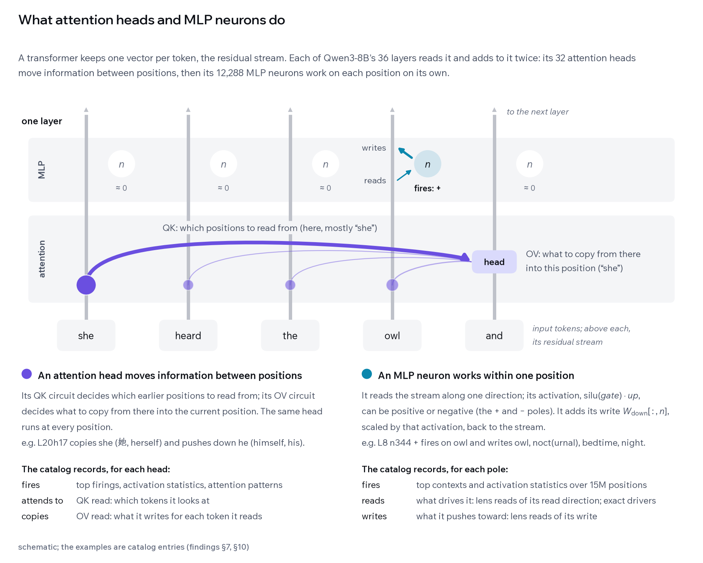

So "what does this unit mean?" has two halves: what makes it fire (its *input side*) and what its output does to the
model's predictions (its *write side*). Running the model samples either one: activations over a corpus show where a unit
fired, and *steering* (adding a unit's write and watching the predictions move) shows what a push does. A *lens* answers
either half from the weights alone, by turning a vector inside the model into a ranking over tokens, averaged over the
contexts it was fitted on.

### Lenses: from the logit lens to the R-lens and S-lens

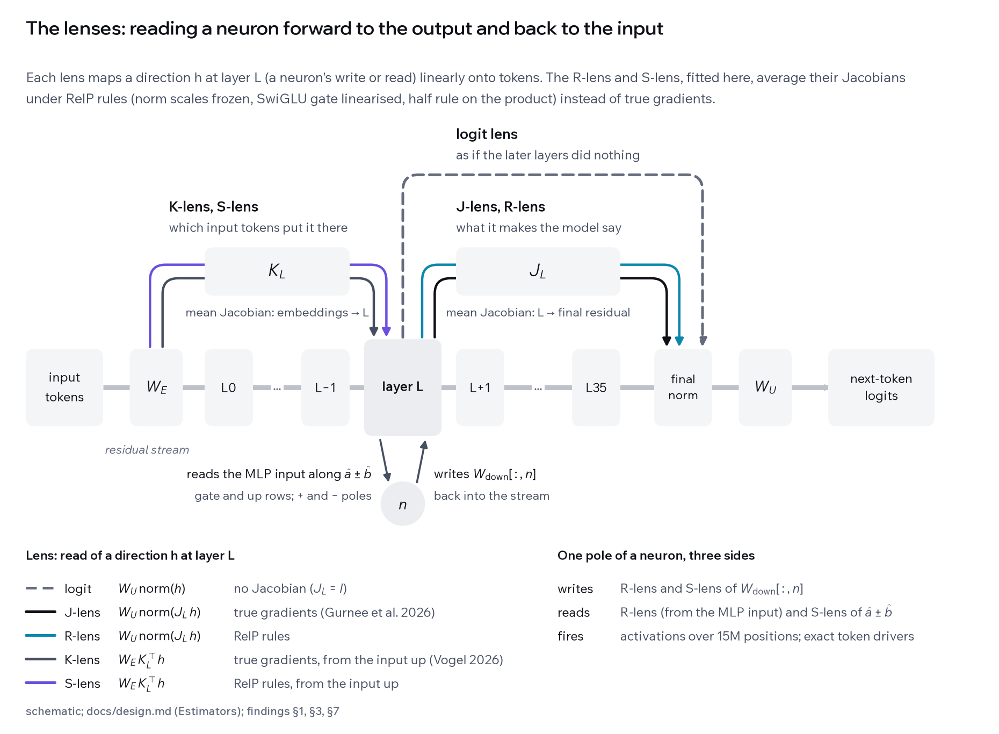

- **Logit lens** ([nostalgebraist, 2020](https://www.lesswrong.com/posts/AcKRB8wDpdaN6v6ru/interpreting-gpt-the-logit-lens)).
  Read a vector `h` at layer `L` as if it were already at the output: `softmax(W_U · norm(h))`. This works near the
  output and reads mostly noise early on, because the remaining layers transform `h` heavily.
- **J-lens** ([Gurnee et al., 2026](https://transformer-circuits.pub/2026/workspace/)). Instead of ignoring the later
  layers, linearize them. `J_L` is the Jacobian of the final residual with respect to layer `L`'s, summed over the current
  and later positions (so effects carried by attention count) and averaged over a corpus. The read is
  `softmax(W_U · norm(J_L h))`: what `h` makes the model say, on average, after everything downstream has acted on it.
- **R-lens** ([camilablank et al., 2026](https://www.lesswrong.com/posts/nv8oedrnLXKRzNEL9/r-lens-making-j-lens-more-faithful-on-early-layers)).
  The same average Jacobian, taken under [RelP](https://arxiv.org/abs/2508.21258)'s propagation rules instead of the true
  gradient: norm scales held constant, the SwiGLU gate linearized, and the gate-times-up product passing half of each
  factor's change. On Qwen3-8B it predicts what steering a neuron does better than the J-lens from layer 4 to 23.
- **K-lens and S-lens.** The J-lens and R-lens look forward, to the output. Theia Vogel's K-lens
  ([@voooooogel, 2026](https://x.com/voooooogel/status/2084858861551526002), unpublished) takes the Jacobian the other
  way, back to the input embeddings: `K_L` averages the Jacobian of layer `L`'s residual with respect to the current and
  earlier token embeddings, and a direction `c` scores each token `v` by `c · K_L (W_E[v] − mean(W_E))`, answering which
  input tokens put that direction there. The S-lens, introduced here, is the K-lens under RelP's rules, as the R-lens is
  the J-lens under them. Under those rules the R-lens's backward map is exactly the transpose of the S-lens's forward one,
  so one estimator fits both.

| lens | maps a vector `h` at layer `L` with | reads with | answers |
|---|---|---|---|
| logit | nothing | `W_U` | what `h` says if nothing downstream acts on it |
| J / R | `J_L = mean_t Σ_{t'≥t} ∂h_final(t')/∂h_L(t)` | `W_U` | what `h` makes the model say later (true / RelP derivatives) |
| K / S | `K_L = mean_t Σ_{s≤t} ∂h_L(t)/∂e(s)` | `W_E` | which input tokens put `h` there (true / RelP derivatives) |

For each model, both lenses are fitted on the same 1,000 documents of
[DCLM](https://huggingface.co/datasets/HuggingFaceFW/dclm_100BT-shuffled) (128 tokens each), at 11-16 s per document per
lens on one H100; Gemma 4's are also fitted on images (COCO) and sounds (ESC-50). Fitting needs no training objective:
each is an average of exact linearizations. Reads are scale-free (the final norm removes a vector's size), so they
describe directions, not effect sizes.

## The catalog

Every neuron has a `+` and a `−` pole, so the catalog has 884,736 neuron entries and 1,152 heads for Qwen3-8B, and
1,474,560 neuron entries and 768 heads for Gemma 4 12B; Qwen3-0.6B, 1.7B, 4B and 14B and the five bases add 6,103,040
neuron entries and 8,448 heads. Each unit is read from three sides:

- **from the weights,** through both lenses: what a neuron writes and what its read direction responds to; what a head
  copies (OV) and attends to (QK), token by token;
- **from activations** over 15M positions of web, Chinese, Python and chat text: how hard and how often it fires, and its
  top contexts;
- **from exact token drivers:** every common token substituted at one position of 8 real documents, to measure which
  tokens directly make the unit fire.

For Gemma 4, each neuron is also read through images and sound: which of 49,694 labelled images and 49,703 labelled sounds
make it fire, what its read direction looks like as a patch of pixels or 40 ms of sound, and a pattern optimised to drive
it.

Either lens can read either side of a neuron. Applied to its read direction, the R-lens says what the stream is about to
say when the neuron fires, and the S-lens which input tokens put it there; applied to its write, the R-lens says what the
write makes the model say, and the S-lens which tokens' *footprints* it imitates (a token's footprint is the average
change it makes to the stream at that layer). Raw reads share *hub tokens* that top many units' reads at once (` the`,
` and` early); *layer-contrastive* reads (`_z`), each token's score z-scored across the layer's units, remove them.

Some Qwen3-8B neuron entries (top tokens, abridged; ⟦ ⟧ marks the token where it fires):

| pole | fires on | exact drivers | R-lens read of its input | R-lens read of its write |
|---|---|---|---|---|
| `L1 n11672 −` | 德⟦國⟧ (Germany) | 德国, german, Germany | noise (S-lens read: German, Germany, 德国) | German, Germany, then hub tokens |
| `L8 n344 +` | the sound of the⟦ ow⟧ls | owl, Owl, OWL, Athena | owl, 星空 (starry sky), Owl | owl, noct, bedtime, night |
| `L8 n1931 +` | non-B⟦ib⟧lical, God's⟦ Word⟧ | biblical, 圣经 (Bible), Scripture | 圣经, 基督教, 信仰 (faith) | 圣经, 基督徒, Bible, Scripture |
| `L28 n8868 −` | quite⟦ arist⟧ocratic, a⟦ plut⟧ocracy | arist, bureauc, democr, anarch | democracy, 民主 | democracy, 民主, democratic |
| `L30 n1034 +` | is⟦ once⟧ again | Once, once | again, 再次 | again, 再次, Again |
| `L35 n9510 +` | hashes and IDs: jsessionid=⟦0⟧000 | unrelated words | punctuation | none: it sets the output's temperature |

And some heads, read from the weights:

| head | what its weights say |
|---|---|
| `L20h17` | copies *she, herself, 她* and suppresses *he, himself* (and the reverse when it reads *himself*) |
| `L26h31` | copies quantities: weight, 体重 (body weight), strength, temperature |
| `L34h1`, `L32h9` | L34h1 copies surnames (Heller, Crosby, Gallagher); L32h9, a copy-suppression head, suppresses the same ones |
| `L1h28` | a duplicate-token head: as a query it seeks the same token again (Paris → Paris), and copies almost nothing |
| `L0h27` | attends to the starts of code and documents (`/*`, `import`) |

Neurons and heads get the same tables, one row per pole or per head: `reads` (weight-only lens reads), `acts` (activation
statistics and top firings), `drivers` (exact token drivers), `sources` (what drives a unit when it fires, and what fires
with it) and `labels` (Claude Haiku's labels in words). Neurons add `firings` (what the residual holds, what the MLP layer
writes and what the model predicts where a pole fires) and `edges` (each pole's strongest direct weight edges); the pruned
Qwen3 pairs add `lineage`, and Gemma 4 adds `image` and `audio` tables. The
[dataset card](https://huggingface.co/datasets/stdlogits/neuron-lens) documents every column.

**Which read to use where.** No single read works at every depth. Each model's *reading plan* names the most coherent
read at each depth, and its edges cut four *depth bands* (findings [§8](docs/findings.md#8-what-each-read-names-and-which-read-to-use-where)),
which the labels and the site use. For Qwen3-8B:

| band | layers | what drives a pole | what a pole writes |
|---|---|---|---|
| sensory | L0-L3 | the S-lens read of its read direction: literal tokens | the tokens it detects, written back (`write_S`) |
| association | L4-L8 | the R-lens read, often an associated concept; the S-lens still names many firing tokens | the R-lens read: what steering does |
| workspace | L9-L20 | the R-lens read, with exact drivers and top contexts beside it | the R-lens read |
| motor | L21-L35 | the R-lens read | the R-lens read: the next token from about L23, suppression from L32 |

Gemma 4 has the same shape at its own depths (the S-lens names firing tokens through L13; association L0-L19, workspace
L20-L32, motor L33-L47).

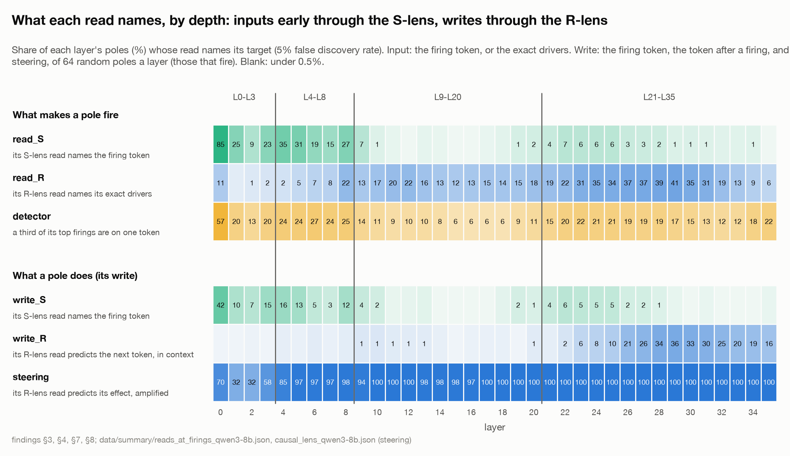

## Findings

Findings 1-14 and 21 are Qwen3-8B's, 15-18 Gemma 4 12B's, and 19 and 20 compare Qwen3's sizes. Numbers are medians or
means over a layer's poles unless stated. Each links to its findings section, with setup, controls and limits.

### I. The lenses and the corpus

**1. The lenses are stable, and their corpus changes tokens, not concepts.** Lenses fitted on two halves of their corpus
differ by at most 6% at every layer, and the halves' reads of a write share their top token for 89-99% of neurons. An
R-lens fitted on chat conversations instead shares the top token with the web-text lens for only 31-51% of neurons
through L16, yet reads the same concepts in another order and scores the same on every causal test
([§1](docs/findings.md#1-the-lenses-stability-and-corpus-dependence)).

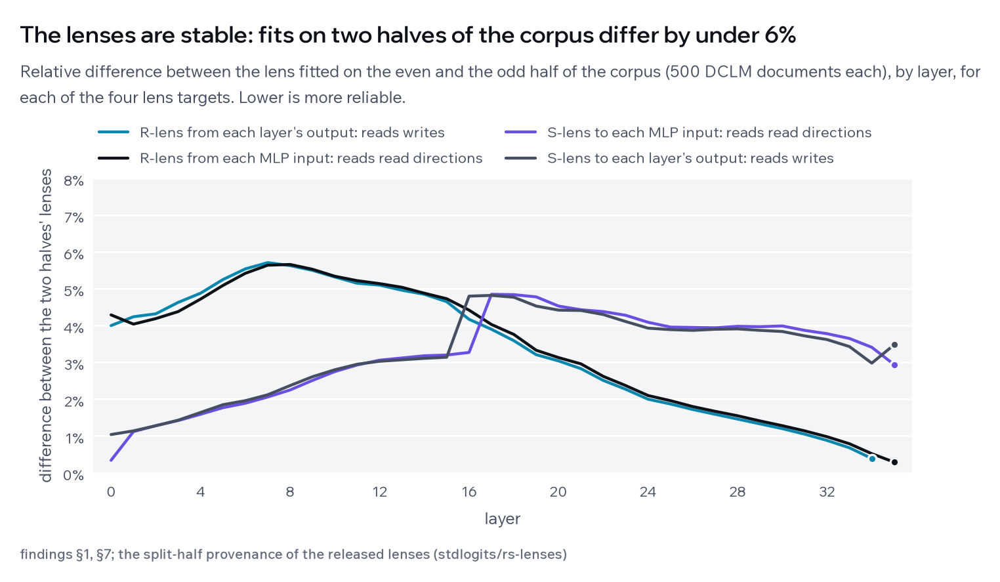

<details><summary>A chat-fitted lens predicts steering as well as the web-text lens</summary>

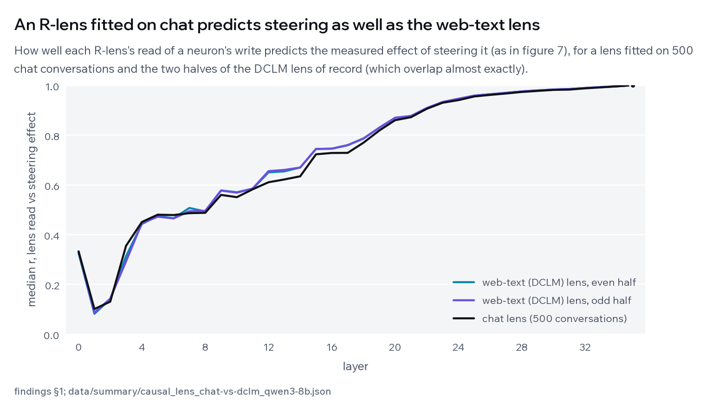

</details>

**2. Where neurons fire.** Over 15M positions, the typical activation is flat at 3-5 from L5 to L21 and grows tenfold to
L35. At L1, 56% of poles are near-silent; at L2-L3, most do their work at the first position alone. Chinese-selective
poles sit at both ends of the network, code-selective ones at L10-L30, and poles selective for the chat slice fire on
ChatGPT's register (" delve", "As of 2021") ([§2](docs/findings.md#2-activations-over-15m-positions)).

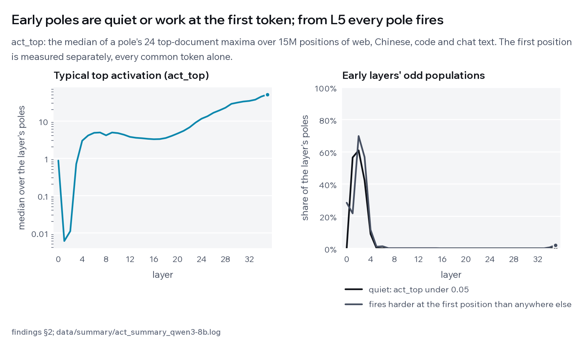

### II. Reading a neuron from its weights

**3. A write's read predicts what steering it does.** Added at its typical activation to real text, a pole's write moves
the next-token probabilities the way the R-lens read of that vector says: median r 0.45-0.50 at L4-L8, 0.65-0.75 at
L12-L16 and 0.9 or more from L22, against ±0.04 for another neuron's read. The R-lens leads the J-lens by 0.03-0.13 from
L4 to L23, and the logit lens trails until about L20. From L5, 94-100% of random poles' writes predict their own steering
effect ([§3](docs/findings.md#3-a-writes-lens-read-predicts-what-steering-it-does)).

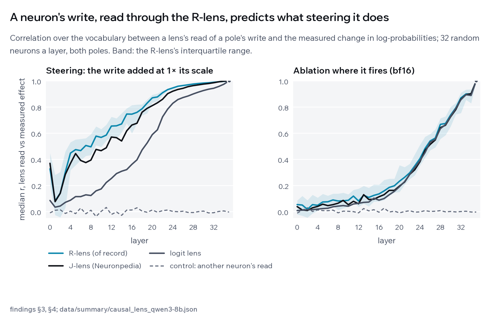

**4. One firing is one sample of what a write does.** Yet a write read rarely names the token after a firing: before L22,
1-4% of poles (net of chance) promote what follows their top firings, against 31-32% at L28-L29. An exact linearization
at 2,290 poles' real firings shows why. Before L21 the same pole, firing equally hard, pushes the predictions different
ways in different documents, so its firings barely predict each other (r 0.05-0.11; from L28, 0.78). The lens and
steering agree because both average over contexts: a write read is the pole's average push, and a firing is one context's
share of it ([§4](docs/findings.md#4-one-firing-is-one-sample-of-a-write)).

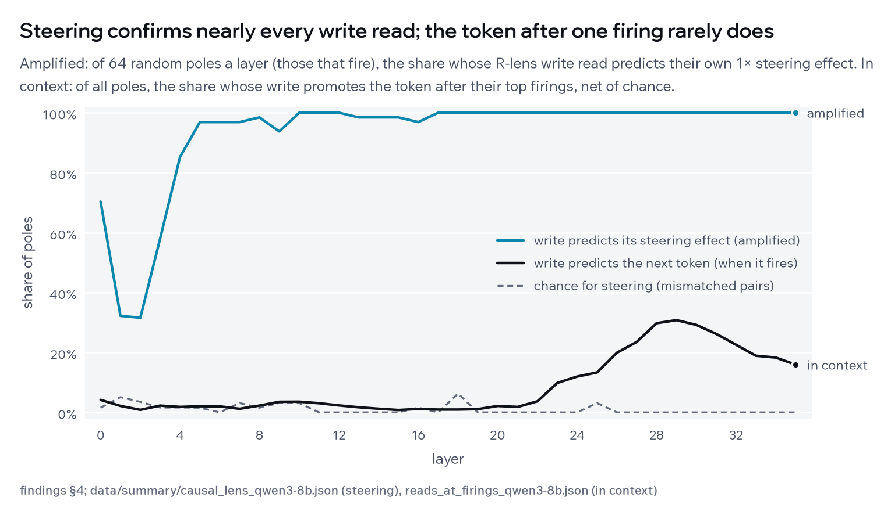

<details><summary>Per-context linearization</summary>

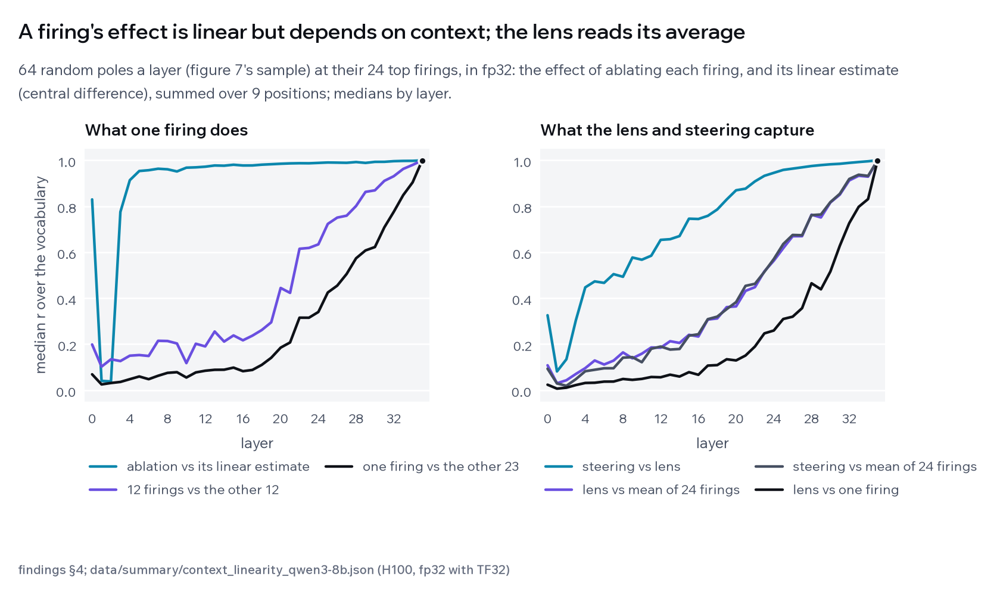

</details>

**5. Prediction and suppression are two signs of one neuron.** Late poles fire on the token before a word their write
promotes ("is⟦ once⟧" → *again*; "⟦arist⟧" → *-ocracy*). Prediction peaks at L28-L31, where 5-6% of poles have more than a
third of their top firings followed by a token they promote (control under 0.1%); suppression starts at L32 and overtakes
it at L34. This is the pattern Gurnee et al. (2024) found in GPT-2; in SwiGLU the two kinds sit on one neuron, the
promoting pole firing harder through L32 and the suppressing pole from L34
([§5](docs/findings.md#5-prediction-and-suppression)).

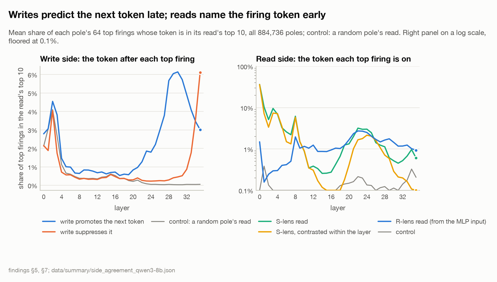

**6. A neuron writes more than it reads.** If MLPs mainly amplified what attention brings them, a write would point along
what its neuron reads. Through L14 it does lean that way, almost all on the `up` side (cosine 0.35-0.55 at L6-L14), and the
lean is gone by L30. But the rest of the write carries 84-100% of its steering effect, and its meaning can differ:
`L21 n1180 −` reads *women* and writes women, wives and husbands; with what it reads removed, its write reads parenting,
childbirth and family education (育儿, 生育, 家庭教育)
([§6](docs/findings.md#6-what-a-write-adds-beyond-what-it-reads)).

**7. The input side: the S-lens early, the R-lens later.** Early neurons detect tokens and token families (阔 "wide";
words starting with 出; English given names), which no output-facing lens reads: at L2, 95% of a typical write, carried
forward by the R-lens, lies along one direction. The S-lens recovers these detectors from the weights: at L0 its read names
the peak token of 36% of a pole's top firings (another pole's read: under 0.1%), and 2-10% at L1-L8, where the R-lens read
names under 0.5%. Early neurons also write back the footprint of what they detect, so layers 0-8 act as an extended
embedding. From L9 the R-lens read of the input names exact drivers more often. Where most of L1-L3's firings sit, on
SiLU's negative lobe, a pole reads its up row alone ([§7](docs/findings.md#7-the-input-side)).

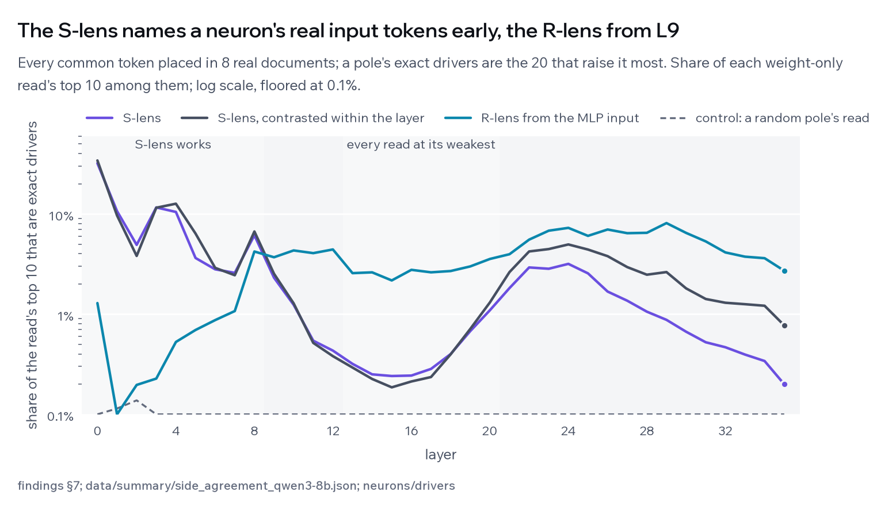

**8. What each read names.** Every pole's reads are scored against what can be counted around it: the S-lens read names
the firing token for 85% of poles at L0, the R-lens read names exact drivers for 31-41% at L27-L31, and the write names the
next token for about a third at L28-L30. These are narrow targets, so a miss doesn't make a read wrong: an R-lens read reads
forward (`L30 n7004 +` fires on *play* and reads *role*), and from L7 a firing's own token supplies under 0.5% of its
activation directly. Coherence ratings by two raters of different lineages set each model's reading plan, whose edges cut
the depth bands above ([§8](docs/findings.md#8-what-each-read-names-and-which-read-to-use-where)).

<details><summary>Read signal holds to rank 64</summary>

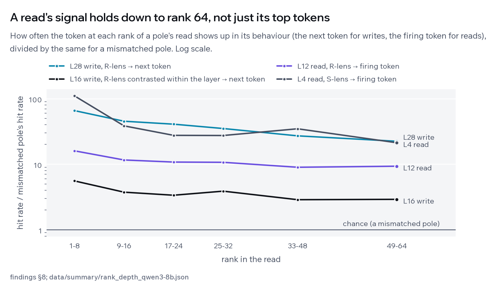

</details>

### III. Units in context

**9. Attention sinks and the output's temperature.** The final RMSNorm's weight is about 1e-4 on two residual dimensions,
so writes there move no prediction directly; but those dimensions hold 64% of the final residual's squared length, so they
set what everything is divided by, and with it how sharp every prediction is. Three L6 neurons fire at up to 10,752 on the
first token, writing onto one of them and creating the *attention sink* that later heads attend to by default; the trigger
is layer 0's MLP output at that position. L16 neurons make a second sink on the year after a date ("May 7, ⟦2⟧013"), which
four L34 neurons clear before the output. L35 n9510 + fires on hashes and IDs, where the next token is hard to guess, and
raises the output's entropy through this scale: an entropy neuron in the sense of Stolfo et al. (2024)
([§9](docs/findings.md#9-attention-sinks-the-outputs-temperature-and-entropy-neurons)).

**10. What each head copies and attends to, from the weights.** Qwen3-8B has 33 induction heads, 33 duplicate-token
heads, 4 previous-token heads and 16 sink heads, and removing any one head costs in-context copying at most 0.07 nats.
A head's keys and values read best through the S-lens (a head reads what a position holds), its output through the S-lens
early and the R-lens from L9. Feeding each token's footprint through a head's circuits gives token-by-token maps: the OV map
says what it copies and suppresses (L26h31 copies quantities; L32h9 suppresses the surnames L34h1 copies) and predicts
where the attended token ranks in the head's actual output (Spearman +0.52; 0.00 under another head); the QK map finds the
duplicate-token heads (AUROC 0.96). With an R-lens query against S-lens keys (`qk_self_R`) it finds the late heads that
look up earlier copies of the token their position is about to say, copy suppression in context (17 heads at L21-L35, AUROC
0.91) ([§10](docs/findings.md#10-attention-heads-circuits-read-token-by-token)).

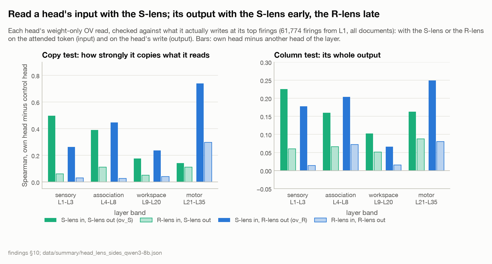

**11. Late heads write the next token.** At their own top firings, 16% of the motor band's heads (26% at L28-L35) write
the next token as their OV read predicts, and few before; read from their outputs in context, 55% of the motor band's heads promote the token after their
strongest firings ([§11](docs/findings.md#11-attention-heads-what-their-reads-name)).

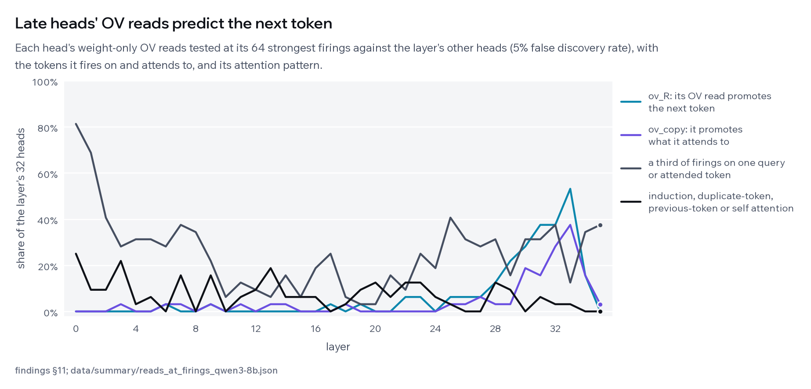

**12. What feeds a neuron: the wiring is in the weights, the traffic in the context.** A neuron's write reaches every
later neuron's input unchanged, so the weights give an edge between every pair of poles. Concept poles are wired from their
concept (an L14 animals pole from L12's dogs-and-pets pole), and an edge ranks every upstream neuron's actual effect at
Spearman 0.88. But when a pole fires, a few units drive it, and they are units firing with it: its 64 largest sources
carry nearly all its activation, its 64 weight edges about a tenth. Heads carry a third (half at L13-L20). Into a head, the
value and keys come mostly from neurons, and the query a third to a half from earlier heads
([§12](docs/findings.md#12-what-feeds-a-unit-edges-and-sources)).

### IV. Describing units in words

**13. Labels from the evidence.** Claude explainers labelled 160 random poles from only their lens reads, only their top
contexts, or both, never seeing steering. Scored by *detection* (can a fresh model, given the label, pick the pole's
held-out top firings out from quiet text; AUROC, 0.5 chance), lens-only firing labels score 0.75; scored by how a judge
ranks the pole's write label against three others from text steered by it (AUROC again, against other labels rather than
quiet text), lens-only write labels score 0.76 (0.87 in the motor band). Contexts lead for firing (0.87) and the lenses
for writes (contexts: 0.63), both on one card do best for writes (0.79), and Claude Opus explains no better than Sonnet:
the bottleneck is the evidence. The catalog's labels come from Claude Haiku on a lean card, the one
input and one write read the reading plan names for the pole's depth plus its top contexts, for six models at $303 in
all; blind, they pick a pole's held-out firings out from another pole's at AUROC 0.82-0.88 (another pole's label:
0.44-0.54). Asked to predict activations token by token, they correlate at 0.21 on Qwen3-8B (another pole's label: 0.00):
they name the context a pole fires in more often than the token ([§13](docs/findings.md#13-labels-from-the-evidence)).

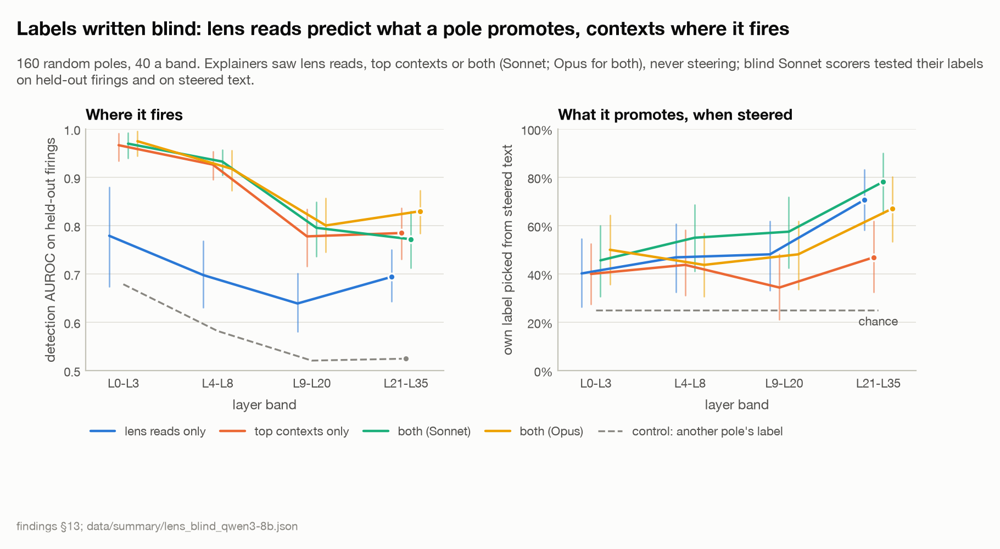

**14. Outside labels.** The [Neuron Persona Library](https://neuronpersonas.com) labels poles by steering each one while
the model answers "Who are you?". Judged generously and blind, 27% of its personas clearly match the pole's write read,
22% its input read and 34% both together (swapped names: 3-6%), most late and least mid-network. Labels from steering one
prompt disagree most often with where the pole fires (the library's "creator god" pole fires on time words), and the
library misses what can't be a persona: idiom completers, morphology, everyday concepts
([§14](docs/findings.md#14-outside-labels)).

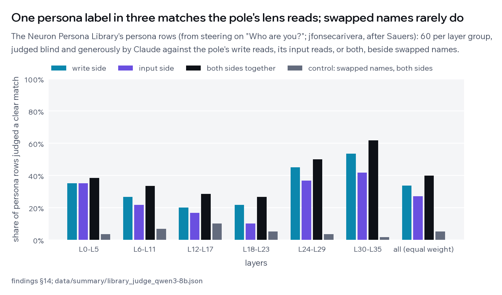

### V. A second model, three modalities

**15. A second model reads the same way.** Gemma 4 12B comes from another lab, with another activation, norm layout and
attention scheme. The R-lens read of a write predicts steering from L11 on (median r 0.40-0.53 from L11 into its
association band, 0.67 in its workspace band and 0.96 in motor), the S-lens names the firing token through L13, about the same relative depth as Qwen3-8B's L8, and the
write promotes the next token from L33. Its R-lens input reads name the exact drivers for 29% of poles once the read row, a
covector, is made a vector by the residual's own scale: Gemma 4's residual coordinates differ in scale by up to 1,600×, and
read as a Euclidean vector the rows name them for 2%
([§15](docs/findings.md#15-gemma-4-12b-the-text-catalog-in-a-second-model)).

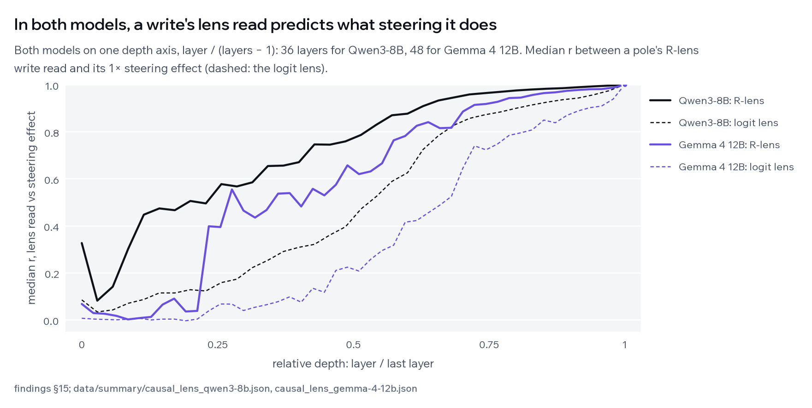

<details><summary>Gemma 4's steering and reads by layer</summary>

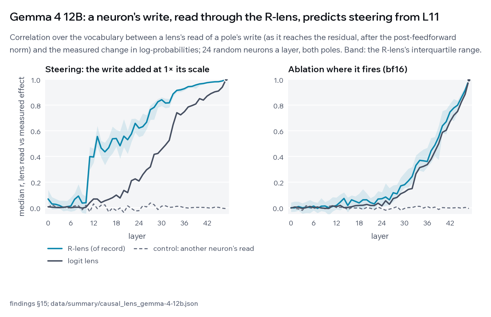

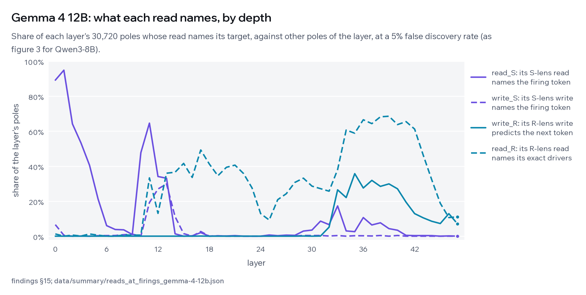

</details>

**16. Images and sound: what drives a neuron.** Gemma 4 has no separate encoder: each 48 × 48-pixel patch or 40 ms of
audio enters the residual stream through a few norms and one linear map, so the lenses can be fitted on images and sounds
and a read direction carried back to pixels or samples. Over 49,694 labelled images and 49,703 labelled sounds, a sixth to
two fifths of each band's poles have a label that holds on held-out documents (AUROC 0.97 for images, 0.78-0.89 for
sound): gratings, checkerboards and writing systems early, objects, scenes and languages later. The lens's patch read
shows what a neuron's input direction looks like, but raises the neuron only in the first six layers; optimised by
gradient ascent from the read, a single patch or 40 ms frame drives its neuron through L23
([§16](docs/findings.md#16-images-and-sound-what-drives-a-neuron)).

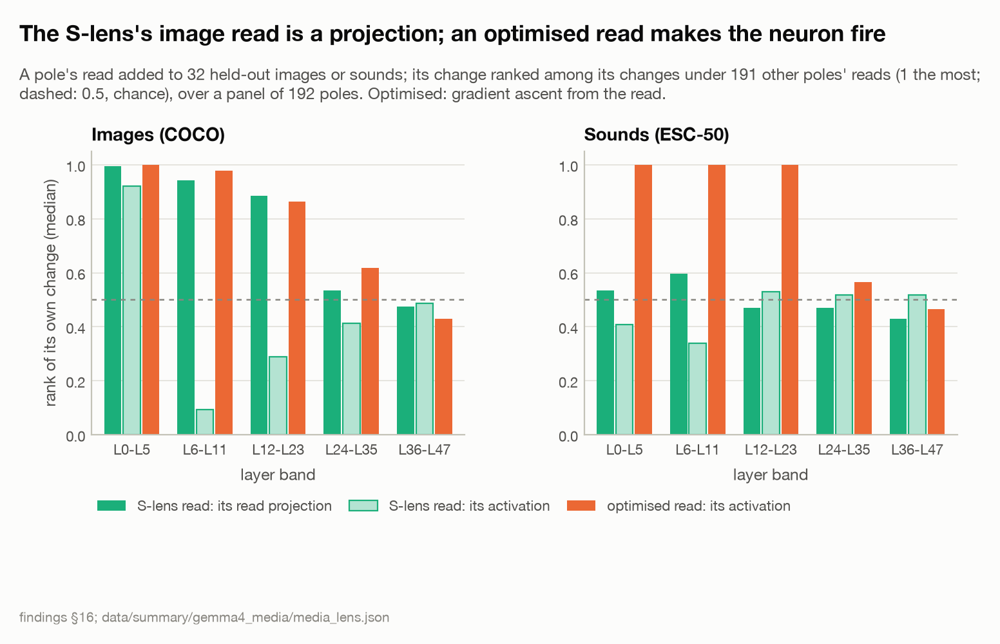

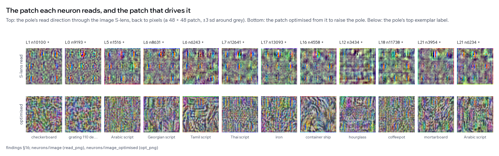

**17. One concept in text, images and sound.** At L12-L23, 42% of the poles with a reliable image label also fire on the
label's name in text (5% by chance). 4,382 poles pass every text test for their image label (its name fires them, the text
S-lens reads it, the text R-lens writes it), and 730 for their audio label. 19 pass all of them for both, where
independent lists would share 2.0: places and peoples, with their language
([§17](docs/findings.md#17-one-concept-in-text-images-and-sound)).

| pole | image label | audio label | exact text drivers | R-lens read of its write |
|---|---|---|---|---|
| `L14 n8313 +` | mosque indoor | Arabic | Amal, أ, Mohamed, Noor | Arabic, Quran, islamic, Saudi |
| `L33 n5249 +` | tacos | Spanish | Peruvian, Ecuadorian, Mexican, Aztecs | Mexican, 墨西哥 (Mexico), Mexico |
| `L33 n6099 +` | pagoda | Mandarin Chinese | WeChat, Xiaomi, Weibo, Shanghai | Chinese, China, Beijing, 中国 |
| `L37 n7165 +` | giant panda | Mandarin Chinese | 熊猫 (panda), 四川 (Sichuan), 成都 (Chengdu) | panda, 熊猫, Chengdu |

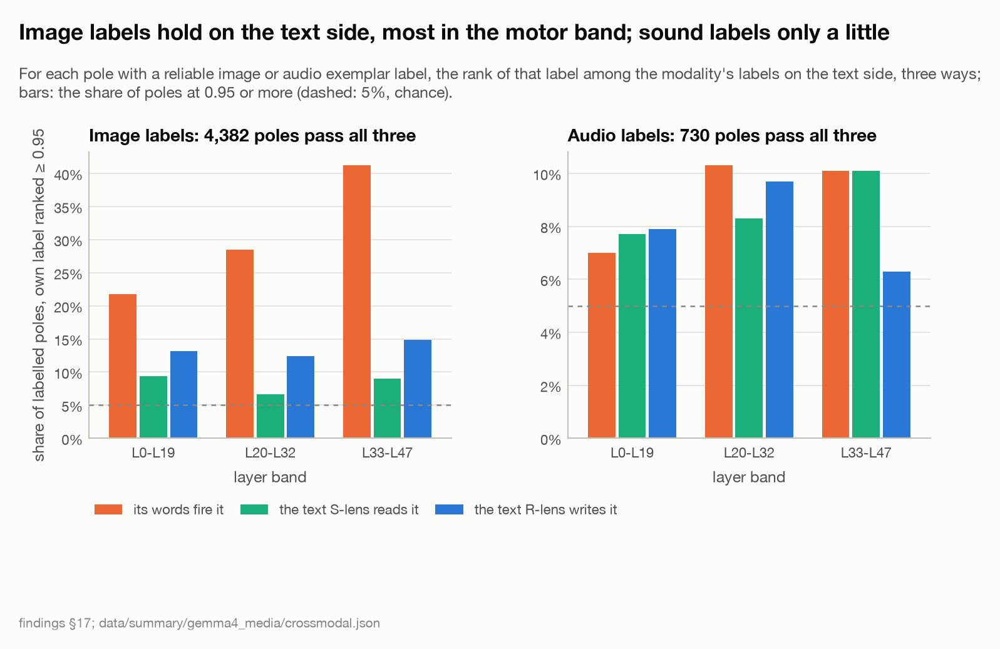

**18. Heads carry what an image shows into the text.** With an image in the prompt followed by ` a`, Gemma 4 gives the
image's own label a lower loss than another class's 97% of the time. Early heads attend within the image, from a patch to
its neighbours; the text reads the image most at L23-L31. Zeroing single heads (L28h6, L29h1, L29h9, L25h2) costs the
right label more than a wrong one, and from L35 heads write the right class. With a sound, the model prefers the right
label only 55% of the time, and no head carries it
([§18](docs/findings.md#18-attention-heads-in-image-and-audio-contexts)).

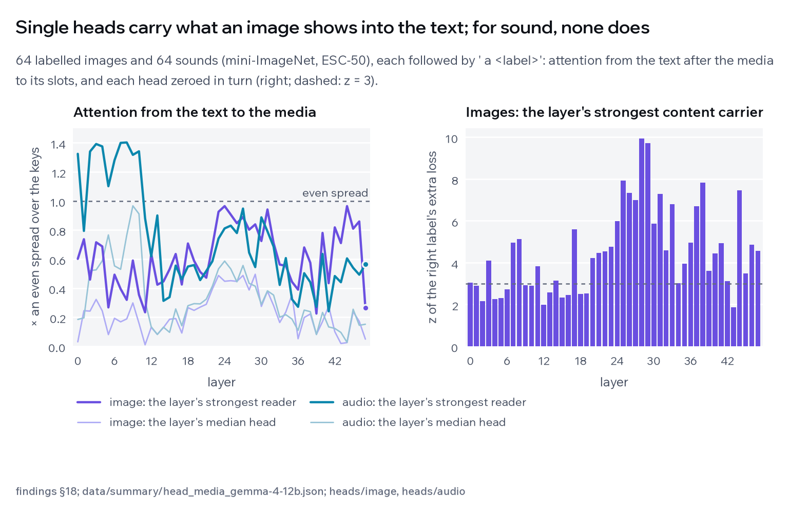

### VI. Across Qwen3's sizes

**19. Late reads hold with size, and early ones fall.** Nine more Qwen3 models, 0.6B to 14B, post-trained and base, each
with its own lenses and the same documents, show which reads depend on size. Late ones don't: at every size a late
write's R-lens read predicts steering at r 0.98-0.99 and promotes what follows the firings for a quarter of poles. Early
ones do: the S-lens names the firing token for 16-25% of mid-network poles in the 28-layer models but 2-8% from 36 layers
on, and early writes predict steering less at every step in size (first-quarter r 0.62 at 0.6B, 0.31 at 14B). The bases
read like their siblings once each pole is held to its own null. Post-training moves every matrix by 5-13% and keeps each
neuron's directions; its clearest added directions read as questions, hedges and contrast (and `Wait` in the 4B), likely
the style of the models' reasoning ([§19](docs/findings.md#19-the-qwen3-family-what-changes-with-size)).

**20. Qwen3-4B and 0.6B are pruned from the 8B and the 1.7B.** In the 4B and the 0.6B a neuron's index tracks its
activation (Spearman ρ to −0.76), where every other model's indices are exchangeable (±0.03). Each pair shares its
attention heads one for one, a linear map fitted on those heads takes the parent's residual to the model's, and through it
99-100% of the 4B's neurons from L1 to L34 match a parent neuron that keeps their scale and promotes the same tokens. The
neurons cut were the parent's least active. This is what width pruning by activation leaves, as in Minitron, so finding
19's five sizes are three lineages. Each neuron's parent is identified for 93% of the 4B's neurons and 85% of the 0.6B's;
the catalog's `lineage` table holds them
([§20](docs/findings.md#20-qwen3-4b-and-06b-are-pruned-from-the-8b-and-the-17b)).

### VII. What the lenses miss

**21. The dark sector.** At each layer of Qwen3-8B a few directions carry 90% of what the R-lens reads from the layer's
neurons, 60-200 of 4,096 at L0-L3; the rest, the dark sector, holds 87-95% of the residual early and 71-81% at L4-L15.
Removing one layer's dark sector moves the predictions 300-5,700 times more than the lens predicts, and over a band of
layers it breaks something different at each depth: early, word forms, the kind of document and the sentences only syntax
decides; in the middle, facts and the use of context; late, the pieces that finish a word ("I am Q, a large language
model"). Yet what two prompts differ in (which country, the answer's language, the next word piece, story or small talk)
moves with the bright sector from L4-L12, and the dark part of the difference changes nothing: the dark sector likely holds
what prompts share. About 3,000 directions are quieter than chance to both lenses; this doubly dark sector carries a half
to two thirds of the dark sector's cost, and the named failures appear only with it and the S-lens's bright part removed
together ([§21](docs/findings.md#21-the-dark-sector-what-the-r-lens-barely-reads)).

**22. Coordinate sectors.** In Qwen3-8B and Gemma 4, as Briggs (2026) found in a larger Gemma, the R-lens reads the
residual mostly off a block of its raw coordinates: the top 11% carry 0.74-0.97 of the readout through the middle layers,
against 0.17-0.33 for the best 11% of a random basis, and the layers' writes avoid them. Single coordinates are not units,
though: inside the block the features are rotated, and the sparse directions found there name the current token. Where
the R-lens's block meets the S-lens's lies a persistent core of 190-365 coordinates; with the norm coordinates, which the
norms divide out, and the rest, d, the residual splits into five sectors. Removing the core at L8-L12 adds 3 nats a token
and dissolves the text into function words, while keeping only the core costs 0.6 at L11-L17. The two cross at L21, and
late the prediction moves into d, spread over its coordinates. §21's doubly dark sector avoids the core and spreads over
d. The layout is set by per-coordinate scales, the residual's in Qwen and the norms' weights in Gemma: the units' rows
read and write the sectors near chance, and the few that lean on one are sink, duplicate-token and spelling units
([§22](docs/findings.md#22-coordinate-sectors-where-the-residual-keeps-what-the-lenses-read)).

### Limits

- Two models read in depth, and nine more Qwen3 models (the four post-trained ones labelled); one lens corpus for text
  (English-heavy web text), COCO photos and ESC-50 sounds for Gemma 4's media lenses; lenses averaged over 128-token
  documents.
- Activations are bf16 passes over documents of up to 256 tokens; the exact drivers match an fp32 rerun through L9 on
  Qwen3-8B, and later layers are unchecked.
- The tests of each read are token-level; labels are written, scored and judged by Claude models. Media labels name what
  a whole image or sound is about.
- Steering adds a write at every position of neutral text, up to many times its natural size: it measures a direction's
  average effect.

## Using the release

Read one neuron's write through the R-lens:

```python
import torch
from huggingface_hub import hf_hub_download
from transformers import AutoModelForCausalLM, AutoTokenizer

model = AutoModelForCausalLM.from_pretrained("Qwen/Qwen3-8B", dtype=torch.bfloat16)
tok = AutoTokenizer.from_pretrained("Qwen/Qwen3-8B")
J = torch.load(hf_hub_download("stdlogits/rs-lenses", "qwen3-8b/r-lens/lens.pt"), weights_only=True)["J"]

L, n, sign = 8, 344, +1                        # L8 n344 +
w = sign * model.model.layers[L].mlp.down_proj.weight[:, n].float()
h = J[L] @ w                                   # layer L's output -> the final residual
h = h * torch.rsqrt(h.pow(2).mean() + 1e-6) * model.model.norm.weight.float()
print(tok.convert_ids_to_tokens((model.lm_head.weight.float() @ h).topk(8).indices))
```

Read which input tokens drive it, through the S-lens to the MLP input:

```python
K = torch.load(hf_hub_download("stdlogits/rs-lenses", "qwen3-8b/s-lens/mid.pt"), weights_only=True)["K"]

layer = model.model.layers[L]
g = layer.post_attention_layernorm.weight.float()
a = g * layer.mlp.gate_proj.weight[n].float()
b = g * layer.mlp.up_proj.weight[n].float()
c = a / a.norm() + sign * b / b.norm()         # the pole's read direction
E = model.model.embed_tokens.weight.float()
scores = (E - E.mean(0)) @ (c @ K[L])          # token v: c · K_L (W_E[v] − mean(W_E))
print(tok.convert_ids_to_tokens(scores.topk(8).indices))   # the catalog also masks rare tokens
```

Query the catalog (one layer of neuron reads is about 100 MB):

```python
import pandas as pd

base = "hf://datasets/stdlogits/neuron-lens/qwen3-8b"
reads = pd.read_parquet(f"{base}/neurons/reads/L08.parquet")
reads.query("neuron == 344 and pole == 1")[["write_R_str", "read_R_str", "read_S_str"]]

labels = pd.read_parquet(f"{base}/neurons/labels/L08.parquet")
labels.query("neuron == 344 and pole == 1")[["fires", "fires_conf", "writes", "writes_conf"]]

heads = pd.read_parquet(f"{base}/heads/reads.parquet").merge(pd.read_parquet(f"{base}/heads/acts.parquet"))
heads.query("layer == 20 and head == 17")[["ov_R_str", "qk_S_str", "duplicate", "contexts"]]
```

Browse a local copy with `python -m neuron_lens.catalog show 8 344 +`, `head 20 17` or `search 'Bible|圣经'`. Both lenses
also load in [Drowse](https://github.com/stdlogits/drowse) (6.0 or later): `drowse lens fetch Qwen/Qwen3-8B rs-r` for the
R-lens and `rs-s` for the S-lens.

For Gemma 4 12B, with this package installed (`neuron_lens.weights.tensors` reads only the named weights from the
checkpoint, so no model is loaded), read a neuron's write, then see its image read, the images that drive it and an
optimised patch:

```python
import io
import pandas as pd
import torch
from huggingface_hub import hf_hub_download
from PIL import Image
from transformers import AutoTokenizer
from neuron_lens.neurons import directions
from neuron_lens.weights import tensors

M = "google/gemma-4-12B"
tok = AutoTokenizer.from_pretrained(M)
J = torch.load(hf_hub_download("stdlogits/rs-lenses", "gemma-4-12b/r-lens/lens.pt"), weights_only=True, mmap=True)["J"]
w = tensors(M, ["model.language_model.embed_tokens.weight", "model.language_model.norm.weight"])
E, g = w["model.language_model.embed_tokens.weight"].float(), w["model.language_model.norm.weight"].float()

L, n, sign = 33, 6099, +1                      # L33 n6099 +: pagodas, pandas, Mandarin speech
h = J[L].float() @ (sign * directions(M, L)["write"][:, n])   # the write: s · γ_post ⊙ W_down[:, n]
h = h * torch.rsqrt(h.pow(2).mean() + 1e-6) * g
print(tok.convert_ids_to_tokens((E @ h).topk(8).indices))      # tied unembedding

base = "hf://datasets/stdlogits/neuron-lens/gemma-4-12b"
image = pd.read_parquet(f"{base}/neurons/image/L33.parquet").query("neuron == 6099 and pole == 1").iloc[0]
image[["label", "labels_str", "sig", "stable", "text_fire_rank", "text_read_rank", "text_write_rank"]]
Image.open(io.BytesIO(image["read_png"]["bytes"]))            # its read direction, in pixels
docs = pd.read_parquet(f"{base}/media/image_docs.parquet")
docs.loc[image["top_doc"][:8], ["labels", "link"]]            # the images that drive it, at their sources
opt = pd.read_parquet(f"{base}/neurons/image_optimised.parquet").query("layer == 20 and gain > 0")
Image.open(io.BytesIO(opt.iloc[0]["opt_png"]["bytes"]))      # a patch that drives its neuron
```

Sound is the same with `audio` for `image`: `read_wave` and `opt_wave` hold 640 samples at 16 kHz.

## Reproducing

```bash
uv pip install -e ".[plots]"     # add the drowse extra (Drowse >= 6.0) to export lenses to Drowse
python -m pytest -q              # estimator tests: brute-force Jacobians
```

The pipeline, in run order. `NEURON_LENS_MODEL` picks the model (Qwen3-8B by default; `google/gemma-4-12B` for Gemma 4).
Runtime artifacts go to `data/` (ignored), compact results to `data/summary/` and figures to `docs/figures/`. Costs are
Qwen3-8B's unless marked; Gemma 4's lens fits take about 1.5× as long.

| script | what | cost |
|---|---|---|
| `01_lens_corpus.py` | the lens corpus: the first 1,000 rows of DCLM-shuffled at a pinned revision | minutes |
| `02_fit.py` | fit the R-lens, S-lens or scale (`--lens R\|S\|scale`, and for Gemma 4 `--modality image\|audio`); resumable, shardable across GPUs, detachable | ~3 h per text lens on one H100; 45-90 min per media lens |
| `03_token_counts.py` | token counts over the activation corpora, which set the kept tokens | minutes |
| `04_export_rlens.py` | export an R-lens fit to a Drowse home | minutes |
| `05_act_corpus.py` | the activation corpora: web (held out from the lens), Chinese, Python, chat | minutes |
| `06_activations.py` | one pass for every neuron and head: statistics, top firings, attention patterns, position 0 | ~70 min on an RTX 4090 |
| `07_drivers.py` | every kept token swept through 8 real documents: neuron and head drivers | 12 min (Qwen3-8B), 24 min (Gemma 4) on an H100 |
| `08_reads.py` | weight-only reads of every pole and head through both lenses | 5-7 min on an H100, ~10 min per side on a Mac |
| `10_labels.py` | a label for every pole and head by Claude Haiku 5.5, and the heads' blind check | ~$53 for Qwen3-8B, ~$90 for Gemma 4 (Batch API) |
| `16_edges.py` | every pole's strongest direct weight edges | minutes |
| `17_firings.py` | one pass over every pole's top firings: the residual, the MLP output and the model's prediction there (`firings`), and what drives each pole and head (`sources`, `heads/sources`) | ~2 h for Gemma 4 on an H100 |
| `13_media_activations.py` | Gemma 4: every pole's activation over the labelled images and sounds; its exemplars | 25-40 min per modality on an H100, and 220 GB of RAM for the images |
| `14_media_tables.py` | Gemma 4: the per-layer image and audio tables | ~15 min on an H100 |
| `15_media_optimised.py` | Gemma 4: the optimised patches and sounds | ~25 min per modality on an H100 |
| `11_figures.py` | every figure in `docs/figures/` | seconds |
| `12_release.py` | release the lenses and the catalog on the Hub | |

An Apple-silicon Mac runs everything but the lens fits and the GPU passes, which want a CUDA card (24 GB is enough for the
text passes); `scripts/catalog_box.sh` sets up a GPU machine and runs them in order. `scripts/checks/` holds the analyses
behind the findings, each named in its findings section, and `neuron_lens/` the package: the estimator (`transport.py`,
every model's layer maps in `layers.py`, `rules.py` as their test reference), each model's geometry and reading plan
(`arch.py`, `neurons.py`, `metric.py`), the readouts (`readout.py`, `heads.py`), the firing and source passes
(`firings.py`, `sources.py`), lens loading (`lenses.py`), images and sound (`media.py`, `media_sets.py`) and the catalog
(`catalog.py`). [AGENTS.md](AGENTS.md) has the working notes.

<details><summary>Gemma 4 12B, in order</summary>

```bash
export NEURON_LENS_MODEL=google/gemma-4-12B
python scripts/02_fit.py --model $NEURON_LENS_MODEL --lens R --docs 1000             # and --lens S, --lens scale
python scripts/02_fit.py --model $NEURON_LENS_MODEL --lens S --modality image --docs 1000
python scripts/02_fit.py --model $NEURON_LENS_MODEL --lens S --modality audio --docs 2000
python scripts/02_fit.py --model $NEURON_LENS_MODEL --lens R --modality image --docs 512 --dim-batch 512
python scripts/02_fit.py --model $NEURON_LENS_MODEL --lens R --modality audio --docs 512 --dim-batch 512
python scripts/05_act_corpus.py --docs chat=8000    # Gemma's chat slice; the other slices are Qwen3-8B's
python scripts/03_token_counts.py
python scripts/06_activations.py --batch-docs 64
python scripts/07_drivers.py --batch 128
python scripts/08_reads.py
python scripts/checks/reads_at_firings.py
python scripts/16_edges.py
python scripts/17_firings.py
python scripts/13_media_activations.py --modalities audio --batch 32   # then image: one at a time
python scripts/checks/crossmodal.py
python scripts/14_media_tables.py
python scripts/15_media_optimised.py --modality image                   # and audio
python scripts/checks/head_media.py
python scripts/checks/causal_lens.py measure --per-layer 24
python scripts/checks/causal_lens.py score --lenses logit,hub
python scripts/11_figures.py && python scripts/12_release.py
```

</details>

## Related work

- Bills et al., [Language models can explain neurons in language
  models](https://openaipublic.blob.core.windows.net/neuron-explainer/paper/index.html) (2023): every GPT-2 XL neuron,
  from activations.
- Choi et al., [Scaling automatic neuron description](https://transluce.org/neuron-descriptions) (Transluce, 2024): every
  Llama-3.1-8B-Instruct neuron, both polarities.
- Gur-Arieh et al., [Enhancing automated interpretability with output-centric feature
  descriptions](https://arxiv.org/abs/2501.08319) (2025): descriptions from what a feature writes, combined with what makes
  it fire.
- Gurnee et al., [Universal neurons in GPT2 language models](https://arxiv.org/abs/2401.12181) (2024): prediction and
  suppression neurons; Stolfo et al., [Confidence regulation neurons in language models](https://arxiv.org/abs/2406.16254)
  (2024): entropy neurons.
- The lens sources above; [docs/design.md](docs/design.md#related-work) has the full list.

## License

The code and docs in this repository are [MIT](LICENSE). The lenses and the catalog on the Hugging Face Hub are
[CC BY 4.0](https://creativecommons.org/licenses/by/4.0/); the models are Apache 2.0.
