# neuron-lens

What does each part of a large language model do? This project reads every MLP neuron and every
attention head of two open models, [Qwen3-8B](https://huggingface.co/Qwen/Qwen3-8B) (442,368 neurons,
1,152 heads) and [Gemma 4 12B](https://huggingface.co/google/gemma-4-12B) (737,280 neurons, 768 heads),
three ways: from their weights alone, through two Jacobian lenses; from what they do on 15M tokens of
real text; and from the exact tokens that drive them. Gemma 4 also takes images and sound, so its
neurons are read through images and sound too. The result is a public catalog, the lenses that
produced it, and measurements of where each way of reading works and where it fails.

- **Lenses:** [`stdlogits/rs-lenses`](https://huggingface.co/stdlogits/rs-lenses), the R-lens and S-lens
  for Qwen3-8B, and for Gemma 4 12B in text, images and sound.
- **Catalog:** [`stdlogits/neuron-lens`](https://huggingface.co/datasets/stdlogits/neuron-lens): every
  neuron's and head's reads, activation statistics, token drivers and legibility tests; labels in
  words; and for Gemma 4, what each neuron responds to in images and sound.
- **Results:** [docs/findings.md](docs/findings.md). **Methods:** [docs/design.md](docs/design.md).

By [@_a9lim](https://x.com/_a9lim) and [@treetowntree](https://x.com/treetowntree), with Claude.

## Background

### Neurons and heads

A transformer keeps one vector per token, the *residual stream* (4,096 numbers in Qwen3-8B). Each of its
36 layers reads that stream and adds to it, in two steps:

- **Attention heads move information between tokens.** At each position, a head looks back over the
  earlier tokens and copies something from them into the current one. Its *QK circuit* decides where it
  looks; its *OV circuit* decides what it copies. Qwen3-8B has 32 heads a layer. Head L20h17, for
  example, copies *she* forward and pushes against *he*.
- **MLP neurons transform what is already there, one position at a time.** A neuron measures how
  strongly the stream points along a direction it reads (its *activation*), then adds a fixed vector
  (its *write*) scaled by that activation. Qwen3-8B has 12,288 a layer. In Qwen's SwiGLU MLPs the
  activation is a gated projection of the stream times a plain linear one ("gate" times "up"), so it
  can be positive or negative, and each neuron has two *poles* that can mean different things.
  `L8 n344 +` (layer 8, neuron 344, positive pole) fires on *owl* and writes toward owls and night.

At the bottom, the embedding matrix `W_E` turns each input token into its starting vector; after the
last layer, a final normalization (`norm`, an RMSNorm) and the unembedding matrix `W_U` turn each
position's vector into next-token probabilities. Gemma 4 12B is built the same way, with 48 layers,
16 heads and 15,360 neurons a layer (GELU in place of SiLU in the gate, so its neurons have two poles
too), and its input positions can also hold a patch of an image or 40 ms of sound.

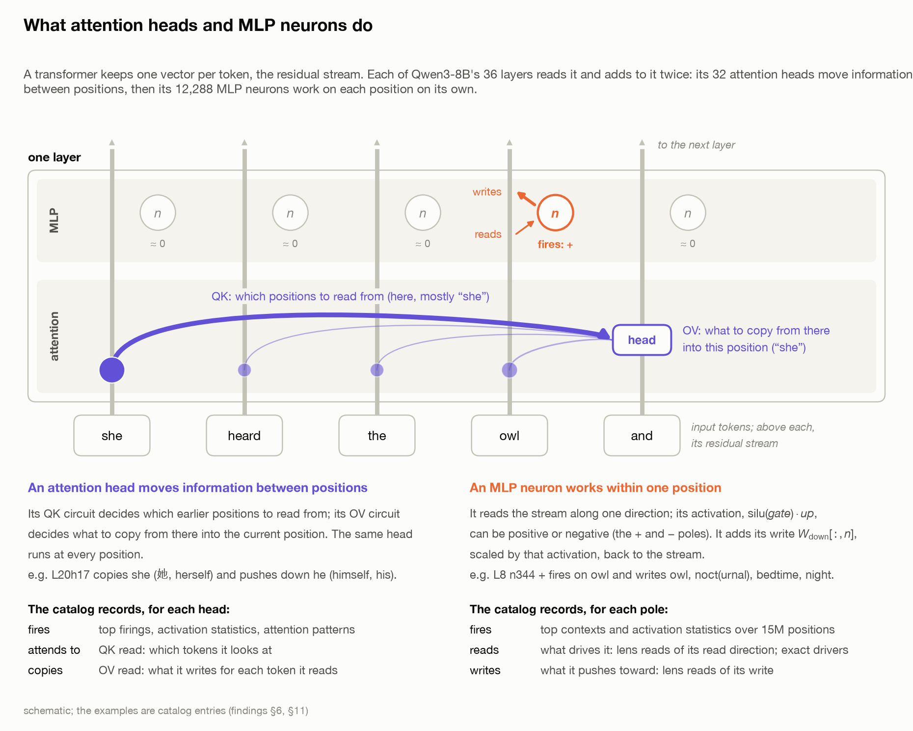

So "what does this unit mean?" has two halves: what makes it fire (its *input side*) and what its output
does to the model's predictions (its *write side*). Both can be measured by running the model: record
activations over a corpus for the first, and *steer* (add a unit's write and watch the predictions
move) for the second. A *lens* answers either half from the weights alone, by turning a vector inside
the model into a ranking over tokens.

### Lenses: from the logit lens to the R-lens and S-lens

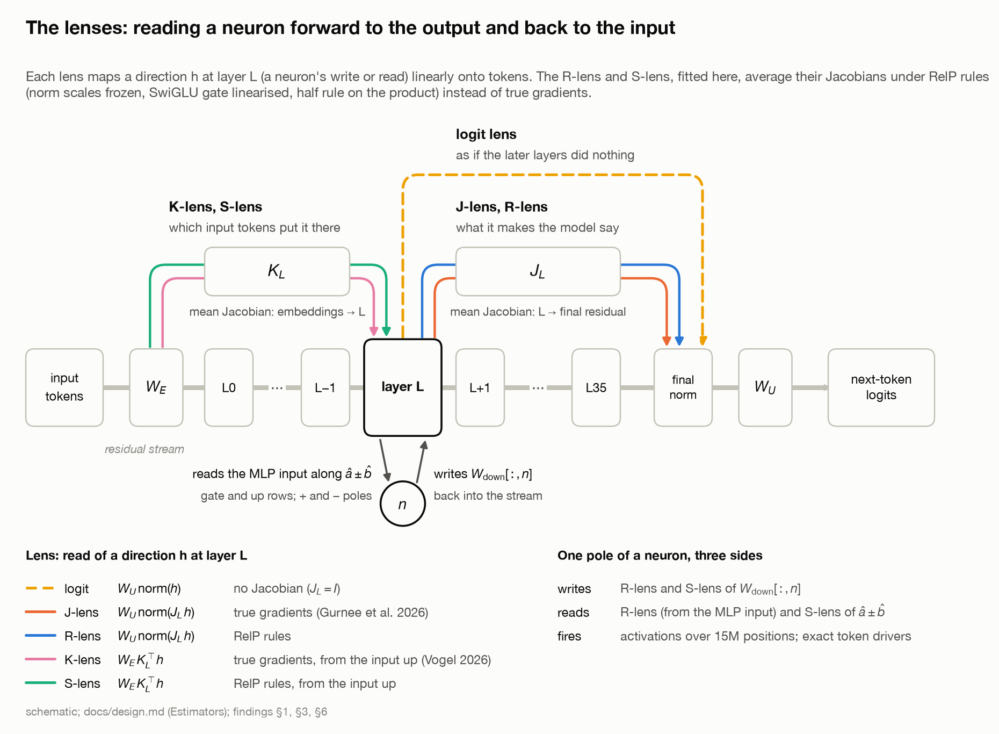

- **Logit lens** ([nostalgebraist,
  2020](https://www.lesswrong.com/posts/AcKRB8wDpdaN6v6ru/interpreting-gpt-the-logit-lens)). Read a
  vector `h` at layer `L` as if it were already at the output: `softmax(W_U · norm(h))`. This works
  near the output and reads mostly noise early on, because the remaining layers transform `h` heavily.
- **J-lens** ([Gurnee et al., 2026](https://transformer-circuits.pub/2026/workspace/)). Instead of
  ignoring the later layers, linearize them. `J_L` is the Jacobian of the final residual with respect to
  layer `L`'s, summed over the current and later positions (so effects carried by attention count) and
  averaged over a corpus. The read is `softmax(W_U · norm(J_L h))`: what `h` makes the model say, on
  average, after everything downstream has acted on it.
- **R-lens** ([camilablank et al.,
  2026](https://www.lesswrong.com/posts/nv8oedrnLXKRzNEL9/r-lens-making-j-lens-more-faithful-on-early-layers)).
  The same average Jacobian, taken under [RelP](https://arxiv.org/abs/2508.21258)'s propagation rules
  instead of the true gradient: norm scales held constant, the SwiGLU gate linearized, and the
  gate-times-up product passing half of each factor's change. On Qwen3-8B it predicts what steering a
  neuron does better than the J-lens from layer 4 to 23.
- **K-lens and S-lens.** The J-lens and R-lens look forward, to the output. Theia Vogel's K-lens
  ([@voooooogel, 2026](https://x.com/voooooogel/status/2084858861551526002), unpublished) takes the
  Jacobian the other way, back to the input embeddings: `K_L` averages the Jacobian of layer `L`'s
  residual with respect to the current and earlier token embeddings, and a direction `c` scores each
  token `v` by `c · K_L (W_E[v] − mean(W_E))`, answering which input tokens put that direction there.
  The S-lens, introduced here, is the K-lens under RelP's rules, as the R-lens is the J-lens under
  them. Under those rules the R-lens's backward map is exactly the transpose of the S-lens's forward
  one, so one estimator fits both.

| lens | maps a vector `h` at layer `L` with | reads with | answers |
|---|---|---|---|
| logit | nothing | `W_U` | what `h` says if nothing downstream acts on it |
| J / R | `J_L = mean_t Σ_{t'≥t} ∂h_final(t')/∂h_L(t)` | `W_U` | what `h` makes the model say later (true / RelP derivatives) |
| K / S | `K_L = mean_t Σ_{s≤t} ∂h_L(t)/∂e(s)` | `W_E` | which input tokens put `h` there (true / RelP derivatives) |

For each model, both lenses are fitted on the same 1,000 documents of
[DCLM](https://huggingface.co/datasets/HuggingFaceFW/dclm_100BT-shuffled) (128 tokens each), at 11-16
s per document per lens on one H100; Gemma 4's are also fitted on images (COCO) and sounds (ESC-50).
Fitting needs no training objective: each is an average of exact linearizations. An R-lens read is
scale-free (the final norm removes a vector's size), and the catalog's S-lens reads use unit
directions, so reads describe directions, not effect sizes.

## The catalog

Every neuron has a `+` and a `−` pole, so the catalog has 884,736 neuron entries and 1,152 heads for
Qwen3-8B, and 1,474,560 neuron entries and 768 heads for Gemma 4 12B. Each is read from three sides:

- **from the weights,** through both lenses: what a neuron writes and what its read direction responds
  to; what a head copies (OV) and attends to (QK), token by token;
- **from activations** over 15M positions of web, Chinese, Python and chat text: how hard and how often
  it fires, and its top contexts;
- **from exact token drivers:** every common token substituted at one position of 8 real documents,
  to measure which tokens directly make the unit fire.

For Gemma 4, each neuron is also read through images and sound: which of 49,694 labelled images and
46,932 labelled sounds make it fire, what its read direction looks like as a patch of pixels or 40 ms
of sound, and a pattern optimised to drive it.

Either lens can read either side of a neuron. Applied to its read direction, the R-lens says what the
stream is about to say when the neuron fires, and the S-lens which input tokens put it there; applied
to its write, the R-lens says what the write makes the model say, and the S-lens which tokens'
*footprints* it imitates (a token's footprint is the average change it makes to the stream at that
layer). Raw reads share *hub tokens* that top many units' reads at once (` the`, ` and` early);
the catalog also keeps *layer-contrastive* reads (`_z`), each token's score z-scored across the
layer's units, which remove them.

Some Qwen3-8B neuron entries (top tokens, abridged; ⟦ ⟧ marks the token where it fires):

| pole | fires on | exact drivers | R-lens read of its input | R-lens read of its write |
|---|---|---|---|---|
| `L1 n11672 −` | 德⟦國⟧ (Germany) | 德国, german, Germany | noise (S-lens read: German, Germany, 德国) | German, Germany, then hub tokens |
| `L8 n344 +` | the sound of the⟦ ow⟧ls | owl, Owl, OWL, Athena | owl, 星空 (starry sky), Owl | owl, noct, bedtime, night |
| `L8 n1931 +` | non-B⟦ib⟧lical, God's⟦ Word⟧ | biblical, 圣经 (Bible), Scripture | 圣经, 基督教, 信仰 (faith) | 圣经, 基督徒, Bible, Scripture |
| `L28 n8868 −` | quite⟦ arist⟧ocratic, a⟦ plut⟧ocracy | arist, bureauc, democr, anarch | democracy, 民主 | democracy, 民主, democratic |
| `L30 n1034 +` | is⟦ once⟧ again | Once, once | again, 再次 | again, 再次, Again |
| `L35 n9510 +` | hashes and IDs: jsessionid=⟦0⟧000 | unrelated words | punctuation | none: it sets the output's temperature |

And some heads, read from the weights:

| head | what its weights say |
|---|---|
| `L20h17` | copies *she, herself, 她* and suppresses *he, himself* (and the reverse when it reads *himself*) |
| `L26h31` | copies quantities: weight, 体重 (body weight), strength, temperature |
| `L34h1`, `L32h9` | L34h1 copies surnames (Heller, Crosby, Gallagher); L32h9, a copy-suppression head, suppresses the same ones |
| `L1h28` | a duplicate-token head: as a query it seeks the same token again (Paris → Paris), and copies almost nothing |
| `L0h27` | attends to the starts of code and documents (`/*`, `import`) |

Neurons and heads get the same five tables, one row per pole or per head: `reads` (weight-only lens
reads), `acts` (activation statistics and top firings), `drivers` (exact token drivers), `legible`
(which reads hold at the unit's own top firings) and `labels` (Claude Haiku's labels in words). Gemma
4 adds `image` and `audio` tables per neuron and a `media` table of heads in image and audio contexts.
The [dataset card](https://huggingface.co/datasets/stdlogits/neuron-lens) documents every column.

**Which reads to trust where.** No single read works at every depth. The early layers are best read
from their input side, the late ones from their write side, and the middle is hard from both
(findings [§7](docs/findings.md#7-which-reads-hold-the-legibility-census)). For Qwen3-8B (Gemma 4's
map has the same shape at its own depths: the input side through L13, the write side from about L33;
[§13](docs/findings.md#13-gemma-4-12b-the-text-catalog-in-a-second-model)):

| layers | what drives a pole | what a pole writes |
|---|---|---|
| L0-L7 | the S-lens read of its read direction (literal tokens) | the S-lens read (early neurons write back the tokens they detect); the R-lens from about L4 |
| L8 | both lenses, agreeing most | both |
| L9-L12 | the R-lens read of its read direction (concepts), and the exact drivers | the R-lens read: what steering does, rarely what follows a firing |
| L13-L20 | only the exact drivers and activations | the R-lens read, for steering |
| L21-L35 | the R-lens read of its read direction, and the exact drivers | the R-lens read: the next token from about L23, suppression from L32 |

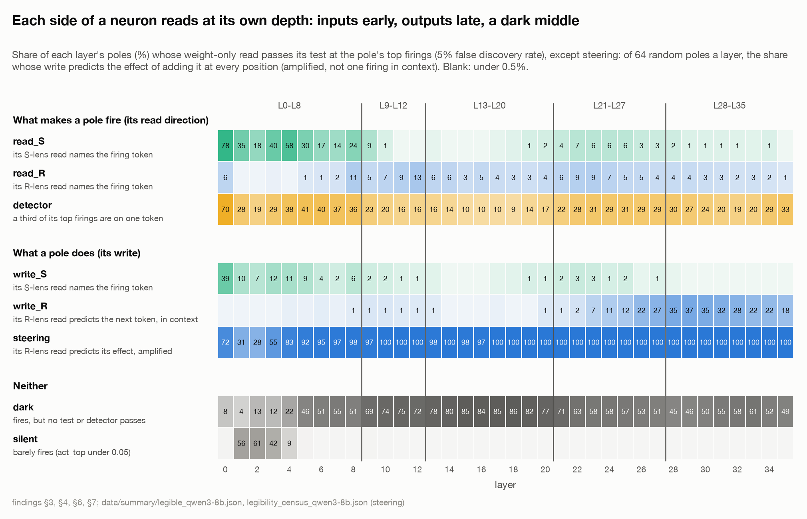

## Findings

Findings 1-12 are Qwen3-8B's, 13-16 Gemma 4 12B's. Numbers are medians or means over a layer's poles
unless stated. Each heading links to its findings section, with setup, controls and limits.

### 1. The lenses are stable, and their corpus changes tokens, not concepts

Fitting each lens on two halves of its corpus gives matrices that differ by at most 6% at every layer,
and the R-lens halves' reads of neurons' writes share their top token for 89-99% of neurons. An R-lens
fitted on chat conversations instead shares the top token with the web-text lens for only 31-51% of
neurons through L16, yet reads the same concepts in a different order and scores the same on every
causal test, chat-format ones included
([§1](docs/findings.md#1-the-lenses-stability-and-corpus-dependence)).

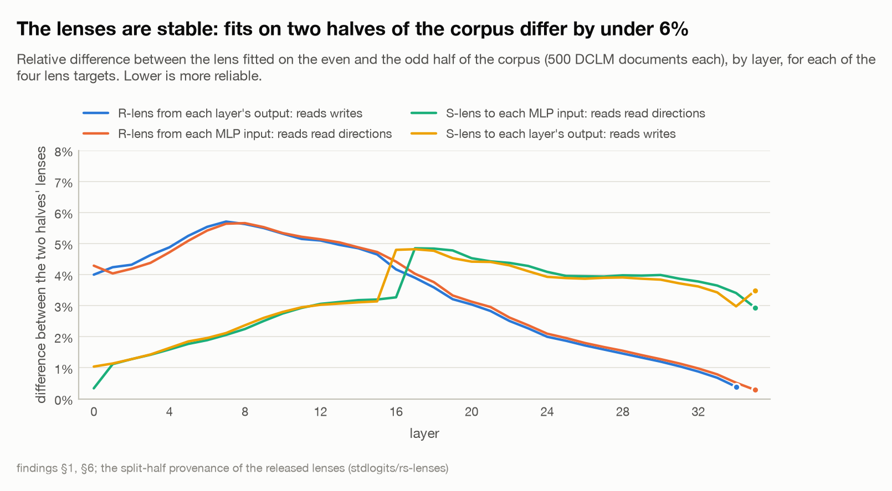

<details><summary>A chat-fitted lens predicts steering as well as the web-text lens</summary>

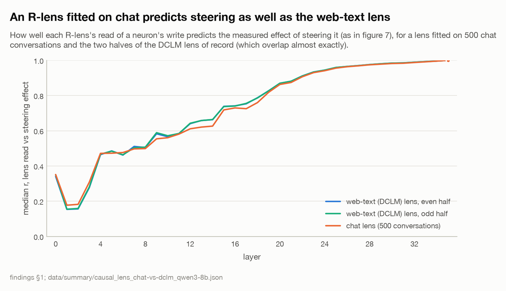

</details>

### 2. Activations: where neurons fire

Over 15M positions, the typical activation is flat at 3-5 from L5 to L21 and grows tenfold to L35. At
L1, 56% of poles are near-silent; at L2-L3, most poles do their work at the first position alone.
Chinese-selective poles sit at both ends of the network, code-selective ones at L20-L29, and poles
selective for the chat slice fire on ChatGPT's register (" delve", "As of 2021")
([§2](docs/findings.md#2-activations-over-15m-positions)).

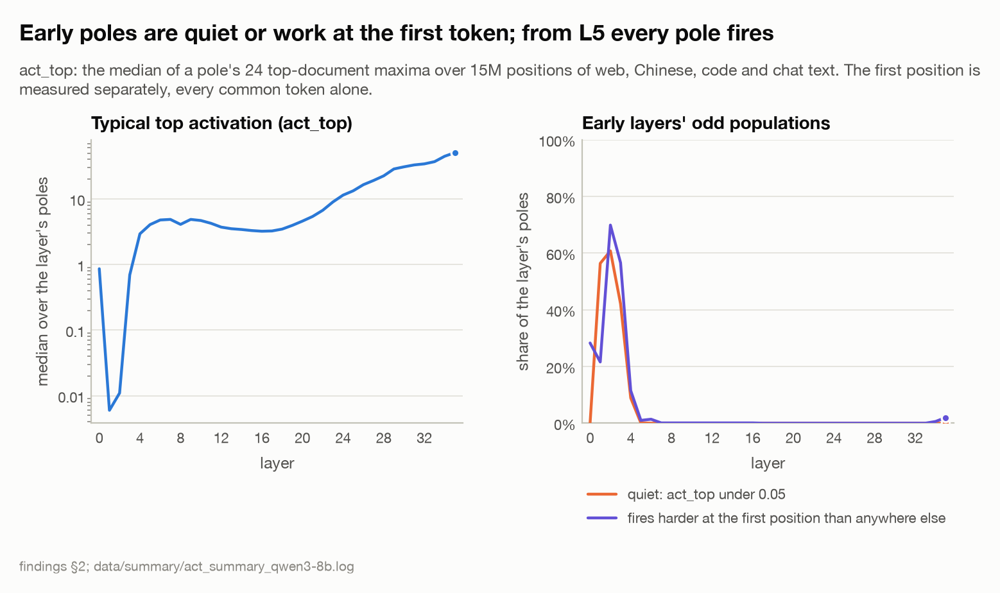

### 3. A neuron's write, read from weights alone, predicts what steering it does

Add a pole's write vector, at about its typical activation, to 48 positions of 16 web documents,
measure the change in next-token log-probabilities, and correlate it with the lens's read of the same
vector. The R-lens reaches a median r of 0.46-0.51 at L4-L8, 0.64-0.74 at L12-L16 and 0.9 or more from
L22, against ±0.04 for another neuron's read. It leads the J-lens by 0.03-0.12 from L4 to L23; the logit
lens trails until about L20 (L8: 0.51 against 0.12). From L5, 92-100% of random poles' writes predict
their own steering effect, against 0-5% for mismatched pairs
([§3](docs/findings.md#3-a-writes-lens-read-predicts-what-steering-it-does)).

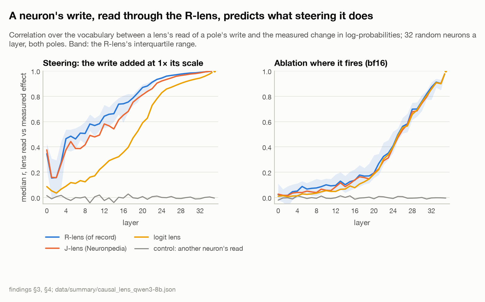

### 4. But steering is not what a neuron does when it fires

In real text, a firing pole's write rarely predicts what comes next: before L22, 1-4% of poles (net of
chance) promote the tokens that follow their top firings, against 31-32% at L28-L29. An exact
linearization of 2,290 poles at their real firings shows why. A firing's effect is close to linear,
but before L21 it depends on its context: the same pole, firing equally hard, pushes the predictions
different ways in different documents (one firing against the pole's other firings: r 0.05-0.11; from
L28: 0.78). The lens and steering agree because both average over contexts; what a mid-network neuron
does in one context is mostly specific to that context, which no single vector can carry
([§4](docs/findings.md#4-steering-is-not-what-a-firing-does)).

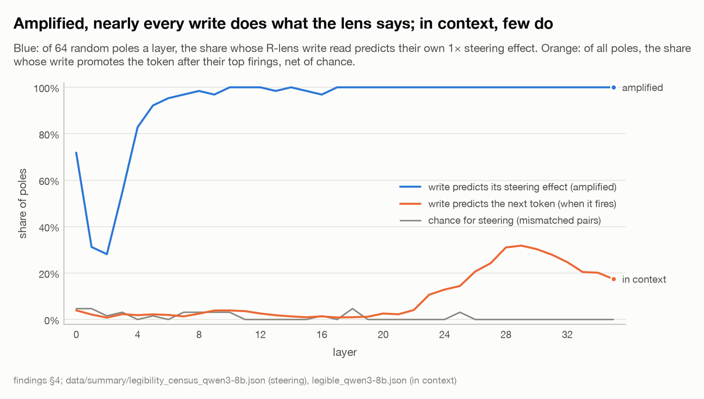

<details><summary>Per-context linearization</summary>

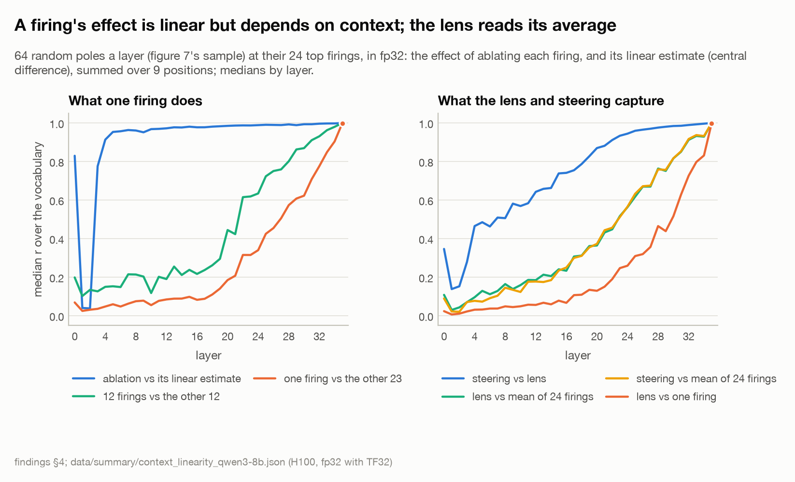

</details>

### 5. Prediction and suppression are two signs of one neuron

Late poles fire on the token before a word their write promotes ("is⟦ once⟧" → *again*; "⟦arist⟧" →
*-ocracy*). Prediction rises from L20 and peaks at L28-L31, where 7-8% of poles have more than a third
of their top firings followed by a token they promote (control under 0.1%). Suppression starts at L32
and overtakes prediction at L35. This is the pattern Gurnee et al. (2024) found in GPT-2; in SwiGLU
the two kinds sit on one neuron, with the promoting pole firing harder through L32 and
the suppressing pole from L34 ([§5](docs/findings.md#5-prediction-and-suppression)).

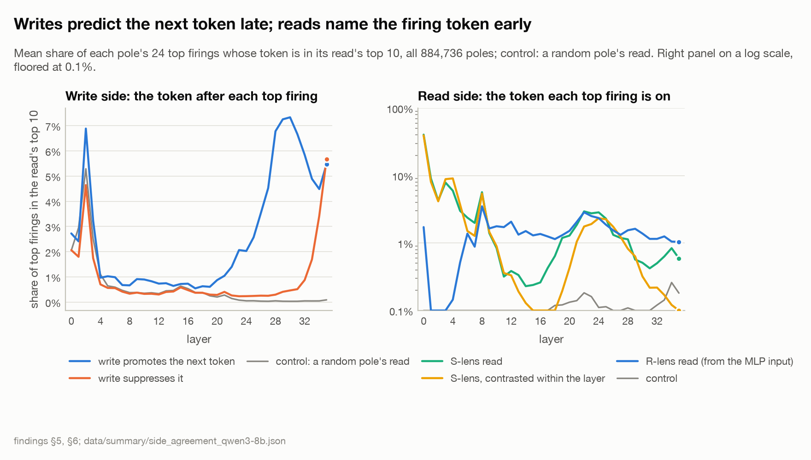

### 6. The input side: the S-lens early, the R-lens later, exact sweeps in between

Early neurons detect tokens and token families (阔 "wide"; words starting with 出; English given names),
which no output-facing lens reads: at L2, 95% of a typical write, carried forward by the R-lens, lies
along one direction. The S-lens recovers these detectors from the weights: at L0, on average 40% of a
pole's top firings have their token in its S-lens read's top 10 (another pole's read: 0.1%), and 2-9%
at L1-L8, where the R-lens read gets under 1.5% (3.5% at L8). Early neurons also write back the
footprint of the tokens they detect: layers 0-8 in effect act as an extended embedding. From L9
the R-lens read of the input direction names exact drivers more often; L13-L20 is the weakest stretch
for every weight-only input read. Past L0 a token's effect is mostly nonlinear (an exact linearization
in the token's own context explains 86% of its footprint at L0 and 7% at L15), though that alone
doesn't explain why S-lens reads fade after L8 ([§6](docs/findings.md#6-the-input-side)).

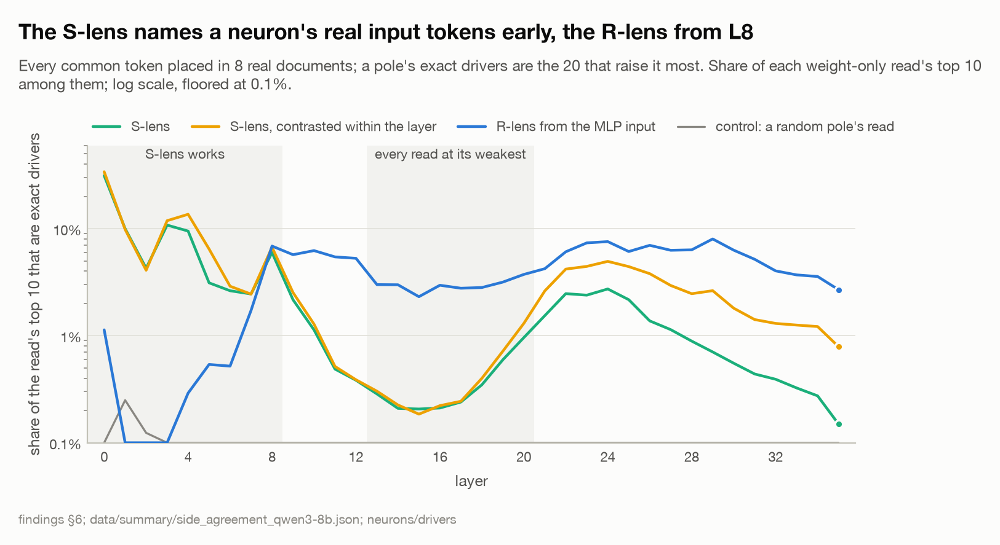

### 7. Most mid-network neurons are dark to weight-only reads, but not indescribable

Every pole's reads are tested at its own top firings against mismatched pairs, at a 5% false discovery
rate. 38% of poles are read by some test (a weight-only read, or a token that dominates their
firings), 5% are silent, and 57% are *dark*: they fire, but no token-level test passes. Dark poles are
82% of L13-L20. Yet explainers with full evidence cards describe dark poles almost as well as legible
ones (detection AUROC 0.90 against 0.96): most are likely concept detectors whose firings vary in token
([§7](docs/findings.md#7-which-reads-hold-the-legibility-census)).

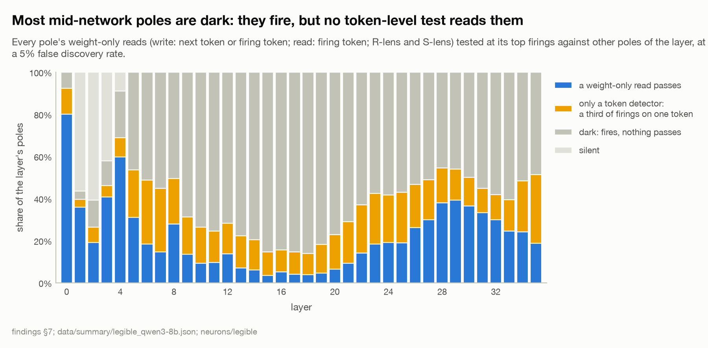

<details><summary>Read signal holds to rank 64</summary>

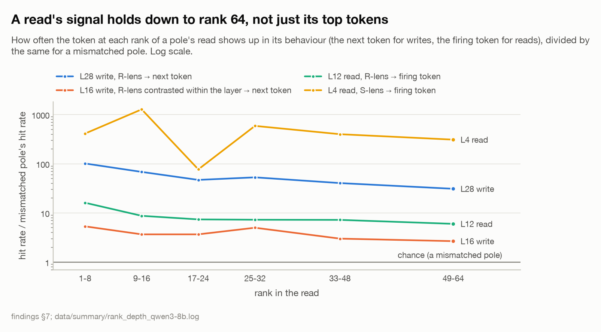

</details>

### 8. Describing neurons from the lenses alone

Claude explainers labelled 160 random poles from only their lens reads, only their top contexts, or
both, never seeing steering. Firing labels are scored by *detection*: can a fresh model, given the
label, pick the pole's held-out top firings out from quiet text (AUROC; 0.5 is chance). Write labels
are scored by whether a judge picks the pole's label out of four from text generated while steering
it. From the lenses alone, firing labels score 0.80 and write labels are picked 65% of the time (95%
at L28-L35, 34% at L0-L8; chance 25%). Top contexts are better for firing (0.87), the lenses for
writes; both together reach 0.89 and 63%. Claude Opus explains no better than Sonnet, which suggests
the bottleneck is the evidence. Claude Haiku then labelled all 884,736 poles for $105; on 100 more
random poles, with a card that keeps only the reads that carry signal at each layer plus top contexts,
it matches Sonnet (0.82 against 0.83) ([§8](docs/findings.md#8-describing-neurons)).

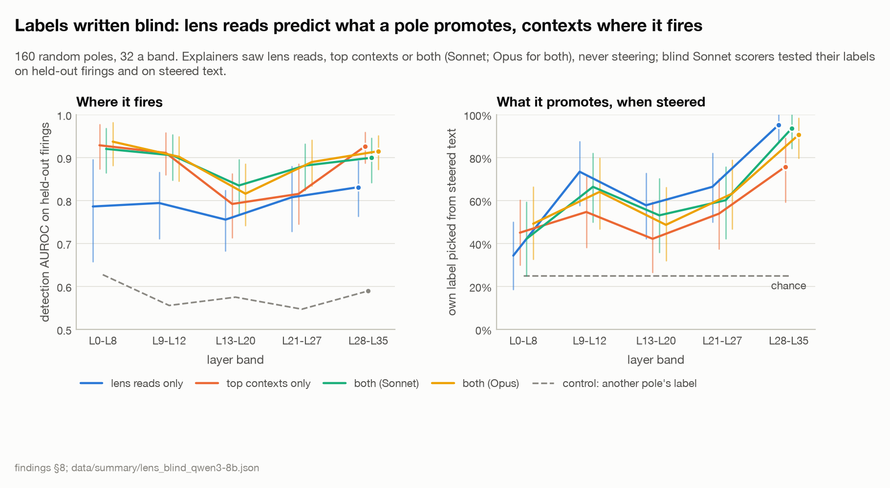

### 9. Attention sinks and the output's temperature

The final RMSNorm divides each position's vector by its overall size, then scales each dimension by a
learned weight. That weight is about 1e-4 on two dimensions, so writes there move no prediction
directly; but those dimensions hold 64% of the final residual's squared length, so they set what
everything is divided by, and with it how sharp every prediction is. Three L6 neurons fire at up to
10,752 on the first token, writing onto one of those two dimensions and creating the *attention sink*
that later heads attend to by default; the trigger is layer 0's MLP output at that position. L16
neurons create a second sink on the year after a date ("May 7, ⟦2⟧013"), which four L34 neurons clear
before the output. L35 n9510 + fires on hashes and IDs, where the next token is hard to guess, and
raises the output's entropy through this scale: an entropy neuron in the sense of Stolfo et al. (2024)
([§9](docs/findings.md#9-attention-sinks-the-outputs-temperature-and-entropy-neurons)).

### 10. Outside labels

The [Neuron Persona Library](https://neuronpersonas.com) labels poles by steering each one while the
model answers "Who are you?". Judged generously and blind on 360 rows, 34% of its personas clearly
match the pole's write read, 27% its input read and 40% both together (swapped names: 2-5%), most late
and least mid-network; weighted by the library's depth mix, 27%, 22% and 34%. Labels from steering one
prompt are the ones activations most often contradict (the library's "creator god" pole fires on time
words), and the library misses what can't be a persona: idiom completers, morphology, everyday
concepts ([§10](docs/findings.md#10-outside-labels)).

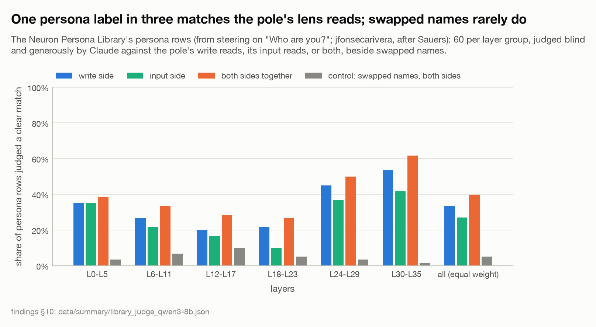

### 11. Attention heads: what each copies and attends to, from the weights

Qwen3-8B has 33 induction heads (which continue repeated text: after `A B … A`, they attend to `B` and
predict it), 33 duplicate-token heads (which attend to earlier copies of the current token), 4
previous-token heads and 60 sink heads, and removing any one head costs in-context copying at most
0.07 nats: the work is spread over many heads. A head's input reads best through the S-lens (a head
reads what a position holds, not what it is about to say); its output with the S-lens up to L8 and the
R-lens from L9, as for neurons. Feeding each vocabulary token's S-lens footprint through a head's
circuits gives two token-by-token maps. The OV map says what it copies and suppresses (L26h31 copies
quantities: ` weight | 体重 | strength`; L32h9 suppresses the surnames L34h1 copies), and predicts where
the attended token ranks in the head's actual output at each firing (Spearman +0.54; 0.00 under
another head). The QK map finds the duplicate-token heads from the weights (AUROC 0.96), and late
heads attend to the classes they copy or suppress
([§11](docs/findings.md#11-attention-heads-circuits-read-token-by-token)).

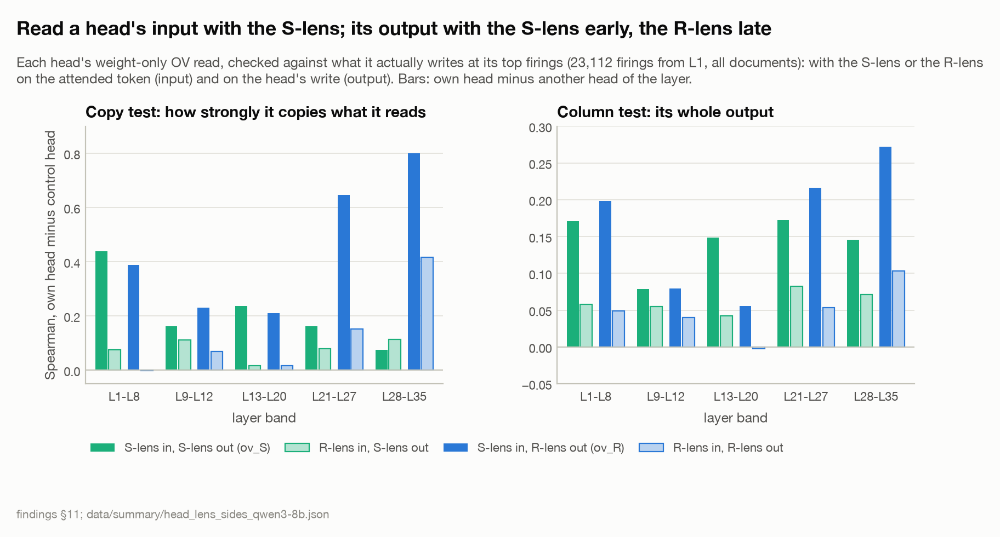

### 12. Heads, like neurons, are dark mid-network

At their own top firings, 27% of L28-L35's heads write the next token as their OV read predicts, and
few heads before; 74-78% of heads at L9-L20 pass no test and show no token mode or pattern. Claude Haiku
labels every head (where it fires, what it attends to, what it writes); checked blind, the firing labels
tell a head's held-out firings from another head's at AUROC 0.71 (control 0.51), and the write labels
are picked out of four 49% of the time (79% at L28-L35; chance 25%)
([§12](docs/findings.md#12-attention-heads-census-and-labels)).

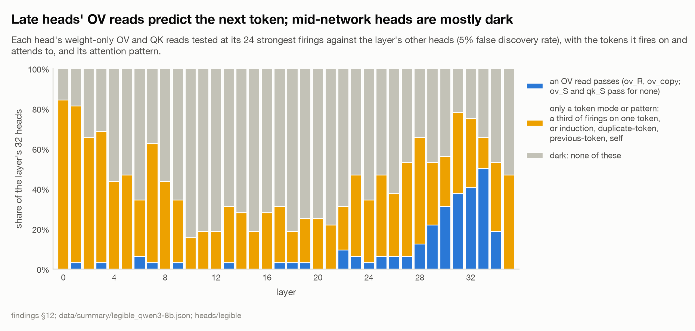

### 13. A second model reads the same way

Gemma 4 12B comes from another lab, with another activation, norm layout and attention scheme. Its
catalog shows the same picture. The R-lens read of a write predicts steering from L11 on (median r
0.53 at L12-L23, 0.82 at L24-L35, 0.97 at L36-L47), ahead of the logit lens; before L11, pushes at a
neuron's natural size move the output too little for either lens to predict, though larger pushes
still raise the tokens the R-lens names. 19% of poles pass some weight-only test (Qwen3-8B: 22%) and
52% are dark (57%): the input side reads through L13, about the same relative depth as Qwen3-8B's L8,
the write side from L33, and the middle is dark from both. Claude Haiku labelled every pole and head;
checked blind, the heads' firing labels hold as Qwen3-8B's do (AUROC 0.71), their write labels are at
chance, and the neuron labels are not checked yet
([§13](docs/findings.md#13-gemma-4-12b-the-text-catalog-in-a-second-model)).

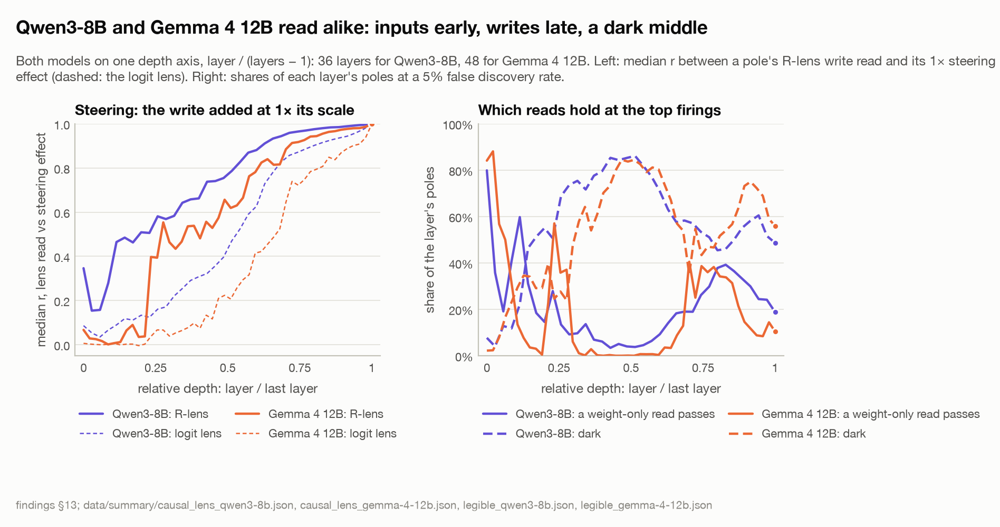

<details><summary>Gemma 4's steering and census by layer</summary>

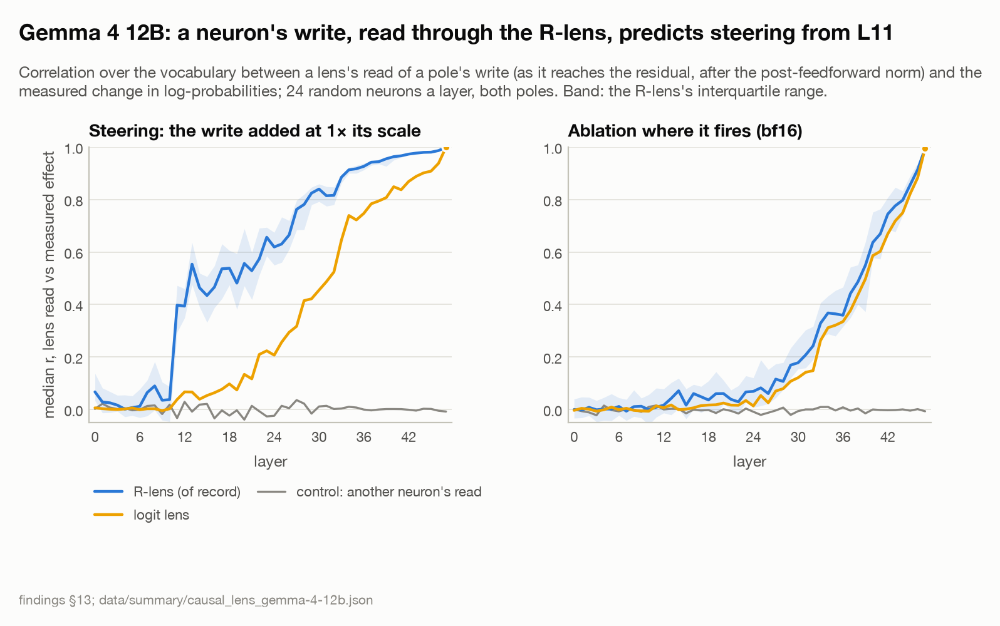

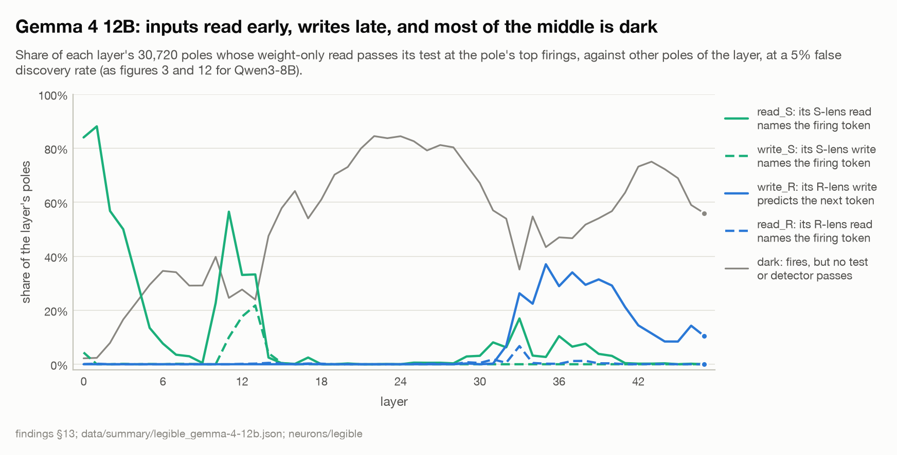

</details>

### 14. Images and sound: what drives a neuron

Gemma 4 has no separate encoder for images or sound: each 48 × 48-pixel patch or 40 ms of audio
enters the residual stream through a few norms and one linear map. So the lenses can be fitted on
images and sounds, and a neuron's read direction can be carried back to pixels or samples. Over
49,694 labelled images and 46,932 labelled sounds, a quarter to a half of each band's poles have a
label that holds on held-out documents (AUROC 0.96-0.97 for images, 0.78-0.91 for sound): gratings,
checkerboards and writing systems early, objects, scenes and languages later. The lens's patch read
shows what a neuron's input direction looks like, but added to held-out images it raises the neuron
only in the first six layers. Started from the read and optimised by gradient ascent through the
model, a single patch or 40 ms frame drives its neuron through L23
([§14](docs/findings.md#14-images-and-sound-what-drives-a-neuron)).

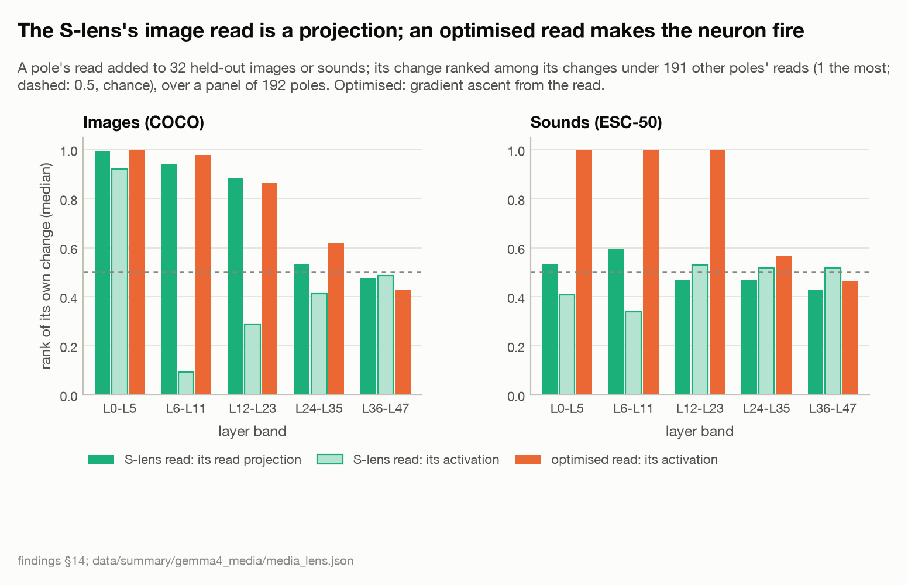

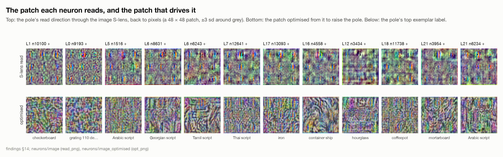

### 15. One concept in text, images and sound

Many of Gemma 4's neurons mean the same thing whatever the input. At L12-L23, 42% of the poles with a
reliable image label also fire on the label's name in text (5% by chance). 4,378 poles pass every
text test for their image label (its name fires them, the text S-lens reads it, the text R-lens writes
it), and 708 for their audio label. 18 pass all of them for both, where independent lists would share
1.8: places and peoples, with their language
([§15](docs/findings.md#15-one-concept-in-text-images-and-sound)).

| pole | image label | audio label | exact text drivers | R-lens read of its write |
|---|---|---|---|---|
| `L14 n8313 +` | mosque indoor | Arabic | Amal, أ, Mohamed, Noor | Arabic, Quran, islamic, Saudi |
| `L33 n5249 +` | tacos | Spanish | Peruvian, Ecuadorian, Mexican, Aztecs | Mexican, 墨西哥 (Mexico), Mexico |
| `L33 n6099 +` | pagoda | Mandarin Chinese | WeChat, Xiaomi, Weibo, Shanghai | Chinese, China, Beijing, 中国 |
| `L37 n7165 +` | giant panda | Mandarin Chinese | 熊猫 (panda), 四川 (Sichuan), 成都 (Chengdu) | panda, 熊猫, Chengdu |

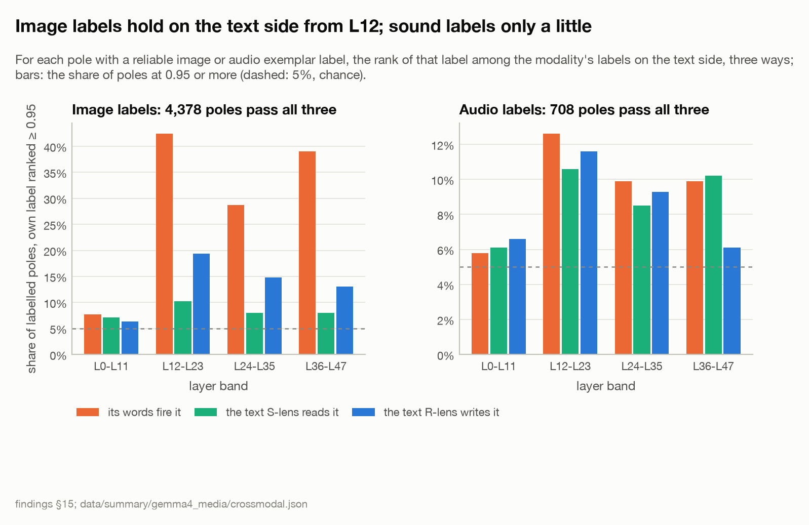

### 16. Heads carry what an image shows into the text

With an image in the prompt followed by ` a`, Gemma 4 gives the image's own label a lower loss than
another class's 97% of the time. Early heads attend within the image, from a patch to its neighbours;
the text reads the image most at L23-L31. Zeroing single heads (L28h6, L29h1, L29h9, L25h2) costs the
right label more than a wrong one, and from L35 heads write the right class. With a sound, the model
prefers the right label only 55% of the time, and no head carries it
([§16](docs/findings.md#16-attention-heads-in-image-and-audio-contexts)).

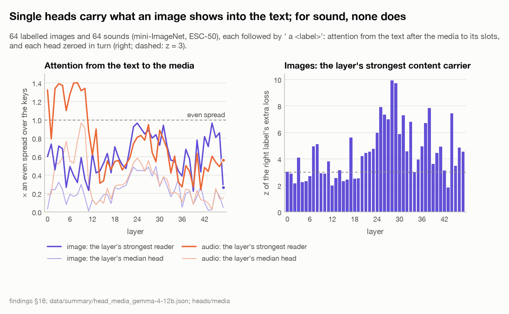

### Limits

- Two models; one lens corpus for text (English-heavy web text), and COCO photos and ESC-50 sounds for
  Gemma 4's media lenses; lenses averaged over 128-token documents.
- Activations are bf16 passes over documents of up to 256 tokens; the exact drivers match an fp32 rerun
  through L9 on Qwen3-8B, and later layers are unchecked.
- The legibility tests are token-level; labels are written, scored and judged by Claude models, and
  exist for Qwen3-8B only. Media labels name what a whole image or sound is about.
- Steering adds a write at every position of neutral text at many times its natural size: it shows what
  a direction does, not what one firing does in context.

## Using the release

Read one neuron's write through the R-lens:

```python
import torch
from huggingface_hub import hf_hub_download
from transformers import AutoModelForCausalLM, AutoTokenizer

model = AutoModelForCausalLM.from_pretrained("Qwen/Qwen3-8B", dtype=torch.bfloat16)
tok = AutoTokenizer.from_pretrained("Qwen/Qwen3-8B")
J = torch.load(hf_hub_download("stdlogits/rs-lenses", "qwen3-8b/r-lens/lens.pt"), weights_only=True)["J"]

L, n, sign = 8, 344, +1                        # L8 n344 +
w = sign * model.model.layers[L].mlp.down_proj.weight[:, n].float()
h = J[L] @ w                                   # layer L's output -> the final residual
h = h * torch.rsqrt(h.pow(2).mean() + 1e-6) * model.model.norm.weight.float()
print(tok.convert_ids_to_tokens((model.lm_head.weight.float() @ h).topk(8).indices))
```

Read which input tokens drive it, through the S-lens to the MLP input:

```python
K = torch.load(hf_hub_download("stdlogits/rs-lenses", "qwen3-8b/s-lens/mid.pt"), weights_only=True)["K"]

layer = model.model.layers[L]
g = layer.post_attention_layernorm.weight.float()
a = g * layer.mlp.gate_proj.weight[n].float()
b = g * layer.mlp.up_proj.weight[n].float()
c = a / a.norm() + sign * b / b.norm()         # the pole's read direction
E = model.model.embed_tokens.weight.float()
scores = (E - E.mean(0)) @ (c @ K[L])          # token v: c · K_L (W_E[v] − mean(W_E))
print(tok.convert_ids_to_tokens(scores.topk(8).indices))   # the catalog also masks rare tokens
```

Query the catalog (one layer of neuron reads is about 100 MB):

```python
import pandas as pd

base = "hf://datasets/stdlogits/neuron-lens/qwen3-8b"
reads = pd.read_parquet(f"{base}/neurons/reads/L08.parquet")
reads.query("neuron == 344 and pole == 1")[["write_R_str", "read_R_str", "read_S_str"]]

labels = pd.read_parquet(f"{base}/neurons/labels/L08.parquet")
labels.query("neuron == 344 and pole == 1")[["fires", "fires_conf", "writes", "writes_conf"]]

heads = pd.read_parquet(f"{base}/heads/reads.parquet").merge(pd.read_parquet(f"{base}/heads/acts.parquet"))
heads.query("layer == 20 and head == 17")[["ov_R_str", "qk_S_str", "duplicate", "contexts"]]
```

Browse a local copy with `python -m neuron_lens.catalog show 8 344 +`, `head 20 17` or
`search 'Bible|圣经'`. The R-lens also loads in [Drowse](https://github.com/stdlogits/drowse):
`drowse lens fetch Qwen/Qwen3-8B workspace-r --repo stdlogits/rs-lenses`.

For Gemma 4 12B, with this package installed (`neuron_lens.weights.tensors` reads only the named
weights from the checkpoint, so no model is loaded), read a neuron's write, then see its image read,
the images that drive it and an optimised patch:

```python
import io
import pandas as pd
import torch
from huggingface_hub import hf_hub_download
from PIL import Image
from transformers import AutoTokenizer
from neuron_lens.neurons import directions
from neuron_lens.weights import tensors

M = "google/gemma-4-12B"
tok = AutoTokenizer.from_pretrained(M)
J = torch.load(hf_hub_download("stdlogits/rs-lenses", "gemma-4-12b/r-lens/lens.pt"), weights_only=True, mmap=True)["J"]
w = tensors(M, ["model.language_model.embed_tokens.weight", "model.language_model.norm.weight"])
E, g = w["model.language_model.embed_tokens.weight"].float(), w["model.language_model.norm.weight"].float()

L, n, sign = 33, 6099, +1                      # L33 n6099 +: pagodas, pandas, Mandarin speech
h = J[L].float() @ (sign * directions(M, L)["write"][:, n])   # the write: s · γ_post ⊙ W_down[:, n]
h = h * torch.rsqrt(h.pow(2).mean() + 1e-6) * g
print(tok.convert_ids_to_tokens((E @ h).topk(8).indices))      # tied unembedding

base = "hf://datasets/stdlogits/neuron-lens/gemma-4-12b"
image = pd.read_parquet(f"{base}/neurons/image/L33.parquet").query("neuron == 6099 and pole == 1").iloc[0]
image[["label", "labels_str", "sig", "stable", "text_fire_rank", "text_read_rank", "text_write_rank"]]
Image.open(io.BytesIO(image["read_png"]["bytes"]))            # its read direction, in pixels
docs = pd.read_parquet(f"{base}/media/image_docs.parquet")
docs.loc[image["top_docs"][:8], ["labels", "link"]]            # the images that drive it, at their sources
opt = pd.read_parquet(f"{base}/neurons/image_optimised.parquet").query("layer == 20 and gain > 0")
Image.open(io.BytesIO(opt.iloc[0]["opt_png"]["bytes"]))      # a patch that drives its neuron
```

Sound is the same with `audio` for `image`: `read_wave` and `opt_wave` hold 640 samples at 16 kHz.

## Reproducing

```bash
uv pip install -e ".[plots]"     # add the drowse extra (Drowse >= 5.4) to export lenses to Drowse
python -m pytest -q              # estimator tests: brute-force Jacobians, agreement with Drowse
```

The pipeline, in run order. `NEURON_LENS_MODEL` picks the model (Qwen3-8B by default;
`google/gemma-4-12B` for Gemma 4). Runtime artifacts go to `data/` (ignored), compact results to
`data/summary/` and figures to `docs/figures/`. Costs are Qwen3-8B's unless marked; Gemma 4's lens fits
take about 1.5× as long.

| script | what | cost |
|---|---|---|
| `01_lens_corpus.py` | the lens corpus: the first 1,000 rows of DCLM-shuffled at a pinned revision | minutes |
| `02_fit.py` | fit the R-lens or S-lens (`--lens R\|S`, and for Gemma 4 `--modality image\|audio`); resumable, shardable across GPUs, detachable | ~3 h per text lens on one H100; 45-90 min per media lens |
| `03_token_counts.py` | token counts over the activation corpora, which set the kept tokens | minutes |
| `04_export_rlens.py` | export an R-lens fit to a Drowse home | minutes |
| `05_act_corpus.py` | the activation corpora: web (held out from the lens), Chinese, Python, chat | minutes |
| `06_activations.py` | one pass for every neuron and head: statistics, top firings, attention patterns, position 0 | ~70 min on an RTX 4090 |
| `07_drivers.py` | every kept token swept through 8 real documents: neuron and head drivers | ~70 min on an RTX 4090 |
| `08_reads.py` | weight-only reads of every pole and head through both lenses | ~10 min per side on a Mac |
| `09_legible.py` | which reads hold at each unit's top firings | ~30 min on a Mac |
| `10_labels.py` | a label for every pole and head by Claude Haiku 5.5, and the heads' blind check | ~$105 for the neurons, under $1 for the heads (Batch API) |
| `13_media_activations.py` | Gemma 4: every pole's activation over the labelled images and sounds; its exemplars | ~50 min per modality on an H100, and 220 GB of RAM for the images |
| `14_media_tables.py` | Gemma 4: the per-layer image and audio tables | ~15 min on an H100 |
| `15_media_optimised.py` | Gemma 4: the optimised patches and sounds | ~25 min per modality on an H100 |
| `11_figures.py` | every figure in `docs/figures/` | seconds |
| `12_release.py` | release the lenses and the catalog on the Hub | |

An Apple-silicon Mac runs everything but the lens fits and the GPU passes, which want a CUDA card (24
GB is enough for the text passes). `scripts/checks/` holds the analyses behind the findings (steering,
the blind tests, sinks and entropy neurons, outside labels, head lens sides; for Gemma 4, the media
lens tests, the cross-modal ranks `14_media_tables.py` reads, and the heads in media contexts);
analyses the pipeline later absorbed are retired. The package `neuron_lens/` holds the
estimator (`transport.py`, with `rules.py` as its test reference, and Gemma 4's layer maps in
`gemma4.py`), the models' geometry (`arch.py`, `neurons.py`), the readouts (`readout.py`, `heads.py`),
lens loading (`lenses.py`), images and sound (`media.py`, `media_sets.py`) and the catalog
(`catalog.py`).

<details><summary>Gemma 4 12B, in order</summary>

```bash
export NEURON_LENS_MODEL=google/gemma-4-12B
python scripts/02_fit.py --model $NEURON_LENS_MODEL --lens R --docs 1000             # and --lens S
python scripts/02_fit.py --model $NEURON_LENS_MODEL --lens S --modality image --docs 1000
python scripts/02_fit.py --model $NEURON_LENS_MODEL --lens S --modality audio --docs 2000
python scripts/02_fit.py --model $NEURON_LENS_MODEL --lens R --modality image --docs 512 --dim-batch 512
python scripts/02_fit.py --model $NEURON_LENS_MODEL --lens R --modality audio --docs 512 --dim-batch 512
python scripts/05_act_corpus.py --docs chat=8000    # Gemma's chat slice; the other slices are Qwen3-8B's
python scripts/03_token_counts.py
python scripts/06_activations.py --batch-docs 64
python scripts/07_drivers.py --batch 128
python scripts/08_reads.py
python scripts/09_legible.py
python scripts/13_media_activations.py --modalities audio --batch 32   # then image: one at a time
python scripts/checks/crossmodal.py
python scripts/14_media_tables.py
python scripts/15_media_optimised.py --modality image                   # and audio
python scripts/checks/head_media.py
python scripts/checks/causal_lens.py measure --per-layer 24
python scripts/checks/causal_lens.py score --lenses logit,hub
python scripts/11_figures.py && python scripts/12_release.py
```

</details>

## Related work

- Bills et al., [Language models can explain neurons in language
  models](https://openaipublic.blob.core.windows.net/neuron-explainer/paper/index.html) (2023): every
  GPT-2 XL neuron, from activations.
- Choi et al., [Scaling automatic neuron description](https://transluce.org/neuron-descriptions)
  (Transluce, 2024): every Llama-3.1-8B-Instruct neuron, both polarities.
- Gur-Arieh et al., [Enhancing automated interpretability with output-centric feature
  descriptions](https://arxiv.org/abs/2501.08319) (2025): descriptions from what a feature writes,
  combined with what makes it fire.
- Gurnee et al., [Universal neurons in GPT2 language models](https://arxiv.org/abs/2401.12181) (2024):
  prediction and suppression neurons; Stolfo et al.,
  [Confidence regulation neurons in language models](https://arxiv.org/abs/2406.16254) (2024): entropy
  neurons.
- The lens sources above; [docs/design.md](docs/design.md#related-work) has the full list.

## License

The code and docs in this repository are [MIT](LICENSE). The lenses and the catalog on the Hugging Face
Hub are [CC BY 4.0](https://creativecommons.org/licenses/by/4.0/); both models are Apache 2.0. Made by
[@_a9lim](https://x.com/_a9lim) and [@treetowntree](https://x.com/treetowntree) with Claude (Anthropic).
