# Findings

What the catalog shows about the neurons and attention heads of Qwen3-8B, Gemma 4 12B (in text, images and sound) and the
rest of the Qwen3 family to 14B, and how far each way of reading them goes. Each section gives its setup, its results
against controls, and its limits; the methods are in [design.md](design.md) and the overview in the
[README](../README.md). The sections run in seven parts:

| | § | in one line |
|---|---|---|
| **I. The lenses and the corpus** | [§1](#1-the-lenses-stability-and-corpus-dependence) | both lenses' halves agree within 0.06; a chat-fitted lens changes tokens, not concepts or causal scores |
| | [§2](#2-activations-over-15m-positions) | scale, near-silent L1, first-position L2-L3, language and code selectivity at the ends of the network |
| **II. Reading a neuron from its weights** | [§3](#3-a-writes-lens-read-predicts-what-steering-it-does) | the R-lens read of a write predicts steering (r 0.45-0.50 at L4-L8, 0.9+ from L22), ahead of the J-lens |
| | [§4](#4-one-firing-is-one-sample-of-a-write) | a write read is a pole's average push; before L21 a pole's firings don't predict each other |
| | [§5](#5-prediction-and-suppression) | late poles fire before the word they promote; suppression from L32; two signs of one neuron |
| | [§6](#6-what-a-write-adds-beyond-what-it-reads) | a write leans on its `up` row through L14, but the rest of it carries 84-100% of the steering effect |
| | [§7](#7-the-input-side) | the S-lens names early neurons' tokens through L8, the R-lens read from L9; on SiLU's negative lobe a pole reads its up row |
| | [§8](#8-what-each-read-names-and-which-read-to-use-where) | each read against the token under a firing, after it, or its drivers; the reading plans and the depth bands |
| **III. Units in context** | [§9](#9-attention-sinks-the-outputs-temperature-and-entropy-neurons) | two null-space dimensions carry the attention sinks and set the output's temperature |
| | [§10](#10-attention-heads-circuits-read-token-by-token) | a head's input reads with the S-lens; what each head copies and attends to, from the weights |
| | [§11](#11-attention-heads-what-their-reads-name) | late heads write the next token; S-side reads are shared across a layer's heads |
| | [§12](#12-what-feeds-a-unit-edges-and-sources) | weight edges rank every source's effect (ρ 0.88) but name a tenth of what drives a pole: co-firing does |
| **IV. Describing units in words** | [§13](#13-labels-from-the-evidence) | labels from the lenses alone: AUROC 0.75 for firing, 0.76 for writes; the catalog's labels, 0.82-0.88 on six models |
| | [§14](#14-outside-labels) | steering-labelled personas against the catalog's reads, from both sides |
| **V. A second model, three modalities** | [§15](#15-gemma-4-12b-the-text-catalog-in-a-second-model) | Gemma 4 12B reads like Qwen3-8B; a read that turns a covector into a vector needs the residual's metric |
| | [§16](#16-images-and-sound-what-drives-a-neuron) | labelled images and sounds name what Gemma's neurons respond to; lens reads are projections, optimised ones drive the neuron |
| | [§17](#17-one-concept-in-text-images-and-sound) | 4,382 poles keep their image label on every text test; 19 hold one concept across all three modalities |
| | [§18](#18-attention-heads-in-image-and-audio-contexts) | single heads carry what an image shows into the text; sound is too weak to trace |
| **VI. Across Qwen3's sizes** | [§19](#19-the-qwen3-family-what-changes-with-size) | late reads hold while early ones fall with size; bases read like their siblings; what post-training changed |
| | [§20](#20-qwen3-4b-and-06b-are-pruned-from-the-8b-and-the-17b) | the 4B and 0.6B are width-pruned from the 8B and 1.7B: three lineages, not five sizes |
| **VII. What the lenses miss** | [§21](#21-the-dark-sector-what-the-r-lens-barely-reads) | the dark sector matters 300-5,700 times more than the lens predicts; what prompts differ in turns bright, and the rest is inert |

Numbers are medians or means over a layer's poles unless stated. Each setup names its script: a pipeline stage
(`scripts/NN_*.py`) or a check (`scripts/checks/`). Compact outputs are in `data/summary/`, and figures are drawn by
`scripts/11_figures.py`. Firings and token swaps are samples of what a unit does: a test against them says whether a read
names that target, not whether the read is right (§4, §8).

**Terms.** A *pole* is one sign of a neuron's activation (SwiGLU activations take both), written `L8 n344 +`. Its *write*
is `±W_down[:, n]`, its *read direction* `â ± b̂` (the gate and up rows). Its *top firings* are its strongest position in
each of its 64 top documents, and `act_top`, its typical high activation, is the median of the first 24 (§3 and §4 use
those 24). The *depth bands* are cut from each model's reading plan (§8): for Qwen3-8B, sensory L0-L3, association L4-L8,
workspace L9-L20 and motor L21-L35. Tables are by band, except where a test was sampled or measured in other layer
groups: §14's persona rows, §16's media panel, §19's quarters of relative depth (to compare sizes) and §21's ablation
windows. A *mismatched control* scores another
unit of the same layer on this unit's tokens. *Kept tokens* are the tokens seen 5+ times in the activation corpora,
without byte-fallback pieces (103,830 for Qwen3-8B, 123,774 for Gemma 4); every token read covers them.

## I. The lenses and the corpus

The two instruments the other sections use: lenses fitted on 1,000 web documents, and activations over 15M positions of
four kinds of text.

### §1. The lenses: stability and corpus dependence

**Setup.** Both lenses are fitted by `02_fit.py` on the first 1,000 rows of DCLM-shuffled, 128 tokens each, in bf16 with
fp32 sums on one H100 (about 11.5 s a document per lens). The documents alternate between an even and an odd half; the
split-half difference is `‖even − odd‖ / ‖mean‖` (Frobenius) per layer. Neuron-by-neuron agreement is from
`checks/lens_compare.py` over 12 layers; the J-lens is Neuronpedia's (461 wikitext prompts).

**The halves agree.** The R-lens's split-half difference is 0.04-0.06 at L0-L18, 0.03 at L19-L22, 0.02 at L23-L27 and
0.01 or less from L28, as expected from two documents' estimates differing by 65% (`0.65/√500` ≈ 0.03). Its `mid`
target is within 0.01 of that; the S-lens is 0.00-0.05 (`mid`) and 0.01-0.05 (`out`), highest at L16-L20. Neuron by
neuron, the halves' write reads share the top token for 89-99% of neurons:

| layer | halves: top-1 agree | halves: top-10 overlap | R-lens vs J-lens: top-1 agree |
|---|---|---|---|
| L2 | 0.89 | 0.92 | 0.02 |
| L8 | 0.89 | 0.91 | 0.05 |
| L14 | 0.91 | 0.93 | 0.06 |
| L20 | 0.94 | 0.95 | 0.20 |
| L26 | 0.97 | 0.98 | 0.47 |
| L32 | 0.99 | 0.99 | 0.73 |

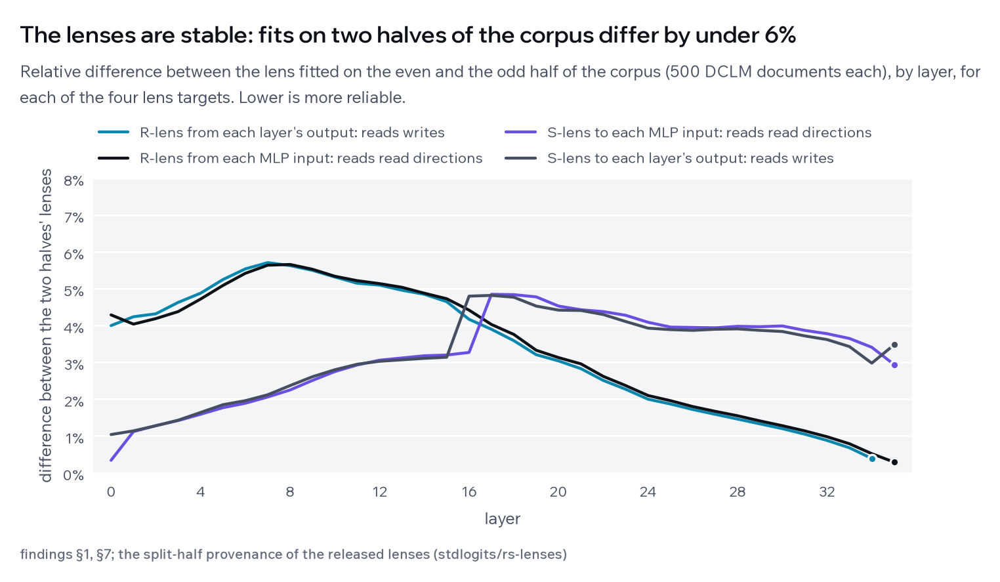

- **The R-lens and J-lens disagree most where the R-lens predicts steering better** (L4-L23, §3).
- **RelP's rules lower the noise.** On a Qwen3-0.6B prototype of the S-lens (12 documents), RelP halved the split-half
  noise of the true-gradient version (L7: 0.15 against 0.26) and fit exact token footprints slightly better (R² +0.02-0.03
  from L1). On Qwen3-8B, RelP beats the true derivative on both sides (§3, §7).
- **Early writes share one direction.** At L2 the R-lens's top singular direction holds 0.78 of `J_L`'s energy and 0.95
  of a median write (0.27 at L5, 0.02 or less from L23). It reads `the, a, in, and` one way and code tokens
  (`startIndex`) the other. The halves agree there (0.89), so this is the early Jacobian, not noise; early neurons are
  read from their inputs instead (§7).
- **Raw reads have hub tokens**, the same few tokens at the top of many poles' reads: at L1, ` the`, ` in` and ` and`
  sit in 30-31% of write reads' top 10s. Layer-contrastive reads (`_z`), which z-score each token across the layer's
  poles, remove them.

**The corpus changes tokens, not concepts.** An R-lens fitted the same way on 500 UltraChat conversations in the chat
template (split-half 0.05-0.07 early, 0.01 late) was compared with the DCLM lens's 500-document halves, so both sides
carry the same noise:

| layer | top-1 agree: chat vs DCLM (DCLM halves) | top-10 overlap |
|---|---|---|
| L0 | 0.40 (0.90) | 0.55 (0.93) |
| L2 | 0.31 (0.89) | 0.54 (0.92) |
| L8 | 0.42 (0.89) | 0.54 (0.91) |
| L16 | 0.51 (0.92) | 0.62 (0.94) |
| L24 | 0.78 (0.96) | 0.84 (0.97) |
| L34 | 0.96 (1.00) | 0.96 (1.00) |

- **Every causal score is the same.** Steering prediction (§3) is within 0.04 at every layer but L3 (0.06), ablation
  identical, persona names (§14) equal from L6 (the DCLM lens is better at L0-L5: 15% of names in the top 10 against 9%),
  fused personas within 0.02. The chat lens is no better on chat-format tests.
- **Clear neurons read the same concept in another order** (L8 n1931 +: 圣经, Bible, 基督徒, Scripture under both).
  **Weak, diffuse writes drift toward each corpus's register:** markdown bold and `...⏎` under chat, `...⏎⏎` and curly
  quotes under DCLM. Where a read's top probability is low, register tokens are the lens's, not the neuron's.

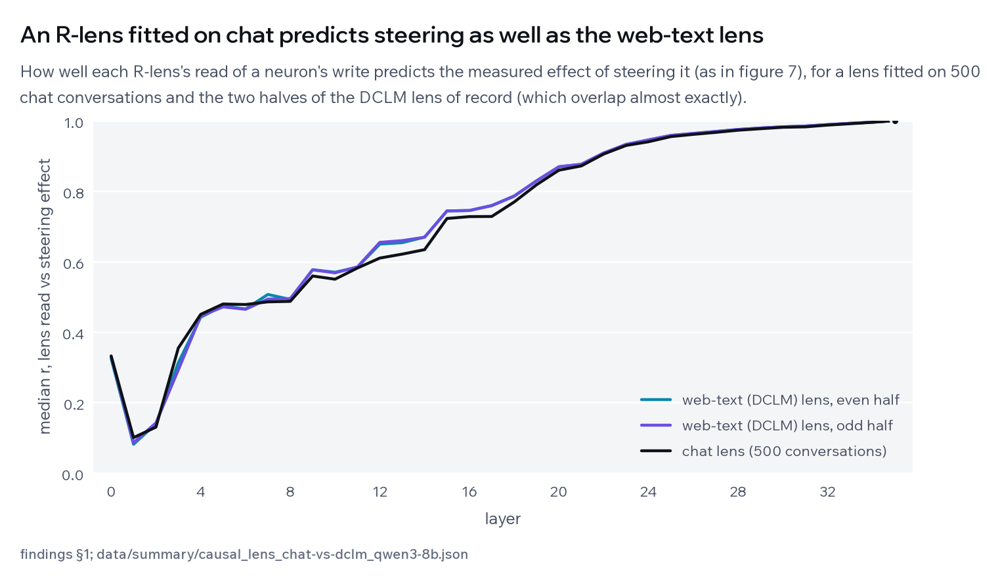

**Limits.** One fitting corpus of record and 128-token documents. Split-half agreement measures stability within a
corpus, not freedom from it; the chat lens is one alternative.

### §2. Activations over 15M positions

**Setup.** `06_activations.py`, one bf16 pass with eager attention (about 70 minutes on an RTX 4090) over every document
of four slices, up to 256 tokens each, from position 1: 15.4M positions in all.

| slice | source | documents | positions |
|---|---|---|---|
| dclm | DCLM-shuffled from row 1,000 (none in the lens corpus) | 40,000 | 9.46M |
| zh | FineWeb-2 `cmn_Hani` | 8,000 | 1.89M |
| code | codeparrot-clean Python | 7,990 | 1.98M |
| chat | UltraChat-200k `test_sft`, in the chat template | 8,000 | 2.04M |

Position 0 attends only to itself, so every kept token run alone gives each pole's exact value there. `rate` is the
share of positions past `act_top / 4`, from exact counts. Checked on Qwen3-0.6B against an unpadded fp32 brute force:
counts exact, sums within 0.2%, top values within 0.9%.

| layer | `act_top` | quiet (`act_top` < 0.05) | fires harder at position 0 than anywhere (> 2×) | zh-selective | code-selective |
|---|---|---|---|---|---|
| L0 | 0.86 | 0.00 | 0.28 (0.01) | 0.033 | 0.023 |
| L1 | 0.006 | 0.56 | 0.22 (0.17) | 0.101 | 0.006 |
| L2 | 0.011 | 0.61 | 0.70 (0.62) | 0.016 | 0.013 |
| L3 | 0.70 | 0.42 | 0.57 (0.51) | 0.019 | 0.027 |
| L4 | 2.94 | 0.09 | 0.12 (0.06) | 0.028 | 0.034 |
| L8 | 4.09 | 0 | 0.001 | 0.007 | 0.029 |
| L16 | 3.22 | 0 | 0.000 | 0.004 | 0.047 |
| L24 | 11.4 | 0 | 0.000 | 0.021 | 0.048 |
| L28 | 22.5 | 0 | 0.000 | 0.018 | 0.056 |
| L35 | 50.8 | 0 | 0.020 | 0.037 | 0.024 |

Selective: the pole's rate in that slice is at least 10× every other slice's, and above 1e-3.

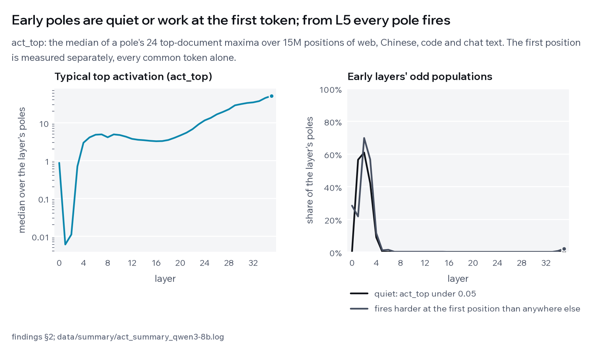

- **Scale is flat at 3-5 from L5 to L21, then grows tenfold to L35**, with the residual stream's norm.
- **L1 is mostly near-silent:** 56% of its poles stay under 0.05 everywhere, position 0 included, like the dead early
  neurons Voita et al. (2023) found in OPT (there zero under ReLU; here near zero).
- **L2 and L3 work at position 0.** 62% and 51% of their poles fire there more than twice as hard as at any later
  position (L2: median 3.7 there against `act_top` 0.011). They do not start the attention sink (zeroing their output
  there leaves it, §9), and matter little downstream (the loss rises 0.5 nats on the token predicted at position 0, 0.01
  from the third). What they compute is open.
- **Language and code features sit at the ends of the network.** Chinese-selective poles are 1.6-10% of L0-L4 (the most
  at L1), 1.8-3.7% of L24-L35 and 0.4-0.8% of L6-L20, the U shape reported for language-specific neurons (Tang et al.
  2024). Code-selective poles are 3.8-5.6% of L10-L30. L29 n8134 + fires at 45% of Chinese positions and under 0.04%
  elsewhere: a language identity, not a word.
- **Chat-selective poles read as ChatGPT's register**, since UltraChat was generated by ChatGPT on both sides: L3 n6404 −
  fires on " delve" and " adhere", in user turns too; L28 n11134 + peaks on the year in "As of 20⟦2⟧1", the
  knowledge-cutoff hedge.
- **Rare poles are counted exactly:** `rate` is 0 for 0.65% of poles, all silent, and L8 n344 + (owls) fires at 1.8 per
  100,000 positions.
- **`act_top` is a tail statistic** and grows with the corpus (1.4-1.8× from 7,000 documents to 64,000): compare poles
  within one corpus.

**Limits.** 256 tokens per document under-samples long-range features, and top firings are one per document. Only the
DCLM slice is a uniform sample; the zh slice is largely traditional script, code is Python only, and chat is one
synthetic dataset.

## II. Reading a neuron from its weights

Whether a lens read says what a neuron does: the write side against steering and firings (§3-§6), the input side
against the tokens that drive it (§7), and which read to trust at each depth (§8).

### §3. A write's lens read predicts what steering it does

**Setup** (`checks/causal_lens.py`, MPS, bf16). 32 random neurons per layer plus the named ones (`neuron_lens/known.py`),
1,194 neurons, both poles. **Steering** adds `±α·W_down[:, n]` to layer `L`'s MLP output at positions 16-63 of 16 DCLM
documents of 64 tokens, at 1× and 4× the pole's `act_top`, and records the mean change in log-probabilities. **Score:**
Pearson r over the tokens seen 5+ times between that change and a lens's logits for the write. **Control:** the next
random neuron's read from the same layer. Medians over the random picks (64 poles a layer).

| layer | logit lens | J-lens | R-lens | control |
|---|---|---|---|---|
| L0 | 0.08 | 0.37 | 0.33 | −0.01 |
| L4 | 0.09 | 0.37 | 0.45 | 0.00 |
| L8 | 0.12 | 0.39 | 0.49 | 0.01 |
| L12 | 0.25 | 0.57 | 0.65 | −0.02 |
| L16 | 0.36 | 0.66 | 0.74 | 0.01 |
| L20 | 0.59 | 0.81 | 0.87 | 0.01 |
| L24 | 0.83 | 0.92 | 0.95 | 0.00 |
| L28 | 0.90 | 0.96 | 0.97 | −0.01 |
| L32 | 0.94 | 0.98 | 0.99 | −0.01 |

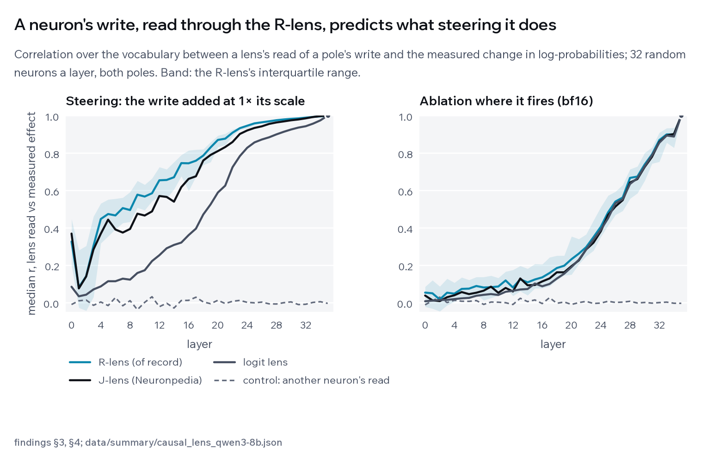

- **A read of one write vector, with no forward pass, predicts what adding it does downstream.** The R-lens reaches
  0.45-0.50 at L4-L8, 0.65-0.75 at L12-L16 and 0.9 or more from L22; controls stay within ±0.04.
- **The R-lens leads the J-lens from L4 to L23** by 0.03-0.13 (L7: 0.50 against 0.37), and in top-10 overlap. The J-lens
  leads at L0, they tie at L1-L3 and converge from L24. The logit lens, which ignores the later layers, trails until
  about L20.
- **Nearly every pole has a specific effect when amplified.** From L5, 94-100% of random poles' writes predict their own
  steering effect (r past 0.24, the 99th percentile of mismatched pairs pooled over layers), against 0-6% of mismatched
  pairs. L1-L3 are lower (32-58% of the poles that fire pass; median r 0.08 at L1 and 0.14 at L2) because their poles
  barely fire, so their doses are tiny.
- **Named concept poles show the R-lens's largest leads:** L8 n5315 − ("nature") at r 0.60 against 0.14 for the J-lens
  (at 4×); steering it raises ` trees`, ` vegetation`, ` gardens` and 植物, while the J-lens reads its write as brackets.
  Named poles are otherwise no more readable than random ones.
- **Ablation where a pole fires** (zeroing the neuron at its peak in its first 8 top documents) agrees far less before L21
  (r under 0.15 to L16, 0.87 at L32), and the lenses tie there. §4 explains why.

**Limits.** 16 held-out DCLM documents of 64 tokens, the lens corpus's source (the chat lens ties, §1). Pearson r over
100k tokens is dominated by small changes; the top-10 overlap complements it. bf16 rounds weak poles' writes partly away,
so the ablation numbers are lower bounds (§4), and weak effects depend on the device: rerun on an RTX 4090 at the same
firings (390 poles of six layers), the ablations reproduce at a median r of 0.997 for the strongest quarter of effects and
0.55 for the weakest.

### §4. One firing is one sample of a write

Steering adds a pole's write at every position of neutral text and reads off its average effect. A firing is one
context. How much of what a write does can one firing show?

**The token after a firing is a narrow test of a write.** For every pole, §8 scores whether its write read promotes the
tokens that follow its top firings. Before L22, 1-4% of poles do (net of chance); from L23 it rises to 31-32% at
L28-L29, and is 17-25% at L32-L35, where suppression takes over (§5). The same write reads predict steering for 94-100%
of poles from L5 (§3). One read, two results: the difference is in what each test asks.

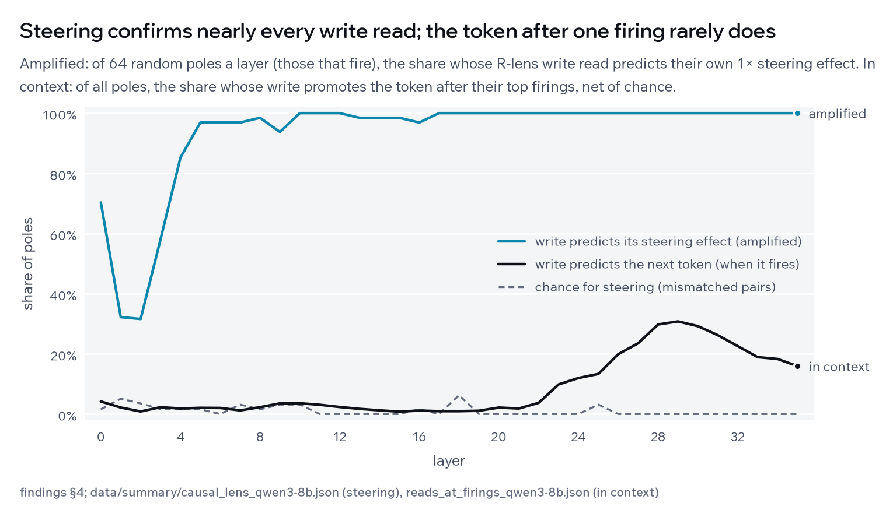

**Per-context linearization** (`checks/context_linearity.py`; one H100, fp32 with TF32 matmuls). §3's random poles at
their top firings, the strongest position in each of their 24 top documents, scored where they fired at least twice
(2,290 of 2,304 poles). At each firing, one batch of four rows multiplies the neuron's activation `a` there by 1, 0, 1.25
and 0.75: the effect of removing the firing (clean − removed) and its first-order effect `a·∂logp/∂a` (the central
difference of the last two, over 0.5), each a change in log-probabilities summed over the firing position and the next 8.
Correlations are Pearson r over the kept tokens; per-firing values are a pole's median over its firings, and the table
gives medians over poles. "One context vs the pole's other 23" compares a firing's first-order effect with the mean of the
pole's other firings'; steering is §3's at 1×.

| band | removed vs first-order | one context vs the pole's other 23 | lens vs one context | lens vs the mean of 24 | steering vs the mean firing effect | steering vs lens |
|---|---|---|---|---|---|---|
| sensory L0-L3 | 0.69 | 0.04 | 0.02 | 0.06 | 0.05 | 0.22 |
| association L4-L8 | 0.96 | 0.06 | 0.04 | 0.13 | 0.10 | 0.48 |
| workspace L9-L20 | 0.98 | 0.10 | 0.07 | 0.23 | 0.24 | 0.70 |
| motor L21-L35 | 0.99 | 0.57 | 0.42 | 0.72 | 0.73 | 0.97 |

Every control (another pole's values) is within 0.01 of zero.

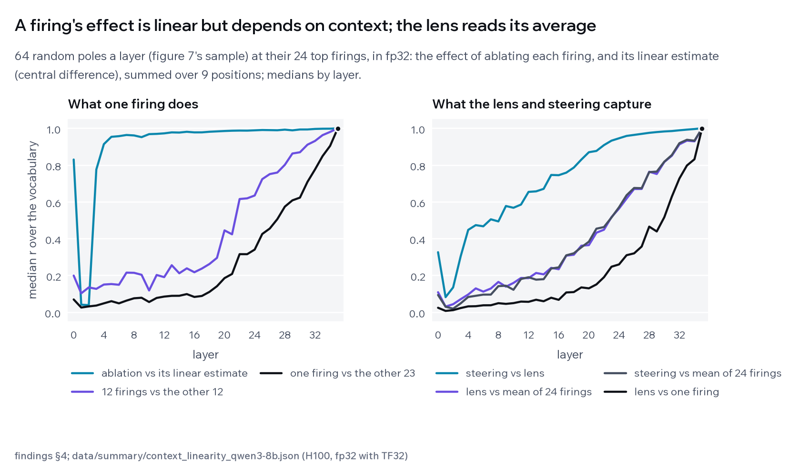

- **A firing's effect is close to linear:** removing it does what its first-order effect says (0.96-0.99 from L4; 0.69 in
  the sensory band, where L1-L2's poles barely fire and sit at the precision floor).
- **Before L21 a pole's firings don't predict each other.** The same pole firing equally hard pushes the logits different
  ways in different contexts: one context's effect correlates with the mean of its other 23 at 0.04-0.10 by band, and 12
  contexts against 12 others reach only 0.14-0.24. In the motor band it is 0.57, and from L28 the effect is nearly the same
  everywhere (0.78; 0.94 split-half).
- **The lens reads the shared part.** Against one context, the weight-only read gets two thirds to three quarters of the
  correlation the pole's own other firings get from L4 (0.67-0.78 of it by band; 0.42 in the sensory band's noise).
- **Lens and steering agree with each other, not with firings.** Before L21 the lens predicts steering at 0.22-0.70 by band,
  while steering predicts the pole's mean firing effect at 0.05-0.24. In the motor band all agree (0.97 and 0.73).
- **Precision matters.** In bf16 a weak pole's write partly rounds away in the residual: on five test neurons, removed
  against first-order was r 0.05-0.77 in bf16 and 0.83-0.99 in fp32.

**What this means.** The lens and steering agree because both average over contexts. Before L21, what a pole does at one
firing is mostly specific to that context, which no single vector, from a lens or from steering, can carry; the pole's own
other firings predict it little better than the read does, so this is a fact about the model and not the lens. A write
read is the pole's average push. A firing is one context's share of it, and from L28, where the context stops mattering,
the two agree.

**Limits.** 32 random neurons a layer; a 9-position window misses later effects; Pearson r weighs all tokens alike; TF32
makes weak early poles' values lower bounds.

### §5. Prediction and suppression

**Setup** (`checks/side_agreement.py`; no model). For each pole's top firings, the token after
the peak. **Predict:** the share of firings whose next token is in the write read's top 10.
**Suppress:** the same for its bottom 10 (the opposite pole's top 10). Control: a random pole of the
same layer and sign.

| layer | predict (control) | poles past ⅓ | suppress | poles past ⅓ |
|---|---|---|---|---|
| L8 | 0.006 (0.004) | 0.00 | 0.003 | 0.00 |
| L16 | 0.007 (0.005) | 0.00 | 0.005 | 0.00 |
| L22 | 0.013 (0.001) | 0.01 | 0.003 | 0.00 |
| L26 | 0.030 (0.000) | 0.02 | 0.003 | 0.00 |
| L28 | 0.057 (0.000) | 0.05 | 0.003 | 0.00 |
| L30 | 0.061 (0.000) | 0.06 | 0.005 | 0.00 |
| L32 | 0.049 (0.000) | 0.05 | 0.009 | 0.01 |
| L34 | 0.034 (0.000) | 0.03 | 0.036 | 0.04 |
| L35 | 0.030 (0.001) | 0.02 | 0.061 | 0.08 |

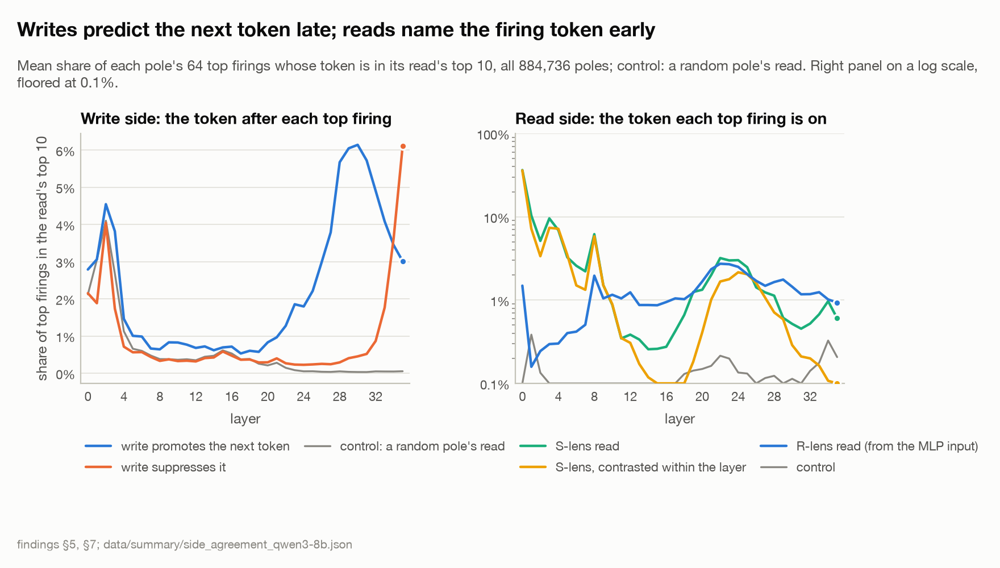

- **Late poles fire on the token before a word their write promotes:** "is⟦ once⟧" → *again* (L30
  n1034 +), "⟦arist⟧" → *-ocracy* (L28 n8868 −). Prediction rises from L20 and peaks at L28-L31, where
  5-6% of poles have more than a third of their top firings followed by a token they promote (control
  under 0.1%).
- **Suppression starts at L32 and overtakes prediction at L34.** This is the pattern Gurnee et al.
  (2024) found in GPT-2 from weight statistics, here measured from activations.
- **Their weight classifier picks the same poles.** Among L24-L35 poles in the top 10% of kurtosis of
  their logit-lens logits, positive skew ("prediction") gives 20% of firings before a promoted token
  (other poles 3%), and negative skew 13% before a bottom-10 token (0.7%).
- **Two signs of one neuron.** Skew flips sign between a neuron's poles, so each high-kurtosis neuron
  has a promoting pole P and a suppressing pole S:

  | layer | P predicts (> ⅓) | S suppresses (> ⅓) | `act_top` P / S |
  |---|---|---|---|
  | L28 | 0.32 | 0.01 | 41 / 16 |
  | L30 | 0.41 | 0.02 | 62 / 23 |
  | L32 | 0.30 | 0.04 | 62 / 31 |
  | L34 | 0.08 | 0.39 | 48 / 54 |
  | L35 | 0.14 | 0.59 | 44 / 68 |

  Through L32 the promoting pole fires harder; from L34 the suppressing one. In SwiGLU, prediction and
  suppression neurons are not two kinds of weights but two signs of one neuron, and a weight-only
  classifier needs the activation statistics to say which a neuron is.

**Limits.** An exact token in a top 10 is strict (" par" against "airs" after "P" is a miss), so these
shares are lower bounds. A bottom-10 token is a directional association, not a measured suppression
after later layers.

### §6. What a write adds beyond what it reads

If MLPs mainly amplified what attention brings them, a neuron's write would point along what it reads. [Matthew
Khoriaty](https://www.lesswrong.com/users/matthew-khoriaty) questioned that, and suggested reading the part of an output
orthogonal to its input.

**Setup** (`checks/write_parts.py`; Qwen3-8B, MPS, fp32). Weights, 512 random neurons a layer: the cosine of a neuron's
write with its gate and up rows, and the top 12 of the R-lens read of the write, orthogonal to the read direction `â ± b̂`
or to the whole gate-up plane (`neurons.orthogonal_write`). Census, §3's random picks, 16 neurons a layer at even layers
L4-L34, both poles (511 live poles): the pole's write added at positions 16+ of 16 documents at 1× `act_top` (§3's
protocol), split into the part along `â ± b̂` and the rest; and removing the same parts of real firings (8 top firings, 8
positions after each). Blind Sonnet ratings of two token lists per pole (same concept, related but distinct, different, or
unclear for lack of a theme), with shuffled pairs mixed in; the second rater judged the orthogonal-to-read-direction list
and the orthogonal-to-plane list for the same poles together. Pairs, keys and ratings are in `data/summary/write_parts/`.

| layer | `cos(w, up)` | `\|cos(w, gate)\|` | the write's top 12 kept when orthogonalized to the plane: Euclidean / in the metric |
|---|---|---|---|
| L6 | +0.35 | 0.06 | 0.57 / 0.27 |
| L10 | +0.55 | 0.13 | 0.44 / 0.14 |
| L14 | +0.45 | 0.14 | 0.46 / 0.19 |
| L18 | +0.29 | 0.20 | 0.49 / 0.25 |
| L22 | +0.26 | 0.14 | 0.53 / 0.37 |
| L26 | +0.12 | 0.09 | 0.75 / 0.68 |
| L30 | −0.02 | 0.06 | 0.85 / 0.84 |
| L34 | −0.17 | 0.05 | 0.69 / 0.70 |

- **The self-alignment is with `up`.** Through L14 a neuron's write leans on the direction its `up` row carries; the gate
  row's cosine is small. At L18-L22 the two sizes close; by L30 the `up` alignment is gone, and it reverses at the last
  layers. Subtracting only the read direction leaves half of this in, which is why the catalog removes the plane.
  `cos_write_up`, `cos_write_gate` keep it per pole.
- **Effect sizes.** Steering, medians over layer ranges: the orthogonal part's effect is 84-100% of the whole write's, the
  along-read part's 8-34%; `r(whole, orth)` 0.94-1.00. `r(along, orth)` is about 0 at every depth, but any two orthogonal vectors would
  tend to that, and no random-split control was run.
- **Meaning, blind.** Orthogonal part against the pole's own read, per rater, among 240 real poles (same / related /
  different / unclear): rater 1, L4-L20 18/5/5/116, L22-L34 10/24/5/57; rater 2, L4-L20 16/8/18/102, L22-L34 10/22/6/58;
  orthogonal to the plane (rater 2), 18/8/14/104 and 10/21/6/59; shuffled pairs 0/3/6/51 and 0/0/16/44. The move to a
  related concept from L22 replicates; before it the part is as often unrelated as the same concept, and rarely related.
  Removing either part of real firings is too noisy for this: 83% of those lists are unclear.
- **Which kind of related.** Some late pairs are concept shifts (L22 n1988 +: faced, confronted → trying, navigating);
  others are collocates of a next word (L30 n165 +: dismantle → apart). `L21 n1180 −` reads *women* and writes women, wives
  and husbands; with what it reads removed, its write reads parenting, childbirth and family education (育儿, 生育, 家庭教育).
- **In the residual's metric** (§15). The measurements above split the write in the raw basis, removing the parts along
  the gate and up rows themselves. The catalog's `write_orth_*` remove the rows as vectors, `s² ⊙ a` and `s² ⊙ b`
  (`neurons.orthogonal_write`): still a write neither row reads, with a different part taken out. The cosines move by 0.02
  at most, but the rest of the write keeps less of what the whole write's R-lens read names through L22 (the last column,
  over every `+` pole), and the two splits agree from L26. The massive-activation coordinates, where `s²` reaches 10⁵× its
  median, don't cause it: clipping `s²` at its 99th percentile changes the kept share by 0.02 at most. In the census,
  `write_orth_R` passes for 23% of L28-L35's poles (Euclidean: 25%; §8). The steering and blind ratings were not rerun
  with the metric's split.

**How much a pole amplifies** (`parallel`, `orthogonal` in the `firings` table, `17_firings.py`; design.md): the factor a
firing adds along what its neuron reads, and what it adds off that direction, on the same scale. Medians over poles that
aren't quiet, Qwen3-8B by band (sensory, association, workspace, motor): `parallel` +0.13, +0.51, +0.35 and 0.00 (below
zero for 24%, 6%, 17% and 50% of poles), `orthogonal` 1.1-3.0. Association and workspace poles amplify the part they read;
motor poles split evenly, and the last layers suppress it mildly (L28-L35: −0.06, 71% below zero). Gemma 4 by band
(association, workspace, motor): `parallel` +0.06, +0.20, +0.02 (below zero for 36%, 20%, 39%); its `orthogonal`, 12-56,
carries the post-MLP norm's weights and doesn't compare across models. In
high dimension any write sits mostly off a given direction, so the sign and size of `parallel` are the informative part;
no random-direction control was run.

**Reads at the firings.** The same table reads what the residual holds where a pole fires (`before`), the layer's MLP
output there (`mlp`) and the model's prediction (`pred`). Of the top 16 tokens a pole's steering promotes, the share in
each read's top 16 (`checks/firing_reads.py`; controls 0.03 or less), in the motor band: Qwen3-8B `write_R` 0.72,
`mlp_R` 0.20, `before_R` 0.05; Gemma 4 12B 0.66, 0.14, 0.06. A read of the residual after the layer, the sum of `before`
and `mlp`, lands between them (0.09-0.11 at Qwen3-8B's L21-L35), so the table doesn't keep it.

**Limits.** One model; a rater per comparison and many unclear lists, so the counts describe poles legible on both sides.
The read direction is a heuristic, and the lens read of a pole's input at early layers is uninformative for many (§7).

### §7. The input side

Early neurons are best read from what drives them. This section asks which weight-only read names those tokens, at which
depth.

**Setup.**
- **The reads** (`08_reads.py`) of a pole's read direction `c = â ± b̂`: `read_S`, the S-lens to the MLP input, scores
  token `v` by `c · K_L (W_E[v] − mean(W_E))` (which input tokens drive the pole); `read_R`, the R-lens from the MLP input
  (what the residual says when it drives the pole), of the read direction made a vector by the residual's metric (§15);
  each also layer-contrastive (`_z`). Gate and up rows are nearly orthogonal (median cosine 0.00 ± 0.005 at every layer,
  except L2), so each pole has a distinct direction.
- **Exact drivers** (`07_drivers.py`): every kept token at position 24 of 8 real documents (4 web, 2 code, 2 chat),
  followed by the documents' own next 16 tokens; per pole, the 64 tokens with the largest activation at the token, and
  summed over the 16 after. An fp32 rerun through L9 shares 98-99% of a pole's top 20 on average at the token (94-99%
  summed; `checks/drivers_precision.py`); later layers are unchecked.

**Early neurons are token-family detectors.** Exact drivers of random early poles:

| pole | exact drivers |
|---|---|
| L0 n1208 − | 阔, 开阔, 开拓, 广阔, 宽阔 ("wide", "open up") |
| L0 n11206 − | 出生, 出行, 出入, 出门, 出土 (words starting with 出) |
| L1 n7735 + | 少年, 少女, 少量, 少许, 少数 (words with 少) |
| L1 n11672 − | 德国, german, Germany, German, Germans |
| L2 n6890 + | Whitney, Courtney, Chelsea, Kendall, Shelby, Lindsay |

**The S-lens names them from the weights, through L8.** Share of each read's top 10 among the pole's 20 exact drivers
(control 0.003 or less; `checks/side_agreement.py`):

| layer | `read_S` | `read_S_z` | `read_R` |
|---|---|---|---|
| L0 | 0.32 | 0.34 | 0.013 |
| L1 | 0.11 | 0.10 | 0.001 |
| L4 | 0.11 | 0.13 | 0.005 |
| L7 | 0.03 | 0.02 | 0.011 |
| L8 | 0.06 | 0.07 | 0.042 |
| L9 | 0.02 | 0.03 | 0.037 |
| L12 | 0.004 | 0.004 | 0.044 |
| L16 | 0.002 | 0.002 | 0.028 |
| L20 | 0.011 | 0.013 | 0.036 |
| L24 | 0.032 | 0.050 | 0.073 |
| L29 | 0.009 | 0.026 | 0.081 |
| L35 | 0.002 | 0.008 | 0.027 |

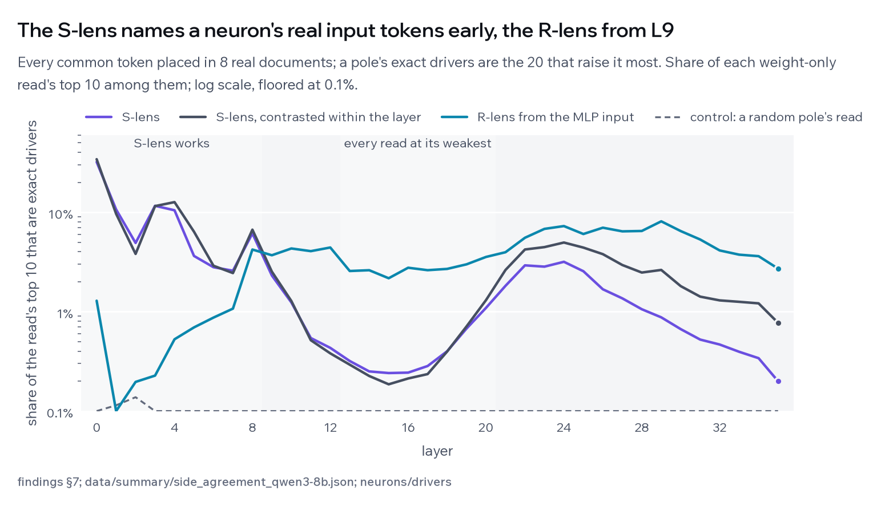

- **L0-L4:** `read_S` names exact drivers (32% of its top 10 at L0, 5-12% at L1-L4), and at L0 the peak token of 36% of
  top firings (another pole's read: under 0.1%); the R-lens read of the same direction almost none. At L1-L8 the S-lens
  read names 2-10% of peak tokens, against under 0.5% for the R-lens read (2% at L8).
- **L8 is the crossover:** both reads name drivers (the S-lens 6-7%, the R-lens 4%), and a pole's S-lens, R-lens and write
  reads share the most tokens (0.15-0.32 tokens of their top 10s on average; control 0.002 or less).
- **From L9 the R-lens read names more:** 4% at L9-L12, 6-8% at L22-L30. On the input side too, the R-lens takes over
  where the S-lens stops.
- **L13-L20 shares the fewest tokens with the exact drivers** (2-4% for the R-lens read). The drivers are also at their
  weakest there: the strongest single-token swap reaches a median 11% of a pole's typical firing in the workspace band
  (L9-L20), against 66% in the sensory band, 27% in association and 19% in motor (`checks/driver_reach.py`; Gemma 4: 10% in
  its workspace band, 48% in association, 31% in motor), so a low share in this stretch says little about either.
- **Past L8, raw S-lens reads are swamped by hub tokens** (rare CJK, spam-cluster and code pieces shared by most poles).
  `read_S_z` recovers concepts (L10 n9952 +: glaciers, terrain, 公里 "km", Mountains; L30 n2310 +, a "green" neuron: 繁殖
  "breeding", Lawn, rooting) but gives up the literal peak token, so both columns are kept.
- **Read and write often name one concept** from the middle on: L8 n1931 + reads 圣经 (Bible), 基督教, 信仰 (faith) and
  writes 圣经, 基督徒, Bible; L20 n2281 − reads else, 否则 (otherwise) and writes else, otherwise; L32 n2407 + reads 斗争
  (struggle), fight and writes fight, fighting, 战斗.

**Early neurons write back what they detect.** `write_S` reads a write through the S-lens to the layer's output: which
input token would put the write there (through the lens's polar factor, §15). It shares 1.73 tokens of 10 with the pole's
exact drivers at L0 (control 0.002), 0.20-0.44 at L1-L4, 0.11-0.27 at L5-L8 and 0.01-0.03 at L11-L18, then 0.10-0.19 again
at L21-L25 (control 0.003; the Euclidean read 0.02-0.04 there). L0 n1649 −, which fires on `ain`, writes `ain | ains |
AIN | aine | strain`, where its R-lens write read is `... | ..." | the`. MLP0-MLP8 in effect act as an extended embedding.

**On SiLU's negative lobe a pole reads its up row** (`checks/lobe_reads.py`). At L1-L3, 49-78% of top firings ride SiLU's
negative lobe (the gate below zero; 14% at L4, 2% or less from L5). SiLU is nearly flat there (its floor is −0.28; Gemma
4's GELU has the same shape), so the activation follows `up`, and which way of the gate raises it varies from pole to pole:
`â ± b̂` points the wrong way. For active poles with `neg_lobe` (`acts`) past a half, the rank of a pole's most frequent
firing token in its S-lens read, among the kept tokens (50 is chance), is 16-48 at Qwen3-8B's L0-L4 and 40-61 at Gemma 4's
L0-L10 with `â ± b̂`, 52-84 and 39-60 with its negative, and 71-81 and 63-82 with the up row alone, `∓b̂`, which the
catalog uses (`neurons.read_rows`); ordinary poles reach 69-95 and 75-95 with `â ± b̂`. The edges agree (§12): with
`â ± b̂`, an edge's push ranks the upstream neurons' contributions at Spearman −0.27, −0.61 and 0.52 at L1-L3, and with the
up row at 0.80, 0.77 and 0.80 (0.86-0.91 from L4).
- **The reads stay hard to interpret by eye.** In `read_S_z` at Qwen3-8B's L1-L4 a firing token is in the top 64 for 9-19%
  of such poles with the up row (8-17% with `â ± b̂`), against 47-73% for ordinary poles; of 30 random such poles, 1-3 have
  a firing token in their top 16. L0 is the exception (71% with the negative of `â ± b̂`, 20% with the up row).
- **Many are faint shadows of the neuron's other pole,** with the same up row and a shut gate: their `act_top` is a median
  0.24 of the other pole's in Qwen3-8B (0.70 in Gemma 4; 1.05 and 1.03 for ordinary poles), though about a quarter are the
  larger pole. L0 n3228 is one: its − pole is a clean 十 neuron (`act_top` 7.9; pushed at that size it raises what follows
  a number, `-year`, `-month`, 月份), and its + pole (0.31) fires on byte fragments sharing 十's bytes, its up row reading
  十. Label cards mark such shadows.

**Why the S-lens read fades: a token's effect is mostly nonlinear past L0** (`checks/s_linearity.py`; 96 tokens swapped
in at position 16 of 4 documents, MPS, fp32). R² of each predictor against the token's exact footprint on the MLP input,
at its own position and summed over later ones:

| layer | own position: exact linearization in context (true / RelP) | S-lens | embedding | summed: RelP linearization | S-lens |
|---|---|---|---|---|---|
| L0 | 0.86 / 0.86 | 0.63 | 0.51 | 0.56 | 0.50 |
| L1 | 0.30 / 0.33 | 0.20 | 0.08 | 0.30 | 0.28 |
| L5 | 0.12 / 0.15 | 0.09 | 0.03 | 0.07 | 0.06 |
| L15 | 0.07 / 0.17 | 0.10 | 0.01 | 0.02 | 0.02 |

- Even the exact linearization in the token's own context explains 86% of its footprint at L0 but 30% at L1 and 7% at
  L15: swapping a whole token is far outside the regime of local linearizations past L0's MLP (this bounds local
  linearizations, not every possible linear map).
- On the summed footprint, the quantity it estimates, the S-lens does about as well as that per-context linearization:
  averaging over contexts and summing over positions cost little.
- RelP beats the true derivative from L1 (0.17 against 0.07 at L15).
- **But nonlinearity does not explain the fall after L8.** The linear share is flat from L4 to L17 (R² about 0.10), while
  the S-lens read's driver hits peak at L8 and fall by L11. The cause is open (candidates: read-write alignment, the norm
  weight's selectivity, how much context L8 neurons use).

**Limits.** Drivers are measured at one position of 8 contexts. The S-lens footprint averages over contexts, so it reads
a direction on average: on the Qwen3-0.6B prototype a pole's exact top 20 tokens of 6,000 were 70% right at L0, 25% at L1
and about 0% from L5. The negative-lobe reads are tested on the S-lens only.

### §8. What each read names, and which read to use where

`checks/reads_at_firings.py` counts how often each weight-only read names what can be counted around a pole: the token
under each top firing, the token after it, and its exact drivers (§7). These targets are narrow, and a firing is one
context summarized by a token: a pass says a read names that target, a miss doesn't make the read wrong, and the shares
describe the reads at each depth, not single poles. The catalog keeps no per-pole test.

**Setup.** For each of the 884,736 poles, with its 64 top firings and 64 exact drivers:
- `read_S`: the mean layer-contrastive z of the peak tokens, under the read direction's S-lens read;
- `read_R`: of the exact drivers, under its R-lens read;
- `write_R`: of the tokens after the firings, under the write read; `write_S`: of the peak tokens, under the write's S-lens
  read; `write_orth_R`, `write_orth_S`: as the write's, for the write orthogonal to the neuron's gate and up rows (§6);
- p-values against mismatched pairs (another pole of the layer and sign, on this pole's tokens); Benjamini-Hochberg over
  the layer's poles at a 5% false discovery rate; *net of chance* is the share past the mismatched pairs' 99th percentile
  minus their own share;
- token modes: a third of the firings share one peak token, or one next token (`acts`' `cur_mode`, `next_mode`);
  near-silent: `act_top` under 0.05, not scored.

| band | `read_S` | `read_R` | `write_R` | `write_S` | `write_orth_R` | `write_orth_S` | token mode | next-token mode | near-silent |
|---|---|---|---|---|---|---|---|---|---|
| sensory L0-L3 | 0.35 [0.30] | 0.04 [0.05] | 0.00 [0.02] | 0.18 [0.17] | 0.00 [0.01] | 0.14 [0.13] | 0.27 | 0.05 | 0.40 |
| association L4-L8 | 0.25 [0.22] | 0.09 [0.10] | 0.00 [0.02] | 0.10 [0.11] | 0.00 [0.01] | 0.03 [0.05] | 0.25 | 0.05 | 0.02 |
| workspace L9-L20 | 0.01 [0.03] | 0.16 [0.16] | 0.00 [0.02] | 0.01 [0.03] | 0.00 [0.01] | 0.00 [0.01] | 0.09 | 0.04 | 0.00 |
| motor L21-L35 | 0.03 [0.04] | 0.27 [0.24] | 0.19 [0.18] | 0.02 [0.03] | 0.14 [0.14] | 0.00 [0.01] | 0.18 | 0.09 | 0.00 |
| all | 0.09 [0.09] | 0.18 [0.17] | 0.08 [0.09] | 0.04 [0.06] | 0.06 [0.06] | 0.02 [0.03] | 0.17 | 0.06 | 0.05 |

Shares of poles passing at 5% FDR, band means over layers; net of chance in brackets.

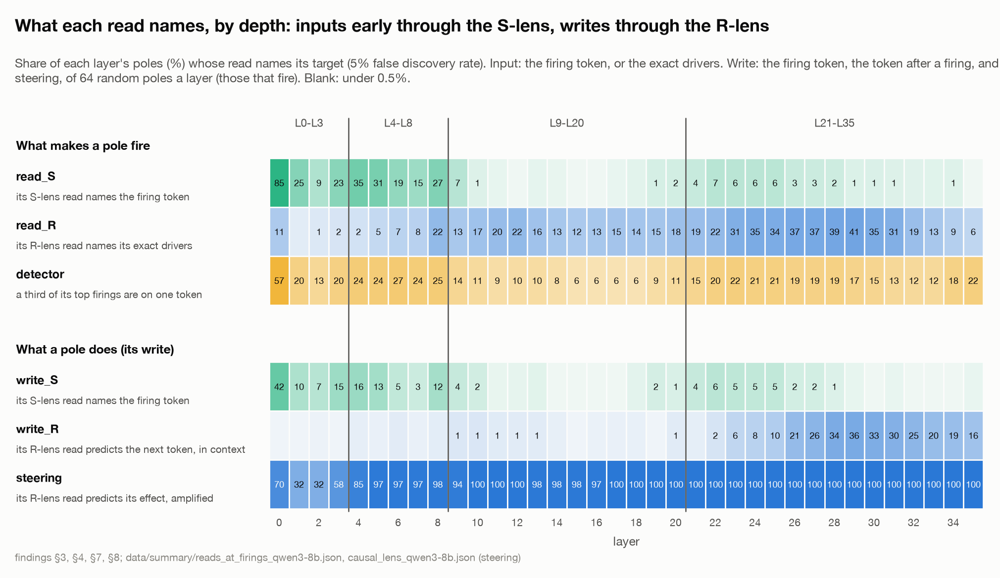

- **Each read names its target at its own depth.** `read_S` passes for 85% of poles at L0 and 23-35% at L1, L3 and L4 (L2:
  9%, since 61% of its poles are near-silent), and almost none at L10-L20. `read_R` names exact drivers for 12-18% of poles
  at L13-L20 and 31-41% at L27-L31 (44-51% with a Euclidean read; §15). `write_S` passes for 18% of the sensory band's poles and 10% of
  association's, nearly always together with `read_S`: early neurons write back what they detect (§7). `write_R` passes from L23, most at
  L28-L29 (30-31% net), and the part of a write off what the neuron reads holds nearly as well there: `write_orth_R`
  passes for 23% of L28-L35's poles, against 27% for the whole write (§6).
- **The token after a firing is a narrow target for a write.** A write read that misses it can still predict the pole's
  steering effect, as 94-100% do from L5 (§3), and before L21 a pole's firings don't predict each other (§4).
- **The token under a firing is a narrow target for a read.** An R-lens read reads forward: L30 n7004 + fires on ` play`
  and reads *role*, and L30 n2003 + fires on ` is` and ` way`, before ` too`, and reads *too*. And the token is rarely what
  drives the firing: the embedding's direct share of an activation is under 0.5% from L7, the rest coming through heads
  and earlier neurons (§12). L16 n101 + peaks on ` alone` and commas and reads *group, 团队, 小组*; L31 n1492 + fires on
  spaces and commas and reads *用电, 电路, electric*.
- **Exact drivers are a token-level target too.** They swap one token at one position of 8 documents, and in the workspace
  band the strongest swap reaches a median 11% of a typical firing (§7). A concept carried by the surrounding text has no single
  token to find.

**Signal holds to rank 64** (`checks/rank_depth.py`; nine layers). Per rank, the share of poles whose token at that rank
shows up after a top firing (writes) or at the peak (reads), against a mismatched pole. Ranks 49-64 still run several
times above chance for most reads (L28's write read 22×, L12's `read_R` 9×), at a tenth to a half of a top-8 token's rate.
The exception is the plain write read before L21 (1.0-1.7× at ranks 49-64), hub tokens at every rank; its `_z` read keeps
signal there from L8 (3-5×). Gemma 4's late write reads hold the same way (L36-L40: 25×). The catalog keeps the top 64.

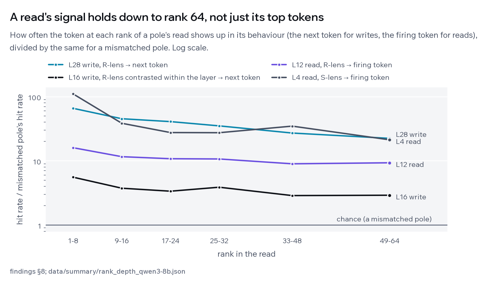

**The reading plans** (`checks/depth_reads.py`, `arch.PLANS`). Token hits are one guide to which read to trust; whether a
read is coherent is another. For each labelled model, 15-16 layers spread over the depth and around its transitions, 8
random firing poles a layer, the eight weight reads shuffled under neutral names: two raters of different lineages (Claude
Opus and Codex) rated each list's coherence (0-2) and, for input reads, whether it agrees with the pole's five contexts
(0-1). They agreed closely: Pearson 0.83-0.90 over 1,024 lists a model, the same score for 80-87%. A model's reading plan
takes the most coherent read at each depth: the S-lens input read in the first layers, the R-lens input read after, and the
R-lens write read everywhere, which also predicts steering (§3, §19). The label cards show the plan's reads (§13).
- **Coherent is not the same as matching the contexts.** Gemma 4's R-lens input read rates 1.0-1.9 at L0-L18 but agrees
  with the contexts for 0-38% of poles there. Its themes are each pole's own (another pole of the layer shares under 1% of
  its first 24 tokens): British spellings or Spanish names on poles that fire on punctuation and possessives. A read can
  name what drives a pole through a concept, a style or a script that five firings don't show (§4), so agreement didn't
  decide the plans.
- **The census's weak band reads well.** At Qwen3-8B's L13-L20, where few reads name the exact firing token or drivers
  (above), the R-lens reads rate 1.0-1.9 and the write reads 1.6-1.75, among the most coherent of any depth.
- **Where the census differs, the plans follow coherence.** Through L8, `read_S` names Qwen3-8B's firing token more often
  than `read_R` does, though from L4 the R-lens read is the more coherent list.

**The depth bands** (`arch.depth_bands`, `data/summary/depth.json`). The plans' edges cut each model into the bands every
summary, label check and the site use. *Sensory*: the input read is the S-lens's. *Association*: the R-lens's, which often
names an associated concept. *Workspace*: the R-lens's, without that line. *Motor*: from where writes often name the next
word, Qwen3-8B's L21 (its writes name the next token from about L23, above) at the same relative depth in the other sizes,
and Gemma 4's L33 (§15). Motor holds where it starts first, and a base model takes its post-trained model's bands:

| model | sensory | association | workspace | motor |
|---|---|---|---|---|
| Qwen3-0.6B | L0-L5 | L6-L8 | L9-L15 | L16-L27 |
| Qwen3-1.7B | L0-L9 | L10-L15 | | L16-L27 |
| Qwen3-4B | L0-L5 (`read_S_z`) | L6-L8 | L9-L20 | L21-L35 |
| Qwen3-8B | L0-L3 | L4-L8 | L9-L20 | L21-L35 |
| Qwen3-14B | L0-L8 | L9-L11 | L12-L22 | L23-L39 |
| Gemma 4 12B | | L0-L19 | L20-L32 | L33-L47 |

For a single Qwen3-8B pole, weigh the sides together: the S-lens input read and `write_S` through L8, the R-lens input
read from L4 (`read_S_z` as a concept view), exact drivers and top contexts beside them at L13-L20, and the R-lens write
read for steering from about L4, the next token from about L23 and suppression from L32 (§5). Say which side a description
rests on.

**Limits.** The tests are token-level, so a read of a concept that shows in no single token scores low. Exact drivers come
from one position of 8 documents. Each pole must clear the FDR on its own evidence; net shares count weak cases in
aggregate. A third of firings is a chosen threshold. Only the plans' input edges were rated, each to within a rated layer
or two, by two raters on 8 poles a layer: a qualitative check, not a measurement of every pole. Ratings and keys are in
`data/summary/depth_reads/`.

## III. Units in context

Neurons that act through the residual's geometry rather than its vocabulary (§9), attention heads read as neurons are
(§10, §11), and what feeds a unit when it fires (§12).

### §9. Attention sinks, the output's temperature and entropy neurons

The largest activations in the model all act through two residual dimensions that the output ignores.

**Setup.** `checks/entropy_neurons.py` (ablations on 16,128 positions of 128 web, code and chat
documents; MPS), `checks/sinks.py` (128 documents with 65 distinct first tokens; position 0 sees only
its own token, so its values count each first token once) and `checks/external_crosscheck.py --sink`.

**Two dimensions set the output's temperature.** The final norm's weight is about 1e-4 on residual
dimensions 1838 and 2276 (median 2.0 elsewhere), so writes there move no logit directly. But they hold
64% of the final residual's squared norm at the median position, so they set the norm the final RMSNorm
divides by: the final RMS is 24.2 at the median and would be 14.6 without them. Writing to them
rescales every logit.

**The attention sink at position 0.** Three L6 neurons (n5723 +, n8518 −, n422 +) fire at up to 10,752
at the first position and write 95-96% of their squared norm onto dimension 2276, raising the
residual's norm from 44 to 12,091 (the three Muyu He reported, here with their poles). Later
layers' heads attend to that position by default. The trigger is layer 0's MLP output at position 0:

| at position 0 | L6 n5723 | first tokens with a sink | attention on position 0 at L9 / L21 / L33 | loss on token 2 / tokens 3+ |
|---|---|---|---|---|
| clean | 5,664 | 100% | 0.63 / 0.49 / 0.77 | 2.95 / 2.40 |
| L0's MLP zeroed | 39 | 38% | 0.03 / 0.04 / 0.03 | 8.02 / 2.74 |
| L0's MLP given the same token's output at position 1 | 262 | 17% | 0.54 / 0.42 / 0.66 | 6.05 / 2.56 |
| L0-L5's MLPs zeroed | 0 | 0% | 0.01 / 0.00 / 0.00 | 8.80 / 3.06 |
| L0's top 300 neurons (by attribution) zeroed | 4,016 | 95% | 0.61 / 0.48 / 0.75 | 3.23 / 2.43 |
| control: L0's MLP zeroed at position 5 | 5,664 | 100% | 0.62 / 0.49 / 0.76 | 2.95 / 2.43 |

- **Without L0's MLP at position 0 the sink mostly fails** and attention to position 0 collapses.
- **It is the MLP's response to being first,** not a few neurons: L0's top 300 neurons removed, the sink
  still forms for 95% of first tokens.
- **A smaller sink suffices:** halving it (zeroing L5) leaves the attention unchanged.

**A second sink on the year after a date.** Three L16 neurons (n2271 +, n1875 +, n1756 +; up to 5,984)
write 96-99% onto the same dimension at the first digit of a year ("Tuesday, May 7, ⟦2⟧013"), which
carries about 15,000 there by L20. The same massive activation appears on `__` in `from __future__`
and on position 1 of code files. Pooled over these 22 positions, later tokens attend to them from L9
as much as to position 0 (0.34 against 0.35 at L9; 0.48 against 0.38 at L30). Four L34 poles (n6620 +,
n3471 +, n8468 +, n3508 +) clear the activation before the output: at 11 year-digit and `__`
positions, n6620 + cuts the final RMS by 68%, lowers the output's entropy by 9.7 nats and the loss by
19.0; without them the output there is close to uniform. Massive activations fading in the last layers
matches Sun et al. (2024). Position 0's sink is halved by L34-L35, not cleared; the final norm divides
it away.

**Entropy neurons.** Stolfo et al. (2024) found last-layer neurons that act through the final norm's
scale. Freezing the scale at its clean value separates that path from the direct one.
- **L35 n9510 + raises entropy where the next token is hard to guess.** It is always on (median 268)
  and fires hard at 3.5% of positions: hashes, IDs and version numbers ("jsessionid=⟦0⟧000"). There
  it raises the final RMS by 9% and the entropy by 0.19 nats, though its direct effect alone would
  lower it by 0.21; it lowers the loss by 0.07 (the hedge pays).
- **L35 n9346 + does the opposite** on near-determined continuations ("Esch⟦ich⟧ia",
  `codecs⟦.char⟧map`): the largest L35 write (98% in the null space) cuts the final RMS by 31% and
  entropy by 1.58 nats, all through the scale (frozen: −0.02).
- **At L32-L33 no candidate acts mainly through the scale** (8 per layer by null-space write at typical
  activation, against 8 random).

**For the catalog.** These poles' lens reads are uninformative: the lenses keep only a direction, and
the readout ignores the two dimensions where these poles act. Their descriptions rest on activations
and on this measurement; `null_share` flags them only together with the activation scale.

**Limits.** 16,128 positions, and the second sink's clearing rests on 11 positions. Poles are ablated
one at a time, though the four L34 poles fire together. The sink share uses a cutoff (|dim 2276| over
2,000 after L6; clean, about 12,000), and under the position-1 swap four first tokens land within 15% of
it, among them the chat template's `<|im_start|>`, which crosses it with the batch size and the device; the table counts
distinct first tokens, each once, and `checks/sinks.py` lists the four.

### §10. Attention heads: circuits read token by token

A head moves information between positions: its QK circuit decides which earlier position it reads,
its OV circuit what it writes from there. Both can be read from the weights over the whole vocabulary,
one token at a time.

**Patterns** (`06_activations.py`, eager attention). Sink, previous-token and self attention from
queries at 16+; induction and duplicate-token scores from 64 sequences of 64 random kept tokens said
twice. Qwen3-8B copies such a sequence almost perfectly (13.55 nats a token on the first copy, 0.09 on
the second). It has 33 induction heads (score past 0.3; strongest L13h13 0.99, L22h23 0.97), 33
duplicate-token heads, mostly early (L1h31, L1h28, seven in L3), 4 previous-token heads (L0h1, L1h4,
L19h20, L12h0) and 16 sink heads (past 0.9; none before L7). Removing one head at a time
(`checks/head_patterns.py`) costs the second copy at most 0.07 nats (L1h28): copying is spread over
many heads, as is usual in large models. Duplicate-token heads cost as much as induction heads but copy
almost nothing; they likely write a marker that the token was seen.

**Where to read a head.** A head reads layer `L − 1`'s output and writes into layer `L`'s MLP input,
so its token map is read between those points. A token at its input can be its S-lens footprint (the
position holds token `v`) or its R-lens direction (the position says `v`); its output can be read with
the R-lens (the write makes the model say `u`) or the S-lens (the residual looks as if `u` were there).
`checks/head_lens_sides.py` tests the four brackets at each head's 64 top firings (61,774 firings from
L1): how well a target token's weight-only copy score predicts its rank in the head's actual output,
own head minus another head of the layer. The target is the attended token for an S-lens input, and
the token after the attended position for an R-lens input:

| band | S→R | S→S | R→R | R→S |
|---|---|---|---|---|
| sensory L1-L3 | +0.26 | +0.49 | +0.03 | +0.07 |
| association L4-L8 | +0.45 | +0.39 | +0.03 | +0.11 |
| workspace L9-L20 | +0.24 | +0.18 | +0.04 | +0.05 |
| motor L21-L35 | +0.74 | +0.14 | +0.30 | +0.11 |
| all | +0.52 | +0.23 | +0.13 | +0.09 |

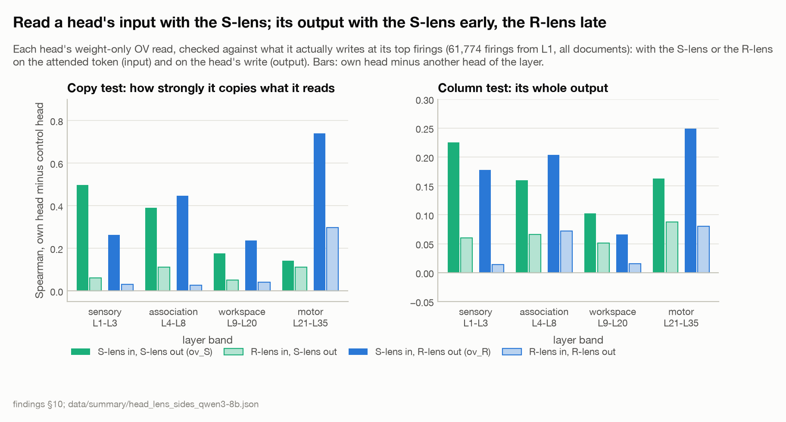

- **The input side is the S-lens, for both circuits.** An S input beats an R input with the same
  output lens in every band, on this test and on whole predicted columns (within the motor band, the
  copy test at L28-L35 with an S-lens output, which the catalog doesn't use there, is the exception); on the QK side
  too, the S-lens key read agrees with the attention keys receive (+0.18, control +0.07) better than
  the R-lens's (+0.05, control +0.01; `checks/head_qk.py`, over every 16th document). A head reads
  what a position holds, not what it is about to say. On the QK side this was tested on keys; a late
  head's query can read what its own position is about to say (cross-lens self-match, below).
- **The output side is the S-lens early and the R-lens late,** as for neuron writes: S→S leads in the sensory band, S→R
  from the association band on, narrowly in the workspace band (where S→S predicts whole columns better) and by far in
  motor. Induction heads favour S→R, duplicate-token heads S→S.
- A coarser test agrees: of the four brackets' copying scores, only S→R tracked single-head
  ablation better than the raw score (Spearman +0.22, +0.08 over raw, 95% interval +0.03 to +0.12;
  `checks/head_circuits.py`).
- The catalog reads keys and values with the S-lens; OV as `ov_R` (S→R, trusted from L9) and `ov_S` (S→S, trusted
  through L8 and a second view through L20); QK as `qk_S` (the mean query), and its diagonal twice: with the S-lens
  query, `qk_self_S` (a position holding `v` seeks `v`: duplicate-token heads, through L20), and with the R-lens query,
  `qk_self_R` (a position about to say `v` seeks `v`: late heads, L28-L35 clearly, L21-L27 mixed; below). Both are kept at
  every layer; the bands are a prior.

**What each head copies** (`ov_R`, `ov_S` in `heads/reads`): each token's z in its own column of the
OV map, that is, where `v` ranks in what the head writes when it reads `v`. At each firing this
weight-only read predicts where the attended token ranks in the head's actual output (Spearman +0.52
over firings; the same token under another head, 0.00), from +0.27 in the workspace band to +0.72 in motor
(`checks/head_census.py`). The S-lens input is what helps: against the same logit-lens read of the
output, an S-lens input scores +0.50 and the raw embedding +0.41. Examples:
- **Classes, across languages:** L26h31 copies quantities (` weight | 体重 | strength | temperature`);
  reading ` population` it writes `人口 | population | statistics`.
- **Pronouns by gender:** L20h17, reading ` herself`, writes ` herself | 她 | she` and suppresses
  ` himself | 他自己 | his`, and the reverse for ` himself`. L6h21 copies *you*.
- **Copy and copy suppression:** L34h1 copies surnames (` Heller | Crosby | Gallagher`); L32h9, a
  copy-suppression head (McDougall et al. 2023), suppresses the same ones.
- **Class suppressors, late:** L32h1 suppresses ` fluid | traffic | bridge | fuel`; L30h10 ` region |
  period | moment`. L19h7 and L10h21 suppress British spellings; reading `Whilst`, L19h7 writes
  American ones.
- **A class the single score misses:** L30h25 scores −0.10 as a copier, yet copies one class at z up to
  31 (`原始 | raw | formal | traditional | native`).
- Induction heads copy nearly everything (L22h23 and L24h22: median z +3.0 and +3.6); duplicate-token
  heads almost nothing.

**What each head attends to** (`qk_S`, `qk_self_S`): each key token's z under the head's mean query,
with the q/k norms' derivative and RoPE averaged over the head's own offsets.
- **Self-match finds duplicate-token heads from the weights** (`qk_self_S`, AUROC 0.96): as queries they
  favour a token's own surface form (L1h28 reading ` Paris` favours ` Paris | Paris | Parse`).
- **Attends-to agrees with the attention tokens receive in context early and late** (`qk_ctx_rho`,
  over tokens seen 10+ times as keys; `checks/head_qk.py`, every 16th document): Spearman over tokens +0.25 in the
  sensory band (control +0.09), +0.13 in workspace (+0.08), +0.20 in motor (+0.05); best at L0 (+0.42: L0h27 attends to
  the starts of code and documents, L0h0 to Chinese and Japanese function words). The S-lens beats raw embeddings wherever
  either reads anything.
- **Late heads attend to what they copy:** at L28-L35, 23% of heads attend mostly to tokens high in
  their own copy read (control 7%; `checks/head_census.py`), and class suppressors to the class they suppress (L31h23 attends to
  ` Combination | Equality` and suppresses ` alternative | balance | combination`). Mid-network, where a
  head looks says little about what it writes.
- **Cross-lens self-match finds the late heads that look up what is about to be said**
  (`qk_self_R`; `checks/head_seek.py`). With an R-lens query (the position says `v`) against S-lens keys (the
  position holds `v`), QK's diagonal asks whether a head seeks earlier copies of the token its query
  position predicts: the QK half of copy suppression (McDougall et al. 2023). A token's R and S
  directions are nearly orthogonal (median cosine 0.02-0.08), so this is not `qk_self_S` again. In
  context (2,000 documents), a head's *seeking* is its attention per key to earlier copies (two or
  more back, induction matches left out) of the R-lens top-1 at its input, relative to uniform, minus
  that to copies of a random earlier token. In the motor band the weight read's per-head median tracks it at
  Spearman +0.47 across heads (another head's read +0.09, `qk_self_S` −0.08), +0.43 with the model's final top-1 as the
  target, and +0.54 at L28-L35 alone; less in the workspace band (+0.29), where the R-lens on both sides does better
  (+0.60). The query is the R-lens row made a vector by the residual's metric (§15); at L28-L35 a Euclidean query scores
  +0.62.
  - Of the 20% of the motor band's heads that seek most, 17 lower the target's logit (direct effect, against a
    random earlier token's): copy suppression in context, among them L33h21, L32h9, L27h7, L29h16 and
    L31h30 (the list is in `data/summary/head_seek_qwen3-8b.log`). The weight read finds them at
    AUROC 0.91 (`qk_self_S` 0.41); a negative OV copy score does as well (0.91). Within about half of
    them the tokens sought most are the ones suppressed most (per-token Spearman with `ov_R` −0.19 at
    the median, −0.66 for L27h7).
    QK says what a head looks up and OV what it does with it: the read also finds the 79 that seek and
    boost (0.67).
  - Early the test is empty: at L3's input the R-lens top-1 is ` the` at 78% of positions (8 distinct
    tokens), so early heads' large "seeking" is attention to function words.
- **Query reads past L1 are noise with an S-lens query:** L20h17 favours nearly the same keys whether its
  query is ` she` or ` he`.

**Limits.** The OV read assumes the head reads one token's footprint; in context a head mixes several
positions. Reads are scale-free. The S-lens footprint is a context-averaged stand-in (§7). The QK read
is first-order: attention that depends on the query's context or on position alone (previous-token,
induction) is not read.

### §11. Attention heads: what their reads name

**Setup** (`checks/reads_at_firings.py`). Each head's weight-only reads are scored at its 64 top firings
(largest output norm, one per document) against the layer's other heads on the same firings; BH over
all 1,152 heads at 5%, as shares of each band's heads (no per-head test is kept). `ov_R`: the attended token's column promotes the next token; `ov_copy`: the head
promotes what it attends to; `ov_S`, `qk_S`: the attended token scores high in the head's own read. Token mode: a third of
firings sharing a query or attended token. Pattern: previous-token or self attention past 0.5, or an induction or
duplicate-token score past 0.3 (§10).

| band | `ov_R` | `ov_copy` | `ov_S` | `qk_S` | token mode: query / attended | pattern |
|---|---|---|---|---|---|---|
| sensory L0-L3 | 0.00 | 0.01 | 0.00 | 0.00 | 0.32 / 0.52 | 0.16 |
| association L4-L8 | 0.01 | 0.01 | 0.00 | 0.00 | 0.13 / 0.30 | 0.05 |
| workspace L9-L20 | 0.01 | 0.01 | 0.00 | 0.01 | 0.06 / 0.09 | 0.08 |
| motor L21-L35 | 0.16 | 0.09 | 0.00 | 0.05 | 0.19 / 0.19 | 0.05 |
| all | 0.07 | 0.05 | 0.00 | 0.02 | 0.15 / 0.21 | 0.07 |

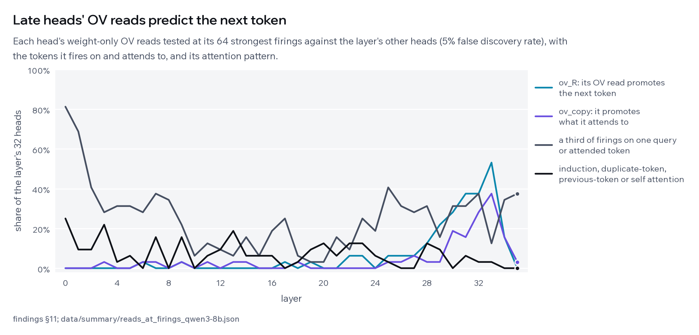

- **Late heads write the next token:** `ov_R` holds for 16% of the motor band's heads, 26% at L28-L35 and 53% at L33. Read
  from their actual outputs in context, 55% of the motor band's heads promote the token that follows their
  strongest firings, and 42% the token they attend to, against 4-7% and 12-19% in the earlier bands
  (`heads/acts`' `out_R_z`; `checks/head_census.py`).
- **The S-side reads never separate a head from its layer.** S→S copying is common to nearly every
  head (`ov_S_copy` medians +0.31 to +0.68 by band), and the mean query's favourite keys are
  shared too. They stay useful as reads of what heads do (§10), not as evidence that a firing is this
  head's.

**Limits.** The tests compare a head with its own layer, so a property shared by a layer's heads never
passes: the right null for "this head", the wrong one for "these heads". Firings are the top 64 by
output norm, one per document, which favours heads with large outputs; sink heads fire where they leave
the sink.

### §12. What feeds a unit: edges and sources

What feeds a neuron? The residual stream is a sum: what a neuron writes reaches every later layer's MLP
input unchanged, so the direct path from one pole to a later one is a number from the weights. This
section builds those edges for Qwen3-8B and asks how much of what drives a pole when it fires they name.

**Setup.**
- **Edges** (`16_edges.py`; weights only, fp32, minutes). For a pole A of layer L and a pole B of a later layer M: `cos`,
  the cosine of A's write `±W_down[:, n]` with B's read direction (`â ± b̂`, or the up row for a negative-lobe pole, §7) in
  the residual's metric at B's MLP input (§15), and `push = cos · act_top_A · ‖w_A‖ / rms_M`, how far one of A's top firings moves B's normalized MLP
  input along B's read direction (`rms_M`: the median RMS of the residual entering layer M's MLP over
  64 documents, 0.1 at L0, 1.0 at L12, 6.6 at L28 and 26 at L35). Each pole keeps its 64 strongest
  in-edges (from earlier poles) and out-edges (to later ones) by |push| among those with
  |cos| ≥ 5/√d = 0.078, which random directions reach about once in 1.7 million (the `edges` table).
- **In context** (`checks/edges_in_context.py`; H100, fp32). §3's 32 random neurons a layer
  at L1-L35, both poles, at their first 5 top firings (2,228 poles). At a firing, B's MLP input is the
  normalized sum of the embedding, every head's write at layers up to M and every neuron's below M.
  Holding the norm's scale and SiLU's ratio `silu(g)/g` (RelP's rules), the half rule splits B's
  activation exactly over these sources (largest error 4·10⁻⁵).

**The wiring is real.** Against the layer before alone, the median pole's strongest |cos| is 0.12
(0.10-0.15 across depth), against 0.063 for the same writes under a random rotation. 92% of poles have an
in-edge above the floor (L0's have none to have), half of them strongest from the layer before. A
concept pole is wired from its concept: L14 n1561 + (animals, pets, livestock) has in-edges from L12
n7934 − (dogs, pets, veterinary), L9 n11117 + (pet words), L11 n9841 − (animals, birds, bees) and L10
n10730 + (animal and rodent nouns).

Shares of the activation at the pole's top firings (medians over poles of each pole's mean):

| band | heads | neurons | top 64 neuron poles | firing among them | the 64 in-edges | 64 random poles | in-edge sources firing | recall (control) | ρ |
|---|---|---|---|---|---|---|---|---|---|
| sensory L1-L3 | 0.27 | 0.71 | 0.82 | 0.37 | 0.06 | 0.00 | 0.02 | 0.08 (0.03) | 0.79 |
| association L4-L8 | 0.36 | 0.63 | 0.81 | 0.42 | 0.05 | 0.00 | 0.03 | 0.06 (0.00) | 0.90 |
| workspace L9-L20 | 0.40 | 0.60 | 1.07 | 0.52 | 0.10 | 0.00 | 0.03 | 0.07 (0.00) | 0.88 |
| motor L21-L35 | 0.27 | 0.73 | 0.76 | 0.61 | 0.09 | 0.00 | 0.06 | 0.06 (0.00) | 0.87 |

*Firing*: at `act_top / 4` or more in its pole (the `acts` tables' rate threshold). *Recall*: the share
of the 64 largest |contributions| that are in-edges (control: another pole's in-edges). *ρ*: Spearman
over every upstream neuron, in the pole it is in, between its push and its contribution.

- **A pole's direct input is concentrated.** The 64 upstream neuron poles that contribute most sum to 76-107% of its
  activation (signed: past 100%, the rest cancels), and 37-61% of them are firing there themselves. Heads carry a quarter to
  two fifths by band (half at L13-L20); the embedding 2% at most (at L1), under 0.5% from L7. Over every pole's first 5
  firings (the `sources` table) heads carry a median 27-43% by band.
- **The edges get the direction right, not the traffic.** An edge's push ranks every upstream neuron's
  contribution at Spearman 0.87-0.90 from L4 (0.79 at L1-L3): the weights say what each would do. But the in-edges are 6-8%
  of the 64 largest contributors and carry 5-10% of the activation, because their sources fire at only 2-6% of the pole's
  top firings. What drives a pole is which units fire with it, which no list from
  the weights can know (the same gap as between global weights and attribution graphs over transcoder
  features; Ameisen et al. 2025).
- **In context the sources read as one concept.** `explain 14 1561 +` gives the animal pole's sources
  at its five top firings: L12 n7934 − (11%), then animal, veterinary, pet and young-animal poles from
  L4-L13 (L12 n7182 −, L11 n2301 −, L13 n12072 +, L10 n11987 +, L4 n12138 + "vet", L10 n4140 − cats),
  topical copy heads (L12h18, L14h7, L14h6: +11.5%) and two heads that suppress topical nouns (L14h5,
  L12h8: −9%). Three of its ten largest neuron sources are among its 16 strongest in-edges (L12 n7934 −,
  L12 n7182 −, L11 n2301 −).
- **Early poles read their up row.** At L1-L3 most top firings ride SiLU's negative lobe, where `â ± b̂` points the wrong
  way (§7): with it, ρ is −0.27, −0.61 and 0.52 there; with the up row for those poles, 0.80, 0.77 and 0.80.
- **Early hubs.** A few L0-L1 neurons sit in most early in-lists: the 1% most-listed sources hold 59% of
  the in-list entries at L0-L8 (8-18% later), and L0 n11466 − (甩, "fling") is in 26% of L1-L8 poles'
  lists. Shared lists show as recall's control at L1-L2 (0.04-0.05).
- **Driven by differs from wired to and fires with** (every pole, its top 16 of each at its first 5 firings;
  `checks/relations.py`). A pole's top 16 driven-by sources are a median of 31-38% in its top 16 in-edges or fires-with
  lists (6-13% and 19-25% taken alone; another pole's lists 0): 62-69% of its largest contributors are in neither,
  because a source's contribution is its activation times its wiring, and the top of the product is not the top of either
  factor. Contributions are diffuse: in a 160-pole probe the top 16 carried only 1-5% of the summed absolute contribution.

**Into a head** (`17_firings.py --parts heads`, the `heads/sources` table; H100). A head's firing reduces to a read of the
residual entering its layer through each input (design.md): the value at the positions it attends to, and the query and
keys through the score margin between its most attended key and the mean of them (equal to the log-probability margin to
5·10⁻⁶). Every head's first 5 top firings (5,760 in Qwen3-8B, 3,840 in Gemma 4); the shares sum to 1 within 1.3·10⁻³.
Medians over a band's layers, share of neurons / earlier heads:

| band | value | query | key |
|---|---|---|---|
| Qwen3-8B sensory L1-L3 | 0.92 / 0.06 | 0.65 / 0.32 | 0.87 / 0.12 |
| association L4-L8 | 0.89 / 0.11 | 0.63 / 0.37 | 0.78 / 0.22 |
| workspace L9-L20 | 0.90 / 0.10 | 0.66 / 0.33 | 0.84 / 0.16 |
| motor L21-L35 | 0.86 / 0.14 | 0.56 / 0.44 | 0.78 / 0.22 |
| Gemma 4 association L1-L19 | 0.87 / 0.11 | 0.71 / 0.28 | 0.85 / 0.15 |
| workspace L20-L32 | 0.85 / 0.15 | 0.67 / 0.33 | 0.84 / 0.16 |
| motor L33-L47 | 0.84 / 0.16 | 0.66 / 0.34 | 0.76 / 0.24 |

What a head copies and what it can be found by come mostly from neurons; what it looks for takes a third to a half from
earlier heads, which suggests composition between heads runs mainly through the query (Q-composition, Elhage et al. 2021,
here measured at firings). There is no signed weight edge into a head: two heads meet through a matrix, not a dot product.

**Gemma 4** has the same split (the in-context sample, 3,008 poles): heads carry 15-25% of the activation by band, neurons
75-85%, and an edge's push ranks every upstream neuron at ρ 0.90-0.92. Over every pole's first 5 firings, heads carry a
median 15-25%. In its workspace and motor bands its edges behave as Qwen3-8B's: the in-edges are 4-8% of the 64 largest
contributors and carry 8-9% of the activation, their sources firing at 4-6% of the pole's firings (random sources 1%), and a
pole's top 16 driven-by sources are 13-19% in its top 16 in-edges, 25-31% in either list. In its association band they
name few (2% of the largest, 1.5% of the activation; 6% of the driven-by, 13% in either list), and at L1-L11 almost none
(0.6% of the activation). A pole's largest |cos| with the layer before's
writes is a median 0.08-0.15, against 0.066 for the same writes rotated at random, and the 1% most-listed sources hold
12-28% of the entries. Taken in the raw basis these were 0.002-0.018 and 52-66%, and the in-edges carried none of the
activation: the cosine that admits an edge pairs a write with a read row, which the raw basis weighs by each coordinate's
units, so it let through a few hub neurons and dropped the rest (§15).

**What this means.** The edges are the model's wiring: what a pole's firing would do to each later pole,
the counterpart of a write read (§3), and like it an average that leaves the context out (§4). Which
units drive a pole when it fires is the context's: a list of what feeds a pole needs activations, its
sources at its top firings, which `explain` gives one pole at a time.

**Limits.** Direct paths at one position: what heads carry between positions, and paths through other units, are not
edges. `push` holds each source at its typical top firing, and Gemma 4's `edges` take each write at its norm's typical
scale. 32 random neurons a layer, 5 firings each.

## IV. Describing units in words

The evidence turned into labels, checked blind (§13) and against labels made another way (§14).

### §13. Labels from the evidence

Can the evidence be turned into words that predict what a unit does? A blind test asks how far the lenses alone go; the
catalog's labels are then checked by detection and by simulation.

**Scoring.** An explainer writes two labels with a confidence: where the pole **fires**, and what its write **promotes**
when amplified.
- **Firing** is scored by detection (Paulo et al. 2024): fresh scorers see the label and a shuffled set of held-out top
  firings (top documents the card did not show, each cut at the firing token) and quiet positions or another pole's
  firings, and give each a probability of firing; the score is the AUROC. The control is another pole's label on the same
  set. This test is made of firings, so it favours evidence made of firings.
- **Writes** are scored by steering: the pole's write is added at doses where it changes the next-token distribution by
  0.5, 1 and 2 nats of KL (10-19× its typical activation), on four prompts; a fresh judge sees the steered text and four
  labels from the same band and gives each a probability of being the pole's own; the score is the AUROC of the pole's
  own label against the other three (chance 0.5).
- Both are AUROCs, but against different negatives (quiet text or another pole's firings for firing, other poles' labels
  for writes), so a firing score and a write score don't compare directly.
- **Cards are leak-free:** nothing on a card summarizes the held-out documents.

**A pilot with full evidence** (`checks/describe_cards.py`, `checks/describe_score.py`): 197 poles (2 random neurons a
layer, both poles, and 53 named poles), Claude Sonnet explainers, full cards (lens reads, top 5 contexts, activation
statistics, steering, outside labels). Over the 189 that fire, 5 held-out firings against 5 quiet positions score a mean
AUROC of **0.93** [0.91, 0.94] (control 0.54). Most poles are token- or phrase-level detectors, often of what comes next:
L7 n271 + poxviruses (monkey⟦p⟧ox), L9 n8548 − an AI assistant's self-reference ("my training", "been programmed"), L16
n6934 + " upon" in "Once upon a time", L26 n4061 − the word before "suicide".

**The blind test** (`checks/lens_blind.py`): 160 random poles, 40 per band, explainers that never see steering, in four
arms: **lens** (only the eight weight-only reads, plain and `_z`, 12 tokens each), **contexts** (only the top 5 contexts,
activation scale and rates), **both** on one card, with Claude Sonnet 5.5 and with Opus 5.5; scorers and judges are
Sonnet 5.5 at maximum effort, told that only the order of their probabilities is scored, so a weak hunch still counts.
Six held-out firings against six quiet positions, three from random documents and three from the firings' own
documents. 18 sampled poles are near-silent (most at L1-L2) and have no firing test.

| band | fires AUROC: lens / contexts / both / Opus | writes AUROC: lens / contexts / both / Opus |
|---|---|---|
| sensory L0-L3 (22 firing) | 0.82 / 0.97 / 0.96 / 0.98 | 0.65 / 0.61 / 0.70 / 0.69 |
| association L4-L8 | 0.73 / 0.93 / 0.92 / 0.92 | 0.78 / 0.66 / 0.79 / 0.76 |
| workspace L9-L20 | 0.73 / 0.82 / 0.84 / 0.85 | 0.74 / 0.55 / 0.77 / 0.70 |
| motor L21-L35 | 0.75 / 0.81 / 0.84 / 0.85 | 0.87 / 0.72 / 0.90 / 0.85 |
| all | 0.75 / 0.87 / 0.88 / 0.89 | 0.76 / 0.63 / 0.79 / 0.75 |

Controls: another pole's firing label scores 0.52-0.58 over all bands; in the sensory band one written from contexts
scores 0.66-0.78 (one written from the lenses, 0.52). Writes chance is 0.5.

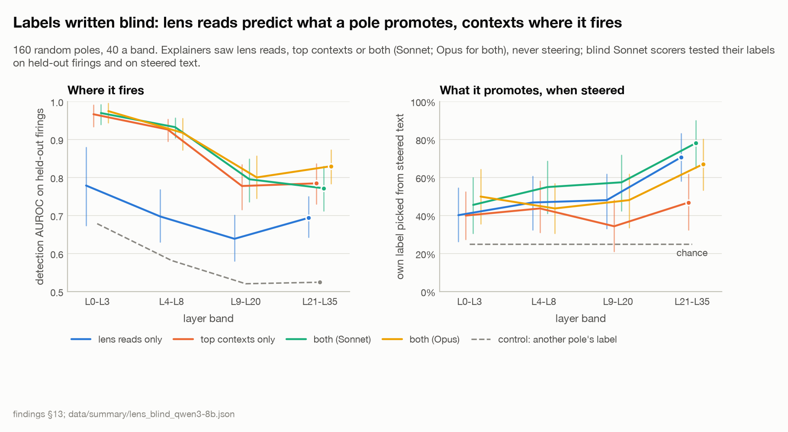

- **From the lenses alone, labels beat chance on both tests:** firing labels at AUROC 0.75 (46% of labels at 0.8 or more,
  against 14% of controls), write labels at 0.76.
- **Scored on firings, contexts lead the lenses for where a pole fires** (0.87 against 0.75), as evidence made of firings
  should, in every band and most in the sensory band (0.97 against 0.82), whose poles are token detectors; over their
  controls the two are about level there (contexts +0.24, lenses +0.30). Same-document negatives cost both arms about 0.06
  against random ones, so neither's labels are mostly topic labels.
- **For what it promotes, the lenses beat contexts** (0.76 against 0.63) from the association band on, most in the
  workspace (0.74 against 0.55) and motor bands (0.87 against 0.72); in the motor band strongly steered text has 20% more
  of its tokens in the pole's own R-lens top 64 than unsteered text (other poles' reads: no change). In the sensory band
  the two are close (0.65 against 0.61), and steering often degenerates the text (§7: early meaning is input-side).
- **Combining helps writes, not firing:** both sources on one card score 0.88 for firing, about as contexts alone, and
  0.79 for writes, more than either alone (0.90 in the motor band).
- **Opus explains no better than Sonnet** (0.89 against 0.88 for firing, 0.75 against 0.79 for writes), which suggests the
  bottleneck is the evidence, not the explainer. On 100 more random poles, Claude Haiku 5.5 matches Sonnet when the card
  has contexts (firing AUROC 0.82 against 0.83; `checks/haiku_blind.py`) and trails it from the lenses alone (0.71 with
  the reads chosen by depth).
- **Where the sides differ:** format and fragment detectors whose reads name something else. L34 n7339 − fires on a
  word-initial W (W|inters), its read direction names GPUs (Nvidia, Radeon), and its write is 再 (again): three sides that
  don't agree, and no test here says which describes the pole.
- **Confidence ranks:** lens firing labels at confidence 0.7 or more score 0.89, below 0.4 0.70 (with contexts and lenses
  on one card, 0.94 and 0.76).
- **14% of firing poles defeat every arm**, 16 of 20 at L9-L35: code identifiers and punctuation, word and name
  fragments and digits, and positions just before a predictable word, whose held-out firings vary in surface form.

**The catalog's labels** (`10_labels.py`). Claude Haiku 5.5 (Batch API, effort low, no thinking, 10 neurons a request)
labels every pole and head of Qwen3-0.6B, 1.7B, 4B, 8B and 14B and Gemma 4 12B: 4,968,448 poles and 5,568 heads for $303
(Qwen3-8B $52.78, Gemma 4 $90.26). A pole's card shows how often it fires and which text slices it favours, the one input
read and one write read its model's reading plan names for its depth (§8), 24 tokens each without strengths, and its first
5 top contexts; confidence is how clearly the card shows one theme. A pole that is a faint shadow of its neuron's other
pole (§7) keeps only its write read and is marked. A head's card shows its attention patterns, how often it fires, the
plan's OV read, its QK reads with both self-match diagonals (§10), its drivers as query and key, and its first 5 contexts.
Each model has its own prompt with worked examples (`scripts/prompts/`).

**Checked blind** (`checks/relabel_check.py --poles all`, `10_labels.py check`). Claude Sonnet 5.5 sees a firing label and
8 contexts, 4 of the pole's held-out top firings (ranks 6-24, off every card) and 4 of another firing pole of its layer,
a harder contrast than quiet text; AUROC per pole, on 150 random firing poles a model:

| | label | another pole's label | by band: sensory / association / workspace / motor |
|---|---|---|---|
| Qwen3-0.6B | 0.86 [0.82, 0.90] | 0.51 | 0.87 / 0.83 / 0.87 / 0.86 |
| Qwen3-1.7B | 0.88 [0.84, 0.91] | 0.54 | 0.83 / 0.86 / – / 0.93 |
| Qwen3-4B | 0.86 [0.82, 0.89] | 0.51 | 0.96 / 0.92 / 0.81 / 0.84 |
| Qwen3-8B | 0.84 [0.80, 0.87] | 0.44 | 0.89 / 0.75 / 0.83 / 0.86 |
| Qwen3-14B | 0.82 [0.78, 0.87] | 0.50 | 0.86 / 0.83 / 0.78 / 0.83 |
| Gemma 4 12B | 0.82 [0.77, 0.86] | 0.50 | – / 0.81 / 0.82 / 0.82 |

- **Firing labels hold at every depth and size.** No band of any model falls below 0.75 (Qwen3-8B's association band, 23
  poles); the smaller models score a little higher (0.86-0.88, against 0.82-0.84 at 8B, 12B and 14B). A longer card with every tier of reads and their
  strengths scored the same within noise on the same poles (Qwen3-8B 0.81, Gemma 4 0.81) at twice the cost, and with
  lower confidence (mean firing confidence 0.34 against 0.44 on Qwen3-8B, 0.30 against 0.40 on Gemma 4).
- **Heads** (20 random heads a band, the same test against another head's firings): Qwen3-8B's firing labels score 0.72
  [0.66, 0.78], and its write labels 0.67 [0.60, 0.74] when a judge picks one of four from what the head's firings promote
  in context (AUROC against the other three: 1 when it picks the head's own, 1/3 otherwise; chance 0.5); Gemma 4's 0.78
  [0.72, 0.84] and 0.55 [0.48, 0.62]. Gemma 4's OV reads rarely pass a test (§15), and what a
  head's OV map promotes is not what it writes in context; its write labels follow its cards. Tables by band:
  `data/summary/labels_heads_<model>.md`.
- Write labels of the catalog's neurons were not checked by steering. 150 poles is about ±4 points a model; a band holds 9-65 of them, so its value is good to ±5-15.
  `data/summary/label_check_<model>.json`.

**Simulation** (`checks/simulate_labels.py`). Bills et al. (2023)'s test on the same 150 Qwen3-8B poles: Claude Sonnet 5.5
sees only a firing label and predicts the pole's activation, 0 to 10, at every token of 15 excerpts of 64 tokens,
shuffled: 5 around held-out top firings (ranks 6-24), 5 around weak firings (a peak at a quarter to a half of `act_top`)
and 5 at random, the last two from 2,000 random activation documents outside the pole's top 64. True activations come
from a bf16 forward pass over each excerpt's document, the pole's sign applied and clipped at zero. The score is the
correlation of simulated and true activations over all 960 tokens (Bills's top-and-random score). Three labels run on the
same excerpts: the catalog's label, the longer card's, and another firing pole's of the layer.

| | label | longer card's label | another pole's label |
|---|---|---|---|
| correlation, all tokens | 0.21 [0.18, 0.25] | 0.20 [0.16, 0.24] | −0.00 |
| within top / weak excerpts | 0.23 / 0.09 | 0.21 / 0.10 | 0.00 / 0.00 |
| correlation of excerpt peaks | 0.44 [0.38, 0.49] | 0.39 [0.33, 0.45] | −0.04 |
| top / weak excerpts found among random ones (AUROC) | 0.75 / 0.61 | 0.73 / 0.61 | 0.49 / 0.50 |
| top excerpts' predicted peak within a token of the true one | 25% | 24% | 0.5% |

- **The labels name the context a pole fires in more often than the token.** Scored by each excerpt's peak (which excerpts
  fire, and how strongly) a label reaches 0.44; token by token 0.21. Of the 750 held-out top excerpts, the predicted peak
  lands on the true token in 16%, one or two tokens after it in 9% and before it in 4%, 3-5 tokens off in 5%, further off
  in the excerpt in 31%, and 35% are predicted silent: the label doesn't cover that firing at all. Detection sees none of
  this, since its contexts end at the firing token. Misses read by hand include a label naming the word about to come (L31
  n9635 −, "academic disciplines and fields of study", fires on " degree" and " career" before a field is named) and one
  naming the construction around the token (L4 n8221 −, "Python import statements", fires on the module name after
  `from`). Where a label names the token, the simulation is close to exact: L0 n6001 − ("no need", 0.92), L31 n94 + ("al"
  starting chemical names, 0.89).
- **Weak firings are mostly outside the labels.** Excerpts that peak at a quarter to a half of `act_top` are found among
  random ones at AUROC 0.61 and correlate at 0.09: a label written from top contexts describes the top regime (§4).
- **Spread:** median 0.17, 30% of poles at 0.3 or more, 9% at 0.5 or more; highest early (band means: 0.39 in the
  sensory band, over 9 poles, and 0.26 in association, against 0.15 in workspace and 0.21 in motor), though detection is
  lowest in the association band (0.75). Confidence ranks weakly (0.25 for the 9 labels at 0.7 or more, 0.17 for the 57 under
  0.4).
- **The two tests agree on whether a label recognises a pole's firings, less on the token.** Per pole, the detection AUROC
  ranks with the simulation's excerpt-level scores at Spearman 0.42-0.44, with the token-level score at 0.20. A label that
  names the token a pole fires on beside its concept would likely close part of the token-level gap (untested).
  `data/summary/label_simulation_qwen3-8b.json`.

**Limits.** Positives come from the high-activation regime (top documents only; the simulation adds weak firings).
40 poles a band is about ±13 points (100 poles for the Haiku test, ±20). Steering is amplified past natural firing (a median 10-19×
in the blind test), in bf16. Explainers, scorers and judges are all Claude models, in separate instances, and the
explainers' prompt carried the depth priors. The scores depend on the scorer's setting: at default effort, told to give
probabilities near 0.5 where a label gives no basis, the same scorers gave every context one probability on 31% of lens
tasks, and lens firing labels scored 0.69 (contexts 0.85). The pilot's held-out sets were not kept. Gemma 4's neuron labels are checked
for firing only.

### §14. Outside labels

How do labels from other methods compare with the catalog? The main outside source is the [Neuron
Persona Library](https://neuronpersonas.com) (by jfonsecarivera), 34,220 rows, each a pole whose push
on "Who are you?" made the model claim a persona, named by Claude Haiku. `neuron_lens/known.py` holds
smaller sets: six steering-verified persona neurons from a persona-steering experiment of ours on this model, and
published neurons from Sudarsh, Sauers, Muyu He and Kazemi et al.

**Strict name matches** (`checks/library_crosscheck.py`): the first token of a persona name's words in
the pole's write read. In the top 10 for 52% of L30-L35 rows and 30% of L24-L29 rows under every lens,
2-3% at L12-L17 (control 0.2-0.3%). At L0-L5, the R-lens finds 15% where the J-lens finds 1% and the
logit lens 3%.

**Generous matches** (`checks/library_judge.py`): 360 rows, 60 per layer group; Claude Sonnet judges
score each read against its persona's name and, shuffled in, another row's (0-3; 2 or more is a clear
match: the concept in any language, or a strongly associated thing). Reads from the write side, the
input side (`read_R` and `read_S`) or both together:

| layers | write | input | both |
|---|---|---|---|
| L0-L5 | 0.35 (0.02) | 0.35 (0.02) | 0.38 (0.03) |
| L6-L11 | 0.27 (0.02) | 0.22 (0.02) | 0.33 (0.07) |
| L12-L17 | 0.20 (0.07) | 0.17 (0.07) | 0.28 (0.10) |
| L18-L23 | 0.22 (0.02) | 0.10 (0.03) | 0.27 (0.05) |
| L24-L29 | 0.45 (0.00) | 0.37 (0.02) | 0.50 (0.03) |
| L30-L35 | 0.53 (0.02) | 0.42 (0.02) | 0.62 (0.02) |

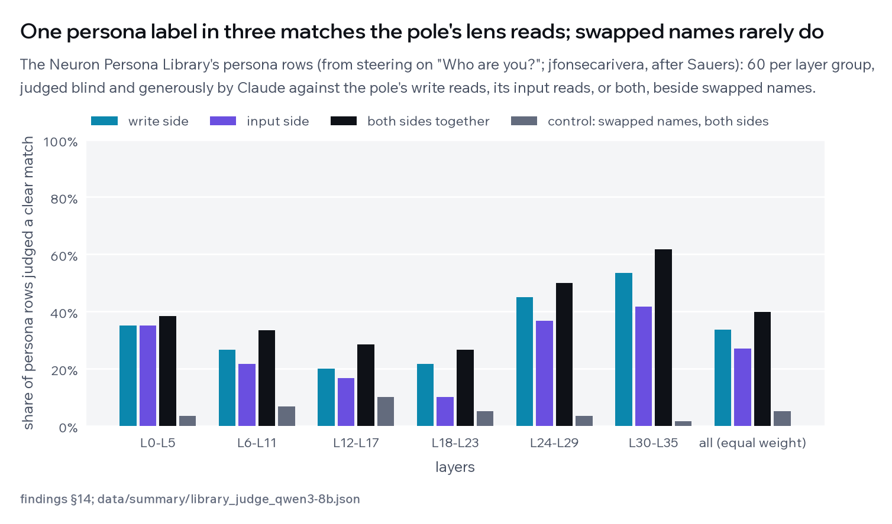

- **A generous reading doubles the strict rate:** weighted by the library's depth mix (mostly
  L6-L17), 27% of rows clearly match the write read, 22% the input read and 34% both together
  (swapped names 3-6%). Translations and associated words count: L9 n3370 − "Dragon" writes dragon,
  龙, dragons.
- **Mid-network is hardest** (20-22% of rows at L12-L23 on the write side).
- **Fused personas.** The library also pushed 2-3 neurons at once; 3,097 of 13,861 pairs gave a persona
  no parent gives alone. The R-lens read of the summed pushes ranks words in neither parent's name in
  its top 100 for 19% of pairs (mismatched names 3%; J-lens 10%, logit lens 7%;
  `checks/combo_crosscheck.py`). The best parent's read alone does about as well (24%, control 5%):
  the new concept is mostly latent in one parent's write.
- **Steering one prompt finds personas, not everything.** Of the 71,661 poles whose write predicts
  what follows their firings (§8), 4.0% have a library row, mostly because 98% sit at L21-L35, where
  the library is thin; against each layer's base rate the library is enriched for them (1.5×;
  `checks/library_crosscheck.py`). What it misses has no self-description: idiom completers (L30
  n1034 + writes *again* on "once"), morphology (L8 n1541 + writes *-ism*/主义 on the stem before it),
  everyday concepts (L28 n8868 − writes *democracy* on "arist|", "olig|").

**Against whole evidence cards** (§13's pilot), the explainers' verdicts on outside labels:

| source | method | agrees | partial | disagrees |
|---|---|---|---|---|
| our persona-steering experiment | steering-verified personas | 6 | 0 | 0 |
| Sudarsh | activation contrast × `W_down`, steering | 10 | 3 | 0 |
| Neuron Persona Library | steering on "Who are you?" | 13 | 9 | 11 |
| Sauers | steering and causal search | 7 | 3 | 4 |
| Muyu He | MLP energy at token 0 | 3 | 1 | 2 |
| Kazemi et al. | refusal gradient × activation difference | 1 | 1 | 1 |

- **Activations sharpen the steering-verified labels:** L8 n1931 + ("Jesus") fires on the Bible as
  scripture ("God's⟦ Word⟧", "non-B⟦ib⟧lical"); L21 n1180 − ("mother") on leaving work to care for
  family ("stay⟦-at⟧-home moms"); L27 n1343 + ("candidate") on deciding to run for office.
- **Labels from steering one prompt disagree with the firings most often:** the library's "creator god" pole, L8 n8079 +,
  fires on time words (times, 时间, `timing_stats`); Kazemi et al.'s refusal neuron, L14 n7924 +, fires
  on light, playful request framing.
- Unsigned labels count both poles, so one pole of each often "disagrees".

So the methods are complementary: steering on one identity prompt reaches the personas, activations
and lenses reach the rest, and each checks the other where they overlap.

**Limits.** Strict matching scores only the first tokens of names. 60 rows a group is about ±12
points. The judges are the library labeller's model family. About a third of the library's strongly
pushed replies change with the batch layout.

## V. A second model, three modalities

Gemma 4 12B, from another lab: whether the text results hold (§15), and what its neurons and heads do with images and
sound (§16-§18).

### §15. Gemma 4 12B: the text catalog in a second model

**Setup.** The catalog's stages and `checks/causal_lens.py` run on the base model `google/gemma-4-12B`
(`NEURON_LENS_MODEL=google/gemma-4-12B`), on H100s in bf16: 48 layers × 15,360 GELU-tanh neurons and 16 heads a layer.
Its architecture differs in ways the readers follow (a norm after the MLP and a per-layer scalar on the write, shared keys
and values on global layers, a softcap on the logits; design.md, [Gemma 4 12B](design.md#gemma-4-12b)). Both lenses are
fitted as Qwen3-8B's, on the same 1,000 DCLM documents (about 16 s a document per lens on one H100); split-half
differences are 0.01-0.12 by layer for the R-lens (median about 0.05) and 0.01-0.07 for the S-lens. The activation corpora
have Qwen3-8B's sizes (15.4M positions), with the chat slice as plain `User:` / `Assistant:` turns, since the base model
has no chat template. The causal sample is 24 random neurons a layer, both poles, with no J-lens to compare.

**Steering** (as §3: the write added at 1× and 4× the pole's `act_top` at positions 16-63 of 16 DCLM documents; Pearson r
with the lens's read, medians over the random poles; controls within ±0.05 at every layer):

| layer | logit lens, 1× | R-lens, 1× | R-lens, 4× | R-lens, ablation where it fires |
|---|---|---|---|---|
| L0 | 0.01 | 0.07 | 0.26 | 0.00 |
| L4 | 0.00 | 0.00 | 0.04 | 0.00 |
| L8 | 0.00 | 0.09 | 0.15 | 0.01 |
| L11 | 0.04 | 0.40 | 0.42 | 0.01 |
| L16 | 0.06 | 0.47 | 0.42 | 0.06 |
| L24 | 0.21 | 0.62 | 0.47 | 0.07 |
| L32 | 0.52 | 0.82 | 0.80 | 0.24 |
| L40 | 0.85 | 0.96 | 0.95 | 0.64 |
| L46 | 0.94 | 0.99 | 0.98 | 0.91 |

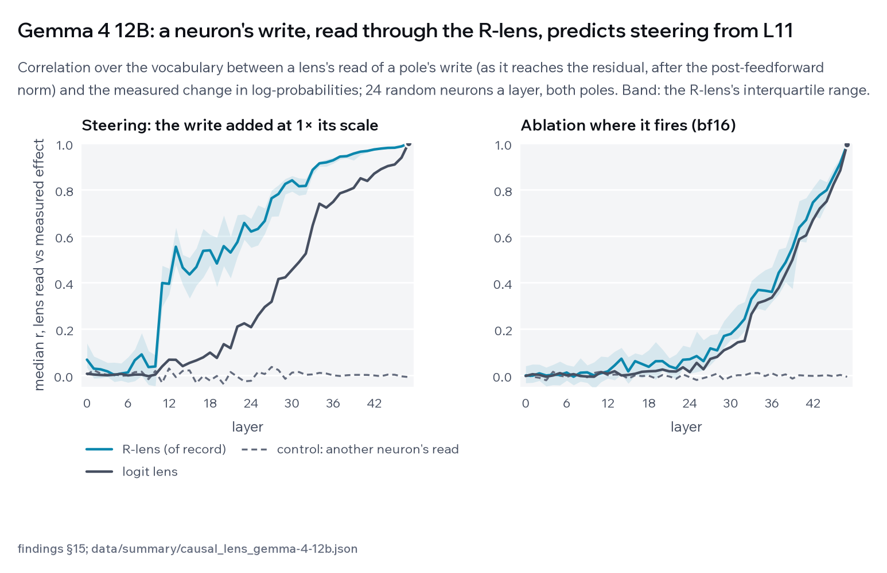

- **From L11 the R-lens read of a write predicts steering, as in Qwen3-8B:** a median r over each band's layers of 0.67 in
  the workspace band (L20-L32) and 0.96 in motor (L33-L47), and 0.40-0.53 from L11 into the association band, whose first
  eleven layers read nothing at 1× (its median: 0.08). The logit lens trails until the last layers (0.01, 0.29 and 0.84 by
  band).
- **Before L11 neither lens predicts a 1× push** (r 0.00-0.09). The correlation rises with the dose (L0: 0.07 at 1×, 0.26
  at 4×), which suggests the natural-scale pushes are too small to measure over the documents' own variation rather than
  misread. Ranked instead of correlated, an amplified write raises the tokens its R-lens read names above other poles'
  read tokens at a median rank of 0.98 at L0-L11 (`checks/write_steer.py`, a 192-pole panel, through an R-lens fitted on
  174 documents).
- **Ablation agrees only late,** as in Qwen3-8B (§4): 0.01, 0.08 and 0.64 by band.

**What each read names** (`checks/reads_at_firings.py`, as §8, BH over all poles at 5%):

| band | `read_S` | `read_R` | `write_R` | `write_S` | token mode | near-silent |
|---|---|---|---|---|---|---|
| association L0-L19 | 0.28 | 0.16 | 0.00 | 0.05 | 0.47 | 0.00 |
| workspace L20-L32 | 0.02 | 0.27 | 0.00 | 0.00 | 0.14 | 0.00 |
| motor L33-L47 | 0.04 | 0.49 | 0.20 | 0.00 | 0.16 | 0.00 |
| all | 0.13 | 0.29 | 0.07 | 0.02 | 0.29 | 0.00 |

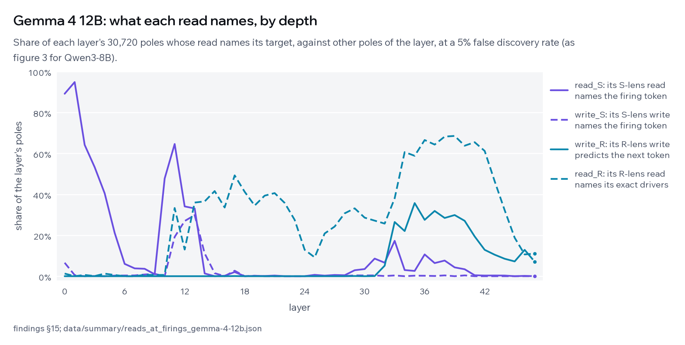

- **The same shape as Qwen3-8B's.** The S-lens names the firing token for 88-95% of L0-L1's poles, and the R-lens write
  promotes the next token late (`write_R` 22-36% at L33-L40).
- **The R-lens read of the input names more than in Qwen3-8B.** `read_R` names the exact drivers for 28-49% of a layer's
  poles at L11-L23 (L12: 13%), 9-38% at L24-L33 and 59-69% at L34-L42 (Qwen3-8B, L27-L31: 31-41%), falling to 11% by
  L46-L47. Read in the raw basis, as a Euclidean vector, it names them for 0-4% by band (the residual's units, below).
- **The input-side stage reaches L13, at about Qwen3-8B's relative depth.** `read_S` falls to 4% at L8 and 1% at L9, then
  rises again to 48-65% at L10-L11 and 33-34% at L12-L13, where `write_S` also holds for 19-30% of poles (L11-L13): early
  neurons that write back the tokens they detect (§7), ending at 27% of the depth (Qwen3-8B: L8, 23%).
- **Late writes fall off at the end:** `write_R` drops from 27% at L40 to 7-13% at L44-L47, where Qwen3-8B's keeps rising
  to its last layer.
- **No poles are near-silent.** Gemma's activations take both signs at every layer, and none of its early layers is
  near-silent as Qwen3-8B's L1 is (§2).

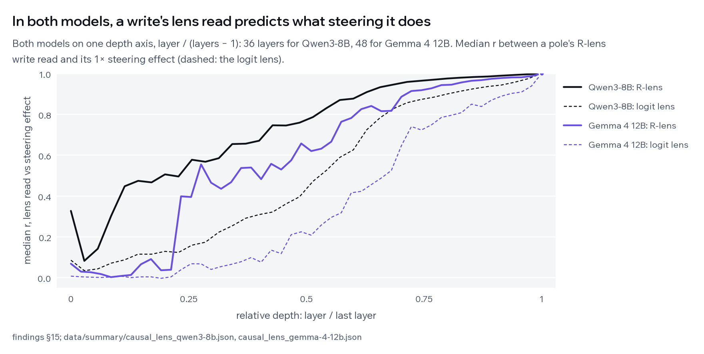

**Heads** (`checks/reads_at_firings.py`, as §11). With 16 heads a layer, a head's mismatched control has 240 pairs, so no
p-value falls below 1/241, and BH over 768 heads passes none. At an uncorrected p ≤ 0.05 (5% by chance), `ov_R` holds for
22% of the motor band's heads and `ov_copy` for 17%. `qk_self_S` finds the 26 duplicate-token heads at AUROC 0.95 (Qwen3-8B:
0.96).
- **The cross-lens self-match points the same way** (`qk_self_R`, `checks/head_seek.py` as §10, 2,000 documents). A head's
  median `qk_self_R` tracks its seeking of the R-lens top-1 in context at Spearman +0.50 in the workspace band and +0.49
  in motor (another head's read −0.04 and +0.14; `qk_self_S` −0.01 and +0.07), and +0.46 and +0.44 with the model's final
  top-1 as the target (Qwen3-8B's motor band: +0.43). Motor heads seek less here: per matching key, 1.8× uniform against
  1.2× for a random earlier token (Qwen3-8B's: 2.6× against 0.8×). Of the top fifth of the motor band's heads by seeking,
  the 14 that lower the target's logit are found at AUROC 0.95 (`qk_self_S` 0.46; a negative OV copy score 0.87); many sit
  on the global layers (L35, L41). In the workspace band the R-lens on both sides tracks seeking about as well (+0.48). The
  association band's heads seek most of all (4.7× uniform), and no read tracks it well (+0.29 at best). With a Euclidean
  query the late heads scored +0.26 at L24-L35 and +0.18 at L36-L47.

**The residual's units** (`neuron_lens.metric`, `checks/read_metric.py`; design.md). [Matthew
Khoriaty](https://www.lesswrong.com/users/matthew-khoriaty) noticed that Gemma 4's input reads, taken in the raw basis,
were junk while its write reads were fine.

- **The cause: a covector read as a vector.** A pole's read row (its gate and up rows times the input norm's weight γ) is a
  covector: what the activation applies to the residual. The S-lens pulls covectors back; the R-lens transports vectors,
  and fed a covector it treats the raw basis as Euclidean. That basis carries a unit per coordinate: rescaling coordinate
  `i`, with every norm's `γ_i` and every write compensating, leaves the model nearly unchanged (only the rms sees it).
  Gemma 4's coordinate scales (of `x / rms` where a norm reads it) span 80-1,600× by layer (99th over 1st percentile),
  γ ≈ 1/σ (correlation 0.91-0.99), and the R-lens's columns track γ, so every read lands on the same few low-variance
  coordinates: the same hub tokens. Qwen3-8B's scales span 3-6×, and the error is mild there. The same error affects a
  head's R-lens query (`qk_self_R`) and the cosines between a write and its neuron's read rows.
- **The fix: a metric that moves with the units.** In the frame a norm reads, `y = γ ⊙ x / rms`, the coordinates don't
  move, so a vector built there and mapped back is free of them: `v = s² ⊙ c`, `s² = σ / |γ|`, with σ the residual's
  standard deviation per coordinate where the norm reads it (`02_fit.py --lens scale`, the lens's 1,000 documents,
  split-half 0.01-0.04). For a pole that is `σ ⊙ w` in the norm's frame (`w` the raw row): the row times the residual's
  scale, between the row itself (`w / γ`, which needs a floor where γ ≈ 0) and the diagonal Haufe pattern (`σ²γ ⊙ w`). Net
  of chance on the exact drivers (as above) / the share of the read's top 64 in what the R-lens reads from the residual at
  the top firings (`before_R_z`; another pole's firings 0.001):

  | layer | Euclidean | `w / γ` | `σ ⊙ w` (the catalog's) | `σ²γ ⊙ w` | `1/‖J_i‖` (the lens's own) |
  |---|---|---|---|---|---|
  | Gemma 4 L12 | 0.02 / 0.002 | 0.03 / 0.002 | 0.17 / 0.019 | 0.16 / 0.019 | 0.02 / 0.002 |
  | L18 | 0.04 / 0.005 | 0.10 / 0.012 | 0.31 / 0.041 | 0.33 / 0.042 | 0.15 / 0.021 |
  | L30 | 0.09 / 0.004 | 0.26 / 0.089 | 0.26 / 0.105 | 0.21 / 0.096 | 0.15 / 0.044 |
  | L36 | 0.06 / 0.003 | 0.58 / 0.190 | 0.54 / 0.205 | 0.47 / 0.179 | 0.55 / 0.150 |
  | L42 | 0.07 / 0.001 | 0.49 / 0.118 | 0.42 / 0.127 | 0.35 / 0.115 | 0.45 / 0.107 |
  | Qwen3-8B L12 | 0.24 / 0.088 | 0.26 / 0.111 | 0.21 / 0.111 | 0.10 / 0.102 | 0.18 / 0.049 |
  | L20 | 0.17 / 0.100 | 0.18 / 0.114 | 0.17 / 0.124 | 0.10 / 0.097 | 0.16 / 0.081 |
  | L28 | 0.36 / 0.206 | 0.36 / 0.207 | 0.33 / 0.237 | 0.24 / 0.196 | 0.37 / 0.194 |
  | L31 | 0.32 / 0.224 | 0.31 / 0.218 | 0.26 / 0.242 | 0.18 / 0.194 | 0.35 / 0.220 |

  `w / γ` is floored at half the median |γ|. On Gemma 4, `σ ⊙ w` lifts both scores at every layer from L12. The floored
  row trails it at L12-L24, where its floor decides, and from L30 has the higher net and the lower share at the firings;
  the lens's own metric moves with the units too, and reads worse. On Qwen3-8B the metric matters little, and `σ ⊙ w`
  trades net for agreement at the firings: net down by up to 0.06 (L31), the firings' share up at every layer from L12. In
  the census `read_R` passes for 18% of Qwen3-8B's poles (Euclidean: 21%; 31-41% at L27-L31 against 44-51%) and 29% of
  Gemma 4's (2%). The catalog takes `σ ⊙ w`, which needs no floor, for `read_R`, `read_R_z`, `qk_self_R`'s query,
  `cos_write_*` and `write_orth_*` (oblique: what the neuron's read rows don't see), and the edges (§12). At L6 no map helps
  (net 0.02 at best): the S-lens's depth.
- **Vectors against footprints: the lens's polar factor.** `write_S` sets a write, a vector, against the S-lens's token
  footprints `K ē_v`, vectors too: which input token would put the write there. That is an inverse problem, and the
  transpose (`ē_v · Kᵀ w`, the Euclidean read) answers it only where `K` doesn't stretch. A ridge inverse,
  `ē_v · Kᵀ (K Kᵀ + λ)⁻¹ w`, reads better on both models over a broad optimum, but λ is a knob that empirical Bayes doesn't
  pin (it picks 16 at Qwen3-8B L0, 474 at L8, 0.05 on Gemma 4). The polar factor has none: with `K = (K Kᵀ)^½ U`,
  `ē_v · Kᵀ (K Kᵀ)^-½ w = (U ē_v) · w`, the footprints with the lens's stretch removed by its nearest rotation, the
  midpoint between the transpose and the inverse. Over the powers `(K Kᵀ)^-p` it peaks at `p = ½` at 5 of 6 layers tested
  (Gemma 4 L12, net for ¼ / ½ / ¾: 0.22 / 0.24 / 0.16; Qwen3-8B L8: 0.10 / 0.12 / 0.08). The S-lenses are numerically
  singular (Gemma 4 L11-L13: 94-95% of `K Kᵀ`'s eigenvalues under 1% of their mean; Qwen3-8B L4-L8: 6-13%), so the factor
  is taken on the lens's range, its eigenvalues floored at 10% of their mean: floors from 1% to 50% read alike, and without
  one the read collapses below the Euclidean one. Net on the peak tokens, Euclidean / polar: Qwen3-8B L0 0.35 / 0.37, L4
  0.13 / 0.16, L8 0.08 / 0.13; Gemma 4 L0 0.06 / 0.08, L11 0.11 / 0.18, L12 0.18 / 0.24, L13 0.20 / 0.27. By eye, the polar
  read names more of a legible pole's firing tokens (Gemma 4 L13, in the top 10: a "bits" pole 0 → 4, an orchestra pole
  2 → 6, a border pole 2 → 5) and trades a word's spelling variants for its neighbours in meaning (Qwen3-8B L8: a "period"
  pole's `-period`, `_period` for ` cycle`, ` cycles`). Gemma 4's `write_S` stays illegible at L0-L6 under every read
  tested. The catalog takes the polar factor for every vector read against S-lens footprints: `write_S`, `write_orth_S`,
  `ov_S` and the firings' `before_S` and `mlp_S`. At the firings it matters most: the Euclidean `before_S` lists the
  layer's hubs (95-100% of its top 10 among the 100 tokens the layer's poles list most), and through the polar factor the
  share of a pole's top firings whose peak token is in its top 16 rises at Qwen3-8B L0-L28 from 0.02-0.14 to 0.13-0.56, and
  on Gemma 4 at L0, L8 and L12 from 0.00-0.07 to 0.17-0.37. From Gemma 4's L16 both list hubs only.
- **Tested and dropped for `write_S`:** whitening by the residual's covariance (total, between-token, or within-token as in
  LDA), metrics from what reads the write downstream (the next layer's read rows, the logit pullback), the reciprocal of
  `read_R`'s metric, and down-weighting coordinates by an estimate of their training noise (`w / γ_post²`): none reads
  better than the polar factor, and most no better than the Euclidean read.
- **What stays Euclidean: lengths the model takes itself.** Every RMSNorm divides by the raw basis's rms. A QK footprint is
  scaled to unit length, the input norm applied to the footprint as a position's content; raw sizes, or the norm applied
  on the real residual's background, read worse late (Qwen3-8B L33, `qk_ctx_rho` 0.30 against 0.19 and 0.20), a length in
  the metric lands between (0.24), and on Gemma 4 all four agree within 0.01. OV's value side needs nothing: `own_token_z`
  z-scores within a value token's column, so the footprint's size cancels.
- **Which symmetry.** With γ folded into the weights, the model's exact symmetry is a rotation of the residual, under which
  the Euclidean read is invariant and `σ ⊙ w` is not; rescaling a coordinate is only approximate. That a diagonal metric
  wins anyway suggests the trained basis is privileged (γ per coordinate, Adam's per-coordinate steps, outlier dimensions).
  The polar factor is rotation-invariant, as the transpose is.

**Limits.** The base model, not a chat model; 24 random neurons a layer for the causal sample; no J-lens for Gemma 4. The
head tests have too little power for a false discovery rate.

### §16. Images and sound: what drives a neuron

Gemma 4 12B takes an image or a sound with no encoder network: each 48 × 48-pixel patch (an image is
an 8 × 8 grid of them, 384 pixels a side) or 40 ms frame of 16 kHz audio (64 of them, 2.56 s) enters
the residual stream through a few norms and one linear map. So the lenses can be fitted on images and
sounds, and a neuron's read direction can be carried back to pixels or samples.

**Setup.** *Media lenses* (`02_fit.py --modality image|audio`): both lenses fitted on media documents
(a short prompt around one image or sound), seeded and read at its 64 slots: COCO 2014 validation
images (1,000 for the S-lens, 512 for the R-lens) and ESC-50 clips (1,615 and 512). The S-lenses are
seeded only in the subspace the embedder reaches (2,048 directions for images, the patch embedder's
rank being 2,041; 640 for audio), which is exact and cuts their cost to 0.1-0.3 of a text document's.
Their maps match autograd to 1e-6. *Exemplars* (`13_media_activations.py`): every pole's mean
activation over the slots of 49,694 labelled images (2,805 labels, from 49 datasets: ImageNet,
Places365, food, cars, sketches, documents, charts, art, medical scans, …, plus manga pages and
synthetic gratings, shapes and scripts) and 49,703 labelled sounds (1,167 labels, from 11 datasets:
AudioSet, FSD50K, ESC-50, speech in many languages and accents, music, plus synthetic tones, chirps,
beats and clicks; `data/corpus/media-*.provenance.json`). A pole's top label (by the z of its mean
activation over that label's documents) is *reliable* if it passes the 99th percentile of a
shuffled-label null for its layer and is in the top 5 of both halves of the documents; a held-out
AUROC scores it on the odd documents after choosing it on the even ones.

| modality | band | reliable label | held-out AUROC (median) |
|---|---|---|---|
| image | association L0-L19 | 28% | 0.97 |
| image | workspace L20-L32 | 43% | 0.97 |
| image | motor L33-L47 | 30% | 0.97 |
| audio | association L0-L19 | 37% | 0.89 |
| audio | workspace L20-L32 | 35% | 0.83 |
| audio | motor L33-L47 | 17% | 0.78 |

- **Labelled media name what a sixth to two fifths of poles respond to.** Early reliable labels are often primitives
  (checkerboards, gratings, click trains at a given rate, scripts by writing system); later ones are objects, scenes and
  languages. Audio labels hold less well in the later bands.

**Reads in pixels and samples** (`14_media_tables.py`, tested by `checks/media_lens.py`). A pole's
read direction through the media S-lens, mapped back through the embedder, is a 48 × 48 patch
(`read_png`) or 640 samples (`read_wave`): what the direction looks like as input. To test it, a read
is added to 32 held-out images or sounds, and the pole's change is ranked among its changes under 191
other poles' reads (1 the most, 0.5 chance), over a panel of 192 poles (`checks/media_reads.py`), by the panel's layer
groups, which split Gemma 4's association band where the embedder's reach ends:

| layers | image read: its read projection | image read: its activation | optimised patch: its activation | optimised sound: its activation |
|---|---|---|---|---|
| L0-L5 | 0.99 | 0.92 | 1.00 | 1.00 |
| L6-L11 | 0.94 | 0.09 | 0.98 | 1.00 |
| L12-L23 | 0.89 | 0.29 | 0.86 | 1.00 |
| L24-L35 | 0.53 | 0.41 | 0.62 | 0.56 |
| L36-L47 | 0.48 | 0.49 | 0.43 | 0.47 |

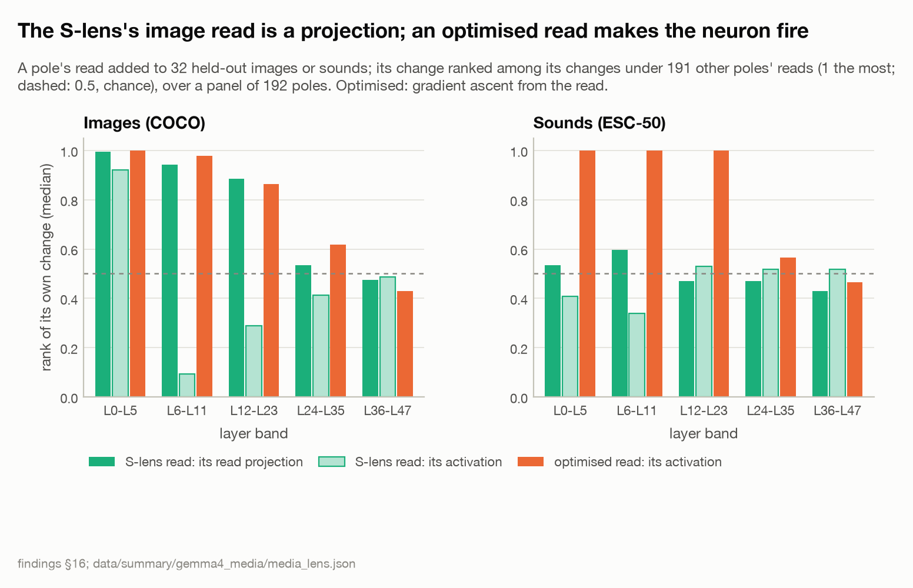

- **The image read is a projection, not a stimulus.** It moves the pole's own read projection most
  through L23, but raises the pole's activation only at L0-L5, and lowers it at L6-L23 (0.09-0.29):
  past the first layers, what aligns with the read direction at the input is not what makes the
  neuron fire. The audio read is at chance on both counts.
- **Optimised reads drive the neuron.** Starting from the read, gradient ascent through the model
  (`15_media_optimised.py`: one pattern tiled over all 64 slots, at 8% of the pixel range or 0.3 of a
  frame's RMS, 24 Adam steps over 128 images or clips) finds a patch or a 40 ms frame that raises its
  pole on held-out inputs through L23. For the catalog's 48 best-labelled poles a layer (L0-L35), it
  raises the pole on 8 held-out documents for 87% and 59% of image poles in the association and workspace bands (49% at
  L33-L35) and 97% and 57% of audio poles (44%); at L12-L23, 70% and 86%. Both are near chance past L35.
- **Deep neurons respond to whole sounds.** Past L35, where one repeated frame does nothing, a 10 s
  clip synthesised for each of 24 poles (one `+` pole a layer from L24, optimised as a spectrogram so
  it stays sound-like) drives its own pole more than the other 23 clips do in a different prompt, at a
  median rank of 0.87 (`checks/synth_audio.py`); one pole a layer is a small sample.
- **The patch reads share one pattern; the optimised patches don't.** Raw S-lens reads carry the same
  column streaks from neuron to neuron, a hub pattern like the hub tokens of text reads (§1); the
  optimised patches differ by neuron.

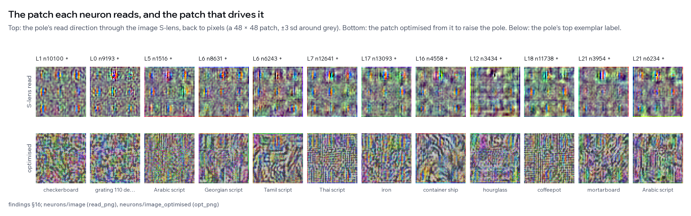

**Limits.** A read is one slot pattern summed over the 64 slots, not a map of where in an image it
sits. Media lenses are fitted on photos (COCO) and environmental sounds (ESC-50) only. Labels name
what a document is about, not each patch or frame. The audio tests' held-out clips are among the audio
S-lens's fitting clips (all of ESC-50), though not the optimisation's.

### §17. One concept in text, images and sound

**Setup** (`checks/crossmodal.py`). For every pole with a reliable image or audio label (§16; labels
that name a whole collection or a synthetic probe are left out), the label's rank among the
modality's labels on the text side, three ways: how hard the pole fires on `Here is an example:
{label}.`, its text S-lens read (`read_S`) and its text R-lens write (`write_R`), each scoring the
label's tokens. A rank of 0.95 or more passes; a shuffled pairing passes 5%.

| | image labels: share passing | audio labels: share passing |
|---|---|---|
| its words fire it | 31% (by band 22 / 29 / 41%) | 9% |
| the text S-lens reads it | 8% | 9% |
| the text R-lens writes it | 14% (by band 13 / 12 / 15%) | 8% |
| all three | 4,382 poles | 730 poles |
| poles scored | 253,785 | 248,033 |

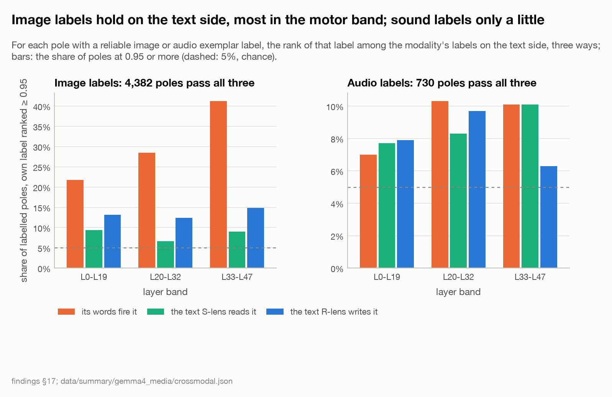

- **Image concepts are text concepts from the middle on.** At L12-L23, 42% of the poles that respond to an image label also
  fire on its name in text, against 5% by chance, and 41% in the motor band; 8% at L0-L11, where image labels are mostly
  visual primitives.
- **Sound is weaker:** 9% fire on their label's name, about twice chance.
- **19 poles hold one concept across all three modalities.** Of 48,497 poles with a reliable label in
  both images and sound, 19 pass all three text tests for both, where independent lists would share
  2.0. They are places and peoples, with their language:

| pole | image label | audio label | exact text drivers | R-lens read of its write |
|---|---|---|---|---|
| `L14 n8313 +` | mosque indoor | Arabic | Amal, أ, Mohamed, Noor | Arabic, Quran, islamic, Saudi |
| `L23 n2831 +` | Sarees | Gujarati | Tendulkar, Karnataka, Bengaluru, lakhs | Mumbai, India, Hyderabad, Delhi |
| `L33 n5249 +` | tacos | Spanish | Peruvian, Ecuadorian, Mexican, Aztecs | Mexican, 墨西哥 (Mexico), Mexico |
| `L33 n6099 +` | pagoda | Mandarin Chinese | WeChat, Xiaomi, Weibo, Shanghai | Chinese, China, Beijing, 中国 |
| `L36 n14109 +` | totem pole | Maori | Cherokee, Navajo, Apache, Mohawk | Native, Indian, Indigenous, Cherokee |
| `L37 n7165 +` | giant panda | Mandarin Chinese | 熊猫 (panda), 四川 (Sichuan), 成都 (Chengdu) | panda, 熊猫, Chengdu |

  The others pair mosques, a pyramid or Arabian camels with Arabic (8 poles), a coral reef with Māori, a giant panda with
  Mandarin, tacos with Spanish, and Pembroke corgis with Welsh. Firing on both names alone is near chance (1,692 poles
  against 1,369 expected): the lenses' reads are what make the triple match specific.

**Limits.** Label words are English and scored in one template; a rank among the modality's labels
says the pole prefers this label to the others, not that the concept is all it does. Exemplar labels
come from the collections, whose coverage of a concept varies. The S-lens test reads every pole as `â ± b̂` with unit rows in
the raw basis; the catalog's `read_S` normalizes them in the residual's metric (§15; median cosine 0.995-1.000 by layer)
and reads negative-lobe poles by the up row alone (§7; 0.1-15% of a layer's poles, most at L4-L8).

### §18. Attention heads in image and audio contexts

**Setup** (`checks/head_media.py --n 64`). 64 mini-ImageNet validation images (64 classes) and 64
ESC-50 clips (49 classes), each in the media prompt and followed by ` a <label>`, its own and another
class's. Per head: attention from the text after the image or sound to its slots, against an even
spread over the keys; within the media, attention to the same slot, the other slots and grid
neighbours; each head zeroed in turn, the rise in the right label's loss minus a wrong one's, as a z
over documents (*content carriers*); and the head's output at the article read through the R-lens
`mid`, as the right class's mean percentile among the classes, against 200 label shuffles with BH
over heads (*label writers*). Per-head values are in `heads/image` and `heads/audio`.

- **The model knows what it sees, but barely what it hears.** The right label's loss is below a wrong
  one's for 97% of images (3.64 against 10.29 nats), 55% of sounds (6.48 against 6.56).
- **Images: early heads look within the image, later ones carry it out.** L0-L3 heads attend from a
  slot to its grid neighbours (L0h13: 0.85). Reading from the text into the image peaks at L23-L31
  and L44 (L24h13 and L44h7 at 0.96 of an even spread). Zeroing single heads costs the right label
  more than a wrong one, most for L28h6 (z 9.9), L29h1 (9.7), L29h9 (8.4) and L25h2 (7.9): 33% of the
  workspace band's heads pass z > 3 (association 4%, motor 9%). By the size of the loss, early heads L8h15 and L7h13 cost the most
  (0.75 and 0.65 nats, z 5). 44% of the workspace band's heads and 39% of motor's write the right class
  (q ≤ 0.05; association 17%), most at L35-L46 (L37h10 and L44h7: the right class's mean percentile 0.955).
- **Sound: heads read it early and nothing carries it.** The text attends to the audio most at L0-L10
  (L8h5: 1.40 times an even spread), but no head passes z > 3 and no head writes the right class.
- Which heads read the media is shared across modalities (Spearman +0.51 between image and audio
  reading), and which carry content is not (+0.09).

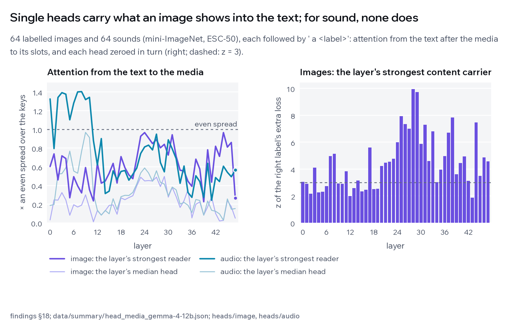

**Limits.** 64 documents a modality in one prompt; zeroing a head measures what the model loses
without it, not all it does. With the model near chance on sound, the audio results say little.

## VI. Across Qwen3's sizes

Nine more Qwen3 models, 0.6B to 14B, post-trained and base: which reads change with size (§19), and why the family is
three lineages rather than five sizes (§20).

### §19. The Qwen3 family: what changes with size

**Setup** (`scripts/catalog_queue.sh` on two H100s, Qwen3-8B's stages and precision). Nine more catalogs: the post-trained
Qwen3-0.6B, 1.7B, 4B and 14B, and the bases 0.6B, 1.7B, 4B, 8B and 14B (Qwen's dense bases go up to 14B). Each model has
its own R-lens, S-lens and scale, fitted on the same 1,000 DCLM documents as Qwen3-8B's (split-half 0.06 or less at every
layer of every one), and its catalog covers the same 63,990 activation documents (a base renders the chat slice with its
post-trained sibling's template). Steering is §3's protocol through each model's own R-lens (`checks/causal_lens.py`: 32
random neurons a layer, 16 contexts of 64 tokens, 1× `act_top`); the reads are tested at the firings as in §8
(`checks/reads_at_firings.py`), as shares of the poles that fire (not near-silent) past the mismatched pairs' 99% point,
net of theirs. Models are compared by quarter of relative depth. Depth and width grow together in this family: 0.6B and
1.7B have 28 layers (1,024 and 2,048 wide), 4B and 8B 36 (2,560 and 4,096), 14B 40 (5,120). And the five are three
lineages: the 0.6B and the 4B are pruned from the 1.7B and the 8B (§20), so a pair of equal depth sets a pruned model
beside its parent, and a comparison between 28 and 36 layers crosses lineages too.

Post-trained models, by quarter (Q1 / Q2 / Q3 / Q4):

| model | `read_S` names the firing token | `read_R` names the drivers | `write_R` promotes the next token | steering r (median) | near-silent poles, Q1 |
|---|---|---|---|---|---|
| 0.6B | .60 / .23 / .18 / .23 | .37 / .33 / .31 / .34 | .02 / .02 / .09 / .24 | .62 / .80 / .90 / .99 | .00 |
| 1.7B | .57 / .25 / .19 / .16 | .15 / .21 / .26 / .19 | .02 / .01 / .08 / .29 | .49 / .73 / .90 / .99 | .01 |
| 4B | .40 / .08 / .08 / .05 | .15 / .19 / .21 / .27 | .02 / .02 / .08 / .24 | .40 / .65 / .87 / .98 | .14 |
| 8B | .32 / .04 / .05 / .02 | .09 / .16 / .23 / .23 | .03 / .02 / .07 / .24 | .36 / .66 / .90 / .99 | .19 |
| 14B | .43 / .05 / .04 / .02 | .10 / .17 / .22 / .28 | .03 / .02 / .07 / .23 | .31 / .58 / .87 / .98 | .20 |

- **The S-lens's input reads fall between 28 and 36 layers.** Past the first quarter it names the firing token for 16-25%
  of the 28-layer models' firing poles and 2-8% of the 36- and 40-layer models'. At 28 layers width changes little (0.6B
  and 1.7B within 0.07 of each other in every quarter); at 36 the wider 8B sits below the 4B (0.02-0.05 against
  0.05-0.08); the 14B, 4 layers deeper and 1,024 wider, matches the 8B. This suggests depth first, then a floor, but five
  sizes that grow in both can't separate the two, and the step from 28 to 36 layers is also a step from the 1.7B's lineage
  to the 8B's (§20). The 14B, a lineage of its own, is the one independent check of it.
- **The R-lens's input reads hold.** In the last quarter it names the drivers of 19-34% of firing poles at every size. The
  input side turns to it (the first layer where its read passes for as many firing poles as the S-lens's, on three-layer
  medians, and keeps doing so on half the layers after) at about a quarter of the depth: L7 of 28 (0.6B), L10 of 28
  (1.7B), L10 of 36 (4B), L9 of 36 (8B, §7), L10 of 40 (14B).
- **Late writes read the same at every size.** The write's R-lens read promotes what follows the firings for 23-29% of
  firing poles in the last quarter, and steering's median r is 0.87-0.90 in the third quarter and 0.98-0.99 in the last.
- **Early writes are less legible in larger models.** The first quarter's median steering r falls at every step in size,
  0.62, 0.49, 0.40, 0.36, 0.31 (second quarter 0.80, 0.73, 0.65, 0.66, 0.58), and the first layer from which it stays at
  0.35 or more moves from L0 (both 28-layer models) to L3 (4B), L4 (8B) and L7 (14B).
- **Near-silent poles appear at 36 layers** (§2): 1% or less of the 28-layer models' first-quarter poles, 14%, 19% and 20%
  of the 4B's, 8B's and 14B's, none later at any size. The 4B's are the 8B's, kept through its pruning (§20).
- **Fewer one-token detectors.** Poles with a third of their top firings on one token, of the first quarter's firing
  poles: 0.40, 0.35, 0.35, 0.33, 0.29. These are the poles the S-lens reads best, so their decline accounts for part of its
  drop.
- **Heads read less with size** (uncorrected p ≤ 0.05, 5% by chance; §11). In the last quarter the OV read promotes what
  follows the query for 45%, 44%, 40%, 41% and 37% of heads, and the QK read names the attended token for 32%, 31%, 27%,
  24% and 22%.
- **What drives a pole** (`sources`, §12) splits between earlier neurons and heads alike at every size: neurons carry
  54-59% of it on average from L4 through the third quarter (36-76% by layer) and 76-82% in the last quarter.

**The bases read like their siblings, but for a null.** On the S-lens's reads, steering and near-silent poles they match
within 0.03, and the write's next-token read trails a little (last quarter 0.19-0.24 against 0.23-0.29). The R-lens input
read seems to trail at every size: last quarter 0.19 against 0.34 (0.6B), 0.11 against 0.19 (1.7B), 0.14 against 0.27
(4B), 0.09 against 0.23 (8B), 0.21 against 0.28 (14B), so their input side would turn to the R-lens later, and the
1.7B-Base's never (by quarter its R-lens read passes for 6-16% of firing poles, its S-lens read for 18-58%). The gap is in
the test's null, not in the reads:
- Swapping read rows between a model and its base moves `read_R`'s share by 0.01 at most; swapping the R-lens moves all of
  it, through its Jacobian in the 8B (the base's Jacobian with the post-trained unembedding scores close to the base) and
  in the 4B's last quarter, while the 4B's readout, its tied embedding, carries most of it earlier.
- `reads_at_firings.py` scores each pole against a null pooled over its layer's mismatched pairs, and the base's lens widens
  that null with a few promiscuous reads: the 1% of poles that score highest on other poles' drivers (through the
  8B-Base's lens, mostly frequent function words across scripts such as `在`, `对`, `に`, `を`, tabs and single capitals)
  hold 53-81% of the null's 99%-point exceedances by quarter, against 34-60% through the post-trained lens, and lift that
  point from 1.2-1.5 to 1.6-2.4.
- Held to a null of its own (its score on its drivers against its score on 16 other poles'), a pole passes as often through
  either lens:

  | model, `read_R` | pooled null, by quarter | own null, by quarter |
  |---|---|---|
  | 8B, its lens | .06 / .16 / .25 / .25 | .29 / .36 / .41 / .61 |
  | 8B, its base's lens | .03 / .03 / .13 / .07 | .35 / .37 / .42 / .62 |
  | 4B, its lens | .13 / .20 / .23 / .33 | .40 / .36 / .38 / .59 |
  | 4B, its base's lens | .07 / .10 / .17 / .13 | .44 / .37 / .38 / .61 |

  The 8B-Base's own drivers give the same shares within 0.01. So post-training doesn't line up what neurons read with what
  the model says, or change how well a base's R-lens names a pole's drivers; it makes a few of the lens's reads less
  promiscuous. The logit lens on read directions (the identity in place of the Jacobian) has the 8B's narrowest null (a
  99% point of 0.85-1.13) but passes fewer poles against their own in both models (.16 / .31 / .34 / .55 in the 8B).

**What post-training changed** (`checks/post_training.py`: Qwen3-8B and Qwen3-4B against their bases, weights only, each
model's lenses of record; post-training keeps the neurons' indices). Every matrix moves by 5-11% of its norm in the 8B and
6-13% in the 4B, the norms by 6% or less and the final norm by 0.3-0.4%; the embedding and unembedding by 7% and 9% (the
4B's, tied, 12%). The change is spread out: `ΔW_down`'s participation ratio is 824-2,506 of the 8B's 4,096 dimensions
(664-1,667 of the 4B's 2,560), its top direction 0.2-2.6% of it. Neurons keep their directions (write and read cosines
0.991-0.998), and a write's R-lens top 10 keeps 4-5 of its tokens at L0-L3 and 7-9 in the last quarter (medians). The
clearest directions of `ΔW_down`, read through the post-trained R-lens from L12 on, are questions (`?`, `吗`), hedges
(`maybe`, `perhaps`, `也许`, `可能`), contrast (`但`, `but`), consequence (`因此`, `thus`) and explanation (`也就是说`,
`例如`), in both models; the 4B adds `Wait` (L34), `Let` and `让我们` (L29) and the chat template's `<think>` and
`<|im_start|>` (L31-L33). That suggests the style of the models' reasoning traces; a direction's sign isn't fixed (both
ends are listed), and each holds about 1% or less of a layer's change past L3.

**Limits.** One family, five sizes in three lineages (§20), and depth and width grow together; quarters average layers of
different roles; the shares are token-level (§8), not judgments of coherence; the post-trained models' labels are checked
for firing only (§13), and the bases have none. Every lens was fitted on 1,000 documents whatever the model's size. At
L1-L3, a few firings with near-zero gate or `up` dominate `sources`' layer means (a share's worst error reaches 533 at the
4B-Base's L2), so the sources bullet starts at L4. The pooled null's shares depend on its tail, which a few promiscuous
reads lift, so a comparison between lenses or models on them can move under a null per pole; only `read_R` between the
bases and their siblings was checked. The weight diff covers two sizes, reads the MLPs' writes and no heads, and uses the
post-trained model's lobe signs and near-silent poles for its base. Compact outputs are
`data/summary/{reads_at_firings,causal_lens,sources,head_sources,edges,reads,post_training}_<model>.*`.

### §20. Qwen3-4B and 0.6B are pruned from the 8B and the 1.7B

**Setup** (`checks/lineage.py`: weights and the catalogs' `acts` and `reads` tables, on a CPU). Each pair has the same
layers and heads: the 4B and the 8B 36 layers of 32 query and 8 key-value heads, the 0.6B and the 1.7B 28 layers of 16 and
8, all of 128 dimensions. They differ in width: residuals of 2,560 against 4,096 and 1,024 against 2,048, MLPs of 9,728
neurons against 12,288 and 3,072 against 6,144. A neuron's RMS activation comes from `acts`; near-silent neurons have both
poles' `act_top` under 0.05 (§2). To match neurons across a pair, a linear map from the parent's residual to the model's is
fitted on the heads' q and k rows (times the input norm's gain), which read the normed residual and keep their
head-internal basis; it is tested on held-out layers, then refitted on all of them. A neuron's score against a parent
neuron of the same layer is the mean cosine of their gate rows and of their up rows, the parent's taken through the map,
and its match comes from a one-to-one assignment (Hungarian). The null is its best score against the parent's layer half
the depth away.

- **In the 4B and the 0.6B, neuron index tracks activation.** In a model trained from a random start, indices are
  exchangeable: the 1.7B, 8B, 14B and Gemma 4 have Spearman ρ between a neuron's index and its RMS activation within ±0.03
  on every layer. The 4B ranges from −0.76 to +0.21 by layer (|ρ| > 0.1 on 34 of 36 layers) and the 0.6B from −0.63 to
  −0.09 (27 of 28); in both, the most active neurons come first. Other models' near-silent neurons sit at a mean position of
  0.49-0.50 in their layer; the 4B's fill the end of L1 (4,469 at a mean position of 0.76) and of L3 (2,302 at 0.85), and
  spread over L2, where the order doesn't follow activation. Post-training keeps each neuron's index and direction (§19),
  so the bases share the order.
- **The heads are the parent's, one for one.** By layer, the correlation over heads of their weight norms between the 4B
  and the 8B has medians of 0.96 (q) and 0.98 (k, v, o), 0.99 for the q_norm and k_norm gains, and −0.00 with the parent's
  heads shuffled; between the 0.6B and the 1.7B, 0.93-0.97, 0.97-0.99 and −0.07. Castin et al. (2026, KV-Lingo, their
  appendix G) report the same pairs' heads aligned one to one.
- **The residual is a linear image of the parent's.** Most of the 0.6B's coordinates are the 1.7B's: 1,008 of its 1,024
  embedding columns match distinct ones (median |r| 0.23, 0.08 for the second best). The 4B's coordinates don't match, but
  a linear map holds: fitted on the even layers' q and k rows, it predicts the odd layers' at a median cosine of 0.55
  (0.18-0.73 by layer), and the next head's rows at 0.05. For the 0.6B these are 0.40 and 0.02.
- **Nearly every neuron of the 4B has a parent.** Its best score clears the null's 99% point for 99-100% of neurons at
  L1-L34, 90% at L0 and 95% at L35 (median best 0.13-0.59 by layer, null 0.07-0.12), and 92-100% of best matches are
  distinct, except at L1-L3 (53-79%), where near-silent neurons look alike. Matched pairs keep their scale (ρ 0.85-0.95
  between their RMS activations) and what they write: through each model's own R-lens, a pair's write reads share 10-30%
  of their top 16 tokens, random pairs 0.0-0.8% from L5. The 0.6B's matches are weaker, like its map: 36-54% clear the
  null at L0-L5 and 73-98% from L6, pairs' activations correlate at ρ 0.61-0.87, and their write reads share 4-24%.
- **The order follows the parent's activation, and the cut took the least active neurons.** A neuron's index has no
  relation to its parent's (ρ −0.04 to +0.03), but follows the parent's RMS activation, more closely than the model's own
  on 33 of the 4B's 36 layers and all 28 of the 0.6B's (to ρ −0.74 and −0.72). The parent neurons the assignment leaves out
  are the pruned ones. In the 4B, at L1-L3 they are almost all the 8B's near-silent neurons (93%, 89% and 96% of the
  2,560), and every near-silent neuron the 4B kept there matches one of the 8B's (99-100%, against 1-5% of its firing
  neurons); at L4 the cut took 973 of the 8B's 1,079 near-silent neurons, leaving none; later, the pruned neurons' median
  RMS activation is 0.70-1.02 of the kept ones', lowest at L5-L7 and L34-L35. In the 0.6B the ratio is 0.62-0.99.
- **Most parents are identified by signals that don't use the map:** the correlation of the two neurons' activations over
  the same documents (Pearson and Spearman from position 1; 49k positions for the 4B, 196k for the 0.6B, bf16 on an RTX
  4090), or the tokens their writes' R-lens reads share (at least 4 of 64 and a unique best). A parent counts as identified
  when the weight match is also some signal's best, which shuffled neurons reach for 0.0-0.2% of a layer. A second round
  fits each layer's own maps on the identified pairs (cross-fitted, so no pair is scored through a map it helped fit;
  held out, they recover 96-100% of the 4B's pairs and 82-97% of the 0.6B's) and rescores the rest against the parents no
  pair holds, so every neuron ends with a parent of its own:

  | model | identified | weight match in a signal's top 4 | weights alone | near-silent, as a class |
  |---|---|---|---|---|
  | 4B | 93.3% (93-100% by layer at L4-L33, 91% at L34, 68% at L35, 85% at L0) | 1.2% | 2.2% | 3.3% |
  | 0.6B | 85.3% (67-94% by layer; under 80% at L0-L2 and L27) | 5.0% | 9.7% | none |

  That is 96.5% of the 4B's firing neurons. Its near-silent neurons at L1-L3 match the 8B's as a class but not one by
  one: their weights have shrunk toward a shared direction (best and second-best scores within 0.005, even with up to 64
  shared components removed), and their activations are noise. Pearson agrees with the weights most often (96.6-99.6% at
  the 4B's L8-L28); the write reads add most at the last layers, where the activations agree least.

**What this suggests.** This is what width pruning by activation leaves (Muralidharan et al. 2024, Minitron: rank each
layer's neurons, heads and embedding channels by their activations on calibration data, keep the top ones, then distill):
the heads stay in place; the residual narrows by channel (the 0.6B) or under enough retraining that only a linear map
survives (the 4B); each MLP's neurons are ranked by activation and cut, near-silent ones first, and the kept ones stay in
rank order. Both sides trained a long way after the cut, so scores are 0.3-0.6 rather than 1, and the parent may have been
an earlier checkpoint. Qwen's technical report describes one pre-training recipe for every dense size and distillation
from larger models in post-training; it doesn't mention pruning.

**What it confounds.**
- **The size comparison (§19).** The five post-trained sizes are three lineages: the 1.7B's (0.6B and 1.7B, 28 layers),
  the 8B's (4B and 8B, 36 layers) and the 14B's (40 layers). The step in the S-lens's input reads from 28 to 36 layers is
  also a step between lineages, and the 14B, which reads like the 8B, is the only check that it goes with depth.
- **Width within a lineage (§19).** The 0.6B against the 1.7B and the 4B against the 8B set a cut-down, distilled model
  beside its parent, not two widths trained alike. The 4B's near-silent poles are the 8B's, inherited.
- **Index ranges.** In these two models a range of neuron indices is a slice by activation rank, not a random sample. The
  catalog's statistics cover every neuron and its steering check samples them at random, so its tables and §19's shares
  stand; a pilot, plot or test over an index range in these models doesn't.

**Limits.** The parents are the released models, so the network at the cut is inferred. The activations cover 49k-196k
positions of three slices (DCLM, Chinese web text, code), not chat. "Identified" means two methods agree, each over a whole
layer, and its error rate is estimated from shuffled neurons only: a wrong parent that both writes and fires like the true
one, such as a redundant neuron of the parent's, would pass. Where the signals don't agree, the weight match is a best
guess, forced one to one. The 0.6B's parent's 444 near-silent L1 neurons were not clearly cut first (the assignment leaves
out 52 of them). The key behind the 4B's order at L0, L2 and L8-L11 isn't recovered from the final weights. Compact
outputs are `data/summary/lineage_<model>.*`. Each neuron's parent and status are in the catalog's `lineage` table
(`lineage.py table`: each pruned model's neurons with their parent and each parent's with its child or `cut`, the bases
the same), and neuron-lens.com links each neuron to its counterpart.

## VII. What the lenses miss

What lies outside the R-lens's reads, and what removing it breaks (§21).

### §21. The dark sector: what the R-lens barely reads

**Setup** (`checks/dark_sector.py`: Qwen3-8B in bf16 on an RTX 4090 and an H100, statistics in fp32; the lens of record).
At each layer's output, the R-lens readout in the residual's metric, `W̄_U diag(γ_f) J_L diag(s)` (`W̄_U`: the kept
unembedding, centred over tokens), has eigenvectors ordered by gain. A layer's *bright sector* is the fewest of them that
carry 90% of the lens energy of the layer's writes; its *dark sector* is the rest, orthogonal in the metric. To *ablate*
a sector of an MLP output is to replace that part with its mean over 64 held-out DCLM documents, at every position but the
first. Controls remove random subspaces of the dark and the bright dimension, or the whole MLP output. Single layers are
scored on 64 other DCLM documents of 128 tokens (positions 16-126), bands of layers on 32 documents of each activation
slice. Generations are greedy, 48 tokens, from ten prompts (seven plain, three in the chat template without thinking).

**The sectors.** The bright sector has 60-192 directions at L0-L3, 610 at L9, 1,114 at L15, 1,920 at L21, 2,688 at L27 and
3,367 at L35, of 4,096. In context the residual is 87-95% dark at L0-L3, 71-81% at L4-L15 and 34-50% from L24 (energy in
the metric). An MLP output is about as dark as a vector with its energy per coordinate (L9: 0.91 against 0.93): its
darkness comes from which coordinates it uses, not from avoiding the lens's directions.
- **The readout's loudest direction is the residual's massive-activation offset.** At every layer one direction reads far
  louder than the rest (2,060-3,830 times a random direction at L0-L9, holding 50-93% of the readout's gain there; 50-730
  later), sitting on a few raw coordinates (eight at L0-L9; 4081 leads from L11). The residual barely varies along it at
  ordinary positions and is 7-115 times larger at the first position from L6. Setting it to its mean costs 0.01-0.15 nats
  a token, and setting it to zero 8.8-11.8 at L0-L8: the massive activations of Sun et al. (2024,
  [arXiv:2402.17762](https://arxiv.org/abs/2402.17762)), few, huge, fixed and needed as they are. Through the lens it
  reads as a frequency axis (its push on the kept tokens follows their log frequency, |ρ| 0.36-0.46), and from L10
  doubling it flattens the predictions. It carries nothing two prompts differ in, so the loudness and soft weights below
  leave it out.
- **Early dark directions stay dark; later ones are cancelled.** How loud a layer's dark sector is to each later layer's
  lens, against a random direction (1 = as loud): L1's and L3's are at most 0.11 to every lens through L15, and 0.17-0.39
  to the unembedding itself. L9's and L12's are at most 0.15 within three layers but up to 0.66-0.76 later: what keeps
  them dark is what the layers in between do to them.

**The lens misses what the dark sector does.** Ablating one layer's dark sector moves the output by a KL of 0.03-0.10 at
L1-L15, 300-5,700 times what the lens predicts (`W_U (γ_f ⊙ J_L Δm) / rms`). It raises the loss by 0.03-0.04 nats at
L2-L9, 2-5 times the bright sector's cost, though per unit of energy removed it matters less than the bright sector or a
random subspace of its size. From L22 the bright sector costs more, and one late layer's dark sector costs little alone
(≤ 0.006 nats at L27-L33). At L35, where the lens is the unembedding, it predicts the dark ablation (KL 0.076 against
0.107).
- **Neurons read the bright sector more than its share.** The dark sector supplies 60-93% of what drives the top 1% of
  activations through L21, less than a random subspace of its size would (79-99%). A dark perturbation stays dark (after
  L9's dark sector is removed, the bright share of the change over the next four layers is 0.08-0.17), carried forward
  mostly by later MLPs, and the later neurons it moves most are formatting and token units (code separators, punctuation,
  line-break runs, word fragments); removing the bright sector moves later neurons half as much, and more topical ones.
- **L16's MLP stands apart:** its output carries ten times its neighbours' energy, 91% of it dark, and dark perturbations
  from L9 and L12-L15 grow 8-12 fold there.

**Removing a sector over a band of layers.** Loss added, in nats per token:

| band | dark removed: DCLM / code / Chinese / chat | bright removed |
|---|---|---|
| L0 | +1.05 / +2.15 / +2.31 / +0.60 | +0.07-0.19 |
| L1-L8 | +1.41 / +1.76 / +1.12 / +1.02 | +0.35-0.67 |
| L9-L20 | +0.51 / +0.80 / +0.46 / +0.38 | +0.35 / +0.76 / +1.11 / +0.19 |
| L21-L35 | +0.77 / +0.91 / +1.02 / +0.45 | +4.16 / +6.81 / +9.54 / +4.51 |
| L1-L35 | +3.70 / +8.33 / +4.13 / +3.73 | +5.59 / +9.79 / +11.49 / +5.99 |

The whole MLP output removed at L9-L20 adds 1.11-3.52, and at L1-L35 6.16-12.76. One late layer's dark sector costs
little alone, but L21-L35's together cost 0.45-1.02: they cover for each other.

**Three depths, three kinds of damage**, from the generations and a comprehension test. Each test item asks who did the
action in one sentence (forced choice between the two nouns, both orders), over seven types sharing their nouns and verbs:
reversible active, subject relative, passive and object relative, and non-reversible (an inanimate patient) active,
passive and object relative. The clean model gets 94-100% of items of every type.
- **Early (L0, L1-L8): form and frame.** The text stays fluent. L0's ablation writes "rome", "madrid" and "Alibabaibaba",
  and its Chinese collapses into a loop ("是首长，首长是首长"); L1-L8's drifts in genre and fact ("The mitochondria is not
  the powerhouse of the cell"; The Hague for the Netherlands), and chat replies turn into reasoning traces ("Okay, so I
  need to explain…"). Comprehension fails on the sentences only syntax decides: with L0's dark sector removed, object
  relatives fall to 0.52 and the rest stay at 0.90-1.00, the pattern Caramazza & Zurif (1976) report for agrammatic
  patients. The pattern isn't specific to the dark sector: removing the whole MLP output or a random subspace at L1-L8, on
  the sentence alone, reverses passives (0.21-0.38).
- **Middle (L9-L20): facts and use of context.** The text loops and is wrong: "The capital of France is a city in the south
  of France, and the capital of the south is the city of Marseille"; code becomes a column of `# print(fibonacci(n))`;
  asked who it is, the model answers "I am an AI assistant", without its name. Comprehension fails broadly and
  specifically: at most 9% of the clean margin kept on any type, object relatives below chance (0.23), against 6-22% kept
  by a random subspace of the dimension. On the sentence alone or at the answer alone it keeps 66-98%: what fails is
  answering from the sentence, not reading it.
- **Late (L21-L35): pieces of words.** The content stays right and pieces go missing ("I am Q, a large language model",
  "due Ray scattering", "passes through Earth atmosphere"), and comprehension holds (92-100% of items). Removing the late
  bright sector instead reduces every prompt to "the, the, the", with comprehension kept.

**Swapping a sector between two prompts** (`patch`). A sector of one layer's residual, at chosen positions, takes its value
from another prompt's run, and the target's output is scored by how far it moves toward the source's: the share of the
gap in the two answers' log-prob difference, and how often the top token switches. Controls: random subspaces of each
sector's dimension, and the whole residual.
- **What two prompts differ in turns bright by L4-L10.** In 99 pairs like "The capital of Italy is" and "The capital of
  France is", patched at every position, the country moves with the dark sector at L0-L8 (0.67-0.99 of the gap), no more
  than a random subspace of its size, and with the bright sector from L10 (0.92-0.99; 90-100% of answers switch), when the
  dark sector, still 78% of the dimensions, moves 0.01-0.08 and switches none. Which piece finishes a word moves with the
  bright sector from L3. Patched at the last position of "中国的首都是" from an English prompt about another country, the
  bright sector at L6-L16 makes every pair answer its own capital in English ("Beijing"); the dark sector moves the
  answer's language at most 0.15 at any layer.
- **The rest of the difference changes nothing.** At L4-L16, 64-83% of the energy of the two prompts' difference is dark.
  Patched from L10, the dark sector moves the next token's distribution by a KL of 0.02-0.12 (the whole residual: 7.7) and
  the next 20 teacher-forced tokens' by at most 0.05 (0.29-0.44). Of 65 greedy continuations with the dark sector patched
  at L6 or later, 39 match the clean ones word for word; with the bright sector, 9.
- **Settings are read from the tokens that set them.** Pairs that keep the content and change a setting (a question asked
  plainly or in the chat template, thinking on or off, a word in capitals, a list after commas or bullets), 64 each:
  patching the tokens the two prompts share switches nothing before L20, even with the whole residual, since later layers
  read the setting again from its own tokens. At the last position the whole residual switches thinking from L11-L12, and
  the bright sector follows (L20-L21, 88-100% of pairs); the dark sector never does, except the list's comma or new line
  over the last layers (86% of pairs at L33, all at L34-L35).
- **Prompts with nothing in common but the template** (`far`): a story request against small talk, in the chat template,
  32 pairs each way. The reply's opening switches with the dark sector at L0-L2 (66-88%), less often than with a random
  subspace of its size from L4, and from L12 almost never (0-9%); the bright sector switches it from L12 (53-72% at
  L16-L20). In between the two mix: with the bright sector from the small talk and the rest from the story request, the
  reply at L6 is a story titled "Monday on the Moon".

**Brightness without a cut** (`soft`). Patching a pair's difference along the lens's directions in order of gain, half of a
swap's effect takes 400-880 directions for the country at L0-L8 and 160-290 at L10-L20, 105-150 for the next word piece
through L16 and 140-340 for the answer's language, where random subspaces take about 1,300-2,900: the lens ranks what
prompts differ in 2.5-20 times above chance at every layer, the early ones included, where the 90% cut (60-520 directions)
left it in the dark sector. A soft weighting, `g / (g + ḡ)` (a direction's gain against a random one's), hands over where
the hard cut does. Thinking mode is the exception: at L6-L16 it takes 2,100-2,700 directions, as random ones do.

**The middle layers** (`middle`), where neither bright sector carries the difference. Pairs split in halves; subspaces of
8-512 directions are patched on the second half: each lens's top directions, their blends, the union of both, and the top
directions of the first half's differences and of its answers' gradients.
- **Not a blend of the two lenses.** Points along the rotation from the S-lens's directions to the R-lens's hold about as
  much as its ends, and their apparent gains at L0-L4 vanish in the union of the two lenses' directions.
- **The country needs the R-lens's top directions and more of the difference besides.** At L4-L8 the R-lens's top 512
  carry 0.14-0.31 of the gap; adding the S-lens's top 512 brings 0.68-0.73, the R-lens's next 512 0.53-0.74 and 512 random
  directions 0.41-0.59, each about in proportion to the share of the difference's energy it adds. The country is compact:
  32 directions fitted on the capital prompts carry 0.63-0.86 of it on official-language prompts.
- **Some variables sit outside both lenses.** At L12, 8 directions fitted on other questions switch thinking mode in every
  pair (0.80 of the gap), while either lens's top 1,024 carries at most 0.18 and switches none. The answer's gradients are
  R-like (their top 32 directions overlap the R-lens's at 4-97 times chance) yet carry at most 0.37 of the gap.

**The two lenses together read every direction, and some barely** (`span`, `--doubly`, fp64). Every readout is full rank,
with singular values spread over many orders of magnitude; the residual's metric restores the two coordinates the final
norm nearly ignores (§9). Early on the R-lens barely reads about half the residual (its Jacobian's singular values span
10⁶-10⁸ at L0-L12), and the S-lens reads that half: with both Grams scaled and summed, every direction at every layer is
read by one lens or the other within a factor of about 1,000 of its second loudest. But 2,960-3,290 directions are quieter
than a random one to both lenses at L0-L22, so "dark to neither" holds only at that loose factor. The S-lens's own bright
sector (the same rule on its token footprints `K_L ē`) has 908 directions at L0, 761 at L9 and 59 at L35; outside the
R-lens's bright sector it is `s_only`, and the directions orthogonal to both bright sectors are the *doubly dark* sector:
3,030-3,340 at L0-L3, 2,330-2,940 at L4-L15 and 670-2,220 later, holding 55-73% of the residual's energy at L0-L3 and
49-60% at L4-L15 (a soft version from the two Grams holds it almost whole and ablates the same).
- **The doubly dark sector carries a half to two thirds of the dark sector's cost; `s_only` almost none.** Over bands, in
  nats per token (DCLM / code / Chinese / chat):

  | band | dark sector | doubly dark | `s_only` | random, doubly dark's size |
  |---|---|---|---|---|
  | L0 | +1.05 / 2.15 / 2.31 / 0.60 | +0.16 / 0.51 / 0.43 / 0.12 | +0.01-0.04 | +1.92-4.19 |
  | L1-L8 | +1.41 / 1.76 / 1.12 / 1.02 | +0.72 / 1.22 / 0.66 / 0.58 | +0.03-0.10 | +3.28-4.47 |
  | L9-L20 | +0.51 / 0.80 / 0.46 / 0.38 | +0.35 / 0.57 / 0.29 / 0.19 | +0.04-0.17 | +0.35-1.22 |
  | L21-L35 | +0.77 / 0.91 / 1.02 / 0.45 | +0.51 / 0.74 / 0.97 / 0.56 | −0.20 to +0.22 | +0.60-1.71 |
  | L1-L35 | +3.70 / 8.33 / 4.13 / 3.73 | +2.42 / 5.05 / 2.28 / 2.26 | −0.06 to +0.55 | +5.43-8.77 |

  With `s_only` removed from every MLP output from L1 to L35 the generations stay fluent and almost all right. Early, the
  lenses' quiet directions matter less than random ones: at L0-L4 a random subspace of the doubly dark dimension costs 9-29
  times as much a layer, and over L1-L8 it breaks words ("villagend", "SpainSpain is Beijing").
- **The named failures need both parts gone.** The costs don't add (L0's dark sector 1.05 nats, its parts 0.16 and 0.01).
  The form errors at L0, the reasoning traces at L1-L8, the agrammatic pattern, the middle's broad comprehension failure
  and the late missing pieces of words each appear only with both removed. What the doubly dark sector does alone is the
  middle's wrong facts ("a city in the south of France", code turned to comments) and early loops. At L35 the 59 `s_only`
  directions alone cost as much as the whole dark sector (0.104 nats against 0.101; 59 random directions 0.012).

**The lenses as sparse frames** (`sparse`). Gurnee et al. (2026) define the J-space as the sparse nonnegative combinations
of the J-lens's token vectors, a union of cones rather than a subspace. Residuals at 2,048 positions a layer (DCLM and
chat, centred, in the metric) are coded greedily with up to 64 nonnegative atoms from the 103,830 kept tokens' R-lens
readout rows, the logit lens's, the S-lens's footprints, or random unit vectors; a frame's occupancy is the number of atoms
after which it gains less than the random frame does.
- **The R-lens's sparse space is small and grows with depth, without a plateau.** Its median occupancy is 0 at L1-L3, 4-9
  at L4-L20, 11-22 at L21-L33 and 36-51 at L34-L35; 25 atoms explain at most 0.023 of the variance beyond random at L4-L20
  and 0.07-0.12 in the last layers. The ceiling is the residual's bright share: its 25-atom component sits 89-96% in the
  bright sector from L4, which holds 4-28% of the residual's energy through L15.
- **The S-lens's frame takes the early layers, the R-lens's the later ones.** Pooled, the first atom comes from the
  S-lens's footprints at 94-100% of positions through L5 and from the R-lens's at 67-84% at L10-L17. At the last position
  of "中国的首都是" the S-lens's atoms are the prompt's own tokens (都是, 首, 首都) through L6 and the R-lens's are 北京 and
  这座城市 ("this city") from L10; after "Monday, Tuesday, Wednesday,", " Days" and 星期 ("weekday") at L10-L18 and
  " Thursday" from L26.
- **What both leave is the doubly dark sector:** pooled, 64 atoms explain 0.18-0.22 of the residual at L4-L20, as 64
  random ones do, and the pooled 25-atom component puts 3-16% of its energy in the doubly dark sector, which holds 54-76%
  of the residual's at L0-L15.

**What this suggests.** What two prompts differ in turns bright by L4-L12, and the dark part of their difference is inert,
for prompts built alike and for prompts with nothing in common but the template. So the dark sector's ablations likely
remove what prompts share rather than what they differ in. That damage is mostly not in the directions neither lens reads:
the doubly dark sector alone costs a half to two thirds as much and leaves out most of the named failures, and only both
parts together give it all, as if what they remove is written into both, or read from both at once (untested). Later the
dark sector may hold the kind of document, position, or the residual's scale, which the R-lens's LN rule holds fixed
(untested). The one variable found in it by swapping is late formatting, in line with the late ablations dropping pieces
of words and with Gurnee et al. (2026), who find the features outside the J-space mostly low-level syntax and bookkeeping.
The 90% cut is a hard line on a graded spectrum: ranked by gain, the lens puts what prompts differ in well above chance at
every layer, so the early dark sector is the lens's middle ranks more than directions it can't see; some variables
(thinking mode at L6-L16) sit in compact directions it doesn't rank. As sparse frames the two lenses split the depth as
Gurnee et al.'s sensory and workspace bands do, the S-lens through L9 and the R-lens from L10, but the R-lens's sparse
space holds a few percent of the variance beyond random and grows into the last layers rather than holding a plateau. Some
of the depth profiles resemble aphasic syndromes, the early comprehension pattern most of all, but not closely enough to
name them after one; other work lesions language models against aphasia batteries (Roll et al. 2026,
[arXiv:2605.16222](https://arxiv.org/abs/2605.16222)).

**Limits.** One model and one lens. The sectors come from the R-lens averaged over contexts, so part of what it misses may
be its averaging rather than a separate channel. The means come from DCLM, which is off the distribution of code and
chat. The single-layer runs score 7,104 positions, the bands 3,552 a slice; each prompt has one greedy rollout; the
comprehension test is one template with 48 items a type, at ceiling when clean, so its margins say more than its
accuracies. The bands are chosen by hand. A swap changes one layer, so a setting the model reads again from its own tokens
can't move before late layers, and a pair shows only what it varies. The middle part's fitted directions transfer only for
what items share, from halves of 13-51 pairs. The S-lens's sector uses the footprints with the lens's stretch, not its
polar factor. The doubly dark sector rests on the two 90% cuts (its soft version agrees). The sparse coder is greedy with
least-squares refits (Gurnee et al. use gradient pursuit), its random frame is isotropic in the metric, and the R-lens is
not their J-lens. Compact outputs are
`data/summary/dark_sector_{trace,bands,comprehend,patch,middle,far,soft,span,sparse}_qwen3-8b.*`, and the doubly dark
ablations' `dark_sector_{trace,bands,comprehend}_dd_qwen3-8b.*`.

## Open questions

- What the dark sector's ablations remove, if not what two prompts differ in (the kind of document, position, the
  residual's scale), why its doubly dark and S-lens parts cost far more together than apart, and whether Gemma 4's has
  the same three depths; what L16's large dark write does; a lens for the middle layers' variables that neither lens
  weights, such as thinking mode at L12 (§21).
- Why the S-lens read of input directions falls after L8, when the linear share of a token's effect is flat from L4 to
  L17 (§7).
- What L2-L3 compute at position 0 (§2), and what duplicate-token heads write (§10).
- Whether J++ filtering (Ayonrinde 2026) or a longer context improves early and mid-network reads.
- Whether the firing-averaged RelP direction (the gate's and `up`'s weights set by each firing's activation) improves on
  the up row at L1-L3 (§7).
- Why a base's R-lens maps a few read directions onto frequent function words (§19), and whether a null per pole changes
  the other comparisons between lenses and models (§8, §19).
- Whether depth, width or lineage sets the S-lens's input reads (§19, §20): a family that varies one at a time, and
  Qwen3-32B (64 layers).
- What ranked the 4B's neurons at L0, L2 and L8-L11, where the order doesn't follow the 8B's activations, and what would
  identify the parents of the 0.6B's last 15% and the 4B's last layer (§20): chat documents, longer contexts, or matching
  the heads' and neurons' joint wiring.
- Whether the poles of larger models read as coherently to a rater as they pass token-level tests (§19 counts hits only).
- Why Gemma 4's early writes barely move the output at their natural scale (§15), and why its weight edges at L1-L11 name
  almost none of what drives a pole (§12).
- Gemma 4's labels with its image and sound exemplars on the cards (§16), and media reads per slot, which would say where
  in an image a neuron looks.
- Weight edges for heads (OV writes into neurons, neurons into QK); heads are covered in context (`heads/sources`, §12).
