# Findings

What the catalog shows about the neurons and attention heads of Qwen3-8B (§1-§12, §17) and Gemma 4 12B
(§13-§16, in text, images and sound), and how far each way of reading them goes. Each section gives
its setup, its results against controls, and its limits; the methods are in [design.md](design.md)
and the overview in the [README](../README.md).

Numbers are medians or means over a layer's poles unless stated. Each setup names its script: a
pipeline stage (`scripts/NN_*.py`) or a check (`scripts/checks/`). Compact outputs are in
`data/summary/`, and figures are drawn by `scripts/11_figures.py`. Firings and token swaps are samples of what a unit does: a
test against them says whether a read names that target, not whether the read is right (§4, §7).

**Terms.** A *pole* is one sign of a neuron's activation (SwiGLU activations take both), written
`L8 n344 +`. Its *write* is `±W_down[:, n]`, its *read direction* `â ± b̂` (the gate and up rows).
Its *top firings* are its strongest position in each of its 64 top documents (its 24 top documents in §3 and §4). The *bands* are L0-L8,
L9-L12, L13-L20, L21-L27 and L28-L35 for Qwen3-8B, and Gemma 4 12B's quarters L0-L11, L12-L23,
L24-L35 and L36-L47. A *mismatched control* scores another unit of the same layer on this unit's
tokens. *Kept tokens* are the tokens seen 5+ times in the activation corpora, without byte-fallback
pieces (103,830 for Qwen3-8B, 123,774 for Gemma 4); every token read covers them.

| § | in one line |
|---|---|
| [§1](#1-the-lenses-stability-and-corpus-dependence) | both lenses' halves agree within 0.06; a chat-fitted lens changes tokens, not concepts or causal scores |
| [§2](#2-activations-over-15m-positions) | scale, near-silent L1, first-position L2-L3, language and code selectivity at the ends of the network |
| [§3](#3-a-writes-lens-read-predicts-what-steering-it-does) | the R-lens read of a write predicts steering (r 0.45-0.50 at L4-L8, 0.9+ from L22), ahead of the J-lens |
| [§4](#4-one-firing-is-one-sample-of-a-write) | a write read is a pole's average push, which steering confirms; before L21 a pole's firings don't predict each other |
| [§5](#5-prediction-and-suppression) | late poles fire before the word they promote; suppression from L32; two signs of one neuron |
| [§6](#6-the-input-side) | the S-lens names early neurons' tokens through L8, the R-lens read from L9 |
| [§7](#7-what-each-read-names) | each read against the token under a firing, the token after it or its exact drivers, and what those targets can say |
| [§8](#8-describing-neurons) | labels from the lenses alone: firing AUROC 0.80, writes picked 65%; Haiku labels every pole |
| [§9](#9-attention-sinks-the-outputs-temperature-and-entropy-neurons) | two null-space dimensions carry the attention sinks and set the output's temperature |
| [§10](#10-outside-labels) | steering-labelled personas against the catalog's reads, from both sides |
| [§11](#11-attention-heads-circuits-read-token-by-token) | a head's input reads with the S-lens; what each head copies and attends to, from the weights |
| [§12](#12-attention-heads-tests-and-labels) | late heads write the next token; a label for every head |
| [§13](#13-gemma-4-12b-the-text-catalog-in-a-second-model) | Gemma 4 12B reads like Qwen3-8B: the S-lens names early inputs, write reads predict steering (r 0.97 at L36-L47) |
| [§14](#14-images-and-sound-what-drives-a-neuron) | labelled images and sounds name what Gemma's neurons respond to; lens reads are projections, optimised ones drive the neuron |
| [§15](#15-one-concept-in-text-images-and-sound) | 4,382 poles keep their image label on every text test; 19 hold one concept across all three modalities |
| [§16](#16-attention-heads-in-image-and-audio-contexts) | single heads carry what an image shows into the text; sound is too weak to trace |
| [§17](#17-direct-edges-between-neurons) | weight edges between poles rank every source's effect (ρ 0.88), but name a tenth of what drives a pole: co-firing does |

## §1. The lenses: stability and corpus dependence

**Setup.** Both lenses are fitted by `02_fit.py` on the first 1,000 rows of DCLM-shuffled, 128 tokens
each, in bf16 with fp32 sums on one H100 (about 11.5 s a document per lens). The documents alternate
between an even and an odd half; the split-half difference is `‖even − odd‖ / ‖mean‖` (Frobenius) per
layer. Neuron-by-neuron agreement is from `checks/lens_compare.py` over 12 layers; the J-lens is
Neuronpedia's (461 wikitext prompts).

**The halves agree.** The R-lens's split-half difference is 0.04-0.06 at L0-L18, 0.03 at L19-L22, 0.02
at L23-L27 and 0.01 or less from L28, as expected from two documents' estimates differing by 65%
(`0.65/√500` ≈ 0.03). Its `mid` target is within 0.01 of that; the S-lens is 0.00-0.05 (`mid`) and
0.01-0.05 (`out`), highest at L16-L20. Neuron by neuron, the halves' write reads share the top token
for 89-99% of neurons:

| layer | halves: top-1 agree | halves: top-10 overlap | R-lens vs J-lens: top-1 agree |
|---|---|---|---|
| L2 | 0.89 | 0.92 | 0.02 |
| L8 | 0.89 | 0.91 | 0.05 |
| L14 | 0.91 | 0.93 | 0.06 |
| L20 | 0.94 | 0.95 | 0.20 |
| L26 | 0.97 | 0.98 | 0.47 |
| L32 | 0.99 | 0.99 | 0.73 |

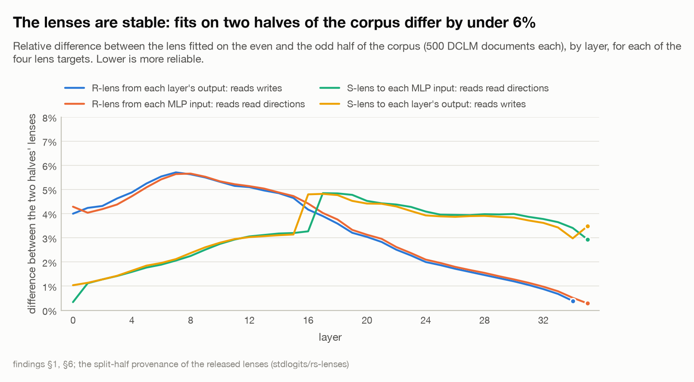

- **The R-lens and J-lens disagree most where the R-lens predicts steering better** (L4-L23, §3).
- **RelP's rules lower the noise.** On a Qwen3-0.6B prototype of the S-lens, fitted per offset on 12
  documents, RelP halved the split-half noise of the true-gradient version (L7: 0.15 against 0.26)
  and fit exact token footprints slightly better (R² +0.02-0.03 from L1). On 8B, RelP beats the true
  derivative on both sides (§3, §6).
- **Early writes share one direction.** At L2 the R-lens's top singular direction holds 0.78 of
  `J_L`'s energy and 0.95 of a median write (0.27 at L5, 0.02 or less from L23). It reads `the, a, in,
  and` one way and code tokens (`startIndex`) the other. The halves agree there (0.89), so this is the
  early Jacobian, not noise; early neurons are read from their inputs instead (§6).
- **Raw reads have hub tokens**, the same few tokens at the top of many poles' reads: at L1, ` the`,
  ` in` and ` and` sit in 30-31% of write reads' top 10s. Layer-contrastive reads (`_z`), which
  z-score each token across the layer's poles, remove them.

**The corpus changes tokens, not concepts.** An R-lens fitted the same way on 500 UltraChat
conversations in the chat template (split-half 0.05-0.07 early, 0.01 late) was compared with the
DCLM lens's 500-document halves, so both sides carry the same noise:

| layer | top-1 agree: chat vs DCLM (DCLM halves) | top-10 overlap |
|---|---|---|
| L0 | 0.40 (0.90) | 0.55 (0.93) |
| L2 | 0.31 (0.89) | 0.54 (0.92) |
| L8 | 0.42 (0.89) | 0.54 (0.91) |
| L16 | 0.51 (0.92) | 0.62 (0.94) |
| L24 | 0.78 (0.96) | 0.84 (0.97) |
| L34 | 0.96 (1.00) | 0.96 (1.00) |

- **Every causal score is the same.** Steering prediction (§3) is within 0.04 at every layer but L3
  (0.06), ablation identical, persona names (§10) equal from L6 (the DCLM lens is better at L0-L5: 15%
  of names in the top 10 against 9%), fused personas within 0.02. The chat lens is no better on
  chat-format tests.
- **Clear neurons read the same concept in another order** (L8 n1931 +: 圣经, Bible, 基督徒,
  Scripture under both). **Weak, diffuse writes drift toward each corpus's register:** markdown bold
  and `...⏎` under chat, `...⏎⏎` and curly quotes under DCLM. Where a read's top probability is low,
  register tokens are the lens's, not the neuron's.
- The DCLM lens is the lens of record.

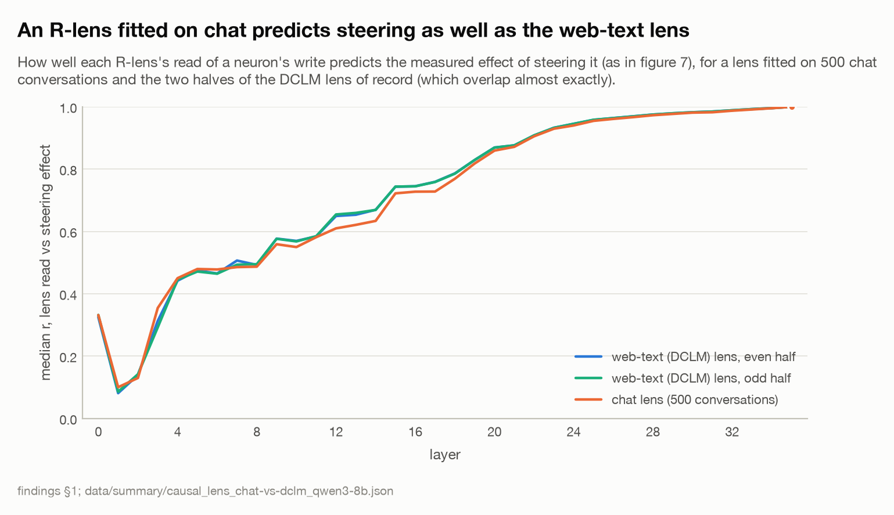

**Limits.** One fitting corpus of record and 128-token documents. Split-half agreement measures
stability within a corpus, not freedom from it; the chat lens is one alternative.

## §2. Activations over 15M positions

**Setup.** `06_activations.py`, one bf16 pass with eager attention (68 minutes on an RTX 4090; this release reran it on an H100 and keeps each pole's top 64 firings):
every document of four slices, up to 256 tokens, from position 1, 15.4M positions in all.

| slice | source | documents | positions |
|---|---|---|---|
| dclm | DCLM-shuffled from row 1,000 (none in the lens corpus) | 40,000 | 9.46M |
| zh | FineWeb-2 `cmn_Hani` | 8,000 | 1.89M |
| code | codeparrot-clean Python | 7,990 | 1.98M |
| chat | UltraChat-200k `test_sft`, in the chat template | 8,000 | 2.04M |

Position 0 attends only to itself, so every kept token run alone gives each pole's exact value
there. `act_top` is the median of a pole's 24 top firings; `rate` is the share of positions past
`act_top / 4`, from exact counts. Checked on Qwen3-0.6B against an unpadded fp32 brute force: counts
exact, sums within 0.2%, top values within 0.9%.

| layer | `act_top` | quiet (`act_top` < 0.05) | fires harder at position 0 than anywhere (> 2×) | zh-selective | code-selective |
|---|---|---|---|---|---|
| L0 | 0.86 | 0.00 | 0.28 (0.01) | 0.033 | 0.023 |
| L1 | 0.006 | 0.56 | 0.22 (0.17) | 0.101 | 0.006 |
| L2 | 0.011 | 0.61 | 0.70 (0.62) | 0.016 | 0.013 |
| L3 | 0.70 | 0.42 | 0.57 (0.51) | 0.019 | 0.027 |
| L4 | 2.94 | 0.09 | 0.12 (0.06) | 0.028 | 0.034 |
| L8 | 4.09 | 0 | 0.001 | 0.007 | 0.029 |
| L16 | 3.22 | 0 | 0.000 | 0.004 | 0.047 |
| L24 | 11.4 | 0 | 0.000 | 0.021 | 0.048 |
| L28 | 22.5 | 0 | 0.000 | 0.018 | 0.056 |
| L35 | 50.8 | 0 | 0.020 | 0.037 | 0.024 |

Selective: the pole's rate in that slice is at least 10× every other slice's, and above 1e-3.

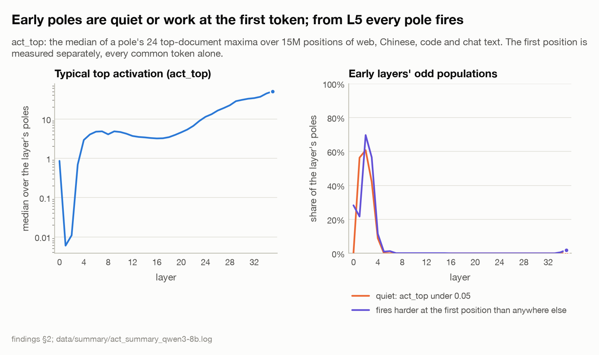

- **Scale is flat at 3-5 from L5 to L21, then grows tenfold to L35**, with the residual stream's norm.
- **L1 is mostly near-silent:** 56% of its poles stay under 0.05 everywhere, position 0 included,
  like the dead early neurons Voita et al. (2023) found in OPT (there zero under ReLU; here near zero).
- **L2 and L3 work at position 0.** 62% and 51% of their poles fire there more than twice as hard as
  at any later position (L2: median 3.7 there against `act_top` 0.011). They do not start the
  attention sink (zeroing their output there leaves it, §9), and matter little downstream (the loss
  rises 0.5 nats on the token predicted at position 0, 0.01 from the third). What they compute is open.
- **Language and code features sit at the ends of the network.** Chinese-selective poles are 1.6-10% of
  L0-L4 (the most at L1), 1.8-3.7% of L24-L35 and 0.4-0.8% of L6-L20, the U shape reported for language-specific neurons
  (Tang et al. 2024). Code-selective poles are 3.8-5.6% of L10-L30. L29 n8134 + fires at
  45% of Chinese positions and under 0.04% elsewhere: a language identity, not a word.
- **Chat-selective poles read as ChatGPT's register**, since UltraChat was generated by ChatGPT on
  both sides: L3 n6404 − fires on " delve" and " adhere", in user turns too; L28 n11134 + peaks on the
  year in "As of 20⟦2⟧1", the knowledge-cutoff hedge.
- **Rare poles are counted exactly.** An earlier 8,192-position sample put `rate` at 0 for 18.6% of
  poles; exact counts leave 0.65%, all silent. L8 n344 + (owls) fires at 1.8 per 100,000 positions.
- **`act_top` is a tail statistic** and grows with the corpus (1.4-1.8× from a 7,000-document pilot):
  compare poles within one corpus.

**Limits.** 256 tokens per document under-samples long-range features, and top firings are one per
document. Only the DCLM slice is a uniform sample; the zh slice is largely traditional script, code is
Python only, and chat is one synthetic dataset.

## §3. A write's lens read predicts what steering it does

**Setup** (`checks/causal_lens.py`, MPS, bf16). 32 random neurons per layer plus the named ones
(`neuron_lens/known.py`), 1,194 neurons, both poles. **Steering** adds `±α·W_down[:, n]` to layer `L`'s
MLP output at positions 16-63 of 16 DCLM documents of 64 tokens, at 1× and 4× the pole's typical top
activation (`act_top` in the `acts` table, the median of its 24 top firings), and records the mean
change in log-probabilities. **Score:** Pearson r over the tokens seen 5+ times between that change and
a lens's logits for the write. **Control:** the next random neuron's read from the same layer. Medians
over the random picks (64 poles a layer).

| layer | logit lens | J-lens | R-lens | control |
|---|---|---|---|---|
| L0 | 0.08 | 0.37 | 0.33 | −0.01 |
| L4 | 0.09 | 0.37 | 0.45 | 0.00 |
| L8 | 0.12 | 0.39 | 0.49 | 0.01 |
| L12 | 0.25 | 0.57 | 0.65 | −0.02 |
| L16 | 0.36 | 0.66 | 0.74 | 0.01 |
| L20 | 0.59 | 0.81 | 0.87 | 0.01 |
| L24 | 0.83 | 0.92 | 0.95 | 0.00 |
| L28 | 0.90 | 0.96 | 0.97 | −0.01 |
| L32 | 0.94 | 0.98 | 0.99 | −0.01 |

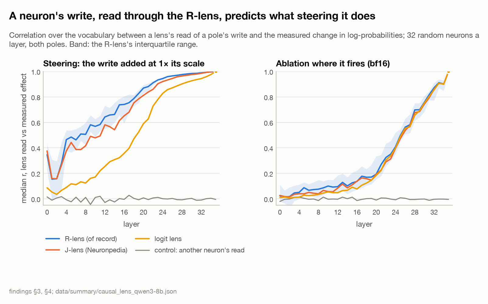

- **A read of one write vector, with no forward pass, predicts what adding it does downstream**. The
  R-lens reaches 0.45-0.50 at L4-L8, 0.65-0.75 at L12-L16 and 0.9 or more from L22; controls stay
  within ±0.04.
- **The R-lens leads the J-lens from L4 to L23** by 0.03-0.13 (L7: 0.50 against 0.37), and in top-10
  overlap. The J-lens leads at L0, they tie at L1-L3 and converge from L24. The logit lens, which
  ignores the later layers, trails until about L20.
- **Nearly every pole has a specific effect when amplified.** From L5, 94-100% of random poles' writes
  predict their own steering effect (r past 0.24, the 99th percentile of mismatched pairs pooled over
  layers), against 0-6% of mismatched pairs. L1-L3 are lower (32-58% of the poles that fire pass; median
  r 0.08 at L1 and 0.14 at L2) because their poles barely fire, so their doses are tiny.
- **Named concept poles show the R-lens's largest leads:** L8 n5315 − ("nature") at r 0.60 against
  0.14 for the J-lens (at 4×); steering it raises ` trees`, ` vegetation`, ` gardens` and 植物, while the
  J-lens reads its write as brackets. Named poles are otherwise no more readable than random ones.
- **Ablation where a pole fires** (zeroing the neuron at its peak in its first 8 top documents, the
  `acts` table's `top_doc` and `top_pos`) agrees far less before L21 (r under 0.15 to L16, 0.87 at L32),
  and the lenses tie there. §4 explains why.

**Limits.** 16 held-out DCLM documents of 64 tokens, the lens corpus's source (the chat lens ties, §1).
Pearson r over 100k tokens is dominated by small changes; the top-10 overlap complements it. bf16 rounds
weak poles' writes partly away, so the ablation numbers are lower bounds (§4), and weak effects depend
on the device: re-run on an RTX 4090 at the same firings (390 poles of six layers), ablations measured
on MPS reproduce at a median r of 0.997 for the strongest quarter of effects and 0.55 for the weakest.
An earlier version of this sample took its doses and ablation sites from a 6,999-document pilot of the
activation pass that was not released ([issue #2](https://github.com/stdlogits/neuron-lens/issues/2));
measured again from the released tables, steering at 1× moved by 0.02 or less except at L1 (0.15 to
0.08), at 4× (doses now about 1.5× larger) by up to 0.08, and ablation by 0.05 or less.
`causal/causal.pt` now holds every input it was measured from, `top_doc` and `top_pos` included.

## §4. One firing is one sample of a write

Steering adds a pole's write at every position of neutral text and reads off its average effect. A firing is one
context. How much of what a write does can one firing show?

**The token after a firing is a narrow test of a write.** For every pole, §7 scores whether its write read promotes the
tokens that follow its top firings. Before L22, 1-4% of poles do (net of chance); from L23 it rises to 31-32% at L28-L29,
and is 17-25% at L32-L35, where suppression takes over (§5). The same write reads predict steering for 94-100% of poles from
L5 (§3). One read, two results: the difference is in what each test asks.

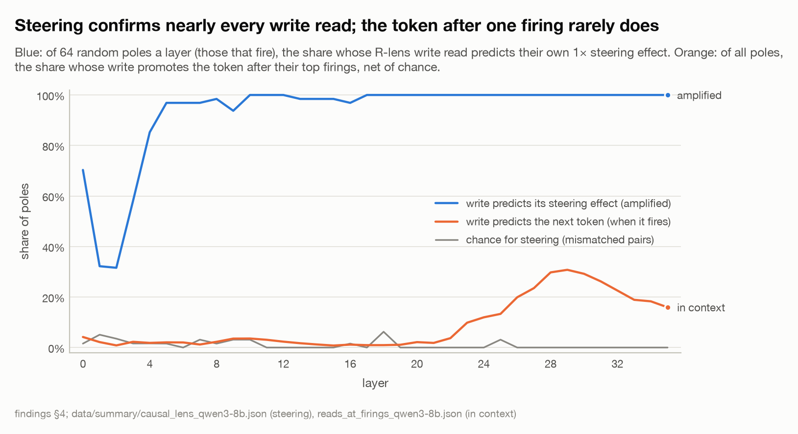

**Per-context linearization** (`checks/context_linearity.py`; one H100, fp32 with TF32 matmuls, 57
minutes). §3's random poles at their top firings, the strongest position in each of their 24 top
documents (the `acts` table's `top_doc`, `top_pos`, `top_val`), scored where they fired at least twice
(2,290 of 2,304 poles). At each firing, one batch of four rows multiplies the neuron's activation `a`
there by 1, 0, 1.25 and 0.75: the effect of removing the firing (clean − removed) and its first-order
effect `a·∂logp/∂a` (the central difference of the last two, over 0.5), each a change in
log-probabilities summed over the firing position and the next 8. Correlations are Pearson r over the
kept tokens; per-firing values are a pole's median over its firings, and the table gives medians over
poles. "One context vs the pole's other 23" compares a firing's first-order effect with the mean of the
pole's other firings'; steering is §3's at 1×. The measurement used the top firings of an earlier
activation pass over the same documents, which the released `acts` match up to bf16 rounding.

| band | removed vs first-order | one context vs the pole's other 23 | lens vs one context | lens vs the mean of 24 | steering vs the mean firing effect | steering vs lens |
|---|---|---|---|---|---|---|
| L0-L8 | 0.92 | 0.05 | 0.03 | 0.11 | 0.08 | 0.40 |
| L9-L12 | 0.97 | 0.08 | 0.05 | 0.16 | 0.17 | 0.59 |
| L13-L20 | 0.98 | 0.11 | 0.09 | 0.28 | 0.29 | 0.76 |
| L21-L27 | 0.99 | 0.36 | 0.27 | 0.57 | 0.57 | 0.94 |
| L28-L35 | 1.00 | 0.78 | 0.66 | 0.86 | 0.87 | 0.99 |

Every control (another pole's values) is within 0.01 of zero.

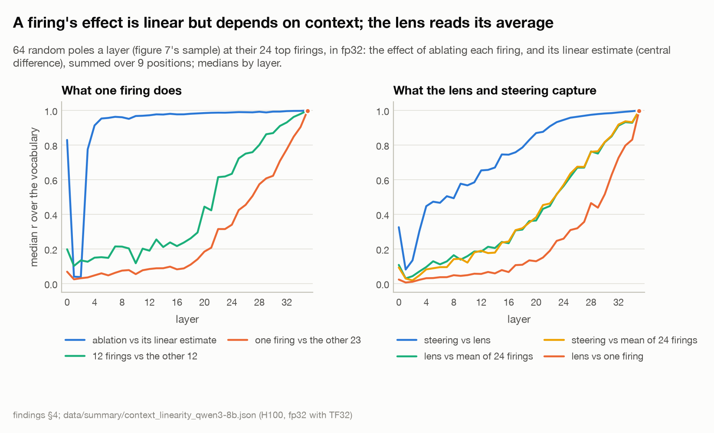

- **A firing's effect is close to linear:** removing it does what its first-order effect says
  (0.92-1.00; L1-L2 are noise, since their poles barely fire).
- **Before L21 a pole's firings don't predict each other.** The same pole firing equally hard pushes the logits
  different ways in different contexts: one context's effect correlates with the mean of its other
  23 at 0.05-0.11, and 12 contexts against 12 others reach only 0.16-0.27. From L28 the effect is
  nearly the same everywhere (0.78; 0.94 split-half).
- **The lens reads the shared part.** Against one context, the weight-only read gets 60-85% of the
  correlation the pole's own other firings get, in every band.
- **Lens and steering agree with each other, not with firings.** Before L21 the lens predicts steering
  at 0.40-0.76, while steering predicts the pole's mean firing effect at 0.08-0.29. From L28 all agree.
- **Precision matters.** In bf16 a weak pole's write partly rounds away in the residual: on five test
  neurons, removed against first-order was r 0.05-0.77 in bf16 and 0.83-0.99 in fp32.

**What this means.** The lens and steering agree because both average over contexts. Before L21, what a pole does at one
firing is mostly specific to that context, which no single vector, from a lens or from steering, can carry; the pole's own
other firings predict it little better than the read does, so this is a fact about the model and not the lens. A write read is
the pole's average push. A firing is one context's share of it, and from L28, where the context stops mattering, the two agree.

**Limits.** 32 random neurons a layer; a 9-position window misses later effects; Pearson r weighs
all tokens alike; TF32 makes weak early poles' values lower bounds.

## §5. Prediction and suppression

**Setup** (`checks/side_agreement.py`; no model). For each pole's top firings, the token after
the peak. **Predict:** the share of firings whose next token is in the write read's top 10.
**Suppress:** the same for its bottom 10 (the opposite pole's top 10). Control: a random pole of the
same layer and sign.

| layer | predict (control) | poles past ⅓ | suppress | poles past ⅓ |
|---|---|---|---|---|
| L8 | 0.007 (0.004) | 0.00 | 0.003 | 0.00 |
| L16 | 0.007 (0.005) | 0.00 | 0.005 | 0.00 |
| L22 | 0.014 (0.001) | 0.01 | 0.003 | 0.00 |
| L26 | 0.035 (0.000) | 0.03 | 0.003 | 0.00 |
| L28 | 0.068 (0.000) | 0.07 | 0.003 | 0.00 |
| L30 | 0.073 (0.000) | 0.07 | 0.005 | 0.00 |
| L32 | 0.058 (0.000) | 0.06 | 0.009 | 0.01 |
| L34 | 0.042 (0.000) | 0.04 | 0.034 | 0.04 |
| L35 | 0.040 (0.000) | 0.04 | 0.056 | 0.07 |

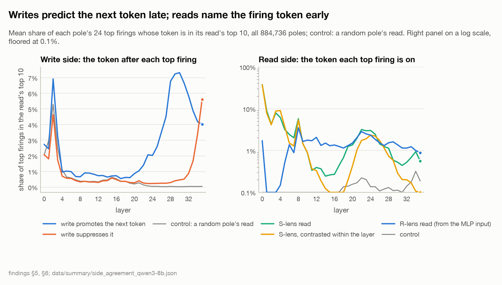

- **Late poles fire on the token before a word their write promotes:** "is⟦ once⟧" → *again* (L30
  n1034 +), "⟦arist⟧" → *-ocracy* (L28 n8868 −). Prediction rises from L20 and peaks at L28-L31, where
  7-8% of poles have more than a third of their top firings followed by a token they promote (control
  under 0.1%).
- **Suppression starts at L32 and overtakes prediction at L35.** This is the pattern Gurnee et al.
  (2024) found in GPT-2 from weight statistics, here measured from activations.
- **Their weight classifier picks the same poles.** Among L24-L35 poles in the top 10% of kurtosis of
  their logit-lens logits, positive skew ("prediction") gives 24% of firings before a promoted token
  (other poles 4%), and negative skew 12% before a bottom-10 token (0.6%).
- **Two signs of one neuron.** Skew flips sign between a neuron's poles, so each high-kurtosis neuron
  has a promoting pole P and a suppressing pole S:

  | layer | P predicts (> ⅓) | S suppresses (> ⅓) | `act_top` P / S |
  |---|---|---|---|
  | L28 | 0.38 | 0.01 | 40 / 16 |
  | L30 | 0.46 | 0.03 | 61 / 23 |
  | L32 | 0.36 | 0.05 | 62 / 31 |
  | L34 | 0.10 | 0.37 | 49 / 53 |
  | L35 | 0.22 | 0.51 | 44 / 67 |

  Through L32 the promoting pole fires harder; from L34 the suppressing one. In SwiGLU, prediction and
  suppression neurons are not two kinds of weights but two signs of one neuron, and a weight-only
  classifier needs the activation statistics to say which a neuron is.

**Limits.** An exact token in a top 10 is strict (" par" against "airs" after "P" is a miss), so these
shares are lower bounds. A bottom-10 token is a directional association, not a measured suppression
after later layers.

## §6. The input side

Early neurons are best read from what drives them. This section asks which weight-only read names
those tokens, at which depth.

**Setup.**
- **The reads** (`08_reads.py`) of a pole's read direction `c = â ± b̂`: `read_S`, the S-lens to the
  MLP input, scores token `v` by `c · K_L (W_E[v] − mean(W_E))` (which input tokens drive the pole);
  `read_R`, the R-lens from the MLP input (what the residual says when it drives the pole); each also
  layer-contrastive (`_z`). Gate and up rows are nearly orthogonal (median cosine 0.00 ± 0.005 at
  every layer, except L2), so each pole has a distinct direction.
- **Exact drivers** (`07_drivers.py`): every kept token at position 24 of 8 real documents (4 web, 2
  code, 2 chat), followed by the documents' own next 16 tokens; per pole, the 64 tokens with the
  largest activation at the token, and summed over the 16 after. An fp32 rerun through L9 shares
  98-99% of a pole's top 20 on average at the token (94-99% summed; `checks/drivers_precision.py`);
  later layers are unchecked.

**Early neurons are token-family detectors.** Exact drivers of random early poles:

| pole | exact drivers |
|---|---|
| L0 n1208 − | 阔, 开阔, 开拓, 广阔, 宽阔 ("wide", "open up") |
| L0 n11206 − | 出生, 出行, 出入, 出门, 出土 (words starting with 出) |
| L1 n7735 + | 少年, 少女, 少量, 少许, 少数 (words with 少) |
| L1 n11672 − | 德国, german, Germany, German, Germans |
| L2 n6890 + | Whitney, Courtney, Chelsea, Kendall, Shelby, Lindsay |

**The S-lens names them from the weights, through L8.** Share of each read's top 10 among the pole's
20 exact drivers (control 0.003 or less; `checks/side_agreement.py`):

| layer | `read_S` | `read_S_z` | `read_R` |
|---|---|---|---|
| L0 | 0.32 | 0.34 | 0.011 |
| L1 | 0.10 | 0.10 | 0.000 |
| L4 | 0.10 | 0.14 | 0.003 |
| L7 | 0.03 | 0.02 | 0.017 |
| L8 | 0.06 | 0.07 | 0.069 |
| L9 | 0.02 | 0.03 | 0.057 |
| L12 | 0.004 | 0.004 | 0.053 |
| L16 | 0.003 | 0.002 | 0.030 |
| L20 | 0.011 | 0.013 | 0.037 |
| L24 | 0.031 | 0.050 | 0.076 |
| L29 | 0.009 | 0.026 | 0.080 |
| L35 | 0.002 | 0.008 | 0.027 |

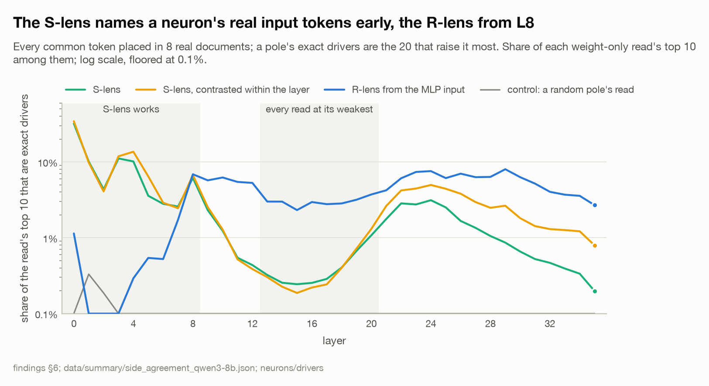

- **L0-L4:** `read_S` names exact drivers (32% of its top 10 at L0, 4-11% at L1-L4), and at L0 the
  peak token of 38% of top firings (another pole's read: under 0.1%); the R-lens read of the same direction
  almost none. At L1-L8 the S-lens read names 2-9% of peak tokens, against under 1.5% for the R-lens
  read (3.5% at L8).
- **L8 is the crossover:** both reads name drivers (6-7%), and a pole's S-lens, R-lens and write reads
  share the most tokens (0.26-0.32 tokens of their top 10s on average; control 0.002 or less).
- **From L9 the R-lens read names more:** 5-6% at L9-L12, 6-8% at L22-L30. On the input side too, the
  R-lens takes over where the S-lens stops.
- **L13-L20 shares the fewest tokens with the exact drivers** (2-4% for the R-lens read). The drivers are also at their
  weakest there: the strongest single-token swap reaches a median 9% of a pole's typical firing at L13-L20, against 36% at L0-L8
  and 22% at L28-L35 (`checks/driver_reach.py`; Gemma 4: 11% at L24-L35, 61% at L0-L11), so a low share in this stretch says little
  about either.
- **Past L8, raw S-lens reads are swamped by hub tokens** (rare CJK, spam-cluster and code pieces
  shared by most poles). `read_S_z` recovers concepts (L10 n9952 +: glaciers, terrain, 公里 "km",
  Mountains; L30 n2310 +, a "green" neuron: 繁殖 "breeding", Lawn, rooting) but gives up the literal
  peak token, so both columns are kept.
- **Read and write often name one concept** from the middle on: L8 n1931 + reads 圣经 (Bible), 基督教,
  信仰 (faith) and writes 圣经, 基督徒, Bible; L20 n2281 − reads else, 否则 (otherwise) and writes else,
  otherwise; L32 n2407 + reads 斗争 (struggle), fight and writes fight, fighting, 战斗.

**Early neurons write back what they detect.** `write_S` reads a write through the S-lens to the
layer's output: the tokens whose footprint the write imitates. It shares 1.69 tokens of 10 with the
pole's exact drivers at L0 (control 0.004), 0.22-0.50 at L1-L4, 0.10-0.26 at L5-L8 and about 0.01
from L11. L0 n1649 −, which fires on `ain`, writes `ain | AIN | ains | rain | strain`, where its R-lens
write read is `... | ..." | the`. MLP0-MLP8 in effect act as an extended embedding.

**Why the S-lens read fades: a token's effect is mostly nonlinear past L0** (`checks/s_linearity.py`;
96 tokens swapped in at position 16 of 4 documents, MPS, fp32). R² of each predictor against the
token's exact footprint on the MLP input, at its own position and summed over later ones:

| layer | own position: exact linearization in context (true / RelP) | S-lens | embedding | summed: RelP linearization | S-lens |
|---|---|---|---|---|---|
| L0 | 0.86 / 0.86 | 0.63 | 0.51 | 0.56 | 0.50 |
| L1 | 0.30 / 0.33 | 0.20 | 0.08 | 0.30 | 0.28 |
| L5 | 0.12 / 0.15 | 0.09 | 0.03 | 0.07 | 0.06 |
| L15 | 0.07 / 0.17 | 0.10 | 0.01 | 0.02 | 0.02 |

- Even the exact linearization in the token's own context explains 86% of its footprint at L0 but 30%
  at L1 and 7% at L15: swapping a whole token is far outside the regime of local linearizations past
  L0's MLP (this bounds local linearizations, not every possible linear map).
- On the summed footprint, the quantity it estimates, the S-lens does about as well as that
  per-context linearization: averaging over contexts and summing over positions cost little.
- RelP beats the true derivative from L1 (0.17 against 0.07 at L15).
- **But nonlinearity does not explain the fall after L8.** The linear share is flat from L4 to L17 (R²
  about 0.10), while the S-lens read's driver hits peak at L8 and fall by L11. The cause is open
  (candidates: read-write alignment, the norm weight's selectivity, how much context L8 neurons use).

**Limits.** At L1-L3, 49-78% of top firings have a negative gate, where the read direction `â ± b̂`
points the wrong way (§17). Drivers are measured at one position of 8 contexts. The S-lens footprint
averages over contexts, so it reads a direction on average: on the Qwen3-0.6B prototype a pole's exact
top 20 tokens of 6,000 were 70% right at L0, 25% at L1 and about 0% from L5.

## §7. What each read names

`checks/reads_at_firings.py` counts how often each weight-only read names what can be counted around a pole: the token
under each top firing, the token after it, and its exact drivers (§6). These targets are narrow, and a firing is one context
summarized by a token: a pass says a read names that target, a miss doesn't make the read wrong, and the shares describe the
reads at each depth, not single poles. The catalog keeps no per-pole test.

**Setup.** For each of the 884,736 poles, with its 64 top firings and 64 exact drivers:
- `read_S`: the mean layer-contrastive z of the peak tokens, under the read direction's S-lens read;
- `read_R`: of the exact drivers, under its R-lens read;
- `write_R`: of the tokens after the firings, under the write read; `write_S`: of the peak tokens, under the write's S-lens
  read; `write_orth_R`, `write_orth_S`: as the write's, for the write orthogonal to the neuron's gate and up rows (§18);
- p-values against mismatched pairs (another pole of the layer and sign, on this pole's tokens); Benjamini-Hochberg over
  the layer's poles at a 5% false discovery rate; *net of chance* is the share past the mismatched pairs' 99th percentile
  minus their own share;
- token modes: a third of the firings share one peak token, or one next token (`acts`' `cur_mode`, `next_mode`); near-silent:
  `act_top` under 0.05, not scored.

| band | `read_S` | `read_R` | `write_R` | `write_S` | `write_orth_R` | `write_orth_S` | token mode | next-token mode | near-silent |
|---|---|---|---|---|---|---|---|---|---|
| L0-L8 | 0.30 [0.26] | 0.06 [0.08] | 0.00 [0.02] | 0.12 [0.12] | 0.00 [0.02] | 0.09 [0.09] | 0.26 | 0.05 | 0.19 |
| L9-L12 | 0.02 [0.07] | 0.22 [0.21] | 0.01 [0.03] | 0.01 [0.03] | 0.01 [0.02] | 0.01 [0.02] | 0.11 | 0.04 | 0.00 |
| L13-L20 | 0.01 [0.01] | 0.15 [0.15] | 0.00 [0.01] | 0.00 [0.01] | 0.00 [0.01] | 0.00 [0.01] | 0.08 | 0.04 | 0.00 |
| L21-L27 | 0.05 [0.06] | 0.34 [0.30] | 0.10 [0.12] | 0.02 [0.03] | 0.08 [0.10] | 0.00 [0.01] | 0.20 | 0.08 | 0.00 |
| L28-L35 | 0.01 [0.02] | 0.30 [0.25] | 0.27 [0.24] | 0.00 [0.01] | 0.25 [0.22] | 0.00 [0.01] | 0.16 | 0.10 | 0.00 |
| all | 0.09 [0.09] | 0.21 [0.19] | 0.08 [0.09] | 0.04 [0.04] | 0.07 [0.08] | 0.02 [0.03] | 0.17 | 0.06 | 0.05 |

Shares of poles passing at 5% FDR, band means over layers; net of chance in brackets.

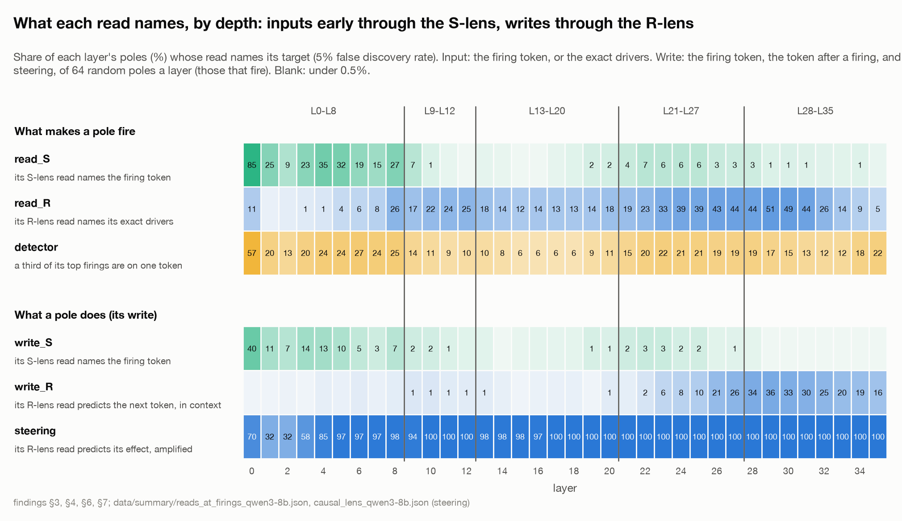

- **Each read names its target at its own depth.** `read_S` passes for 85% of poles at L0 and 23-35% at L1, L3 and L4 (L2: 9%,
  since 61% of its poles are near-silent), and almost none at L10-L20. `read_R` names exact drivers for 12-18% of poles at L13-L20 and
  44-51% at L27-L31. `write_S` passes for 12% of L0-L8's poles, nearly always together with `read_S`: early neurons write back what
  they detect (§6). `write_R` passes from L23, most at L28-L29 (30-31% net), and the part of a write off what the neuron reads holds
  nearly as well there: `write_orth_R` passes for 25% of L28-L35's poles, against 27% for the whole write (§18).
- **The token after a firing is a narrow target for a write.** A write read that misses it can still predict the pole's
  steering effect, as 94-100% do from L5 (§3), and before L21 a pole's firings don't predict each other (§4).
- **The token under a firing is a narrow target for a read.** An R-lens read reads forward: L30 n7004 + fires on ` play`
  and reads *role*, and L30 n2003 + fires on ` is` and ` way`, before ` too`, and reads *too*. And the token is rarely what drives the
  firing: the embedding's direct share of an activation is under 0.5% from L7, the rest coming through heads and earlier neurons
  (§17). L16 n101 + peaks on ` alone` and commas and reads *group, 团队, 小组*; L31 n1492 + fires on spaces and commas and reads *用电, 电路,
  electric*.
- **Exact drivers are a token-level target too.** They swap one token at one position of 8 documents, and at L13-L20 the
  strongest swap reaches a median 9% of a typical firing (§6). A concept carried by the surrounding text has no single token to find.

**Which read to use where,** from §3-§7. The bands are priors: weigh a pole's sides by its reads, contexts and drivers
together, and say which side a description rests on.

| layers | what drives a pole | what a pole writes |
|---|---|---|
| L0-L7 | `read_S`: literal tokens (raw at L0-L4) | `write_S`: what it detects, written back; `write_R` from about L4 |
| L8 | both lenses, agreeing most | both |
| L9-L12 | `read_R`, with `read_S_z` as a concept view | `write_R`: predicts steering |
| L13-L20 | `read_R`, `read_S_z`, with contexts and exact drivers beside them (reads and contexts tie in §8's blind test) | `write_R`, for steering |
| L21-L35 | `read_R`, `read_S_z` | `write_R`: steering, and the next token from about L23; suppression from L32 |

**Signal holds to rank 64** (`checks/rank_depth.py`; nine layers). Per rank, the share of
poles whose token at that rank shows up after a top firing (writes) or at the peak (reads), against a
mismatched pole. Ranks 49-64 still run several times above chance for most reads (L28's write read
22×, L12's `read_R` 6×), at a tenth to a half of a top-8 token's rate. The exception is the plain write read
before L21 (1.0-1.7× at ranks 49-64), hub tokens at every rank; its `_z` read keeps signal there from L8
(3-5×). Gemma 4's late write reads hold the same way (L36-L40: 25×). The catalog keeps the top 64.

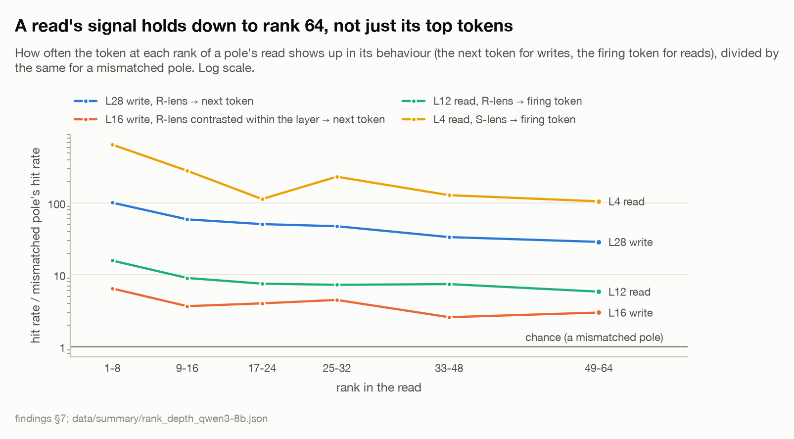

**Limits.** The tests are token-level, so a read of a concept that shows in no single token scores low. Exact drivers come
from one position of 8 documents. Each pole must clear the FDR on its own evidence; net shares count weak cases in aggregate. A
third of firings is a chosen threshold.

## §8. Describing neurons

Can the evidence be turned into words that predict what a pole does? Three studies: a pilot with full
evidence cards, a blind test of how far the lenses alone go, and a cheap labeller run on every pole.

**Scoring.** An explainer writes two labels with a confidence: where the pole **fires**, and what its
write **promotes** when amplified.
- **Firing** is scored by detection (Paulo et al. 2024): fresh scorers see the label and a shuffled
  set of held-out top firings (top documents the card did not show, each cut at the firing token) and
  quiet positions, and give each a probability of firing; the score is the AUROC. The control is
  another pole's label on the same set. This test is made of firings, so it favours evidence made of firings.
- **Writes** are scored by steering: the pole's write is added at doses where it changes the
  next-token distribution by 0.5, 1 and 2 nats of KL (7-15× its typical activation), on four prompts;
  a fresh judge sees the steered text and four labels from the same band and picks the pole's own
  (chance 25%).
- **Cards are leak-free:** nothing on a card summarizes the held-out documents. (The pilot's cards
  still carried a steering-sample ablation summary that overlapped 90 of its 945 scored positives;
  dropping those moved its mean AUROC from 0.926 to 0.927, and later cards omit it.)

**The pilot** (`checks/describe_cards.py`, `checks/describe_score.py`): 197 poles (2 random neurons
a layer, both poles, and 53 named poles), Claude Sonnet explainers, full cards (lens reads, top 5
contexts, activation statistics, steering, outside labels). Over the 189 that fire, 5 held-out firings
against 5 quiet positions score a mean AUROC of **0.93** [0.91, 0.94] (control 0.54); 0.96 at
L0-L11, 0.89 at L12-L23 and 0.91 at L24-L35. Most poles are token- or phrase-level detectors, often of
what comes next: L7 n271 + poxviruses (monkey⟦p⟧ox), L9 n8548 − an AI assistant's self-reference ("my
training", "been programmed"), L16 n6934 + " upon" in "Once upon a time", L26 n4061 − the word before
"suicide". The explainers judged that the descriptions rest on activations everywhere, with the weight
reads agreeing on about 40% of cards from L12 and a quarter or fewer before. Its score sets and
scorers' answers were not kept, so these numbers stand as recorded; the scripts rebuild the same 197
cards from the current catalog (their steering from §3's current sample) and draw fresh held-out sets.

**The blind test** (`checks/lens_blind.py`): 160 random poles, 32 per band, explainers that never see
steering, in four arms: **lens** (only the eight weight-only reads, plain and `_z`, 12 tokens each),
**contexts** (only the top 5 contexts, activation scale and rates), **both** on one card, with Sonnet
and with Opus. Six held-out firings against six quiet positions, three from random documents and three
from the firings' own documents.

| band | fires AUROC: lens / contexts / both / Opus | writes picked: lens / contexts / both / Opus |
|---|---|---|
| L0-L8 | 0.79 / 0.93 / 0.92 / 0.94 | 0.34 / 0.45 / 0.42 / 0.49 |
| L9-L12 | 0.79 / 0.91 / 0.91 / 0.90 | 0.73 / 0.55 / 0.66 / 0.64 |
| L13-L20 | 0.76 / 0.79 / 0.84 / 0.82 | 0.58 / 0.42 / 0.53 / 0.49 |
| L21-L27 | 0.81 / 0.82 / 0.88 / 0.89 | 0.66 / 0.54 / 0.60 / 0.63 |
| L28-L35 | 0.83 / 0.93 / 0.90 / 0.91 | 0.95 / 0.76 / 0.94 / 0.91 |
| all | 0.80 / 0.87 / 0.89 / 0.89 | 0.65 / 0.54 / 0.63 / 0.63 |

Controls: another pole's firing label scores 0.58; writes chance is 0.25.

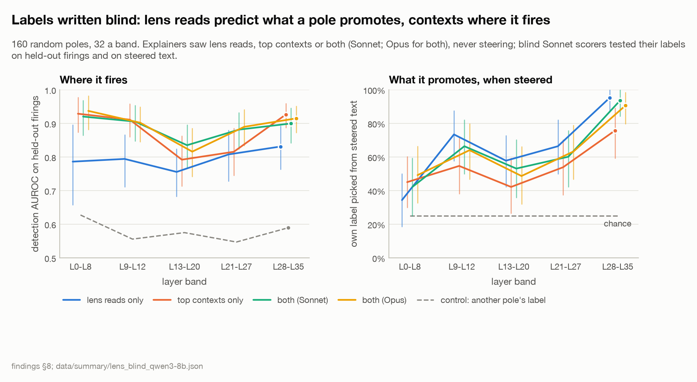

- **From the lenses alone, a random pole gets a usable description most of the time:** firing labels
  at AUROC 0.80 (58% of labels at 0.8 or more, against 16% of controls), write labels picked 65% of
  the time.
- **Scored on firings, contexts lead the lenses for where a pole fires** (0.87 against 0.80), as evidence made of firings
  should, and tie them at L13-L27. Same-document negatives cost both arms about 0.05, so neither's labels
  are mostly topic labels.
- **For what it promotes, the lenses beat contexts** (65% against 54%): 95% at L28-L35, where 42% of
  strongly steered tokens are in the pole's own R-lens top 64 (none in other poles'); 58-73% at
  L9-L27, where the judge matches concepts (L11 n4351 + reads *trauma, genocide, survivors*, and
  steered, the model writes of "a powerful narrative of trauma"); near chance at L0-L8, where steering
  mostly degenerates the text (§6: early meaning is input-side).
- **Combining helps a little:** both sources on one card reach AUROC 0.89 and 63%; the lenses add to
  contexts only for firing at L13-L27 (+0.03-0.07). Picking each side's best source does as well.
- **Opus explains no better than Sonnet** (0.89 and 63% each), which suggests the bottleneck is the
  evidence, not the explainer.
- **Where the sides differ:** format and fragment detectors whose reads name something else. L34
  n7339 − fires on a word-initial W (W|inters), its read direction names GPUs (Nvidia, Radeon), and
  its write is 再 (again): three sides that don't agree, and no test here says which describes the pole.
- **Confidence ranks:** lens firing labels at confidence 0.7 or more score 0.97, below 0.4 0.67.
- **17% of firing poles defeat every arm**, 19 of 25 at L9-L27: code-identifier fragments and Chinese
  punctuation whose held-out firings vary in surface form.

**A label for every pole** (`10_labels.py`, `checks/haiku_blind.py`). The same tests on 100 more
random poles compared Claude Haiku 5.5 with Sonnet, on the blind test's cards and on a depth-aware
card that shows only the reads that carry signal at the pole's layer (§7), hub tokens removed:

| arm | fires AUROC (control) | fires holds | writes picked |
|---|---|---|---|
| Haiku, lens card | 0.66 (0.55) | 0.30 | 0.57 |
| Haiku, depth-aware lens card | 0.71 (0.55) | 0.41 | 0.63 |
| Haiku, depth-aware card with contexts | 0.82 (0.56) | 0.61 | 0.61 |
| Sonnet, lens and contexts | 0.83 (0.56) | 0.62 | 0.62 |

With contexts, Haiku matches Sonnet; from the lenses alone it trails. The depth-aware card with
contexts then labelled all 884,736 poles through the Batch API (44,244 requests of 10 neurons each,
$105). Confidence ranks (firing AUROC 0.94 at 0.7 or more, 0.79 below 0.4), but only 6-15% of each
band's labels reach 0.7. The full run was checked only through this 100-pole sample.

**Relabelling the negative-lobe poles** (`10_labels.py cards --flipped`, `checks/relabel_check.py`). The up-row reads (§17) replaced the
weight-only reads of 63,423 Qwen3-8B poles and 63,958 Gemma 4 poles, so the 42,578 and 50,920 neurons holding them were labelled again
($9.87 and $14.21 on the Batch API; every head again, $0.28 and $0.19). A pole that is a faint shadow of the neuron's other pole (`neg_lobe` past a
half, `act_top` under a quarter of the other pole's) is marked on its card. Checked blind by Claude Sonnet on about 150 random such poles a
model: 4 of a pole's held-out firings (ranks 6-24) against 4 of another flipped pole of its layer, AUROC per pole for each label on the same contexts:

| | new label | first label | another pole's new label | new − first |
|---|---|---|---|---|
| Qwen3-8B (149 poles) | 0.80 [0.75, 0.84] | 0.75 [0.70, 0.80] | 0.52 | +0.05 [0.00, 0.10] |
| Gemma 4 12B (148) | 0.72 [0.68, 0.77] | 0.71 [0.67, 0.76] | 0.53 | +0.01 [−0.04, 0.07] |

The new labels are at least as good, likely a little better on Qwen3-8B, and no more confident (firing confidence 0.21 against 0.24 on
Qwen3-8B, 0.25 for both on Gemma 4). Every other pole keeps its first label.

**Limits.** Positives come from the high-activation regime (top documents only), and quiet positions
are an easier contrast than near misses. 32 poles a band is about ±15 points (100 poles for the Haiku
test, ±20). Steering is amplified past natural firing (5-18× in the blind test, 7-29× in the Haiku
test), in bf16. Explainers, scorers and judges are all Claude models, in separate instances, and the
explainers' prompt carried the depth priors.

## §9. Attention sinks, the output's temperature and entropy neurons

The largest activations in the model all act through two residual dimensions that the output ignores.

**Setup.** `checks/entropy_neurons.py` (ablations on 16,128 positions of 128 web, code and chat
documents; MPS), `checks/sinks.py` (128 documents with 65 distinct first tokens; position 0 sees only
its own token, so its values count each first token once) and `checks/external_crosscheck.py --sink`.

**Two dimensions set the output's temperature.** The final norm's weight is about 1e-4 on residual
dimensions 1838 and 2276 (median 2.0 elsewhere), so writes there move no logit directly. But they hold
64% of the final residual's squared norm at the median position, so they set the norm the final RMSNorm
divides by: the final RMS is 24.2 at the median and would be 14.6 without them. Writing to them
rescales every logit (RMSNorm algebra; the measurement is new here).

**The attention sink at position 0.** Three L6 neurons (n5723 +, n8518 −, n422 +) fire at up to 10,752
at the first position and write 95-96% of their squared norm onto dimension 2276, raising the
residual's norm from 44 to 12,091 (these are Muyu He's three dimensions, here with their poles). Later
layers' heads attend to that position by default. The trigger is layer 0's MLP output at position 0:

| at position 0 | L6 n5723 | first tokens with a sink | attention on position 0 at L9 / L21 / L33 | loss on token 2 / tokens 3+ |
|---|---|---|---|---|
| clean | 5,664 | 100% | 0.63 / 0.49 / 0.77 | 2.95 / 2.40 |
| L0's MLP zeroed | 39 | 38% | 0.03 / 0.04 / 0.03 | 8.02 / 2.74 |
| L0's MLP given the same token's output at position 1 | 262 | 17% | 0.54 / 0.42 / 0.66 | 6.05 / 2.56 |
| L0-L5's MLPs zeroed | 0 | 0% | 0.01 / 0.00 / 0.00 | 8.80 / 3.06 |
| L0's top 300 neurons (by attribution) zeroed | 4,016 | 95% | 0.61 / 0.48 / 0.75 | 3.23 / 2.43 |
| control: L0's MLP zeroed at position 5 | 5,664 | 100% | 0.62 / 0.49 / 0.76 | 2.95 / 2.43 |

- **Without L0's MLP at position 0 the sink mostly fails** and attention to position 0 collapses.
- **It is the MLP's response to being first,** not a few neurons: L0's top 300 neurons removed, the sink
  still forms for 95% of first tokens.
- **A smaller sink suffices:** halving it (zeroing L5) leaves the attention unchanged.

**A second sink on the year after a date.** Three L16 neurons (n2271 +, n1875 +, n1756 +; up to 5,984)
write 96-99% onto the same dimension at the first digit of a year ("Tuesday, May 7, ⟦2⟧013"), which
carries about 15,000 there by L20. The same massive activation appears on `__` in `from __future__`
and on position 1 of code files. Pooled over these 22 positions, later tokens attend to them from L9
as much as to position 0 (0.34 against 0.35 at L9; 0.48 against 0.38 at L30). Four L34 poles (n6620 +,
n3471 +, n8468 +, n3508 +) clear the activation before the output: at 11 year-digit and `__`
positions, n6620 + cuts the final RMS by 68%, lowers the output's entropy by 9.7 nats and the loss by
19.0; without them the output there is close to uniform. Massive activations fading in the last layers
matches Sun et al. (2024). Position 0's sink is halved by L34-L35, not cleared; the final norm divides
it away.

**Entropy neurons.** Stolfo et al. (2024) found last-layer neurons that act through the final norm's
scale. Freezing the scale at its clean value separates that path from the direct one.
- **L35 n9510 + raises entropy where the next token is hard to guess.** It is always on (median 268)
  and fires hard at 3.5% of positions: hashes, IDs and version numbers ("jsessionid=⟦0⟧000"). There
  it raises the final RMS by 9% and the entropy by 0.19 nats, though its direct effect alone would
  lower it by 0.21; it lowers the loss by 0.07 (the hedge pays).
- **L35 n9346 + does the opposite** on near-determined continuations ("Esch⟦ich⟧ia",
  `codecs⟦.char⟧map`): the largest L35 write (98% in the null space) cuts the final RMS by 31% and
  entropy by 1.58 nats, all through the scale (frozen: −0.02).
- **At L32-L33 no candidate acts mainly through the scale** (8 per layer by null-space write at typical
  activation, against 8 random).

**For the catalog.** These poles' lens reads are uninformative: the lenses keep only a direction, and
the readout ignores the two dimensions where these poles act. Their descriptions rest on activations
and on this measurement; `null_share` flags them only together with the activation scale.

**Limits.** 16,128 positions, and the second sink's clearing rests on 11 positions. Poles are ablated
one at a time, though the four L34 poles fire together. The sink share uses a cutoff (|dim 2276| over
2,000 after L6; clean, about 12,000), and under the position-1 swap four first tokens land within 15% of
it, among them the chat slice's shared `<|im_start|>`: 1,776 here at batches of 8, 16 and 32 (MPS,
bf16), 1,904-2,008 on another GPU. There it crossed the cutoff with the batch size, taking all 32 chat
documents with it, so the earlier count over documents moved from 9% to 34%
([issue #2](https://github.com/stdlogits/neuron-lens/issues/2)). `checks/sinks.py` lists these tokens.

## §10. Outside labels

How do labels from other methods compare with the catalog? The main outside source is the [Neuron
Persona Library](https://neuronpersonas.com) (by jfonsecarivera), 34,220 rows, each a pole whose push
on "Who are you?" made the model claim a persona, named by Claude Haiku. `neuron_lens/known.py` holds
smaller sets: six steering-verified persona neurons from an earlier experiment on this model, and
published neurons from Sudarsh, Sauers, Muyu He and Kazemi et al.

**Strict name matches** (`checks/library_crosscheck.py`): the first token of a persona name's words in
the pole's write read. In the top 10 for 52% of L30-L35 rows and 30% of L24-L29 rows under every lens,
2-3% at L12-L17 (control 0.2-0.3%). At L0-L5, the R-lens finds 15% where the J-lens finds 1% and the
logit lens 3%.

**Generous matches** (`checks/library_judge.py`): 360 rows, 60 per layer group; Claude Sonnet judges
score each read against its persona's name and, shuffled in, another row's (0-3; 2 or more is a clear
match: the concept in any language, or a strongly associated thing). Reads from the write side, the
input side (`read_R` and `read_S`) or both together:

| layers | write | input | both |
|---|---|---|---|
| L0-L5 | 0.35 (0.02) | 0.35 (0.02) | 0.38 (0.03) |
| L6-L11 | 0.27 (0.02) | 0.22 (0.02) | 0.33 (0.07) |
| L12-L17 | 0.20 (0.07) | 0.17 (0.07) | 0.28 (0.10) |
| L18-L23 | 0.22 (0.02) | 0.10 (0.03) | 0.27 (0.05) |
| L24-L29 | 0.45 (0.00) | 0.37 (0.02) | 0.50 (0.03) |
| L30-L35 | 0.53 (0.02) | 0.42 (0.02) | 0.62 (0.02) |

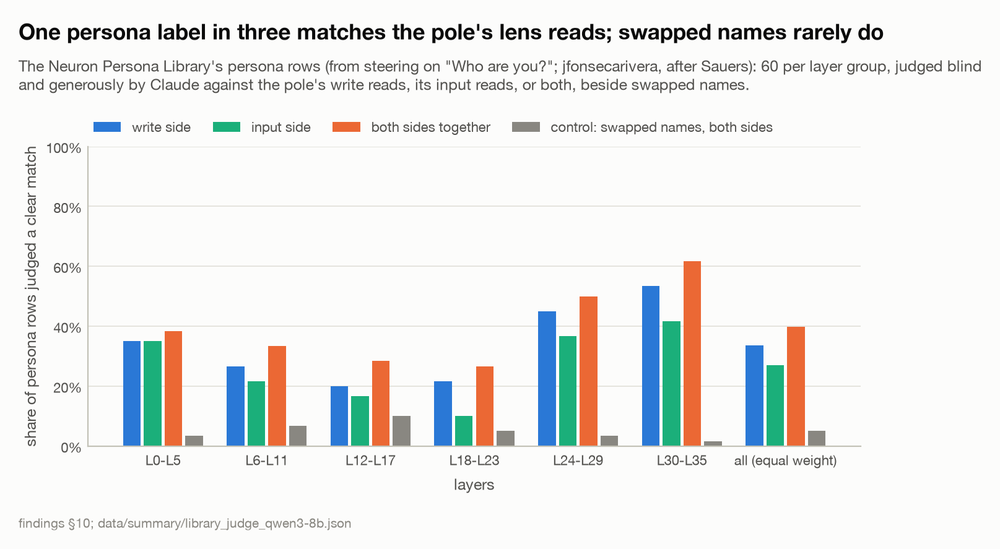

- **A generous reading doubles the strict rate:** weighted by the library's depth mix (mostly
  L6-L17), 27% of rows clearly match the write read, 22% the input read and 34% both together
  (swapped names 3-6%). Translations and associated words count: L9 n3370 − "Dragon" writes dragon,
  龙, dragons.
- **Mid-network is hardest** (20-22% of rows at L12-L23 on the write side).
- **Fused personas.** The library also pushed 2-3 neurons at once; 3,097 of 13,861 pairs gave a persona
  no parent gives alone. The R-lens read of the summed pushes ranks words in neither parent's name in
  its top 100 for 19% of pairs (mismatched names 3%; J-lens 10%, logit lens 7%;
  `checks/combo_crosscheck.py`). The best parent's read alone does about as well (24%, control 5%):
  the new concept is mostly latent in one parent's write.
- **Steering one prompt finds personas, not everything.** Of the 71,661 poles whose write predicts
  what follows their firings (§7), 4.0% have a library row, mostly because 98% sit at L21-L35, where
  the library is thin; against each layer's base rate the library is enriched for them (1.5×;
  `checks/library_crosscheck.py`). What it misses has no self-description: idiom completers (L30
  n1034 + writes *again* on "once"), morphology (L8 n1541 + writes *-ism*/主义 on the stem before it),
  everyday concepts (L28 n8868 − writes *democracy* on "arist|", "olig|").

**Against whole evidence cards** (§8's pilot), the explainers' verdicts on outside labels:

| source | method | agrees | partial | disagrees |
|---|---|---|---|---|
| earlier persona-steering experiment | steering-verified personas | 6 | 0 | 0 |
| Sudarsh | activation contrast × `W_down`, steering | 10 | 3 | 0 |
| Neuron Persona Library | steering on "Who are you?" | 13 | 9 | 11 |
| Sauers | steering and causal search | 7 | 3 | 4 |
| Muyu He | MLP energy at token 0 | 3 | 1 | 2 |
| Kazemi et al. | refusal gradient × activation difference | 1 | 1 | 1 |

- **Activations sharpen the steering-verified labels:** L8 n1931 + ("Jesus") fires on the Bible as
  scripture ("God's⟦ Word⟧", "non-B⟦ib⟧lical"); L21 n1180 − ("mother") on leaving work to care for
  family ("stay⟦-at⟧-home moms"); L27 n1343 + ("candidate") on deciding to run for office.
- **Labels from steering one prompt disagree with the firings most often:** the library's "creator god" pole, L8 n8079 +,
  fires on time words (times, 时间, `timing_stats`); Kazemi et al.'s refusal neuron, L14 n7924 +, fires
  on light, playful request framing.
- Unsigned labels count both poles, so one pole of each often "disagrees".

So the methods are complementary: steering on one identity prompt reaches the personas, activations
and lenses reach the rest, and each checks the other where they overlap.

**Limits.** Strict matching scores only the first tokens of names. 60 rows a group is about ±12
points. The judges are the library labeller's model family. About a third of the library's strongly
pushed replies change with the batch layout.

## §11. Attention heads: circuits read token by token

A head moves information between positions: its QK circuit decides which earlier position it reads,
its OV circuit what it writes from there. Both can be read from the weights over the whole vocabulary,
one token at a time.

**Patterns** (`06_activations.py`, eager attention). Sink, previous-token and self attention from
queries at 16+; induction and duplicate-token scores from 64 sequences of 64 random kept tokens said
twice. Qwen3-8B copies such a sequence almost perfectly (13.55 nats a token on the first copy, 0.09 on
the second). It has 33 induction heads (score past 0.3; strongest L13h13 0.99, L22h23 0.97), 33
duplicate-token heads, mostly early (L1h31, L1h28, seven in L3), 4 previous-token heads (L0h1, L1h4,
L19h20, L12h0) and 16 sink heads (past 0.9; none before L7). Removing one head at a time
(`checks/head_patterns.py`) costs the second copy at most 0.07 nats (L1h28): copying is spread over
many heads, as is usual in large models. Duplicate-token heads cost as much as induction heads but copy
almost nothing; they likely write a marker that the token was seen.

**Where to read a head.** A head reads layer `L − 1`'s output and writes into layer `L`'s MLP input,
so its token map is read between those points. A token at its input can be its S-lens footprint (the
position holds token `v`) or its R-lens direction (the position says `v`); its output can be read with
the R-lens (the write makes the model say `u`) or the S-lens (the residual looks as if `u` were there).
`checks/head_lens_sides.py` tests the four brackets at each head's 24 top firings (23,112 firings from
L1): how well a target token's weight-only copy score predicts its rank in the head's actual output,
own head minus another head of the layer. The target is the attended token for an S-lens input, and
the token after the attended position for an R-lens input:

| band | S→R | S→S | R→R | R→S |
|---|---|---|---|---|
| L1-L8 | +0.39 | +0.44 | 0.00 | +0.08 |
| L9-L12 | +0.23 | +0.16 | +0.07 | +0.11 |
| L13-L20 | +0.21 | +0.24 | +0.02 | +0.02 |
| L21-L27 | +0.65 | +0.16 | +0.15 | +0.08 |
| L28-L35 | +0.80 | +0.08 | +0.42 | +0.11 |
| all | +0.51 | +0.23 | +0.13 | +0.08 |

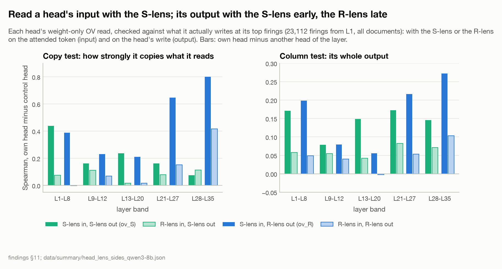

- **The input side is the S-lens, for both circuits.** An S input beats an R input with the same
  output lens in every band, on this test and on whole predicted columns (the one exception is the
  copy test at L28-L35 with an S-lens output, which the catalog doesn't use there); on the QK side
  too, the S-lens key read agrees with the attention keys receive (+0.18, control +0.08) better than
  the R-lens's (+0.09, control +0.05; `checks/head_qk.py`, over every 16th document). A head reads
  what a position holds, not what it is about to say. On the QK side this was tested on keys; a late
  head's query can read what its own position is about to say (cross-lens self-match, below).
- **The output side is the S-lens early and the R-lens late,** as for neuron writes: S→S leads at
  L1-L8 and edges S→R at L13-L20 (where it also predicts whole columns better), S→R leads at L9-L12
  and by far from L21. Induction heads favour S→R, duplicate-token heads S→S.
- An earlier, coarser test agrees: of the four brackets' copying scores, only S→R tracked single-head
  ablation better than the raw score (Spearman +0.22, +0.08 over raw, 95% interval +0.03 to +0.12;
  `checks/head_circuits.py`).
- The catalog reads keys and values with the S-lens; OV as `ov_R` (S→R, trusted from L9) and `ov_S` (S→S, trusted
  through L8 and a second view through L20); QK as `qk_S` (the mean query), and its diagonal twice: with the S-lens
  query, `qk_self_S` (a position holding `v` seeks `v`: duplicate-token heads, through L20), and with the R-lens query,
  `qk_self_R` (a position about to say `v` seeks `v`: late heads, L28-L35 clearly, L21-L27 mixed; below). Both are kept at
  every layer; the bands are a prior.

**What each head copies** (`ov_R`, `ov_S` in `heads/reads`): each token's z in its own column of the
OV map, that is, where `v` ranks in what the head writes when it reads `v`. At each firing this
weight-only read predicts where the attended token ranks in the head's actual output (Spearman +0.51
over firings; the same token under another head, 0.00), from +0.22 at L13-L20 to +0.74 at L28-L35
(`checks/head_census.py`). The S-lens input is what helps: against the same logit-lens read of the
output, an S-lens input scores +0.49 and the raw embedding +0.40. Examples:
- **Classes, across languages:** L26h31 copies quantities (` weight | 体重 | strength | temperature`);
  reading ` population` it writes `人口 | population | statistics`.
- **Pronouns by gender:** L20h17, reading ` herself`, writes ` herself | 她 | she` and suppresses
  ` himself | 他自己 | his`, and the reverse for ` himself`. L6h21 copies *you*.
- **Copy and copy suppression:** L34h1 copies surnames (` Heller | Crosby | Gallagher`); L32h9, a
  copy-suppression head (McDougall et al. 2023), suppresses the same ones.
- **Class suppressors, late:** L32h1 suppresses ` fluid | traffic | bridge | fuel`; L30h10 ` region |
  period | moment`. L19h7 and L10h21 suppress British spellings; reading `Whilst`, L19h7 writes
  American ones.
- **A class the single score misses:** L30h25 scores −0.10 as a copier, yet copies one class at z up to
  31 (`原始 | raw | formal | traditional | native`).
- Induction heads copy nearly everything (L22h23 and L24h22: median z +3.0 and +3.6); duplicate-token
  heads almost nothing.

**What each head attends to** (`qk_S`, `qk_self_S`): each key token's z under the head's mean query,
with the q/k norms' derivative and RoPE averaged over the head's own offsets.
- **Self-match finds duplicate-token heads from the weights** (`qk_self_S`, AUROC 0.96): as queries they
  favour a token's own surface form (L1h28 reading ` Paris` favours ` Paris | Paris | Parse`).
- **Attends-to agrees with the attention tokens receive in context early and late** (`qk_ctx_rho`,
  over tokens seen 10+ times as keys): Spearman over tokens +0.18 at L0-L8 (control +0.07), +0.01 at
  L13-L20 (−0.01), +0.16 at L28-L35 (+0.04); best at L0 (+0.42: L0h27 attends to the starts of code and
  documents, L0h0 to Chinese and Japanese function words). The S-lens beats raw embeddings wherever
  either reads anything (`checks/head_qk.py`). The released pass renormalized attention without the
  sink by `1 − a₀`, which bf16 rounds to 0 for sink heads; `06_activations.py` now divides by the
  non-sink sum, which on a 176-document slice raises these means by at most 0.03 (at L28-L35).
- **Late heads attend to what they copy:** at L28-L35, 23% of heads attend mostly to tokens high in
  their own copy read (control 7%; `checks/head_census.py`), and class suppressors to the class they suppress (L31h23 attends to
  ` Combination | Equality` and suppresses ` alternative | balance | combination`). Mid-network, where a
  head looks says little about what it writes.
- **Cross-lens self-match finds the late heads that look up what is about to be said**
  (`qk_self_R`; `checks/head_seek.py`). With an R-lens query (the position says `v`) against S-lens keys (the
  position holds `v`), QK's diagonal asks whether a head seeks earlier copies of the token its query
  position predicts: the QK half of copy suppression (McDougall et al. 2023). A token's R and S
  directions are nearly orthogonal (median cosine 0.02-0.08), so this is not `qk_self_S` again. In
  context (2,000 documents), a head's *seeking* is its attention per key to earlier copies (two or
  more back, induction matches left out) of the R-lens top-1 at its input, relative to uniform, minus
  that to copies of a random earlier token. At L28-L35 the weight read's per-head median tracks it at
  Spearman +0.62 across heads (another head's read +0.11, `qk_self_S` −0.17), and +0.58 with the model's
  final top-1 as the target; less earlier (+0.39 at L13-L20, where R-lens on both sides does better,
  +0.21 at L21-L27).
  - Of the 20% of L21-L35 heads that seek most, 17 lower the target's logit (direct effect, against a
    random earlier token's): copy suppression in context, among them L33h21, L32h9, L27h7, L29h16 and
    L31h30 (the list is in `data/summary/head_seek_qwen3-8b.log`). The weight read finds them at
    AUROC 0.91 (`qk_self_S` 0.41); a negative OV copy score does as well (0.91). Within about half of
    them the tokens sought most are the ones suppressed most (per-token Spearman with `ov_R` −0.18 at
    the median, −0.68 for L27h7).
    QK says what a head looks up and OV what it does with it: the read also finds the 79 that seek and
    boost (0.75).
  - Early the test is empty: at L3's input the R-lens top-1 is ` the` at 78% of positions (8 distinct
    tokens), so early heads' large "seeking" is attention to function words.
- **Query reads past L1 are noise with an S-lens query:** L20h17 favours nearly the same keys whether its
  query is ` she` or ` he`.

**Limits.** The OV read assumes the head reads one token's footprint; in context a head mixes several
positions. Reads are scale-free. The S-lens footprint is a context-averaged stand-in (§6). The QK read
is first-order: attention that depends on the query's context or on position alone (previous-token,
induction) is not read.

## §12. Attention heads: tests and labels

**What each read names** (`checks/reads_at_firings.py`). Each head's weight-only reads are scored at its 64 top firings
(largest output norm, one per document) against the layer's other heads on the same firings; BH over
all 1,152 heads at 5%, as shares of each band's heads (no per-head test is kept). `ov_R`: the attended token's column promotes the next token; `ov_copy`: the head
promotes what it attends to; `ov_S`, `qk_S`: the attended token scores high in the head's own read. Token mode: a third of
firings sharing a query or attended token.

| band | `ov_R` | `ov_copy` | `ov_S` | `qk_S` | token mode: query / attended | pattern |
|---|---|---|---|---|---|---|
| L0-L8 | 0.00 | 0.01 | 0.00 | 0.00 | 0.22 / 0.40 | 0.10 |
| L9-L12 | 0.01 | 0.02 | 0.00 | 0.01 | 0.05 / 0.12 | 0.08 |
| L13-L20 | 0.01 | 0.01 | 0.00 | 0.00 | 0.06 / 0.08 | 0.08 |
| L21-L27 | 0.04 | 0.02 | 0.00 | 0.00 | 0.12 / 0.18 | 0.06 |
| L28-L35 | 0.26 | 0.16 | 0.00 | 0.08 | 0.25 / 0.19 | 0.04 |
| all | 0.07 | 0.05 | 0.00 | 0.02 | 0.15 / 0.21 | 0.07 |

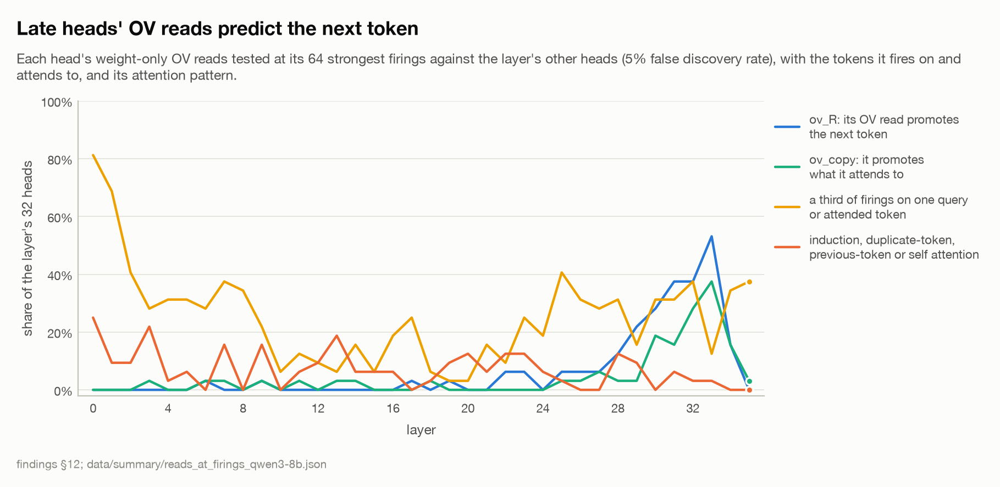

- **Late heads write the next token:** `ov_R` holds for 26% of L28-L35's heads (53% at L33). Read
  from their actual outputs in context, 32-61% of heads from L21 promote the token that follows their
  strongest firings, and 38% the token they attend to, against 4-7% and 10-14% before L21
  (`heads/acts`' `out_R_z`; `checks/head_census.py`).
- **The S-side reads never separate a head from its layer.** S→S copying is common to nearly every
  head (`ov_S_copy` medians +0.65 to +0.84 in every band), and the mean query's favourite keys are
  shared too. They stay useful as reads of what heads do (§11), not as evidence that a firing is this
  head's.

**A label for every head** (`10_labels.py --side heads`). Claude Haiku 5.5 labelled all 1,152 heads
from leak-free cards (patterns, output scale, OV and QK reads with both self-match diagonals, drivers, the
first 5 contexts): where it fires, what it attends to, what it writes ($0.30 on the Batch API). Checked
blind on 100 random heads, 20 a band, by Claude Sonnet:
- **Firing:** the labels separate 4 held-out top firings from 4 of another head of the band at AUROC
  0.70 [0.64, 0.77]; a third head's labels score 0.50. Half the heads (55%) score 0.8 or more. The
  contrast is another head's strongest firings, harder than §8's quiet text.
- **Writes:** a judge shown the firings' in-context output read picks the head's own label out of four
  54% of the time [45, 65] (chance 25%): 79% at L28-L35, 67% at L9-L12, 55% at L21-L27, 42% at
  L13-L20, 28% at L0-L8.
- Most labels are unconfident (median 0.25-0.30), and confidence tracks the score only weakly
  (Spearman +0.15).
- The labels before `qk_self_R` was on the cards scored the same within noise (0.71 and 49%), and the
  copy suppressors' labels barely changed: their `qk_self_R` lists are scattered tokens, and the
  labeller leans on the contexts and the OV reads.

**Limits.** The tests compare a head with its own layer, so a property shared by a layer's heads never
passes: the right null for "this head", the wrong one for "these heads". Firings are the top 64 by
output norm, one per document, which favours heads with large outputs; sink heads fire where they leave
the sink. 20 heads a band is noisy.

## §13. Gemma 4 12B: the text catalog in a second model

**Setup.** The pipeline (`06`-`09`, `checks/causal_lens.py`) run on the base model
`google/gemma-4-12B` with `NEURON_LENS_MODEL=google/gemma-4-12B`, on H100s in bf16: 48 layers ×
15,360 GELU-tanh neurons and 16 heads a layer. Its architecture differs in ways the readers follow
(a norm after the MLP and a per-layer scalar on the write, shared keys and values on global layers,
a softcap on the logits; design.md, [Gemma 4 12B](design.md#gemma-4-12b)). Both lenses were fitted
as Qwen3-8B's, on the same 1,000 DCLM documents (about 16 s a document per lens on one H100);
split-half differences are 0.01-0.12 by layer for the R-lens (median about 0.05) and 0.01-0.07 for
the S-lens. The activation corpora have Qwen3-8B's sizes (15.4M positions), with the chat slice as
plain `User:` / `Assistant:` turns, since the base model has no chat template. The causal sample is
24 random neurons a layer, both poles, with no J-lens to compare.

**Steering** (as §3: the write added at 1× and 4× the pole's `act_top` at positions 16-63 of 16
DCLM documents; Pearson r with the lens's read, medians over the random poles; controls within
±0.05 at every layer):

| layer | logit lens, 1× | R-lens, 1× | R-lens, 4× | R-lens, ablation where it fires |
|---|---|---|---|---|
| L0 | 0.01 | 0.07 | 0.26 | 0.00 |
| L4 | 0.00 | 0.00 | 0.04 | 0.00 |
| L8 | 0.00 | 0.09 | 0.15 | 0.01 |
| L11 | 0.04 | 0.40 | 0.42 | 0.01 |
| L16 | 0.06 | 0.47 | 0.42 | 0.06 |
| L24 | 0.21 | 0.62 | 0.47 | 0.07 |
| L32 | 0.52 | 0.82 | 0.80 | 0.24 |
| L40 | 0.85 | 0.96 | 0.95 | 0.64 |
| L46 | 0.94 | 0.99 | 0.98 | 0.91 |

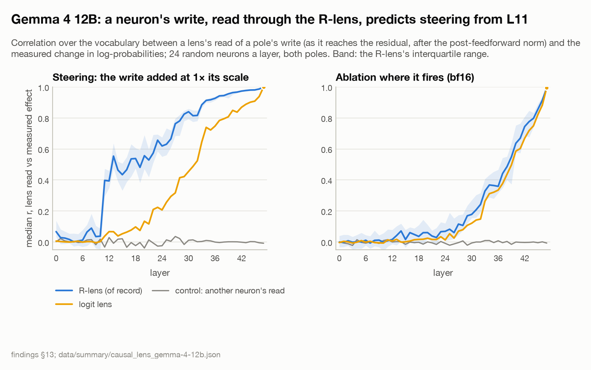

- **From L11 the R-lens read of a write predicts steering, as in Qwen3-8B:** a median r (over each
  band's layers) of 0.53 at L12-L23, 0.82 at L24-L35 and 0.97 at L36-L47. The logit lens trails until
  the last layers (0.08, 0.44 and 0.86 by the same bands).
- **Before L11 neither lens predicts a 1× push** (r 0.00-0.09). The correlation rises with the dose
  (L0: 0.07 at 1×, 0.26 at 4×), which suggests the natural-scale pushes are too small to measure
  over the documents' own variation rather than misread. Ranked instead of correlated, an amplified
  write raises the tokens its R-lens read names above other poles' read tokens at a median rank of
  0.98 at L0-L11 (`checks/write_steer.py`, a 192-pole panel, with an earlier R-lens fit on 174
  documents).
- **Ablation agrees only late,** as in Qwen3-8B (§4): 0.05 at L12-L23, 0.17 at L24-L35, 0.71 at
  L36-L47.

**What each read names** (`checks/reads_at_firings.py`, as §7, BH over all poles at 5%):

| band | `read_S` | `read_R` | `write_R` | `write_S` | token mode | near-silent |
|---|---|---|---|---|---|---|
| L0-L11 | 0.40 | 0.00 | 0.00 | 0.01 | 0.57 | 0.00 |
| L12-L23 | 0.06 | 0.01 | 0.00 | 0.04 | 0.26 | 0.00 |
| L24-L35 | 0.04 | 0.04 | 0.07 | 0.00 | 0.18 | 0.00 |
| L36-L47 | 0.03 | 0.01 | 0.19 | 0.00 | 0.15 | 0.00 |
| all | 0.13 | 0.02 | 0.07 | 0.01 | 0.29 | 0.00 |

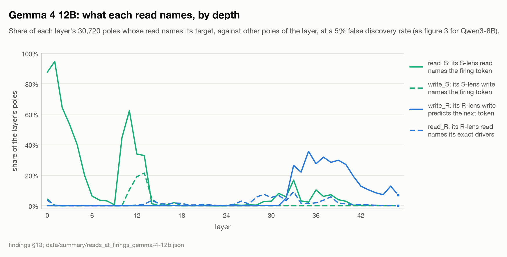

- **The same shape as Qwen3-8B's.** The S-lens names the firing token for 88-95% of L0-L1's poles, and the R-lens write promotes
  the next token late (`write_R` 22-36% at L33-L40).
- **The weight-only R-lens read of the input fails on this model.** `read_R` names the exact drivers for at most 9% of a
  layer's poles, and its top 64 shares 0.2-0.4% with what the residual holds at the firings, by band (another pole: 0.1%;
  Qwen3-8B: 3-20%). The catalog's read rows are the rows times the input norm's weight γ, the covector the activation applies to
  the residual. That suits the S-lens, a pullback; the R-lens transports a vector. γ is nearly uniform on Qwen3-8B (std/mean
  0.1-0.3) and not on Gemma 4 (1.1-4.8; the 99th percentile is 365× the median at L42). Read with row / γ instead, the overlap rises
  from 0.4% to 9.2% at L30 and 0.1% to 3.8% at L42, less at L18 (1.3%) and not at L6, and it is a little worse on Qwen3-8B (22.6% to
  19.6% at L30), so neither form is final (`checks/read_norm.py`). The released `read_R`, `read_R_z` use row × γ.
- **The input-side stage reaches L13, at about Qwen3-8B's relative depth.** `read_S` falls to 3% at L8
  and 1% at L9, then rises again to 62% at L11 and 33-34% at L12-L13, where `write_S` also holds for 10-21% of poles:
  early neurons that write back the tokens they detect (§6), ending at 27% of the depth (Qwen3-8B: L8,
  23%).
- **Late writes fall off at the end:** `write_R` drops from 27% at L40 to 7-13% at L44-L47, where
  Qwen3-8B's keeps rising to its last layer.
- **No poles are near-silent.** Gemma's activations take both signs at every layer, and none of its early
  layers is near-silent as Qwen3-8B's L1 is (§2).

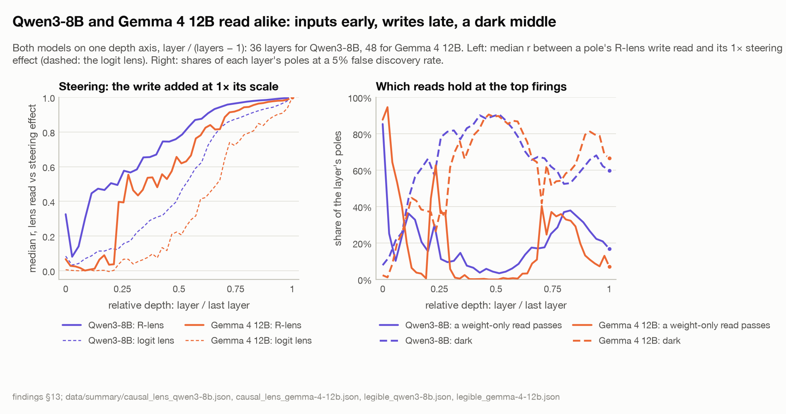

**Heads** (`checks/reads_at_firings.py`, as §12). With 16 heads a layer, a head's mismatched control has 240 pairs,
so no p-value falls below 1/241, and BH over 768 heads passes none. At an uncorrected p ≤ 0.05 (5% by chance), `ov_R` holds for 23% of L36-L47's heads and
`ov_copy` for 18%. `qk_self_S` finds the 26
duplicate-token heads at AUROC 0.95 (Qwen3-8B: 0.96).

- **The cross-lens self-match points the same way, more weakly** (`qk_self_R`, `checks/head_seek.py` as §11, 2,000
  documents). A head's median `qk_self_R` tracks its seeking of the R-lens top-1 in context at Spearman +0.26 at L24-L35
  and +0.18 at L36-L47 (another head's read +0.02 and −0.05; `qk_self_S` +0.07 and +0.11), and +0.40 at L24-L35 with the
  model's final top-1 as the target (Qwen3-8B, L28-L35: +0.62). Late heads seek less here: per matching key, 1.7× uniform
  at L36-L47 against 1.3× for a random earlier token (Qwen3-8B, L28-L35: 2.7× against 0.8×). Of the top fifth of L24-L47's
  heads by seeking, the 25 that lower the target's logit are found at AUROC 0.66 (`qk_self_S` 0.50), and a negative OV
  copy score does better (0.78); many sit on the global layers (L29, L35, L41). At L12-L23, as at Qwen3-8B's L13-L20, the
  R-lens on both sides tracks seeking best (+0.46; `qk_self_R` +0.25, `qk_self_S` +0.26). L1-L11 heads seek most of all
  and no read tracks it (+0.13 at best).

**Labels** (`10_labels.py`, as §8 and §12, with Gemma 4's own reading plan and prompts: four bands
from the tests above, L0-L4, L5-L13, L14-L32 and L33-L47, and six worked examples of its own poles).
Claude Haiku 5.5 labelled every head ($0.20) and all 1,474,560 neuron poles (73,728 requests of 10
neurons each, $171.66).

- **Haiku is less sure of Gemma 4's neurons.** Median confidence is 0.30 for firing labels and 0.20 for
  write labels (Qwen3-8B: 0.30 and 0.25), and 3% and 6.5% of them reach 0.7 (Qwen3-8B: 9% and 11%). Firing labels
  are least sure at L14-L32 (median 0.20; 0.30 in every other band), and write labels most sure there (0.30; 0.10 at
  L0-L4, 0.20 at L5-L13, 0.15 at L33-L47), where `out·R` predicts steering. Of Gemma 4's neuron labels, only
  the relabelled negative-lobe poles are checked blind (§8). From L14 their cards show the R-lens read of the input, which fails
  on this model (above), with priors telling the labeller to expect little.

- **Head labels: the firing labels hold, the write labels barely do.** Checked blind as §12's, on 80 random
  heads (20 a band) by Claude Sonnet 5.5: the `fires` and `attends` labels tell 4 of a head's held-out
  firings (ranks 6-24) from 4 of another head's at AUROC 0.71 [0.64, 0.78] (a third head's labels on the
  same contexts: 0.49), as Qwen3-8B's do (0.70). A judge picks a head's `writes` label out of four from
  what its firings promote in context 32% of the time [22, 42], near chance (25%; Qwen3-8B: 54%; before
  `qk_self_R` was on the cards, 22%). Its cards'
  OV reads rarely pass a test (above), and what a head's OV map promotes is not what it writes in
  context; the labels follow the cards (`data/summary/labels_heads_gemma-4-12b.md`).

**Limits.** The base model, not a chat model; 24 random neurons a layer for the causal sample; no
J-lens for Gemma 4, and of its neuron labels only the relabelled poles are checked blind (§8; `checks/haiku_blind.py` steers on a
GPU). The head tests have too little power for a false discovery rate.

## §14. Images and sound: what drives a neuron

Gemma 4 12B takes an image or a sound with no encoder network: each 48 × 48-pixel patch (an image is
an 8 × 8 grid of them, 384 pixels a side) or 40 ms frame of 16 kHz audio (64 of them, 2.56 s) enters
the residual stream through a few norms and one linear map. So the lenses can be fitted on images and
sounds, and a neuron's read direction can be carried back to pixels or samples.

**Setup.** *Media lenses* (`02_fit.py --modality image|audio`): both lenses fitted on media documents
(a short prompt around one image or sound), seeded and read at its 64 slots: COCO 2014 validation
images (1,000 for the S-lens, 512 for the R-lens) and ESC-50 clips (1,615 and 512). The S-lenses are
seeded only in the subspace the embedder reaches (2,048 directions for images, the patch embedder's
rank being 2,041; 640 for audio), which is exact and cuts their cost to 0.1-0.3 of a text document's.
Their maps match autograd to 1e-6. *Exemplars* (`13_media_activations.py`): every pole's mean
activation over the slots of 49,694 labelled images (2,805 labels, from 49 datasets: ImageNet,
Places365, food, cars, sketches, documents, charts, art, medical scans, …, plus manga pages and
synthetic gratings, shapes and scripts) and 49,703 labelled sounds (1,167 labels, from 11 datasets:
AudioSet, FSD50K, ESC-50, speech in many languages and accents, music, plus synthetic tones, chirps,
beats and clicks; `data/corpus/media-*.provenance.json`). A pole's top label (by the z of its mean
activation over that label's documents) is *reliable* if it passes the 99th percentile of a
shuffled-label null for its layer and is in the top 5 of both halves of the documents; a held-out
AUROC scores it on the odd documents after choosing it on the even ones.

| modality | band | reliable label | held-out AUROC (median) |
|---|---|---|---|
| image | L0-L11 | 34% | 0.96 |
| image | L12-L23 | 26% | 0.97 |
| image | L24-L35 | 39% | 0.97 |
| image | L36-L47 | 32% | 0.97 |
| audio | L0-L11 | 51% | 0.91 |
| audio | L12-L23 | 21% | 0.85 |
| audio | L24-L35 | 30% | 0.82 |
| audio | L36-L47 | 19% | 0.77 |

- **Labelled media name what a third of poles respond to.** Early reliable labels are often
  primitives (checkerboards, gratings, click trains at a given rate, scripts by writing system); later
  ones are objects, scenes and languages. Audio labels hold less well past L11.

**Reads in pixels and samples** (`14_media_tables.py`, tested by `checks/media_lens.py`). A pole's
read direction through the media S-lens, mapped back through the embedder, is a 48 × 48 patch
(`read_png`) or 640 samples (`read_wave`): what the direction looks like as input. To test it, a read
is added to 32 held-out images or sounds, and the pole's change is ranked among its changes under 191
other poles' reads (1 the most, 0.5 chance), over a panel of 192 poles (`checks/media_reads.py`):

| band | image read: its read projection | image read: its activation | optimised patch: its activation | optimised sound: its activation |
|---|---|---|---|---|
| L0-L5 | 0.99 | 0.92 | 1.00 | 1.00 |
| L6-L11 | 0.94 | 0.09 | 0.98 | 1.00 |
| L12-L23 | 0.89 | 0.29 | 0.86 | 1.00 |
| L24-L35 | 0.53 | 0.41 | 0.62 | 0.56 |
| L36-L47 | 0.48 | 0.49 | 0.43 | 0.47 |

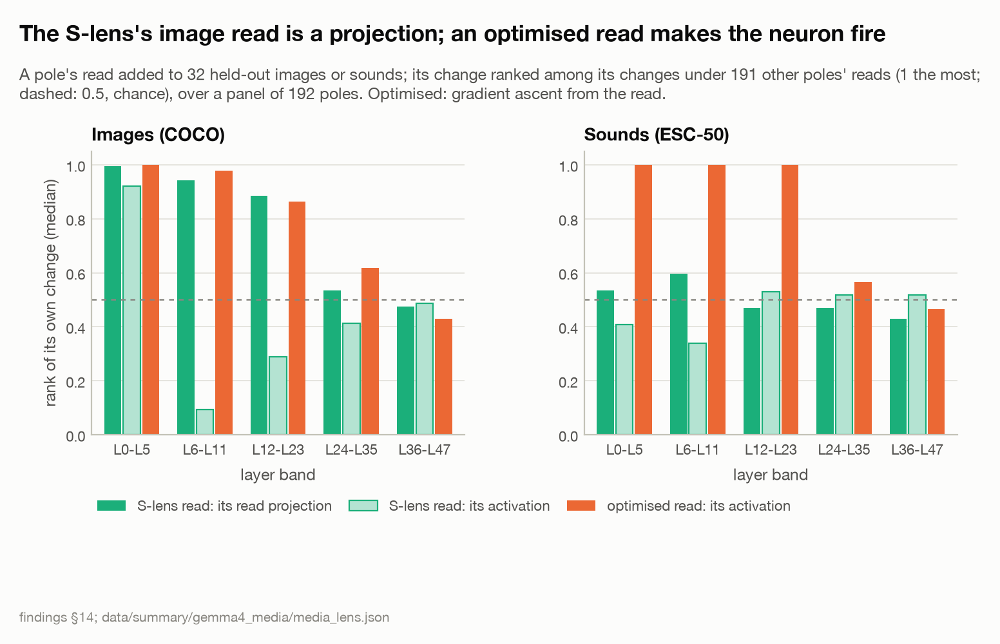

- **The image read is a projection, not a stimulus.** It moves the pole's own read projection most
  through L23, but raises the pole's activation only at L0-L5, and lowers it at L6-L23 (0.09-0.29):
  past the first layers, what aligns with the read direction at the input is not what makes the
  neuron fire. The audio read is at chance on both counts.
- **Optimised reads drive the neuron.** Starting from the read, gradient ascent through the model
  (`15_media_optimised.py`: one pattern tiled over all 64 slots, at 8% of the pixel range or 0.3 of a
  frame's RMS, 24 Adam steps over 128 images or clips) finds a patch or a 40 ms frame that raises its
  pole on held-out inputs through L23. For the catalog's 48 best-labelled poles a layer (L0-L35), it
  raises the pole on 8 held-out documents for 95%, 70% and 56% of image poles by band (L0-L11,
  L12-L23, L24-L35) and 99%, 86% and 51% of audio poles. Both are near chance past L35.
- **Deep neurons respond to whole sounds.** Past L35, where one repeated frame does nothing, a 10 s
  clip synthesised for each of 24 poles (one `+` pole a layer from L24, optimised as a spectrogram so
  it stays sound-like) drives its own pole more than the other 23 clips do in a different prompt, at a
  median rank of 0.87 (`checks/synth_audio.py`); one pole a layer is a small sample.
- **The patch reads share one pattern; the optimised patches don't.** Raw S-lens reads carry the same
  column streaks from neuron to neuron, a hub pattern like the hub tokens of text reads (§1); the
  optimised patches differ by neuron.

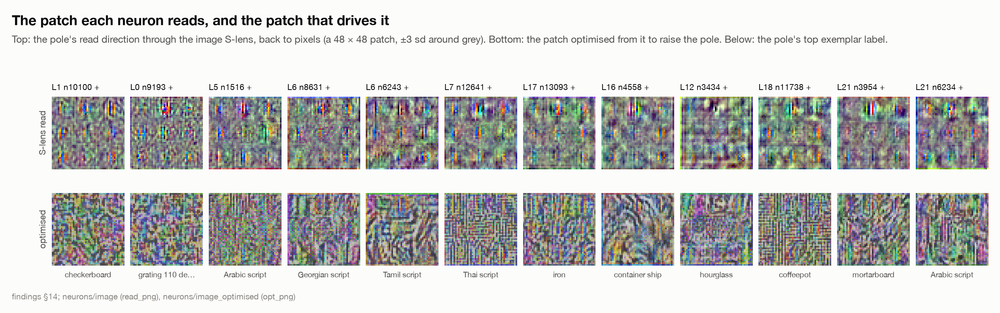

**Limits.** A read is one slot pattern summed over the 64 slots, not a map of where in an image it
sits. Media lenses are fitted on photos (COCO) and environmental sounds (ESC-50) only. Labels name
what a document is about, not each patch or frame. The audio tests' held-out clips are among the audio
S-lens's fitting clips (all of ESC-50), though not the optimisation's.

## §15. One concept in text, images and sound

**Setup** (`checks/crossmodal.py`). For every pole with a reliable image or audio label (§14; labels
that name a whole collection or a synthetic probe are left out), the label's rank among the
modality's labels on the text side, three ways: how hard the pole fires on `Here is an example:
{label}.`, its text S-lens read (`read_S`) and its text R-lens write (`write_R`), each scoring the
label's tokens. A rank of 0.95 or more passes; a shuffled pairing passes 5%.

| | image labels: share passing | audio labels: share passing |
|---|---|---|
| its words fire it | 31% (L12-L23: 42%) | 9% |
| the text S-lens reads it | 8% | 9% |
| the text R-lens writes it | 14% (L12-L23: 19%) | 8% |
| all three | 4,382 poles | 730 poles |
| poles scored | 253,785 | 248,033 |

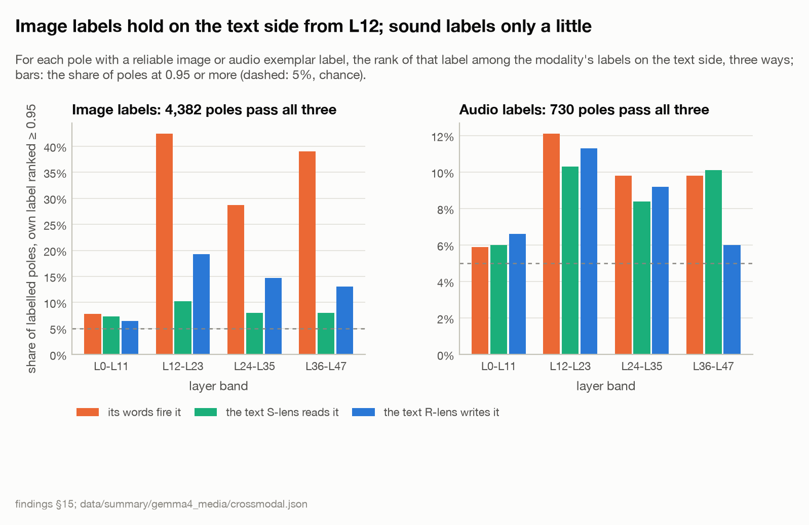

- **Image concepts are text concepts mid-network.** At L12-L23, 42% of the poles that respond to an
  image label also fire on its name in text, against 5% by chance; 8% at L0-L11, where image labels
  are mostly visual primitives.
- **Sound is weaker:** 9% fire on their label's name, about twice chance.
- **19 poles hold one concept across all three modalities.** Of 48,497 poles with a reliable label in
  both images and sound, 19 pass all three text tests for both, where independent lists would share
  2.0. They are places and peoples, with their language:

| pole | image label | audio label | exact text drivers | R-lens read of its write |
|---|---|---|---|---|
| `L14 n8313 +` | mosque indoor | Arabic | Amal, أ, Mohamed, Noor | Arabic, Quran, islamic, Saudi |
| `L23 n2831 +` | Sarees | Gujarati | Tendulkar, Karnataka, Bengaluru, lakhs | Mumbai, India, Hyderabad, Delhi |
| `L33 n5249 +` | tacos | Spanish | Peruvian, Ecuadorian, Mexican, Aztecs | Mexican, 墨西哥 (Mexico), Mexico |
| `L33 n6099 +` | pagoda | Mandarin Chinese | WeChat, Xiaomi, Weibo, Shanghai | Chinese, China, Beijing, 中国 |
| `L36 n14109 +` | totem pole | Maori | Cherokee, Navajo, Apache, Mohawk | Native, Indian, Indigenous, Cherokee |
| `L37 n7165 +` | giant panda | Mandarin Chinese | 熊猫 (panda), 四川 (Sichuan), 成都 (Chengdu) | panda, 熊猫, Chengdu |

  The others pair mosques, a pyramid or Arabian camels with Arabic (8 poles), a coral reef with Māori, a giant panda with
  Mandarin, tacos with Spanish, and Pembroke corgis with Welsh. Firing on both names alone is near chance (1,692 poles
  against 1,369 expected): the lenses' reads are what make the triple match specific.

**Limits.** Label words are English and scored in one template; a rank among the modality's labels
says the pole prefers this label to the others, not that the concept is all it does. Exemplar labels
come from the collections, whose coverage of a concept varies.

## §16. Attention heads in image and audio contexts

**Setup** (`checks/head_media.py --n 64`). 64 mini-ImageNet validation images (64 classes) and 64
ESC-50 clips (49 classes), each in the media prompt and followed by ` a <label>`, its own and another
class's. Per head: attention from the text after the image or sound to its slots, against an even
spread over the keys; within the media, attention to the same slot, the other slots and grid
neighbours; each head zeroed in turn, the rise in the right label's loss minus a wrong one's, as a z
over documents (*content carriers*); and the head's output at the article read through the R-lens
`mid`, as the right class's mean percentile among the classes, against 200 label shuffles with BH
over heads (*label writers*). Per-head values are in `heads/image` and `heads/audio`.

- **The model knows what it sees, but barely what it hears.** The right label's loss is below a wrong
  one's for 97% of images (3.64 against 10.29 nats), 55% of sounds (6.48 against 6.56).
- **Images: early heads look within the image, later ones carry it out.** L0-L3 heads attend from a
  slot to its grid neighbours (L0h13: 0.85). Reading from the text into the image peaks at L23-L31
  and L44 (L24h13 and L44h7 at 0.96 of an even spread). Zeroing single heads costs the right label
  more than a wrong one, most for L28h6 (z 9.9), L29h1 (9.7), L29h9 (8.4) and L25h2 (7.9): 29% of
  L24-L35's heads pass z > 3. By the size of the loss, early heads L8h15 and L7h13 cost the most
  (0.75 and 0.65 nats, z 5). From L12, 36-43% of heads per band write the right class (q ≤ 0.05),
  most at L35-L46 (L37h10 and L44h7: the right class's mean percentile 0.955).
- **Sound: heads read it early and nothing carries it.** The text attends to the audio most at L0-L10
  (L8h5: 1.40 times an even spread), but no head passes z > 3 and no head writes the right class.
- Which heads read the media is shared across modalities (Spearman +0.51 between image and audio
  reading), and which carry content is not (+0.09).

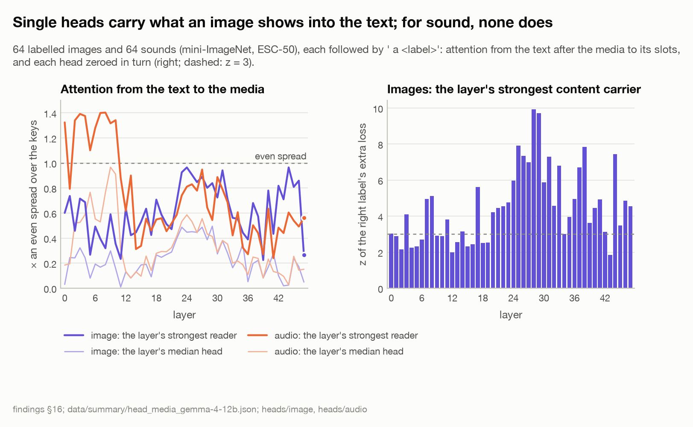

**Limits.** 64 documents a modality in one prompt; zeroing a head measures what the model loses
without it, not all it does. With the model near chance on sound, the audio results say little.

## §17. Direct edges between neurons

What feeds a neuron? The residual stream is a sum: what a neuron writes reaches every later layer's MLP
input unchanged, so the direct path from one pole to a later one is a number from the weights. This
section builds those edges for Qwen3-8B and asks how much of what drives a pole when it fires they name.

**Setup.**
- **Edges** (`16_edges.py`; weights only, fp32, minutes). For a pole A of layer L and a pole B
  of a later layer M: `cos`, the cosine of A's write `±W_down[:, n]` with B's read direction (`â ± b̂`, or the up row for a negative-lobe pole, below),
  and `push = cos · act_top_A · ‖w_A‖ / rms_M`, how far one of A's top firings moves B's normalized MLP
  input along B's read direction (`rms_M`: the median RMS of the residual entering layer M's MLP over
  64 documents, 0.1 at L0, 1.0 at L12, 6.6 at L28 and 26 at L35). Each pole keeps its 64 strongest
  in-edges (from earlier poles) and out-edges (to later ones) by |push| among those with
  |cos| ≥ 5/√d = 0.078, which random directions reach about once in 1.7 million (the `edges` table).
- **In context** (`checks/edges_in_context.py`; H100, fp32). §3's 32 random neurons a layer
  at L1-L35, both poles, at their first 5 top firings (2,228 poles). At a firing, B's MLP input is the
  normalized sum of the embedding, every head's write at layers up to M and every neuron's below M.
  Holding the norm's scale and SiLU's ratio `silu(g)/g` (RelP's rules), the half rule splits B's
  activation exactly over these sources (largest error 4·10⁻⁵).

**The wiring is real.** Against the layer before alone, the median pole's strongest |cos| is 0.13
(0.10-0.16 by band), against 0.063 for the same writes under a random rotation. 93% of poles have an
in-edge above the floor (L0's have none to have), half of them strongest from the layer before. A
concept pole is wired from its concept: L14 n1561 + (animals, pets, livestock) has in-edges from L12
n7934 − (dogs, pets, veterinary), L9 n11117 + (pet words), L11 n9841 − (animals, birds, bees) and L10
n10730 + (animal and rodent nouns).

Shares of the activation at the pole's top firings (medians over poles of each pole's mean):

| band | heads | neurons | top 64 neuron poles | firing among them | the 64 in-edges | 64 random poles | in-edge sources firing | recall (control) | ρ |
|---|---|---|---|---|---|---|---|---|---|
| L1-L8 | 0.33 | 0.66 | 0.82 | 0.41 | 0.05 | 0.00 | 0.03 | 0.06 (0.00) | 0.88 |
| L9-L12 | 0.25 | 0.74 | 1.13 | 0.45 | 0.15 | 0.00 | 0.04 | 0.06 (0.00) | 0.89 |
| L13-L20 | 0.49 | 0.51 | 1.03 | 0.55 | 0.10 | 0.00 | 0.03 | 0.07 (0.00) | 0.87 |
| L21-L27 | 0.42 | 0.58 | 0.72 | 0.59 | 0.09 | 0.00 | 0.04 | 0.08 (0.00) | 0.87 |
| L28-L35 | 0.19 | 0.81 | 0.79 | 0.62 | 0.11 | 0.00 | 0.07 | 0.05 (0.00) | 0.88 |

*Firing*: at `act_top / 4` or more in its pole (the `acts` tables' rate threshold). *Recall*: the share
of the 64 largest |contributions| that are in-edges (control: another pole's in-edges). *ρ*: Spearman
over every upstream neuron, in the pole it is in, between its push and its contribution.

- **A pole's direct input is concentrated.** The 64 upstream neuron poles that contribute most sum to 72-113% of its activation
  (signed: past 100%, the rest cancels), and 41-62% of them are firing there themselves. Heads carry a third, half at
  L13-L20; the embedding 2% at most (at L1), under 0.5% from L7. Over every pole's first 5 firings (the `sources` table) heads carry
  a median 19-52% by band.
- **The edges get the direction right, not the traffic.** An edge's push ranks every upstream neuron's
  contribution at Spearman 0.87-0.89: the weights say what each would do. But the in-edges are 5-8% of
  the 64 largest contributors and carry 5-15% of the activation, because their sources fire at only
  3-7% of the pole's top firings. What drives a pole is which units fire with it, which no list from
  the weights can know (the same gap as between global weights and attribution graphs over transcoder
  features; Ameisen et al. 2025).
- **In context the sources read as one concept.** `explain 14 1561 +` gives the animal pole's sources
  at its five top firings: L12 n7934 − (11%), then animal, veterinary, pet and young-animal poles from
  L4-L13 (L12 n7182 −, L11 n2301 −, L13 n12072 +, L10 n11987 +, L4 n12138 + "vet", L10 n4140 − cats),
  topical copy heads (L12h18, L14h7, L14h6: +11.5%) and two heads that suppress topical nouns (L14h5,
  L12h8: −9%). Three of its ten largest neuron sources are among its 16 strongest in-edges (L12 n7934 −,
  L12 n7182 −, L11 n2301 −).
- **At L1-L3 `â ± b̂` misled.** With it, ρ was −0.27 at L1, −0.61 at L2 and 0.52 at L3, against
  0.86-0.91 from L4: at L1-L3, 49-78% of top firings ride SiLU's negative lobe (the gate below 0; 14%
  at L4, 2% or less from L5), where `â ± b̂` points the wrong way. With the up row for those poles (next
  point), ρ is 0.80, 0.77 and 0.80.
- **On the negative lobe a pole reads the up row.** SiLU is nearly flat below zero (its floor is −0.28; Gemma's GELU has the same shape), so there the activation
  follows `up`, opposite in sign to the pole, and which way of the gate raises it varies from pole to pole. Active poles with `neg_lobe`
  past a half, S-lens reads (`checks/lobe_reads.py`), the rank of a pole's most frequent firing token among the kept tokens (50 is chance):
  `â ± b̂` 16-48 at Qwen L0-L4 and 40-61 at Gemma L0-L10; its negative 52-84 and 39-60; the up row alone, `∓b̂`, 71-81 and 63-82 (`read_rows` now
  uses it). Ordinary poles reach 69-95 and 75-95 with `â ± b̂`. In Qwen's `read_S_z` at L1-L4 a firing token is in the top 64 for 1-2% of poles
  with the negative, 8-17% with `â ± b̂`, 9-19% with the up row, against 47-73% for ordinary poles. L0 is the exception (71% with the negative, 20% with
  the up row). Limits: S-lens only, and the reads stay hard to interpret by eye under any rule: of 30 random such poles, 1-3 have a firing token in
  their top 16. Many are faint shadows of the neuron's other pole, with the same up row and a shut gate: their `act_top` is a median 0.24 of the other pole's in
  Qwen (0.70 in Gemma; 1.05 and 1.03 for ordinary poles), though about a quarter are the larger pole. L0 n3228 is one: its − pole is a clean 十 neuron (`act_top` 7.9;
  pushed at that size it raises what follows a number, `-year`, `-month`, 月份), and its + pole (0.31) fires on byte fragments sharing 十's bytes, its up row reading 十.
- **Early hubs.** A few L0-L1 neurons sit in most early in-lists: the 1% most-listed sources hold 62% of
  the in-list entries at L0-L8 (8-20% later), and L0 n11466 − (甩, "fling") is in 29% of L1-L8 poles'
  lists. Shared lists show as recall's control at L1-L2 (0.04-0.05).

- **Driven by differs from wired to and fires with** (every pole, K = 16, first 5 firings; `checks/relations.py`). A pole's
  top 16 driven-by sources are a median of 31-44% in its top 16 in-edges or fires-with lists (13-19% and 19-25% taken alone; another pole's lists 0): 56-69% of its largest contributors
  are in neither, because a source's contribution is its activation times its wiring and the top of the product is not the top of
  either factor. In a 160-pole probe (`data/summary/relations_probe_qwen3-8b.json`) the top 16 carried only 1-5% of the summed absolute contribution, which is diffuse.

- **Into a head** (`17_firings.py --parts heads`, the `heads/sources` table; H100). A head's firing reduces to a read of the residual entering its layer through each
  input (design.md): the value at the positions it attends to, and the query and keys through the score margin between its most attended key and the mean of them
  (equal to the log-probability margin to 5·10⁻⁶). Every head's first 5 top firings (5,760 in Qwen3-8B, 3,840 in Gemma 4); the shares sum to 1 within 1.3·10⁻³. Medians over a band's
  layers, share of neurons / earlier heads:

| band | value | query | key |
|---|---|---|---|
| Qwen3-8B L1-L8 | 0.90 / 0.10 | 0.65 / 0.34 | 0.83 / 0.17 |
| L9-L12 | 0.90 / 0.10 | 0.67 / 0.33 | 0.83 / 0.17 |
| L13-L20 | 0.94 / 0.06 | 0.61 / 0.39 | 0.87 / 0.13 |
| L21-L27 | 0.85 / 0.15 | 0.54 / 0.46 | 0.77 / 0.23 |
| L28-L35 | 0.86 / 0.14 | 0.60 / 0.40 | 0.82 / 0.18 |
| Gemma 4 L1-L11 | 0.92 / 0.08 | 0.78 / 0.21 | 0.90 / 0.10 |
| L12-L23 | 0.82 / 0.18 | 0.57 / 0.43 | 0.81 / 0.19 |
| L24-L35 | 0.85 / 0.15 | 0.67 / 0.33 | 0.81 / 0.19 |
| L36-L47 | 0.85 / 0.15 | 0.66 / 0.35 | 0.76 / 0.24 |

  What a head copies and what it can be found by come mostly from neurons; what it looks for takes a third to a half from earlier heads, which suggests composition between heads
  runs mainly through the query (Q-composition, Elhage et al. 2021, here measured at firings). There is no signed weight edge into a head: two heads meet through a matrix, not a dot product.

- **Gemma 4** has the same split (the in-context sample, 3,008 poles): heads carry 12-26% of the activation, neurons 74-86%, and an edge's push ranks every upstream neuron at ρ 0.88-0.92. Over every
  pole's first 5 firings, heads carry a median 13-26%. But its in-edges name almost none of the sources: they carry 0.00 of the activation at every band, recall is 0, and the driven-by lists share none of
  them (0-19% with fires-with). The lists are full of a few hub neurons (the 1% most-listed sources hold 52-66% of the entries at L0-L11 and L24-L35) that fire at 0-1% of the pole's firings, and a pole's
  largest |cos| with the layer before's writes is a median 0.002-0.018, below the 0.065 of the same writes rotated at random. That suggests its writes, scaled by the post-MLP norm's weights, mostly sit where the next
  layers' reads don't look. Read Gemma 4's `edges` as a list of what could reach a pole, not of what does.

**What this means.** The edges are the model's wiring: what a pole's firing would do to each later pole,
the counterpart of a write read (§3), and like it an average that leaves the context out (§4). Which
units drive a pole when it fires is the context's: a list of what feeds a pole needs activations, its
sources at its top firings, which `explain` gives one pole at a time.

**Limits.** Direct paths at one position: what heads carry between positions, and paths through other
units, are not edges. `push` holds each source
at its typical top firing, and Gemma 4's `edges` take each write at its norm's typical scale. 32 random neurons a layer, 5 firings each.

## §18. What a write adds beyond what it reads

The question this section tests, what an MLP adds beyond amplifying what it receives, and the idea of reading the part of an output orthogonal to its input, came from [Matthew Khoriaty](https://www.lesswrong.com/users/matthew-khoriaty).

**Setup** (`checks/write_parts.py`; Qwen3-8B, MPS, fp32). Weights, 512 random neurons a layer: the cosine of a neuron's write with its
gate and up rows, and the top 12 of the R-lens read of the write, orthogonal to the read direction `â ± b̂` or to the whole gate-up plane
(`neurons.orthogonal_write`). Census, §3's random picks, 16 neurons a layer at even layers L4-L34, both poles (511 live poles): the
pole's write added at positions 16+ of 16 documents at 1× `act_top` (§3's protocol), split into the part along `â ± b̂` and the rest; and
removing the same parts of real firings (8 top firings, 8 positions after each). Blind Sonnet ratings of two token lists per pole (same
concept, related but distinct, different, or unclear for lack of a theme), with shuffled pairs mixed in; the second rater judged the
orthogonal-to-read-direction list and the orthogonal-to-plane list for the same poles together. Pairs, keys and ratings are in
`data/summary/write_parts/`.

| layer | `cos(w, up)` | `|cos(w, gate)|` | the write's top 12 kept when orthogonalized to the plane |
|---|---|---|---|
| L6 | +0.35 | 0.06 | 0.57 |
| L10 | +0.55 | 0.13 | 0.44 |
| L14 | +0.45 | 0.14 | 0.46 |
| L18 | +0.29 | 0.20 | 0.49 |
| L22 | +0.26 | 0.14 | 0.53 |
| L26 | +0.12 | 0.09 | 0.75 |
| L30 | −0.02 | 0.06 | 0.85 |
| L34 | −0.17 | 0.05 | 0.69 |

- **The self-alignment is with `up`.** Through L14 a neuron's write leans on the direction its `up` row carries; the gate row's cosine is
  small. At L18-L22 the two sizes close; by L30 the `up` alignment is gone, and it reverses at the last layers. Subtracting only the read
  direction leaves half of this in, which is why the plane is the version in the catalog. `cos_write_up`, `cos_write_gate` keep it per pole.
- **Effect sizes.** Steering, medians by band: the orthogonal part's effect is 84-100% of the whole write's, the along-read part's 8-34%; `r(whole, orth)` 0.94-1.00.
  `r(along, orth)` is about 0 at every depth, but any two orthogonal vectors would tend to that, and no random-split control was run.
- **Meaning, blind.** Orthogonal part against the pole's own read, per rater, among 240 real poles (same / related / different / unclear): rater 1,
  L4-L20 18/5/5/116, L22-L34 10/24/5/57; rater 2, L4-L20 16/8/18/102, L22-L34 10/22/6/58; orthogonal to the plane (rater 2), 18/8/14/104 and 10/21/6/59;
  shuffled pairs 0/3/6/51 and 0/0/16/44. The move to a related concept from L22 replicates; before it the part is as often unrelated as the same concept, and rarely
  related. Removing either part of real firings is too noisy for this: 83% of those lists are unclear.
- **Which kind of related.** Some late pairs are concept shifts (L22 n1988 +: faced, confronted → trying, navigating); others are collocates of a next word (L30 n165 +: dismantle → apart).

**The `firings` table** (`17_firings.py`) reads what the residual holds where a pole fires, the layer's MLP output there and the model's prediction, as activation-side counterparts of these weight reads.
**How much a pole amplifies** (`parallel`, `orthogonal`, in `firings`; design.md): the factor a firing adds along what its neuron reads, and what it adds off that direction, on the same scale. Medians over poles that aren't
quiet, Qwen3-8B by band: `parallel` +0.45, +0.55, +0.29, +0.13 and −0.06 (below zero for 12%, 7%, 21%, 26% and 71% of poles), `orthogonal` 1.0-2.1. Mid-network poles amplify the part they read, and the last layers suppress it mildly.
Gemma 4 by quarter: `parallel` +0.01, +0.22, +0.19, +0.01 (below zero for 45%, 22%, 20%, 44%); its `orthogonal`, 12-67, carries the post-MLP norm's weights and doesn't compare across models. In high dimension any write sits mostly off a given direction, so the sign and size of `parallel` are the informative part; no random-direction control was run.

A read of the residual after the layer was tested and dropped: it is the sum of `before` and `mlp` and lands between them. Of the top 16 tokens a pole's steering promotes, the share in each read's top 16 (`checks/firing_reads.py`; controls 0.03 or less): Qwen3-8B L21-35, `write_R` 0.60-0.82, `mlp_R` 0.18-0.21, after 0.09-0.11, `before_R` 0.05; Gemma 4 12B L24-47, 0.41-0.68, 0.11-0.14, 0.08, 0.05.

**Limits.** One model; a rater per comparison and many unclear lists, so the counts describe poles legible on both sides. The read direction is a heuristic, the
lens read of a pole's input at early layers is uninformative for many (§6). §3 and §4 stand as first measured, with 24 top firings a pole; §2, §7, §12, §13 and §17 are from this release's tables, whose lists hold 64.

## Open questions

- Why the S-lens read of input directions falls after L8, when the linear share of a token's effect is
  flat from L4 to L17 (§6).
- What L2-L3 compute at position 0 (§2), and what duplicate-token heads write (§11).
- Whether J++ filtering (Ayonrinde 2026) or a longer context improves early and mid-network reads.
- The same catalog for Qwen3-8B-Base, as a neuron-by-neuron diff of what post-training changed.
- Why Gemma 4's early writes barely move the output at their natural scale (§13).
- Gemma 4's labels with its image and sound exemplars on the cards (§14), and media reads
  per slot, which would say where in an image a neuron looks.
- Weight edges for heads (OV writes into neurons, neurons into QK); heads are covered in context (`heads/sources`, §17).
- Why Gemma 4's weight edges name so few of what drives a pole (§17).
- Whether the firing-averaged RelP direction (the gate's and `up`'s weights set by each firing's activation) improves on the up row at L1-L3 (§17).
